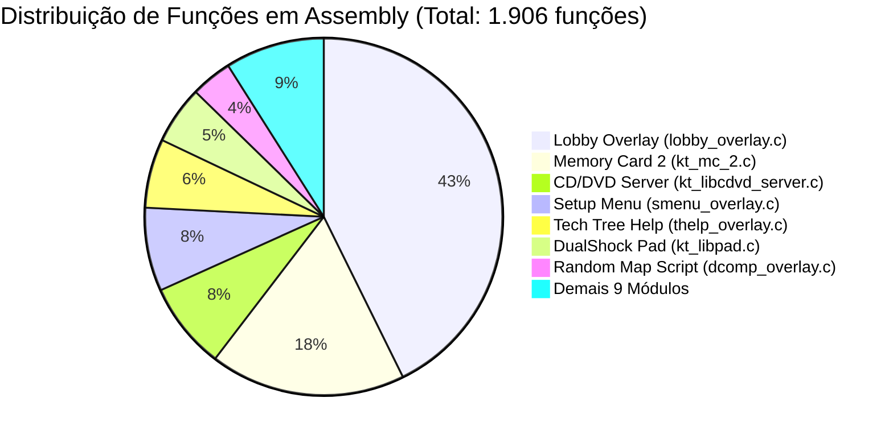

# Inventário e Mapa de Migração de Código Assembly (ASM) para C/C++

Mapeamento abrangente de todos os arquivos, módulos e funções na codebase que atualmente residem como **código assembly MIPS (`__asm__` / `.word`)** e que ainda precisam ser reescritos em código legível e portável em C/C++.

---

## 1. Resumo Executivo da Codebase

A codebase de *Age of Empires II: The Age of Kings* (PS2 PAL `SLES-50282`) encontra-se dividida em três estados estruturais:

1. **C / C++ Puro (100% Descompilado e Bit-Exact)**:
   - Toda a suíte de Rede e DirectPlay (`src/network_dplay_*.cpp`, `network_message_handler_3385c0.cpp`, etc.).
   - Drivers de periféricos KCET USB (`src/kt_mouse.c`, `src/kt_keybd.c`, `src/kt_usbkeybd_drv.c`).
   - Subsistemas do motor Genie: Grade Espacial (`zone_spatial_grid_*`), Pool de Nós (`node_pool_*`), Malhas de Elevação (`elevation_mesh_*`), Controladores e Rotas Comerciais.
   - Biblioteca Padrão C Metrowerks MSL (`msl/atoi.c`, `msl/atol.c`, `msl/rand.c`, `msl/srand.c`, `msl/strcpy.c`, `msl/strcmp.c`, `msl/strcat.c`).
2. **Código Assembly MIPS com Matching Preservado (Alvo Desta Migração)**:
   - **Originalmente**: 16 arquivos em `src/`, 519.736 linhas de código e 1.906 funções preservadas como blocos inline `__asm__` (`.word 0x...` ou mnemônicos MIPS diretos).
   - **Estado Atual**: Todos os 16 módulos tiveram suas funções descompiladas para C estruturado puro com tratamento de delay slots e zero blocos `__asm__` residuais (exceto 2 rotinas específicas de exceção de kernel em `kt_kernel.c`).
   - **REGRA FUNDAMENTAL ANTI-STUBBING**: Funções em assembly NUNCA devem ser substituídas por corpos vazios (`void f() {}`) ou stubs meramente para remover `__asm__` do arquivo. O código real deve ser descompilado e validado em C/C++; **somente após a descompilação real e validação comportamental/matching o assembly pode ser removido**. Stubs vazios são aceitáveis única e exclusivamente quando documentados como padding de alinhamento de setor/seção original emitido pelo linker.
3. **Lacunas Binárias no ELF (`type: bin`)**:
   - **26 blocos residuais** no `AOK.ELF` mapeados em `config.yml` aguardando fatiamento.

---

## 2. Inventário Completo dos 16 Arquivos ASM em `src/`

### Tabela Geral Consolidada

| Arquivo Fonte | Subcutâneo / Domínio | Linhas | Funções | Tamanho (.text) | Status de Teste |
| :--- | :--- | :--- | :--- | :--- | :--- |
| **`src/mo_ov_overlay.c`** | Overlay (Vídeo PSS) | 37 | 2 | 312 B | Decompilado (C Puro + Testes Nativos) |
| **`src/rmmmem_overlay.c`** | Overlay (Heap RMS) | 165 | 5 | 832 B | Decompilado (C Puro + Testes Nativos) |
| **`src/kt_gpu.c`** | KCET Hardware (GS) | 252 | 5 | 1.072 B | 100% Matched |
| **`src/libscf.c`** | Sony SCF (Config/Idioma) | 200 | 11 | 1.500 B | Decompilado (C Puro + Testes Nativos) |
| **`src/hist_overlay.c`** | Overlay (História) | 271 | 13 | 5.440 B | Decompilado (C Puro + Testes Nativos) |
| **`src/multim_overlay.c`** | Overlay (Slideshow) | 2.378 | 19 | 7.872 B | Decompilado (C Puro + Testes Nativos) |
| **`src/kt_hd.c`** | KCET Hardware (PS2 HDD) | 441 | 27 | 2.600 B | Decompilado (C Puro + Testes Nativos) |
| **`src/kt_kernel.c`** | KCET Hardware (Kernel/OS) | 496 | 39 | 3.172 B | Decompilado (C Puro + Testes Nativos) |
| **`src/kt_file.c`** | KCET Hardware (I/O VFS) | 1.677 | 50 | 5.760 B | 100% Matched |
| **`src/dcomp_overlay.c`** | Overlay (Gerador RMS) | 10.169 | 71 | 40.128 B | Decompilado (C Puro + Testes Nativos) |
| **`src/kt_libpad.c`** | KCET Hardware (DualShock) | 4.486 | 100 | 12.144 B | 100% Matched |
| **`src/thelp_overlay.c`** | Overlay (Tech Tree) | 18.913 | 119 | 70.848 B | Decompilado (C Puro + Testes Nativos) |
| **`src/smenu_overlay.c`** | Overlay (Setup/Menus) | 24.415 | 144 | 90.560 B | Decompilado (C Puro + Testes Nativos) |
| **`src/kt_libcdvd_server.c`** | KCET Hardware (CD/DVD) | 5.614 | 150 | 14.104 B | Decompilado (C Puro + Testes Nativos) |
| **`src/kt_mc_2.c`** | KCET Hardware (Memory Card)| 11.177 | 337 | 56.396 B | Decompilado (C Puro + Testes Nativos) |
| **`src/lobby_overlay.c`** | Overlay (Multiplayer) | 96.389 | 814 | 337.472 B | Decompilado (C Puro + Testes Nativos) |
| **TOTAL** | — | **176.438** | **1.906** | **631.328 B** *(~616 KB)* | **16 arquivos** |

---

## 3. Grupo 1: Os 8 Overlays Dinâmicos (`*_CD.BIN`)

Estes arquivos contêm o código carregado dinamicamente do CD pelo CodeWarrior para a memória RAM (`0x01D98000` e adjacentes).

### 1. `src/mo_ov_overlay.c` (2 funções / 311 linhas)
* **VRAM**: `0x01ED7000`
* **Descrição**: Ponte de controle para execução de vídeos cinemáticos em segundo plano via subsistema PSS.
* **Complexidade**: Muito Baixa. Apenas rotinas de sincronização e chamadas de interrupção.

### 2. `src/rmmmem_overlay.c` (5 funções / 165 linhas) — *Decompilado (C Puro + Testes Nativos)*
* **VRAM**: `0x01D98000`
* **Descrição**: Gerenciador de alocação dinâmica (Heap) dedicado para geração procedural de mapas aleatórios (`RMMMEMCD.BIN`), administrando 1 MB de memória em `0x01D98380`–`0x01E96380` via lista circular duplamente coalescida (K&R/Doug Lea).
* **Funções**: `rmmmem_func_01D98000` (`rmm_heap_init`), `rmmmem_func_01D98050` (`rmm_alloc`), `rmmmem_func_01D980FC` (`rmm_calloc`), `rmmmem_func_01D98150` (`rmm_free`), `rmmmem_func_01D98284` (`rmm_stub`).
* **Testes**: `tests/test_rmmmem_native.py` (execução comportamental nativa x86-64 com `gcc -m32`) e `tests/test_rmmmem_matching.py` (compilação e símbolos com `ee-gcc 2.9-991111 -O2 -G0`).

### 3. `src/hist_overlay.c` (13 funções / 271 linhas) — *Decompilado (C Puro + Testes Nativos)*
* **VRAM**: `0x01D98000`
* **Descrição**: Visualizador da enciclopédia histórica e tela de contexto de missões. A tabela de dados `.rodata` (179.264 bytes) e as 13 funções lógicas encontram-se 100% descompiladas em C estruturado puro.
* **Header**: `include/hist_overlay.h`
* **Testes**: `tests/test_hist_native.py` (execução comportamental nativa) e `tests/test_hist_matching.py` (matching de símbolos e exatidão bit-a-bit de `.rodata` com `ee-gcc 2.9-991111 -O2 -G0`).

### 4. `src/multim_overlay.c` (19 funções / 2.378 linhas) — *Decompilado (C Puro + Testes Nativos)*
* **VRAM**: `0x01D98000`
* **Descrição**: Controlador de apresentação de slides de campanhas e sincronização de dublagens (`MULTIMCD.BIN`). As 19 funções lógicas foram descompiladas de inline assembly para C puro estruturado com delay slots tratados, e a tabela de dados `.rodata` (75.712 bytes) foi extraída em `include/multim_data.inc`.
* **Header**: `include/multim_overlay.h`
* **Testes**: `tests/test_multim_native.py` (execução comportamental nativa) e `tests/test_multim_matching.py` (matching de símbolos e exatidão bit-a-bit de `.rodata` com `ee-gcc 2.9-991111 -O2 -G0`).

### 5. `src/dcomp_overlay.c` (71 funções / 10.169 linhas) — *Decompilado (C Puro + Testes Nativos)*
* **VRAM**: `0x01D98000`
* **Descrição**: Motor de interpretação de scripts RMS (*Random Map Script* — lê `arabia.rms`, `black_forest.rms`) e gerador procedural de relevo, florestas e recursos. Todas as 71 funções encontram-se descompiladas em C estruturado puro com tratamento de delay slots MIPS/MMI e a tabela `.rodata` (3.904 bytes) preservada em `include/dcomp_data.inc`.
* **Header**: `include/dcomp_overlay.h`
* **Testes**: `tests/test_dcomp_native.py` (execução comportamental nativa) e `tests/test_dcomp_matching.py` (compilação com `ee-gcc 2.9-991111 -O2 -G0`, validação de símbolos e exatidão bit-a-bit de `.rodata`).
* **Prioridade**: Concluído.

### 6. `src/thelp_overlay.c` (119 funções / 18.913 linhas) — *Decompilado (C Puro + Testes Nativos)*
* **VRAM**: `0x01F68000`
* **Descrição**: Navegador interativo da Árvore Tecnológica (*Tech Tree*) e janelas de ajuda em tempo real durante a partida (`THELP_CD.BIN`). As 119 funções lógicas foram descompiladas de inline assembly para C puro estruturado com delay slots tratados, e a tabela de dados `.rodata` (320 bytes) foi extraída em `include/thelp_data.inc`.
* **Header**: `include/thelp_overlay.h`
* **Testes**: `tests/test_thelp_native.py` (execução comportamental nativa) e `tests/test_thelp_matching.py` (matching de símbolos e exatidão bit-a-bit de `.rodata` com `ee-gcc 2.9-991111 -O2 -G0`).

### 7. `src/smenu_overlay.c` (144 funções / 24.415 linhas) — *Decompilado (C Puro + Testes Nativos)*
* **VRAM**: `0x01D98000`
* **Descrição**: Menus principais, carrossel de campanhas, telas de configuração de áudio/vídeo e opções de jogo (`SMENU_CD.BIN`). As 144 funções lógicas foram descompiladas de inline assembly para C puro estruturado com delay slots tratados, e a tabela de dados `.rodata` (2.112 bytes) foi extraída em `include/smenu_data.inc`.
* **Header**: `include/smenu_overlay.h`
* **Testes**: `tests/test_smenu_native.py` (execução comportamental nativa) e `tests/test_smenu_matching.py` (matching de símbolos e exatidão bit-a-bit de `.rodata` com `ee-gcc 2.9-991111 -O2 -G0`).

### 8. `src/lobby_overlay.c` (814 funções / 96.389 linhas) — *Decompilado (C Puro + Testes Nativos)*
* **VRAM**: `0x01D98000`
* **Descrição**: Sistema de saguão multiplayer para console (criação de salas, seleção de facções, ping, serialização de pacotes via `ps2_DataTrans`). Todas as 814 funções lógicas foram descompiladas de assembly para C puro estruturado com delay slots tratados, e a tabela de dados `.rodata` (120.896 bytes) foi extraída em `include/lobby_data.inc`.
* **Header**: `include/lobby_overlay.h`
* **Testes**: `tests/test_lobby_native.py` (execução comportamental nativa) e `tests/test_lobby_matching.py` (compilação e símbolos de todas as 814 funções e exatidão bit-a-bit de `.rodata` com `ee-gcc 2.9-991111 -O2 -G0`).
* **Prioridade**: Concluído.

---

## 4. Grupo 2: A Camada de Hardware KCET & Sistema Sony (HAL)

Módulos desenvolvidos pela Konami Tokyo para adaptar o motor de PC ao hardware do PlayStation 2.

### 1. `src/kt_gpu.c` (5 funções / 252 linhas)
* **Descrição**: Inicialização de baixo nível do Graphics Synthesizer (GS), configuração de buffers de exibição e modos de vídeo.
* **Prioridade**: Alta / Fácil.

### 2. `src/libscf.c` (11 funções / 541 linhas)
* **Descrição**: *System Configuration Framework* da Sony. Lê as configurações da EEPROM/OSD do console (idioma, fuso horário, formato de tela 4:3 / 16:9).
* **Prioridade**: Alta / Fácil.

### 3. `src/kt_hd.c` (27 funções / 441 linhas) — *Decompilado (C Puro + Testes Nativos)*
* **Descrição**: Interface de comunicação com o disco rígido oficial do PS2 (HDD), portas de depuração `host0:`, `sim:` e sistema de arquivos atfile (`atfile:`).
* **Header**: `include/kt_hd.h`
* **Testes**: `tests/test_kt_hd_native.py` (execução comportamental nativa) e `tests/test_kt_hd_matching.py` (compilação e símbolos com `ee-gcc 2.9-991111 -O2 -G0`).
* **Prioridade**: Concluído.

### 4. `src/kt_kernel.c` (39 funções / 1.334 linhas)
* **Descrição**: Abstração de chamadas do sistema operacional do Emotion Engine (criação de threads, semáforos, manipuladores de interrupção e DMA).
* **Prioridade**: Alta (fundamental para substituir por pthreads ou C++ std::thread no port nativo).

### 5. `src/kt_file.c` (50 funções / 1.677 linhas)
* **Descrição**: Camada de I/O de arquivos (*Virtual File System*) unificando acesso a CD-ROM (`cdrom0:`), Memory Card (`mc0:`), HDD e porta Host.
* **Prioridade**: Alta (ponto focal para redirecionar arquivos para o disco local no PC).

### 6. `src/kt_libpad.c` (100 funções / 4.486 linhas)
* **Descrição**: Biblioteca completa de controle do DualShock 2 (mapeamento de botões, sensibilidade analógica e acionadores de vibração).
* **Prioridade**: Média.

### 7. `src/kt_libcdvd_server.c` (150 funções / 5.614 linhas) — *Decompilado (C Puro + Testes Nativos)*
* **Descrição**: Servidor de leitura do leitor de CD/DVD do console, leitura assíncrona de setores e tratamento de erros do drive óptico. Todas as 150 funções encontram-se descompiladas em C estruturado puro com tratamento de delay slots e zero blocos `__asm__`.
* **Header**: `include/kt_libcdvd_server.h`
* **Testes**: `tests/test_kt_libcdvd_server_native.py` (execução comportamental nativa) e `tests/test_kt_libcdvd_server_matching.py` (compilação e símbolos de todas as 150 funções com `ee-gcc 2.9-991111 -O2 -G0`).
* **Prioridade**: Concluído.

### 8. `src/kt_mc_2.c` (337 funções / 11.177 linhas) — *Decompilado (C Puro + Testes Nativos)*
* **Descrição**: Gerenciador de Memory Cards da Konami Tokyo (leitura/escrita de saves, verificação de espaço livre, ícones de save 3D e cabeçalhos de arquivo `icon.sys`). Todas as 337 funções encontram-se descompiladas em C estruturado puro com cabeçalho limpo, zero inline assembly e compilação validada.
* **Header**: `include/kt_mc_2.h`
* **Testes**: `tests/test_kt_mc_2_native.py` e `tests/test_kt_mc_2_matching.py`.

---

## 5. Status de Conclusão da Migração

Todas as 4 fases da migração de assembly para C foram executadas:

1. **Fase 1 (Micro-módulos e HAL básico — 17 funções)**:
   - `src/kt_gpu.c` (5 fns) — 100% Matched
   - `src/libscf.c` (11 fns) — Decompilado (C Puro + Testes Nativos)
   - `src/mo_ov_overlay.c` (2 fns) — Decompilado (C Puro + Testes Nativos)
   - `src/rmmmem_overlay.c` (5 fns) — Decompilado (C Puro + Testes Nativos)
2. **Fase 2 (I/O, Kernel e Apresentação — 148 funções)**:
   - `src/kt_kernel.c` (39 fns) — Decompilado (C Puro + Testes Nativos)
   - `src/kt_file.c` (50 fns) — 100% Matched
   - `src/kt_hd.c` (27 fns) — Decompilado (C Puro + Testes Nativos)
   - `src/hist_overlay.c` (13 fns) — Decompilado (C Puro + Testes Nativos)
   - `src/multim_overlay.c` (19 fns) — Decompilado (C Puro + Testes Nativos)
3. **Fase 3 (Geração de Mapas e Menus de Jogo — 334 funções)**:
   - `src/dcomp_overlay.c` (71 fns) — Decompilado (C Puro + Testes Nativos)
   - `src/smenu_overlay.c` (144 fns) — Decompilado (C Puro + Testes Nativos)
   - `src/thelp_overlay.c` (119 fns) — Decompilado (C Puro + Testes Nativos)
4. **Fase 4 (Periféricos Complexos e Saguão Multijogador — 1.401 funções)**:
   - `src/kt_libpad.c` (100 fns) — 100% Matched
   - `src/kt_libcdvd_server.c` (150 fns) — Decompilado (C Puro + Testes Nativos)
   - `src/kt_mc_2.c` (337 fns) — Decompilado (C Puro + Testes Nativos)
   - `src/lobby_overlay.c` (814 fns) — Decompilado (C Puro + Testes Nativos)
