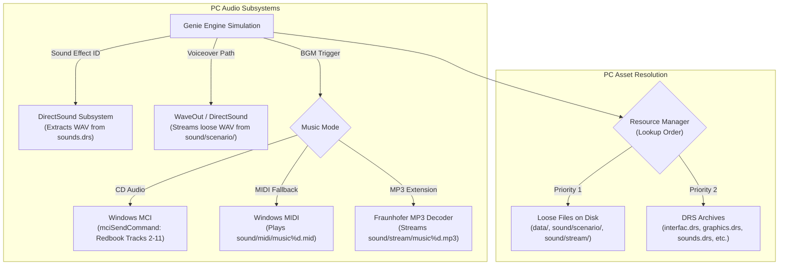
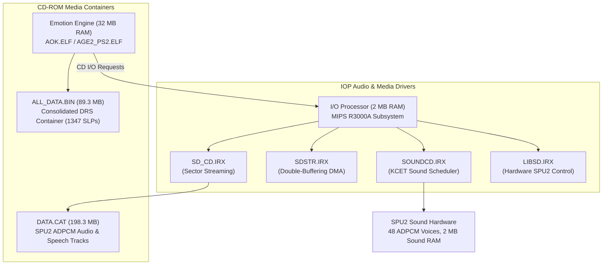
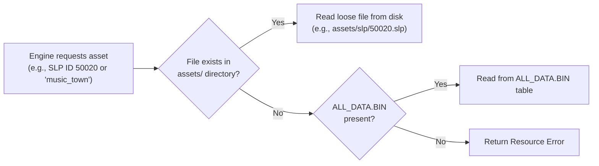

# Audio and Asset Pipeline: PC vs PS2 vs HD Edition & Recomp Strategy

Technical specification of the asset and audio architectures across *Age of Empires II* releases (PC Classic 1999/2001, PlayStation 2 PAL `SLES-50282`, and HD Edition 2013), and the operational blueprint for using extracted HD audio and extracted `ALL_DATA.BIN` assets in the modern static recompilation and hook environment.

---

## 1. Executive Summary & Guiding Principles

1. **Decoupling from Legacy Console Hardware:**
   The PS2 version's audio container (`DATA.CAT`) and packed asset container (`ALL_DATA.BIN`) were engineered to overcome severe hardware constraints: 32 MB total RAM, lack of a general-purpose MP3 decoder, low CD-ROM seek speeds, and dedicated SPU2 ADPCM sound hardware.
2. **Modern Recomp Target (PC / Linux / Mac / Web):**
   In a modern native port, emulating the PS2 I/O Processor (IOP) sound streaming driver (`SOUNDCD.IRX` / `SDSTR.IRX`) or reverse-engineering proprietary SPU2 ADPCM streams from `DATA.CAT` introduces unnecessary complexity and reproduces inferior 22 kHz/44.1 kHz 4-bit compressed audio.
3. **HD Edition Audio Drop-In:**
   *Age of Empires II: HD Edition* (2013) already provides pre-extracted, high-fidelity stereo audio assets in modern standard formats (MP3/OGG/WAV). The recompilation can bind directly to these loose files via lightweight audio hooks.
4. **Loose-Asset DRS Architecture:**
   The Genie Engine has always supported loading loose files before consulting DRS archives. `ALL_DATA.BIN` is a standard DRS archive (`1.00tribe`); extracting it into discrete `.slp` and palette files enables hot-reloading, modding, and debugging without repacking.

---

## 2. Cross-Platform Comparison Matrix

| Subsystem | PC Classic (1999/2001) | PS2 Console (`SLES-50282`) | HD Edition (2013) | Modern Recomp Strategy |
| :--- | :--- | :--- | :--- | :--- |
| **Asset Container** | Multiple DRS files (`graphics`, `interfac`, `sounds`, `terrain`, `gamedata`) | Single unified `ALL_DATA.BIN` (`1.00tribe` DRS) | DRS + loose file overrides in `resources/` | **Extracted loose assets** (`assets/slp/`, etc.) with fallback to `ALL_DATA.BIN` |
| **Loose File Support** | Native in `data/` and `sound/` | Disabled to avoid CD seek latency | Fully supported (primary development path) | **First-class VFS priority** for loose files |
| **Background Music (BGM)**| Redbook CD-Audio (MCI) or General MIDI (`music%d.mid`) | Proprietary ADPCM stream in `DATA.CAT` (`SdDt`/`sdtr`) | Discrete MP3 tracks in `sound/stream/` | **HD Edition MP3/OGG tracks** loaded directly from disk |
| **Scenario Speech** | Loose WAVs in `sound/scenario/*.wav` | Bundled in `DATA.CAT` | Loose MP3/WAV in `sound/scenario/` | **HD Edition localized speech** via path-lookup hook |
| **Sound Effects (SFX)** | Loaded from `sounds.drs` table `wav ` into DirectSound buffers | Pre-loaded / streamed into SPU2 Sound RAM (2 MB) | Loose WAVs or DRS table | **Standard WAV playback** via modern audio mixer |
| **Audio Backend** | Windows DirectSound 5.0+ & MCI | SPU2 hardware + IOP drivers (`SOUNDCD.IRX`) | FMOD / DirectSound wrapper | **miniaudio** or **SDL2_mixer** (multiplatform) |
| **Screen Overlays** | Monolithic executable (all code in memory) | 8 `MWo3` overlay binaries swapped in EE RAM | Monolithic executable | **Monolithic link** (no overlay paging needed) |

---

## 3. Deep Dive: How the PC Version Handles Assets and Audio

The Genie Engine on PC (`EMPIRES2.EXE` and `age2_x1.exe`) relies on an extensible resource and audio architecture:



### PC DRS Archive Format (`1.00tribe`)
The DRS header consists of a 40-byte copyright string, 4-byte version (`1.00`), 12-byte subtype (`tribe\0`), table count, and the file data start offset:
* Table type `b" pls"` (`slp ` reversed): Unit, structure, interface sprite frames.
* Table type `b" vaw"` (`wav ` reversed): 286 sound effects (unit acknowledgments, clangs, horns, ambient wildlife).
* Table type `b" nib"` (`bin ` reversed): Binary tables, cursors, palettes.

### PC Audio Search Strategy
In `EMPIRES2.EXE`, the sound loader checks for loose files before querying DRS tables:
```
*sound file : is not there
*sound file : %s 
*sound resource id : not used 
*sound resource id : %d 
```
If a file exists at the specified relative disk path, the engine skips DRS lookup and plays the loose disk file.

---

## 4. Deep Dive: How the PS2 Port Handles Assets and Audio

Konami Computer Entertainment Tokyo (KCET) adapted the engine for the console hardware:



### Why KCET Merged Files into `ALL_DATA.BIN` and `DATA.CAT`
1. **CD-ROM Seek Penalties:** On a 24x CD-ROM, opening and closing hundreds of loose files or jumping between 5 different DRS archives caused unacceptable seek thrashing and head travel times.
2. **SPU2 Hardware Compatibility:** The SPU2 only understands ADPCM (VAG). Rather than decoding MP3 or software-mixing 30 WAV streams in EE RAM, KCET processed all music and voice streams into ADPCM and streamed them directly to the SPU2.
3. **Trigger Hooks in Game Code:**
   In `AOK.ELF`, triggers call KCET dispatcher functions:
   - `sd_call(BGM_open)`: Starts title/menu music.
   - `sd_call(BGM_town)`: Starts active gameplay background music.
   - `ps2_DataTrans`: Transfers chunks of speech and streaming data.

---

## 5. HD Edition (2013) Audio Assets Structure

Age of Empires II: HD Edition modernized the audio pipeline by removing Redbook CD-Audio, MCI, and MIDI, replacing them with loose digital audio files:

### Directory Structure in HD Edition
```
resources/
├── _common/
│   └── sound/
│       ├── stream/
│       │   ├── music1.mp3 ... music10.mp3   (Full orchestral BGM)
│       │   ├── open.mp3                     (Main title theme)
│       │   └── victory.mp3 / defeat.mp3     (End of match stingers)
│       └── drs/
│           └── sounds/                      (Unit/UI WAV files extracted from sounds.drs)
└── <language>/                              (e.g., en, br, fr, de, it, es)
    └── sound/
        ├── scenario/
        │   ├── 10101.mp3 ... 10508.mp3      (Campaign briefing speech)
        │   └── c01_*.mp3                    (In-game campaign character dialog)
        └── taunt/
            ├── 1.mp3 ... 42.mp3             (Audio taunts: "Yes", "No", "Food please")
```

### Advantages of Using HD Edition Audio in Recomp
1. **High Acoustic Fidelity:** Mastered in stereo MP3 (192+ kbps) or uncompressed WAV, free from 4-bit SPU2 ADPCM quantization noise.
2. **Standard Formats:** Playable by any standard audio engine without proprietary Sony decoders.
3. **Exact 1:1 Trigger Parity:** Scenario trigger IDs and track assignments match the classic game scripts identically.

---

## 6. Recomp Hooking & Integration Architecture

To implement this in the recompilation, we introduce two components: a **Virtual File System (VFS)** and a **Modern Audio Driver Bridge**.

### Virtual File System (VFS) Lookup Flow



### Audio Hook Implementation Pattern

In the decompiled C++ codebase, we replace the low-level KCET `sd_call` and SPU2 driver invocations with high-level calls to a portable audio engine (such as **miniaudio**):

```cpp
// Hooking architecture for recomp/audio_bridge.cpp

#include "audio_bridge.h"
#include "miniaudio.h"

static ma_engine g_audio_engine;
static ma_sound  g_bgm_sound;
static bool      g_bgm_playing = false;

bool audio_init(void) {
    ma_result result = ma_engine_init(NULL, &g_audio_engine);
    return (result == MA_SUCCESS);
}

// Replaces KCET sd_call(BGM_...) in AOK.ELF
void hook_sd_call(const char *cue_name) {
    char filepath[256];
    
    if (strcmp(cue_name, "BGM_open") == 0) {
        snprintf(filepath, sizeof(filepath), "assets/sound/music/open.mp3");
    } else if (strcmp(cue_name, "BGM_town") == 0) {
        // Can randomly select or cycle through HD Edition music1.mp3 to music10.mp3
        snprintf(filepath, sizeof(filepath), "assets/sound/music/music1.mp3");
    } else {
        return;
    }

    if (g_bgm_playing) {
        ma_sound_stop(&g_bgm_sound);
        ma_sound_uninit(&g_bgm_sound);
        g_bgm_playing = false;
    }

    if (ma_sound_init_from_file(&g_audio_engine, filepath, MA_SOUND_FLAG_STREAM, NULL, NULL, &g_bgm_sound) == MA_SUCCESS) {
        ma_sound_set_looping(&g_bgm_sound, MA_TRUE);
        ma_sound_start(&g_bgm_sound);
        g_bgm_playing = true;
    }
}

// Replaces campaign voice / scenario speech calls
void hook_play_scenario_speech(int speech_id) {
    char filepath[256];
    snprintf(filepath, sizeof(filepath), "assets/sound/scenario/%d.mp3", speech_id);
    ma_engine_play_sound(&g_audio_engine, filepath, NULL);
}

// Replaces unit/combat sound effect triggers
void hook_play_sfx(int sound_id) {
    char filepath[256];
    snprintf(filepath, sizeof(filepath), "assets/sound/sfx/%d.wav", sound_id);
    ma_engine_play_sound(&g_audio_engine, filepath, NULL);
}
```

---

## 7. Operational Workflow for the Recomp Agent

To set up the workspace for recompilation:

1. **Audio Directory Layout (`assets/sound/`):**
   ```
   assets/
   └── sound/
       ├── music/      <- Place HD Edition music1.mp3..music10.mp3, open.mp3
       ├── scenario/   <- Place HD Edition campaign scenario MP3/WAV files
       ├── taunt/      <- Place HD Edition 1.mp3..42.mp3
       └── sfx/        <- Place extracted WAV effects from sounds.drs / HD
   ```
2. **Visual Asset Directory Layout (`assets/slp/`):**
   - Extract the 1,347 SLP frames from `ALL_DATA.BIN` into `assets/slp/<id>.slp`.
   - The VFS checks `assets/slp/<id>.slp` first. If present, it loads immediately without needing `ALL_DATA.BIN`.
3. **Overlays (`*_CD.BIN`):**
   - No overlay swapping is necessary. The code for menus, lobby, tech tree, and random map generation can be compiled and linked into the main recomp executable.
