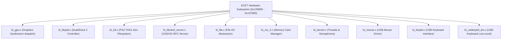

# KCET Hardware Subsystem Analysis (SLES-50282)

Analysis and memory layout of the PlayStation 2 hardware abstraction layer developed by **Konami Computer Entertainment Tokyo (KCET)** for *Age of Empires II: The Age of Kings* (PS2 PAL `SLES-50282`).

---

## 1. Overview and Architecture

The PS2 port of *Age of Empires II* combines Ensemble Studios' core Genie Engine (C++) with a hardware adaptation layer written in C by KCET. This subsystem manages controller input, USB peripherals (mouse and keyboard), CD/DVD optical drive streaming, memory card saving/loading, and Sony PS2 TOOL development hardware interfacing.

All KCET hardware files reside contiguously within the executable image in the VRAM range **`0x00125800` – `0x00137800`** (~73 KiB).

---

## 2. Memory Map of KCET Modules

The boundaries of each source file were established through assertion string cross-references (`__FILE__`, line numbers, and conditional error checks) and function epilogue analysis (`jr ra` / stack frame adjustments):

| Module | VRAM Range | File Offset | Size | Key Identifiers & Assertions |
|---|---|---|---|---|
| **`kt_gpu.c`** | `0x00125800` – `0x00125c34` | `0x0259e0` – `0x025e14` | ~1.1 KiB | Line 630: `kind < numberof(func_list)` |
| **`kt_libpad.c`** | `0x00125c38` – `0x00128ba4` | `0x025e18` – `0x028d84` | ~11.9 KiB | Lines 358–2521: `n_pad > 0`, `n_pad <= numberof(buf)`, `act_number < KT_PAD_MAX_ACTUATER` |
| **`kt_hd.c`** | `0x00128ba8` – `0x001295fc` | `0x028d88` – `0x0297dc` | ~2.6 KiB | Lines 277+: `prio > 0`, `start_id == id`, `host0:`, `sim:`, `atfile:` |
| **`kt_libcdvd_server.c`** | `0x00129600` – `0x0012bdfc` | `0x0297e0` – `0x02bfdc` | ~9.8 KiB | `KT_USE_SCE_LIB < KT_SCE_LIB_1_6_5`, `ktSceCdInitMmode` |
| **`kt_file.c`** | `0x0012cc00` – `0x0012dbfc` | `0x02cde0` – `0x02dddc` | ~4.0 KiB | `kind < N_KT_FILE_KIND`, `p_string` |
| **`kt_mc_2.c`** | `0x0012dc00` – `0x001340fc` | `0x02dde0` – `0x0342dc` | ~25.2 KiB | Lines 66–1870+: `n_card <= KT_MC_CARD_MAX`, `ktMcInit2`, `sceMcInit` |
| **`kt_kernel.c`** | `0x00134100` – `0x001347fc` | `0x0342e0` – `0x0349dc` | ~1.8 KiB | `ThreadID=%d, can't delete`, `SignalSema` |
| **`kt_mouse.c`** | `0x00134de8` – `0x00135ebc` | `0x034fc8` – `0x03609c` | ~4.2 KiB | Lines 100–659: `mouse_number < W->n_mouse`, `sizeof(KT_MOUSE) == 176` |
| **`kt_keybd.c`** | `0x00135ec0` – `0x001370fc` | `0x0360a0` – `0x0372dc` | ~4.6 KiB | Lines 102–1020+: `keybd_number < W->n_keybd`, `ktKeybdGetStatus` |
| **`kt_usbkeybd_drv.c`**| `0x00137100` – `0x001377fc` | `0x0372e0` – `0x0379dc` | ~1.8 KiB | `ktKeybdApiSetCapsTypeRequest` |

---

## 3. Detailed Analysis of `kt_mouse.c` (Initial Target)

`kt_mouse.c` is the smallest peripheral module with high isolation and self-contained routines:

- **Address span**: `0x00134de8` to `0x00135ebc` (4,308 bytes, 1,077 instructions).
- **Core Data Structures**:
  - `KT_MOUSE_WORK`: Global subsystem context (`W`) at `0x004ea060` (or GP-relative). Tracks active mouse count (`W->n_mouse <= 2`).
  - `KT_MOUSE`: 176 bytes per instance. Buffer of 2 mice = 352 bytes allocated at `0x00134ec0`.
- **Identified Functions**:
  - `0x00134e50`: `ktMouseInit(int n_mouse)` — asserts `n_mouse < 3`, zeros structures, registers interrupt handler.
  - `0x001356d8`: `ktMouseGetStatus(int mouse_number, ...)`
  - `0x00135d60`: `ktMousePoll(void)` — polling loop running status update and event ring-buffer drain.
  - `0x00135d98`: `ktMouseDummy(void)` — 2-instruction stub (`jr ra; nop`).
  - `0x00135da0`: `ktMouseCheck(void)` — checks hardware event availability.

---

## 4. Compiler Calibration and Decompilation Status

- **Confirmed Compiler:** Sony PlayStation 2 SDK 1.6.5 **EE-GCC 2.9-991111** (`ee-gcc.exe`).
- **Flags:** `-O2 -G0 -Iinclude` (MIPS 64-bit EABI register conventions).
- **Matching Progress (`kt_mouse.c`):**
  - Matched Functions: **16 / 45** (616 / 4,236 bytes = **14.54% byte-matched**)
  - Verified 100.0% Byte Matches:
    - `func_00134F18` (8 B) — stub (`jr ra; nop`)
    - `func_00134F20` (44 B) — `D_50A060 = func_134210(1, 1, 0)`
    - `func_00134F50` (64 B) — teardown / handler cleanup
    - `func_00134F90` (36 B) — device event dispatch
    - `func_00134FB8` (36 B) — device event trigger
    - `func_001351B0` (8 B) — accessor returning `ptr[1]`
    - `func_00135238` (28 B) — guarded word read if `ptr[1] != -1`
    - `func_001356D8` (16 B) — status check `ptr[1] != -1`
    - `func_001359B8` (20 B) — block reset with `-1` markers
    - `func_00135BE8` (8 B) — tail call to `func_134A20`
    - `func_00135D60` (56 B) — polling loop with delay-slot register restoration
    - `func_00135D98` (8 B) — stub (`jr ra; nop`)
    - `func_00135DA0` (72 B) — event availability query and device status check
    - `func_00135DE8` (68 B) — mouse packet read dispatch (packet mode 1)
    - `func_00135E30` (72 B) — mouse config and read dispatch (packet mode 2)
    - `func_00135E78` (72 B) — mouse config and read dispatch (packet mode 3)

