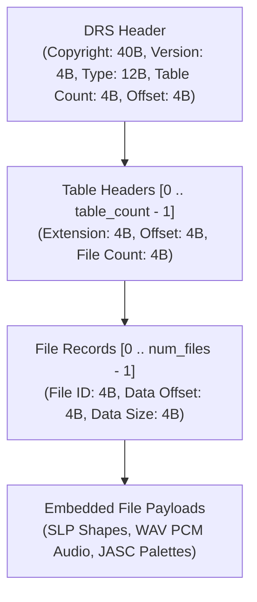

# Reverse Engineering Analysis: glouw's Open Empire & Asset Pipeline

Documenting reverse engineering findings and discoveries from Gustav Louw's (*glouw*) research series ([*Reverse Engineering Age of Empires 2*](http://glouw.com/2019/04/10/Reverse-Engineering-Age-of-Empires-2)) and the accompanying C99 recreation engine ([*Open Empire*](https://github.com/glouw/openempire) / [*Open Empires*](https://github.com/jubalskaggs/openempires)).

---

## 1. Context and Origin

In April 2019, developer Gustav Louw initiated a series documenting the reverse engineering of Ensemble Studios' Genie Engine (*Age of Empires II: The Age of Kings*):
- **Part 0 (April 10, 2019):** Introduction, goals, and tooling overview.
- **Part 1 (April 11, 2019):** Binary DRS databases, SLP shape compression, scanline bytecode VM, and JASC-PAL palettes.
- **Part 2 (April 11, 2019):** Isometric projection mathematics, terrain tile mapping, and coordinate transforms.
- **Follow-up (April 2020):** Transitioned into the *Open Empire* / *Open Empires* repository, detailing deterministic lockstep networking, `blendomatic.dat` terrain alpha transitions, and anti-cheat out-of-sync restoration.

These findings correlate directly with Genie Engine resource management functions discovered in the PS2 binary analysis (such as [`RESFILE_load2()`](file:///home/samuelcaldas/repos/aoe/docs/ps2_binary_analysis.md#L114)) and provide concrete struct layouts and decoding logic for the original asset formats.

---

## 2. DRS Archive Architecture

Artistic and audio assets in *Age of Empires II* are packed into uncompressed binary DRS (Draw Resource System) archive databases. The primary databases located in the `Data/` directory are:

| Archive file | Contents | Internal formats |
|---|---|---|
| `graphics.drs` | Unit and building sprites, animations, shadows | `.slp` |
| `interfac.drs` | Static UI graphics, menus, button states, color palettes | `.slp`, `.pal`, binary |
| `terrain.drs` | Isometric terrain tile textures and transitions | `.slp` |
| `sounds.drs` | Audio snippets, unit acknowledgments, sound effects | `.wav` |

### 2.1 File Header and Layout

The DRS archive begins with a fixed header followed by a table directory and file resource records:



### 2.2 On-Disk vs Memory Structs

On disk, the header strings are 40 bytes for copyright, 4 bytes for version, and 12 bytes for file type:

```c
typedef struct
{
    FILE* fp;
    const char* path;
    char copyright[41];       /* 40 bytes on disk + null terminator */
    char version[5];          /* 4 bytes on disk (e.g. "1.00") */
    char ftype[13];           /* 12 bytes on disk (e.g. "tribev\0") */
    int32_t table_count;      /* Number of resource tables */
    int32_t file_offset;      /* Offset to first file data */
    Table* table;
} Drs;

typedef struct
{
    char file_extension[5];   /* 4 bytes on disk: "slp ", "wav ", "bin " (reversed in memory) */
    int32_t file_info_offset; /* Offset to array of File records */
    int32_t num_files;        /* Number of files in table */
    File* file;
} Table;

typedef struct
{
    int32_t id;               /* Unique numeric resource ID */
    int32_t data_offset;      /* Absolute byte offset in DRS file */
    int32_t size;             /* Uncompressed payload size in bytes */
} File;
```

---

## 3. SLP (Shape) Format & Bytecode Decompression VM

SLP files contain indexed-color vector/raster shape animations for units, buildings, UI, and terrain tiles. Rather than raw bitmaps, SLP files store sprites as run-length encoded (RLE) scanline command streams executed by a dedicated decoding virtual machine.

### 3.1 SLP File Structure

```c
typedef struct
{
    char version[5];          /* 4 bytes on disk (e.g. "2.0N") */
    int32_t num_frames;       /* Number of animation frames */
    char comment[25];         /* 24 bytes comment string */
    Frame* frame;
    Image* image;
} Slp;

typedef struct
{
    uint32_t cmd_table_offset;     /* Offset to scanline command offset table */
    uint32_t outline_table_offset; /* Offset to outline padding table */
    uint32_t palette_offset;       /* Color palette ID/offset in interfac.drs */
    uint32_t properties;           /* Frame property flags */
    int32_t width;                 /* Pixel width */
    int32_t height;                /* Pixel height */
    int32_t hotspot_x;             /* Center/anchor X coordinate */
    int32_t hotspot_y;             /* Center/anchor Y coordinate */
} Frame;
```

### 3.2 Outline Table

Before processing bytecode commands, each scanline defines left and right transparent padding boundaries:

```c
typedef struct
{
    uint16_t left_padding;         /* Number of transparent pixels on the left */
    uint16_t right_padding;        /* Number of transparent pixels on the right */
} Outline;
```

The outline table array size equals `height`. Pixels to the left of `left_padding` and right of `(width - right_padding)` are transparent and never touched by blit commands.

### 3.3 Scanline Bytecode Command Reference

Each scanline is decoded from `image.data[image.cmd_table[y]]` as a stream of byte instructions until the end-of-scanline terminator `0x0F` (or `0xFF`) is encountered.

The command byte is split into a **lower nibble** (`command & 0x0F`) representing the opcode and an **upper nibble** (`command & 0xF0`) representing parameters or count:

| Lower Nibble Opcode | Name | Operand / Count | Semantics |
|---|---|---|---|
| `0x0`, `0x4`, `0x8`, `0xC` | **Lesser Block Copy** | `count = command >> 2` | Copy `count` literal palette indices directly from data stream. |
| `0x1`, `0x5`, `0x9`, `0xD` | **Lesser Skip** | `shift = command >> 2`<br/>`count = shift ? shift : next_byte()` | Skip `count` transparent pixels without drawing. |
| `0x2` | **Greater Block Copy** | `count = ((upper << 4) + next_byte())` | Copy large sequence of literal palette indices. |
| `0x3` | **Greater Skip** | `count = ((upper << 4) + next_byte())` | Skip large transparent span of pixels. |
| `0x6` | **Player Color Block Copy** | `shift = command >> 4`<br/>`count = shift ? shift : next_byte()` | Copy `count` indices remapped through active player palette offset. |
| `0x7` | **Solid Fill** | `count = (command >> 4) ?: next_byte()`<br/>`color = next_byte()` | Repeat specified palette index `color` for `count` pixels. |
| `0xA` | **Fill Player Color** | `count = (command >> 4) ?: next_byte()`<br/>`index = next_byte() + player_offset` | Fill `count` pixels using the player's primary color tint. |
| `0xB` | **Draw Shadow** | `count = (command >> 4) ?: next_byte()` | Draw `count` shadow pixels (50% alpha / black tint darkening background). |
| `0xE` | **Extended Commands** | Full byte opcode (see table below) | Special hints, outlines, and multi-player tinting. |
| `0xF` | **End of Scanline** | N/A | Terminates decoding for current scanline. |

#### Extended Command Sub-Opcodes (`0xE`)

| Full Byte | Name | Semantics |
|---|---|---|
| `0x0E` | **Render Hint X-Flip** | Horizontal flip hint flag for mirrored animations. |
| `0x1E` | **Render Hint Normal** | Unflipped rendering hint. |
| `0x2E` | **Table Use Normal** | Select standard color translation table. |
| `0x3E` | **Table Use Alternate** | Select alternate color translation table. |
| `0x4E` | **Outline Player Color** | Draw unit silhouette pixel using player color (when unit is behind a building/occluded). |
| `0x5E` | **Fill Player Color (Extended)** | `count = next_byte()`; fill `count` pixels with player primary color. |
| `0x6E` | **Outline Secondary Color** | Secondary player outline pixel for occluded units. |
| `0x7E` | **Fill Secondary Color** | `count = next_byte()`; fill `count` pixels with secondary color. |

---

## 4. Palette System and Player Color Remapping

1. **JASC-PAL Format:**
   Palettes stored in `interfac.drs` table 0, resource `45 + palette_offset`, adhere to standard JASC-PAL text formatting:
   ```
   JASC-PAL
   0100
   256
   R G B
   ...
   ```
2. **Player Color Remapping:**
   Instead of duplicating sprite art for each player color, sprites embed relative player color indices (`0x00 .. 0x0F`). At runtime, the engine shifts these into designated player color ranges within the 256-color palette:
   $$\text{palette\_index} = \text{base\_color\_index} + 16 \times (\text{player\_id} + 1)$$
   This enables 8-player color customization, occluded unit silhouettes, and checkered water transparency effects with zero additional texture storage.

---

## 5. Isometric Terrain Projection & Mathematics

Terrain files in `terrain.drs` store approximately 100 frames per terrain category (e.g. grass, dirt, water), which are tiled across the map.

### 5.1 Mega-Tile Sub-Indexing

To prevent visible repetition across large expanses of terrain, a sub-tile index is calculated from 2D map coordinates:

$$\text{bound} = \lfloor\sqrt{\text{tile\_count}}\rfloor$$
$$\text{frame\_index} = (x \pmod{\text{bound}}) + (y \pmod{\text{bound}}) \times \text{bound}$$

### 5.2 Coordinate Transformation (World to Screen)

The 2D Cartesian tile grid is projected onto the isometric 2:1 diamond screen space using:

$$\text{screen}_x = \frac{(y + x) \times \text{scale}_\text{width}}{2}$$
$$\text{screen}_y = \frac{(y - x) \times \text{scale}_\text{height}}{2}$$

* Where standard *Age of Empires II* tiles have $\text{scale}_\text{width} = 96$ pixels and $\text{scale}_\text{height} = 48$ pixels (a 2:1 isometric ratio).
* To perform mouse picking / hit-testing, the inverted matrix maps screen pixel coordinates back to grid $(x, y)$.

### 5.3 Alpha Blending with `blendomatic.dat`

Transitions between different terrain types (e.g. dirt transitioning into grass) are defined in `blendomatic.dat`:
- Contains `nr_blending_modes` and `nr_tiles`.
- Each blending mode defines an alpha-mask tile applied to terrain boundaries.
- Produces organic, non-linear edges between adjacent tiles rather than harsh diamond seams.

---

## 6. Relevance to Matching Decompilation

1. **Asset Loader Validation:**
   Ensemble's `RESFILE_load2()` and shape decompression routines in [`tribegam.cpp`](file:///home/samuelcaldas/repos/aoe/docs/ps2_binary_analysis.md#L88) and related files directly implement the DRS/SLP unpacking documented above.
2. **Struct Field Verification:**
   The struct member orders and bitfield sizes for [`Frame`](#31-slp-file-structure), [`Outline`](#32-outline-table), and [`Drs`](#22-on-disk-vs-memory-structs) can be directly cross-checked against MIPS and x86 disassembly stack frames and register allocations.
3. **Stand-alone Verification Tools:**
   The parsing logic enables standalone command-line extraction tools to verify that original binary archives in `orig/` can be parsed cleanly without invoking external proprietary dependencies.
