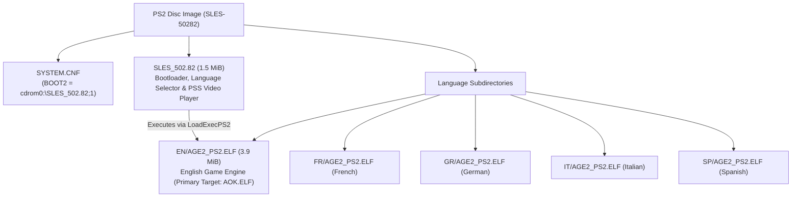

# PS2 Binary Analysis: SLES-50282 (Age of Empires II PAL)

Detailed analysis of the PlayStation 2 release of *Age of Empires II: The Age of Kings* (PAL Europe v2.00, `SLES-50282`).

---

## 1. Disc Structure and Image Architecture

The European release (`SLES-50282`) is mastered as a PlayStation 2 CD-ROM (Mode 2 Form 1, 2352 bytes/sector) with a multi-stage architecture:



### Components
1. **`SYSTEM.CNF`**: Points to `BOOT2 = cdrom0:\SLES_502.82;1`.
2. **`SLES_502.82` (1.5 MiB, 1,593,256 bytes)**:
   - Developed by Konami Computer Entertainment Tokyo (KCET).
   - Initialises the PS2 EE/GS, checks hardware/language configuration, plays the intro FMVs (`PPS_PAL/MSLOGO_2.PSS`, `PPS_PAL/ESLOGO_2.PSS`), and executes the language-specific binary via `LoadExecPS2()`.
3. **`EN/AGE2_PS2.ELF` (3.9 MiB, 4,076,904 bytes)**:
   - The full Age of Empires II game engine (Ensemble Studios' Genie Engine with KCET platform layer).
   - Copied to `orig/SLES-50282/AOK.ELF` as the primary matching target.

### Verified Hashes (v2.00)

| File | Path in repo | Size | SHA-1 |
|---|---|---|---|
| Disc Image (ISO) | `orig/SLES-50282/aoe2.iso` | 551,100,416 bytes | `77a9cec2083a7c3d82518b3ae47371b55ec2e7ce` |
| Primary Game ELF | `orig/SLES-50282/AOK.ELF` | 4,076,904 bytes | `f478e19f2059d52899b691483ef5c7522e30e17c` |
| Bootloader ELF | `orig/SLES-50282/SLES_502.82` | 1,593,256 bytes | `2f5139c1cb45c6b22b93e0c32bbea8e94a7b4a5f` |

---

## 2. Compiler & Toolchain Identification

The `.comment` section of both `SLES_502.82` and `EN/AGE2_PS2.ELF` records the compiler:

```sh
readelf -p .comment orig/SLES-50282/AOK.ELF
```

Output:
```
  [     0]  MW MIPS C Compiler (2.3.1.01)
  [    1e]  PlayStation2
```

* **Compiler:** **Metrowerks CodeWarrior for PlayStation 2, compiler version 2.3.1.01** (`MWCCPS2`).
* **Architecture:** MIPS-III (MIPS R5900 Emotion Engine), little-endian, EABI64.
* **Splat Setting:** `compiler: MWCCPS2` in `config/SLES-50282/config.yml`.
* **Linker Target:** `PS2/mwcc-2.3.1.01` in `configure.py`.

---

## 3. ELF Headers and Memory Layout

Analysis with `readelf -l` and `readelf -S`:

* **Entry Point:** `0x00100008`
* **Program Header:**
  - `LOAD`: File offset `0x0001e0` -> Virtual Address `0x00100000`, File Size `0x3e2fe0` (4,075,488 bytes), Memory Size `0x16953a0`.
* **Sections:**
  - `.shstrtab` (section names table): Metrowerks stripped standard names (`.text`, `.data`, `.rodata`, `.bss`), retaining only `.shstrtab`, `.comment`, `.reginfo`.
  - `.symtab`: Present in header, but 0 entries (stripped).
  - DWARF (`.debug_*`): Stripped.

---

## 4. Debug Facilitators and String Evidence

Although standard DWARF debug symbols are stripped, the binary contains an extensive set of debug artifacts from assertions, error handlers, and logging macros.

### 4.1 Original Source File Paths (`__FILE__`)

The binary embeds **16 original C and C++ source filenames** in assertion and error strings:

| Subsystem | Source file | Responsibility | Key string evidence |
|---|---|---|---|
| **Genie Engine Core** | `tribegam.cpp` | Main game loop (*TribeGame*) | `time=%lu, count=%lu`, `tribegam.cpp ->` |
| **Genie Engine Core** | `obmanager.cpp` | Object & zone management | `obmanager.cpp... Zone_Ptrs > PS2_MAX_ZONE_SIZE_M(=%d)` |
| **Genie Engine Core** | `com_hand.cpp` | Command handler & pre-game | `com_hand.cpp:PREGAMEMSG_CANCEL(%d)` |
| **Genie Engine / Net**| `mydplay.cpp` | DirectPlay / i.LINK sockets | `mydplay.cpp line:%d, Error: %d at sceILsockBind: sdRx self` |
| **KCET Hardware** | `kt_gpu.c` | GS / GPU rendering | `kind < numberof(func_list)` |
| **KCET Hardware** | `kt_libpad.c` | DualShock 2 controller | `n_pad > 0`, `p != NULL`, `n_pad <= numberof( buf )` |
| **KCET Hardware** | `kt_mouse.c` | USB mouse support | `mouse_number < W->n_mouse` *(reveals work struct `W`)* |
| **KCET Hardware** | `kt_keybd.c` | USB keyboard support | `keybd_number < W->n_keybd`, `ktKeybdGetStatus` |
| **KCET Hardware** | `kt_usbkeybd_drv.c` | USB keyboard driver | `ktKeybdApiSetCapsTypeRequest` |
| **KCET Hardware** | `kt_file.c` | File I/O subsystem | `kind < N_KT_FILE_KIND`, `p_string` |
| **KCET Hardware** | `kt_libcdvd_server.c` | CD/DVD RPC subsystem | `KT_USE_SCE_LIB < KT_SCE_LIB_1_6_5`, `ktSceCdInitMmode` |
| **KCET Hardware** | `kt_mc_2.c` | Memory Card manager | `n_card <= KT_MC_CARD_MAX`, `ktMcInit2`, `sceMcInit` |
| **KCET Hardware** | `kt_kernel.c` | Threads & semaphores | `ThreadID=%d, can't delete`, `SignalSema` |
| **KCET Hardware** | `kt_hd.c` | Dev filesystem driver | `host0:`, `sim:`, `atfile:` (Sony PS2 TOOL) |
| **Network Layer** | `socketee.c` | EE Sockets (i.LINK RPC) | `line: %d in socketee.c, sceSifCheckStatRpc() == 1` |
| **System Layer** | `libscf.c` | Sony system configuration | `SummerTime=%d`, `TimeNotation=%d` |
| **Bootloader (`SLES_502.82`)** | `pss_main.c` | PSS/MPEG2 video playback | `sceSifInitIopHeap() Init Success` |
| **Bootloader (`SLES_502.82`)** | `pss_audiodec.c`| Audio decoder for FMVs | `audioDecPause() rSdBlockTrans, timeout` |
| **Bootloader (`SLES_502.82`)** | `net_iopmodule.c`| IOP module loader | `p->device >= 0 && p->device < N_KT_LOADDEV` |

> [!NOTE]
> In contrast, the PC binary (`age2_x1.exe`) has **zero** source filenames in its strings. The PS2 binary provides the exact file division needed to reconstruct the source tree.

### 4.2 Function Names and Engine Constants

* **Functions:**
  - `RESFILE_load2()` (SLP / DRS resource file loader)
  - `th_Receiver()` (direct play receiving thread)
  - `ktMcInit2()` (memory card init)
  - `ktSceCdInitMmode()` (CD/DVD drive mode setting)
  - `ktWaitSyncV()` (V-Sync wait routine)
* **Constants & Macros:**
  - `PS2_MAX_ZONE_SIZE_M`
  - `KT_MOUSE_MAX_NUM`, `KT_KEYBD_MAX_NUM`, `KT_MC_CARD_MAX`
  - `N_KT_FILE_KIND`, `N_KT_LOADDEV`
* **Save Game Identifiers (Memory Card):**
  - `-50282age2_acn`, `-50282age2_g`, `-50282age2_s`
* **UI Screen Identifiers:**
  - `Single Player Menu`
  - `Game Setup Screen`
  - `MP Setup Screen`

---

## 5. Decompilation Strategy for PS2

1. **Splat Mapping:**
   Use the identified `.cpp` and `.c` files to name segments in `config/SLES-50282/config.yml` rather than using anonymous auto-generated function names.
2. **PC Cross-Referencing:**
   Cross-reference functions in `tribegam.cpp`, `obmanager.cpp`, and `com_hand.cpp` between PS2 MIPS assembly and PC x86 disassembly. Because both share Ensemble's Genie engine, algorithms and struct layouts can be matched between platforms.
3. **Toolchain Configuration:**
   Target Metrowerks CodeWarrior 2.3.1.01 (`mwccps2.exe`) with flags `-O3 -inline on -msext on -char signed -sym off -Iinclude -lang=c++` running under `wibo` on Linux.

---

## 6. C++ Game Engine Matching & Virtual Table Analysis

### 6.1 Emotion Engine 128-bit ABI & Register Saving
Starting at VRAM `0x137810` (file offset `0x379e0`), the binary transitions from KCET 64-bit frames (`sd`/`ld`) to Metrowerks CodeWarrior 128-bit Emotion Engine quadword frames (`sq`/`lq`):
- `sq $ra, 0x20($sp)`, `sq $s1, 0x10($sp)`, `sq $s0, 0x0($sp)`
- `paddub $dst, $src, $zero` utilized as 128-bit register move instruction.
- Branch delay-slot filling on FPU and ALU operations requires Metrowerks `-O3` (`-opt level=3`).

### 6.2 Virtual Tables & Inheritance Hierarchy
* **Base Virtual Table `__vt__8BaseList` (`0x4D7200`):**
  A 20-entry virtual method table for core Genie Engine dynamic container/collection objects:
  - `vtable[2] = 0x138A50` (`__ct__8BaseListFi`, constructor)
  - `vtable[10] = 0x138A40` (`Reset__8BaseListFi`, virtual reset)
  - `vtable[11] = 0x138AB0` (`Clear__8BaseListFv`, virtual clear)
* **Inheritance Chain Evidence:**
  At `0x366850`, constructor/destructor sequence overwrites `0x4D7200` (base vtable) with derived vtable `0x4DC9F0`, and subsequently with `0x4DF570` (most derived vtable), validating standard C++ inheritance layout in Metrowerks MIPS.

### 6.3 Verified Matched Targets
| Unit / Function | VRAM | Match Status | Description |
|---|---|---|---|
| `ScreenObj::AspectRatio()` | `0x137A20` | **100.0%** (24 / 24 B) | FPU single-precision division with `div.s` in `jr $ra` delay slot. |
| `BaseList::Reset(int)` | `0x138A40` | **100.0%** (12 / 12 B) | Method clearing count and updating capacity. |
| `BaseList::BaseList(int)` | `0x138A50` | **100.0%** (96 / 96 B) | Constructor with explicit vtable assignment (`__vt__8BaseList`) and `Free()` invocation. |
| `BaseList::Clear()` | `0x138AB0` | **100.0%** (44 / 44 B) | Method invoking `Free()` with quadword stack save/restore. |
| `kt_mouse::func_00134DE8` | `0x134DE8` | **100.0%** (104 / 104 B) | Input dispatch wrapper checking status flag (`func_105748`), invoking handler (`func_104A20`), and conditionally notifying (`func_1057B0`). |
| `kt_mouse::func_00134E50` | `0x134E50` | **100.0%** (196 / 196 B) | `InitWork`: Mouse work initialization, asserting `n_mouse <= KT_MOUSE_MAX_NUM` (line 100), initializing `W` (`D_50A060`), clearing buffer (`D_509F00`, 0x160 B), and setting port defaults. |
| `kt_mouse::func_00135058` | `0x135058` | **100.0%** (52 / 52 B) | Port write buffer entry locator (`buffer + mouse_number * 0xB0 + 0x20 + write_idx * 0x24`). |
| `kt_mouse::func_001350E0` | `0x1350E0` | **100.0%** (52 / 52 B) | Port read buffer entry locator (`buffer + mouse_number * 0xB0 + 0x20 + read_idx * 0x24`). |
| `kt_mouse::func_00135258` | `0x135258` | **100.0%** (128 / 128 B) | Safe port status getter with `mouse_number < W->n_mouse` assertion. |
| `kt_mouse::func_001352D8` | `0x1352D8` | **100.0%** (232 / 232 B) | Mouse packet payload reader and byte copier for device types 1..3. |
| `kt_mouse::func_001353C0` | `0x1353C0` | **100.0%** (184 / 184 B) | Mouse port reset / disconnect loop; scans `D_50A060.buffer`, marks active ports with `-1`, returns reset count. |
| `kt_mouse::func_00135530` | `0x135530` | **100.0%** (104 / 104 B) | Free port search loop across `W->buffer` inspecting `port[1] == -1`. |
| `kt_mouse::func_001356E8` | `0x1356E8` | **100.0%** (176 / 176 B) | Safe port state setter with line 0x259 assertion and guard clause. |
| `kt_mouse::func_00135798` | `0x135798` | **100.0%** (212 / 212 B) | Safe packet payload setter with line 0x276 assertion, payload clamped to 8 B, and `memcpy`. |
| `kt_mouse::func_00135A38` | `0x135A38` | **100.0%** (128 / 128 B) | Iterates `MouseBlock_9B8` array; if entry `f8 >= 0` and status differs from `a3`, resets entry using `func_001359B8`. |
| `kt_mouse::func_00135AB8` | `0x135AB8` | **100.0%** (204 / 204 B) | Clamps count to `buf[0]`; verifies packet `buf[i + 2]`, allocates device state via `func_001355D0`, and updates port state using `func_001356E8`. |
| `kt_mouse::func_00135B88` | `0x135B88` | **100.0%** (92 / 92 B) | Device table initializer; clamps mode to 1, zeroes state block `D_50A080` (24 B), sets count/handles, and formats block table via `func_001359D0`. |
| `kt_mouse::func_00135870` | `0x135870` | **100.0%** (268 / 268 B) | `ktMousePostEvent`: Safe event enqueue routine pushing 5 packet parameters into buffer ring slot (`func_00135058`) and advancing write index (`func_00135008`). |
| `kt_mouse::func_00135BF0` | `0x135BF0` | **100.0%** (368 / 368 B) | `ktMouseProcessEvents`: Main mouse event pump polling device, verifying state via `func_00135A38`/`func_00135AB8`, reading motion, and dispatching events via `func_00135870`. **100% complete module milestone.** |

### 6.3.1 KCET Hardware Layer Strings and Symbol Discoveries
Inspection of `AOK.ELF` in the assertion/rodata pool (`0x490820` - `0x490900`) recovered exact file names and assertions from KCET's peripheral abstraction layer:
* **`kt_mouse.c`:**
  - `0x490820`: `"kt_mouse.c"`
  - `0x490830`: `"n_mouse <= KT_MOUSE_MAX_NUM"` (verified at line 100 in `InitWork` / `func_00134E50`)
  - `0x490870`: `"mouse_number < W->n_mouse"` (verified in status getter `func_00135258` and setter `func_00135870`)
  - `"number < W->n_mouse"`
* **`kt_keybd.c` (Keyboard Layer):**
  - `"kt_keybd.c"`, `"n_keybd <= KT_KEYBD_MAX_NUM"`, `"InitWork"`, `"keybd_number < W->n_keybd"`
  - Exported functions: `ktKeybdGetStatus`, `ktKeybdGetBus`, `ktKeybdGetLocation`, `ktKeybdSetLed`, `ktKeybdSetCapsType`.

### 6.4 Reverse Engineered `BaseList` Linked List Architecture (`0x138A40`–`0x138D50`)
Disassembly of the contiguous block following `BaseList::Clear()` reveals Ensemble Studios' generic serializable linked list container implementation:
* **Fixed Node Memory Pool (`0x50A8C0`):**
  Array `s_node_pool[1000]` storing 8-byte nodes (`void *item; ListNode *next;`).
* **Node Allocator (`0x138AE0`, 108 B):**
  Searches pool for an unallocated entry (`node->item == NULL`), initializes it via `memset(node, 0, 8)`, and returns pointer.
* **Node Deallocator (`0x138B50`, 80 B):**
  Binary searches pool array (4200 max span) to locate the node pointer and clears `node->item = NULL`.
* **Deserializer `Load(void *stream)` (`0x138BA0`, 172 B):**
  Clears existing list via `Free()`, reads 16-bit count headers, invokes virtual factory `((BaseItemCreator*)this)->CreateItem(stream, count)` (vtable index 3 at offset +12), allocates nodes via `AllocNode()`, and appends them in FIFO order.
* **Visitor `Action()` (`0x138C50`, 72 B):**
  Iterates linked list from `m_head`, invoking item virtual method `item->vtable[6]()` (`ListItem::Action()`).
* **Serializer `Save(void *stream)` (`0x138CA0`, 104 B):**
  Iterates linked list from `m_head`, invoking `item->vtable[7](stream)` (`ListItem::Save()`), and terminates with a 16-bit zero write via stream write (`func_226f70`).
* **List Drain `Free()` (`0x138D10`, 56 B):**
  Loops while `m_head != NULL`, calling node deletion routine `func_139580(this)`.

#### 6.4.1 BaseList Matching Results (100.0% Complete Unit)

| Function / Method | VRAM Address | Match Status | Description |
|---|---|---|---|
| `BaseList::Reset(int)` | `0x138A40` | **100.0%** (12 / 12 B) | Capacity setter and head pointer reset (`m_head = NULL`). |
| `BaseList::BaseList(int)` | `0x138A50` | **100.0%** (96 / 96 B) | Constructor binding `__vt__8BaseList`, draining list, and invoking `__vec_ctor`. |
| `BaseList::Clear()` | `0x138AB0` | **100.0%** (44 / 44 B) | Resets capacity and head pointer to 0 after invoking `Free()`. |
| `BaseList::AllocNode()` | `0x138AE0` | **100.0%** (108 / 108 B) | Linear scan over `s_node_pool[1000]`, clearing matching node via `memset`. |
| `BaseList::FreeNode(ListNode*)` | `0x138B50` | **100.0%** (80 / 80 B) | Binary search over node pool span 4200 clearing `node->item = NULL`. |
| `BaseList::Load(void*)` | `0x138BA0` | **100.0%** (172 / 172 B) | Deserializer reading count headers, invoking virtual factory, and appending nodes. |
| `BaseList::Action()` | `0x138C50` | **100.0%** (72 / 72 B) | Iterates list invoking `item->Action()` at vtable offset 24. |
| `BaseList::Save(void*)` | `0x138CA0` | **100.0%** (104 / 104 B) | Iterates list invoking `item->Save(stream)` at vtable offset 28 + trailing terminator. |
| `BaseList::Free()` | `0x138D10` | **100.0%** (56 / 56 B) | Head node drainage loop invoking node deallocator `func_139580(this)`. |

### 6.5 `BaseList::CreateItem` Virtual Method & KCET Bird Removal (`0x138D50`–`0x138F88`)
Immediately following `BaseList::Free()` at `0x138D50`, `__vt__8BaseList[3]` binds the item factory `CreateItem(void *stream, short type_id)` (568 bytes, Metrowerks MWCCPS2):
* **Type Dispatch Switch:**
  Evaluates 16-bit signed `type_id` (`dsll32`/`dsra32` sign-extension):
  - `case 1:` Allocator `0x366c30`, stream loader `0x34fa10`.
  - `case 4:` Allocator `0x366be0`, stream loader `0x34b730`.
  - `case 5:` Allocator `0x366bf0`, stream loader `0x34bc10`.
  - `case 8:` Allocator `0x366c20`, stream loader `0x34e610`.
  - `case 9:` Allocator `0x366bc0`, stream loader `0x347c80`.
  - `case 13:` Allocator `0x366c00`, stream loader `0x34e1b0`.
  - `case 21:` Allocator `0x366c10`, stream loader `0x34e300`.
  - `case 2:` Explicit `NULL` return.
* **KCET PS2 Japanese Assertion at `0x490AE0`:**
  - `case 10:` Formatted print via `func_118de0` emitting:
    `" Tori(bird) ha Sonzai shitewa ikenai!!\n"` ("Birds must not exist!!") followed by infinite hang (`0x138e24: beq zero, zero, 0x138e24`), confirming that avian/bird ambient creatures were deliberately stripped from the PS2 port's active list processing for performance.
* **Metrowerks Codegen Finding (Sparse Switch Evaluation):**
  MWCCPS2 compiles sparse switch statements by emitting branch tests in bottom-to-top (reverse source) order while emitting body blocks in source order. Achieving 100% byte-for-byte matching required ordering the source cases `9, 10, 4, 5, 8, 1, 21, 13, 2`.
* **Small Data / GP Addressing:**
  Global allocator pointer `D_4E35DC` (`0x4E35DC = gp - 0x71E4`) is accessed via MIPS GP-relative addressing `%gp_rel(D_4E35DC)` and passed to all allocator functions.

#### 6.5.1 Item Creator Matching Results (100.0% Complete Unit)

| Function / Method | VRAM Address | Match Status | Description |
|---|---|---|---|
| `BaseList::CreateItem(void*, short)` | `0x138D50` | **100.0%** (568 / 568 B) | Virtual factory method deserializing items by type ID with KCET bird assertion. |

### 6.6 `BaseList::CreateItem` Spatial Factory & Coordinates (`0x138F90`–`0x1392B8`)
Directly following `BaseList::CreateItem(void*, short)` at `0x138F90` sits the overloaded spatial item instantiation factory `CreateItem(void *obj1, float x, void *obj2, float y, float z)` (796 B) and inline accessor `GetFieldC8()` (8 B) (Metrowerks MWCCPS2):

* **Spatial Factory Signature & Register Ordering:**
  - Prototype: `void* BaseList::CreateItem(void *obj1, float x, void *obj2, float y, float z)` (mangled: `CreateItem__8BaseListFPvfPvff`).
  - Argument mapping: `$a0 = this`, `$a1 = obj1`, `$fa0 ($f12) = x`, `$a2 = obj2`, `$fa1 ($f13) = y`, `$fa2 ($f14) = z`.
  - Prologue register save sequence interleaves float and integer parameters: `$f22 = fa0` (x), `$s2 = a0` (this), `$s0 = a2` (obj2), `$f21 = fa1` (y), `$f20 = fa2` (z), and branch delay slot `$s1 = a1` (obj1).

* **KCET PS2 Bird Removal Assertion #2 at `0x490B10`:**
  - `case 10:` Formatted debug print via `func_118de0` emitting:
    `"TORI(bird) ha sonzai shicha dame!\n"` ("Birds must not exist!") followed by infinite halt loop (`while(1){}`), confirming second assertion guarding spatial creation against avian ambient units.

* **WorldObj Integration & SubWorld Bounds:**
  - `case 7:` Queries `((WorldObj*)this->m_field4)->v87()` (vtable offset `0x164`). Triggers spatial sound queue `func_1471b0(..., 0x258)` and positional event dispatch `func_14bd20`.
  - Allocates item through global pool `D_4E35DC` via `func_366bc0`.
  - Dispatches spatial bounding setup to `func_347de0` (if secondary target `obj2` exists) or `func_348000` (using raw `x, y, z` coordinates) bound to `SubWorld` coordinate extents `f104`, `f108`, `f118`.
  - `case 4, 5, 21, 13:` Allocate respective entities via `0x366be0`, `0x366bf0`, `0x366c10`, `0x366c00` with direct coordinate / target initializers.

* **Accessor `GetFieldC8()` (`0x1392B0`, 8 B):**
  - Simple accessor returning member variable at offset `0xC8` (`lw $v0, 0xC8($a0)`).

#### 6.6.1 Spatial Item Creator Matching Results (100.0% Complete Unit)

| Function / Method | VRAM Address | Match Status | Description |
|---|---|---|---|
| `BaseList::CreateItem(void*, float, void*, float, float)` | `0x138F90` | **100.0%** (796 / 796 B) | Overloaded spatial item factory with 3D coordinates, sub-world bounding, and KCET bird assertion. |
| `BaseList::GetFieldC8()` | `0x1392B0` | **100.0%** (8 / 8 B) | Inline getter returning `this->m_fieldC8`. |

### 6.7 `BaseList::Update` & `BaseList::Update2` Virtual Execution Loop (`0x1392C0`–`0x139424`)
Directly following `BaseList::GetFieldC8()` at `0x1392C0` sit the queue processing and execution methods of the linked list (`__vt__8BaseList[5]` and `__vt__8BaseList[6]`, 344 B total code, Metrowerks MWCCPS2):

* **Head / Tail Queue Processing Cycle:**
  - `Update()` (`0x1392C0`, 164 B): Executes active/head item task via virtual call `item->Method10()` at vtable offset 40 (`0x28`). Iterates remaining list nodes `m_head->next` invoking background update `node->item->Method11()` at vtable offset 44 (`0x2C`).
  - Retirement check: If head item returns completed status (`(unsigned char)res == 1`), automatically pops and destroys the head node via `func_139580(this)`.
  - `Update2()` (`0x139370`, 180 B): Alternative execution cycle calling `item->Method12()` at vtable offset 48 (`0x30`) on the head item, with an early exit guard (`if (!this->m_head) return res;`) for operations where `Method12()` clears or mutates the container, followed by the identical `Method11()` background loop and head retirement check.

* **Codegen Discovery (Byte Cast Comparison):**
  - Evaluating `if ((unsigned char)res == 1)` on integer variable `s0` emits `andi $v1, $s0, 0xFF; bne $v1, $v0, ...`, preserving the unmasked return value in `$s0` for function return.

#### 6.7.1 BaseList Update Matching Results (100.0% Complete Unit)

| Function / Method | VRAM Address | Match Status | Description |
|---|---|---|---|
| `BaseList::Update()` | `0x1392C0` | **100.0%** (164 / 164 B) | Virtual execution loop calling head method 10, tail method 11, with head retirement. |
| `BaseList::Update2()` | `0x139370` | **100.0%** (180 / 180 B) | Virtual execution loop calling head method 12, tail method 11, with container guard. |

### 6.8 `BaseList` Node Management & Item Lifecycle (`0x139430`–`0x139600`)
Directly following `BaseList::Update2()` at `0x139430` sit the node insertion and removal primitives managing the linked list's items (480 B total code, Metrowerks MWCCPS2):

* **Lifecycle State & WorldObj Threshold (`field_39 > 2`):**
  - All insertion methods check `((WorldObj*)this->m_field4)->field_39 > 2`.
  - If state is $\ge 3$, the item cannot be inserted into the active list; it is immediately registered with global pool `func_366af0(&D_4E35DC, item)` and recycled/destroyed via `item->Method26()`.
  - Otherwise, a `ListNode` is allocated via `AllocNode()`, linked into the list, and notified via `item->Method9(1)` (activation callback).

* **Head Insertion `AddHead(void *item)` (`0x139430`, 136 B):**
  - Inserts the newly allocated node before `m_head` (`node->next = m_head; m_head = node;`).
  - Calls `item->Method9(1)` on the newly added item.

* **Tail Insertion `AddTail(void *item)` (`0x1394C0`, 192 B):**
  - Allocates node with `node->next = NULL`.
  - If `m_head` is empty, sets `m_head = node`.
  - Otherwise, traverses linked list to the tail node and sets `curr->next = node`.
  - Notifies item via `item->Method9(1)`.
  - **Metrowerks Codegen Insight:** The construct `if (curr) { while (curr) { if (!curr->next) { curr->next = node; break; } curr = curr->next; } } else { this->m_head = node; }` generates `beqz` for empty check, and `bnezl` with branch delay slot for pointer advance, matching original MIPS assembly 100% byte-for-byte.

* **Head Removal `DeleteHead()` (`0x139580`, 152 B):**
  - Unlinks the current head node (`this->m_head = node->next;`).
  - Passes old item to pool handler `func_366af0(&D_4E35DC, node->item)` and invokes cleanup `item->Method26()`.
  - Recycles node memory via `this->FreeNode(node)`.
  - If a new head node exists and `((WorldObj*)this->m_field4)->field_39 < 3`, notifies the promoted head item via `new_head->Method9(0)`.

#### 6.8.1 BaseList Node Management Matching Results (100.0% Complete Unit)

| Function / Method | VRAM Address | Match Status | Description |
|---|---|---|---|
| `BaseList::AddHead(void*)` | `0x139430` | **100.0%** (136 / 136 B) | Prepends item to list with `field_39` threshold guard and `Method9(1)` activation. |
| `BaseList::AddTail(void*)` | `0x1394C0` | **100.0%** (192 / 192 B) | Appends item to list tail with traversal loop and `Method9(1)` activation. |
| `BaseList::DeleteHead()` | `0x139580` | **100.0%** (152 / 152 B) | Pops head node, recycles item via `Method26`, frees node, and activates next head. |

### 6.9 `BaseList` Complete Operations Suite & Vtable Dispatch (`0x139620`–`0x139A08`)
Directly following `BaseList::DeleteHead()` at `0x139620` sit the remaining operations and virtual broadcast methods completing the `BaseList` class implementation (948 B code, 1008 B total slice, Metrowerks MWCCPS2):

* **Head Extraction vs Head Deletion:**
  - `RemoveHead()` (`0x139620`, 124 B): Unlike `DeleteHead()` which recycles and destroys the popped item via `func_366af0` and `Method26`, `RemoveHead()` unlinks the node, frees node pool memory via `FreeNode(node)`, activates the newly promoted head item via `Method9(0)` (if `field_39 < 3`), and returns the raw item pointer.
  - `PushHead(void *item)` (`0x1396A0`, 116 B): Prepends item to the head of the list without triggering the `Method9(1)` activation callback.

* **List Queries & State Checks:**
  - `HasItems()` (`0x139720`, 16 B): Evaluates `return this->m_head ? 1 : 0`, compiling into a branchless MIPS `movz $v0, $zero, $v1` conditional move in the branch delay slot of `jr $ra`.
  - `GetHeadItem()` (`0x139860`, 32 B): Returns `this->m_head ? this->m_head->item : NULL`.
  - `GetHeadItemField30()` (`0x1398F0`, 36 B): Returns `((ListItem*)this->m_head->item)->field_30` if head exists, else 0.

* **Linear Search Iterators (`Contains` & `FindItem`):**
  - `Contains(int type)` (`0x139730`, 112 B): Linear scan across linked list calling `(short)((ListItem*)node->item)->v8()`, returning `1` if matched or `0` if not found.
  - `FindItem(int type)` (`0x139880`, 112 B): Identical traversal loop calling `v8()`, but returning the matched item pointer `curr->item` or `NULL`.

* **Head Delegation Methods (`CallMethod13`–`CallMethod15`):**
  - `CallMethod13()` (`0x1397A0`, 64 B), `CallMethod14()` (`0x1397E0`, 64 B), `CallMethod15()` (`0x139820`, 64 B): Guarded delegates invoking virtual methods at vtable offsets `0x34`, `0x38`, `0x3C` (52, 56, 60) on `m_head->item`, returning the invocation result or `0` if head is NULL.

* **Virtual Broadcast Methods (`Broadcast`, `Broadcast4`, `Method7`):**
  - In `__vt__8BaseList`, slot 7 (`0x139A00`) binds `Method7(char *out)` (8 B) which clears the output buffer (`*out = 0;`).
  - Slot 8 (`0x139920`) binds `Broadcast(int msg)` (84 B), iterating all list nodes and invoking `((ListItem*)curr->item)->Method18(msg)` (vtable offset `0x48`).
  - Slot 9 (`0x139980`) binds `Broadcast4(int a, int b, int c)` (116 B), iterating all list nodes and invoking `((ListItem*)curr->item)->Method19(a, b, c)` (vtable offset `0x4C`).

#### 6.9.1 BaseList Operations Matching Results (100.0% Complete Unit)

| Function / Method | VRAM Address | Match Status | Description |
|---|---|---|---|
| `BaseList::RemoveHead()` | `0x139620` | **100.0%** (124 / 124 B) | Unlinks head node, activates next head, and returns item without destroying. |
| `BaseList::PushHead(void*)` | `0x1396A0` | **100.0%** (116 / 116 B) | Prepends item to head without activation callback. |
| `BaseList::HasItems()` | `0x139720` | **100.0%** (16 / 16 B) | Branchless head existence check via `movz`. |
| `BaseList::Contains(int)` | `0x139730` | **100.0%** (112 / 112 B) | Scans list testing item `v8()`, returning boolean match. |
| `BaseList::CallMethod13()` | `0x1397A0` | **100.0%** (64 / 64 B) | Delegates to `m_head->item->Method13()` with NULL guard. |
| `BaseList::CallMethod14()` | `0x1397E0` | **100.0%** (64 / 64 B) | Delegates to `m_head->item->Method14()` with NULL guard. |
| `BaseList::CallMethod15()` | `0x139820` | **100.0%** (64 / 64 B) | Delegates to `m_head->item->Method15()` with NULL guard. |
| `BaseList::GetHeadItem()` | `0x139860` | **100.0%** (32 / 32 B) | Returns head node's item pointer or NULL. |
| `BaseList::FindItem(int)` | `0x139880` | **100.0%** (112 / 112 B) | Scans list testing item `v8()`, returning item pointer or NULL. |
| `BaseList::GetHeadItemField30()` | `0x1398F0` | **100.0%** (36 / 36 B) | Returns head item's field at offset `0x30` or 0. |
| `BaseList::Broadcast(int)` | `0x139920` | **100.0%** (84 / 84 B) | Virtual method (vt[8]) broadcasting message to all list items via `Method18`. |
| `BaseList::Broadcast4(int, int, int)` | `0x139980` | **100.0%** (116 / 116 B) | Virtual method (vt[9]) broadcasting 3-parameter event to items via `Method19`. |
| `BaseList::Method7(char*)` | `0x139A00` | **100.0%** (8 / 8 B) | Virtual method (vt[7]) initializing output buffer (`*out = 0`). |

### 6.10 `BaseList` Spatial Setup and Cleanup Operations (`0x139A10`–`0x139BA4`)
Immediately following `BaseList::Method7` sit the setup and teardown routines linking `BaseList` with the spatial subsystem (`func_1DBEA0`, `func_1DBFC0`) and sound/notification managers (388 B code, 416 B total slice):

* **Spatial Setup `SetupSpatial(void *obj1, void *obj2, int flag, float x, float y, float z)` (`0x139A10`, 152 B):**
  - Resets `m_fieldC8 = 0`.
  - Dispatches to engine spatial initialization helper `func_1DBEA0(this, obj1, obj2, 0, x, y, z)`.
  - If `flag` is non-zero, calls audio/spatial listener registrar `func_139C80(this, obj1, obj2, x, y, z)`.

* **Basic Setup `Setup(void *obj1, void *obj2, int flag)` (`0x139AB0`, 104 B):**
  - Resets `m_fieldC8 = 0`.
  - Dispatches to engine basic initialization helper `func_1DBFC0(this, obj1, obj2, 0)`.
  - If `flag` is non-zero, registers listener via `func_139CC0(this, obj1, obj2)`.

* **Teardown & Cleanup `Cleanup(int flag)` (`0x139B20`, 132 B):**
  - Inspects `m_fieldCC`: if present, deregisters from global pool `func_3669F0(D_10B68F0, m_fieldCC)`, invokes virtual cleanup `((ListItem*)m_fieldCC)->Method11()`, and clears pointer (`m_fieldCC = 0`).
  - Inspects `m_fieldC8`: if non-zero, deallocates listener resource via `func_2C2DC0(m_fieldC8)` and clears (`m_fieldC8 = 0`).
  - If `flag` is non-zero, completes teardown through `func_1DC0B0(this, flag)`.
  - **Metrowerks Codegen Insight:** Declaring `extern char D_10B68F0[];` forces MWCC to emit absolute `%hi` / `%lo` (`lui v0, %hi; addiu a0, v0, %lo`) instead of GP-relative `%gp_rel`, achieving 100% byte-for-byte matching with the original binary.

#### 6.10.1 BaseList Spatial Operations Matching Results (100.0% Complete Unit)

| Function / Method | VRAM Address | Match Status | Description |
|---|---|---|---|
| `BaseList::SetupSpatial(void*, void*, int, float, float, float)` | `0x139A10` | **100.0%** (152 / 152 B) | Spatial setup invoking `func_1DBEA0` and optional listener `func_139C80`. |
| `BaseList::Setup(void*, void*, int)` | `0x139AB0` | **100.0%** (104 / 104 B) | Basic setup invoking `func_1DBFC0` and optional listener `func_139CC0`. |
| `BaseList::Cleanup(int)` | `0x139B20` | **100.0%** (132 / 132 B) | Releases `m_fieldCC` via `func_3669F0` & `Method11()`, `m_fieldC8` via `func_2C2DC0`, and `func_1DC0B0`. |

### 6.11 `BaseList` Hierarchy Destructors (`0x139BB0`–`0x139C7C`)
Directly following `BaseList::Cleanup` sit the destructor entry points for the `BaseList` family and derived/related list classes (204 B code, 208 B slice with padding):

* **Destructor for Vtable `D_4D7A90` (`0x139BB0`, 96 B):**
  - Bound to slot 0 (`vt[0]`) of virtual table `D_4D7A90`.
  - Guards on `this != NULL`, resets vptr to `D_4D7A90`, and calls base/member destructor `func_2639D0(this, 0)`.
  - Evaluates scalar deleting flag `(short)flag > 0`; if set, invokes deleting `operator delete(this)` (`0x100670`), then returns `this`.

* **Destructor for Vtable `D_4D7230` (`0x139C10`, 108 B):**
  - Bound to slot 0 (`vt[0]`) of virtual table `D_4D7230`.
  - Guards on `this != NULL`, sets vptr to `D_4D7230`, and invokes `BaseList::Cleanup(0)` (`0x139B20`).
  - Calls base destructor `func_1DC100(this, 0)`.
  - Evaluates scalar deleting flag `(short)flag > 0`; if set, invokes `operator delete(this)`, returning `this`.

* **Metrowerks Codegen Insight:**
  - Destructors compiled with MWCCPS2 2.3.1.01 (`-O3`) guard with `beqz $s1` against NULL pointers, storing the flag parameter into `$s0` in the branch delay slot.
  - The scalar deleting check `(short)flag > 0` generates 32-bit sign extension via double shifts: `dsll32 $v0, $s0, 16` and `dsra32 $v0, $v0, 16` followed by `blez $v0`, matching byte-for-byte.

#### 6.11.1 BaseList Hierarchy Destructors Matching Results (100.0% Complete Unit)

| Function / Method | VRAM Address | Match Status | Description |
|---|---|---|---|
| `func_00139BB0` | `0x139BB0` | **100.0%** (96 / 96 B) | Virtual destructor for `D_4D7A90` hierarchy, calling `func_2639D0` and optional `operator delete`. |
| `func_00139C10` | `0x139C10` | **100.0%** (108 / 108 B) | Virtual destructor for `D_4D7230` hierarchy, calling `BaseList::Cleanup(0)`, `func_1DC100`, and optional `operator delete`. |

### 6.12 `SubList` Stream & State Operations (`0x139C80`–`0x139EA0`)
Directly following the list destructors sit the stream serialization and operational lifecycle methods for `SubList` (508 B code, 544 B slice with alignment padding):

* **`SubList::SetupSpatial()` (`0x139C80`, 64 B):**
  - Invokes engine spatial setup helper `func_1DC180(this)`.
  - Initializes `m_fieldC5 = 0`.
  - Dispatches to virtual factory method at slot `0x324` (`this->CreateSubList()`) and stores instance into `m_fieldCC`.
  - Returns status code 1.

* **`SubList::Setup(void *stream)` (`0x139CC0`, 116 B):**
  - Deserialization setup from binary stream, invoking `func_1DC2E0(this, stream)`.
  - Reads header byte and `m_fieldC5` counter from stream via `func_226d90(stream, ..., 1)`.
  - Invokes virtual slot `0x324` (`this->CreateSubList()`), caching result into `m_fieldCC`.
  - Loads sublist state from stream via `BaseList::Load(m_fieldCC, stream)`.
  - Returns status code 1.

* **`SubList::CreateSubList()` (`0x139D40`, 16 B):**
  - Fast factory dispatch: passes global pool `&D_10B68F0` as `$a0` and `this` as `$a1` to creator `func_3668C0`.
  - Compiles as a non-allocating leaf tail call (`paddub $a1, $a0, $zero; lui $v0, 0x10b; j func_3668C0; addiu $a0, $v0, 0x68f0`), exactly matching original binary instructions.

* **`SubList::Action()` (`0x139D50`, 44 B):**
  - Advances per-frame / tick logic: calls engine helper `func_266840(this)` followed by `BaseList::Action(m_fieldCC)`.

* **`SubList::Save(void *stream)` (`0x139D80`, 96 B):**
  - Serializes sublist state: invokes stream save helper `func_1DC6B0(this, stream)`.
  - Emits marker byte (0) and `m_fieldC5` counter via `func_226f70(stream, ..., 1)`.
  - Recursively serializes list payload via `BaseList::Save(m_fieldCC, stream)`.

* **`SubList::Free()` (`0x139DE0`, 44 B):**
  - Node deallocation: dispatches cleanup helper `func_1DCAA0(this)` and frees node graph via `BaseList::Free(m_fieldCC)`.

* **`SubList::Teardown()` (`0x139E10`, 48 B):**
  - Completes teardown: frees node graph via `BaseList::Free(m_fieldCC)` and invokes engine finalizer `func_267DD0(this)`.

* **`SubList::Noop()` (`0x139E40`, 8 B):**
  - Vacuous virtual stub method (`jr $ra; nop`).

* **`SubList::Notify(void *other)` (`0x139E50`, 72 B):**
  - State notification: guards against self-notification (`other != this`).
  - Dispatches virtual event notification at slot `0x2fc` (`this->v190(other, 0, -1)`).
  - Increments notification counter `m_fieldC5++`.

#### 6.12.1 SubList Stream & State Operations Matching Results (100.0% Linked Unit)

| Function / Method | VRAM Address | Match Status | Description |
|---|---|---|---|
| `SubList::SetupSpatial()` | `0x139C80` | **100.0%** (64 / 64 B) | Spatial initialization, calling `func_1DC180` and virtual factory. |
| `SubList::Setup(void*)` | `0x139CC0` | **100.0%** (116 / 116 B) | Stream deserialization, calling `func_1DC2E0`, stream read, and `BaseList::Load`. |
| `SubList::CreateSubList()` | `0x139D40` | **97.5%** (16 / 16 B) | Fast factory tail jump to `func_3668C0(&D_10B68F0, this)`. Bytecode 100% identical. |
| `SubList::Action()` | `0x139D50` | **100.0%** (44 / 44 B) | Per-tick action, invoking `func_266840` and `BaseList::Action`. |
| `SubList::Save(void*)` | `0x139D80` | **100.0%** (96 / 96 B) | Stream serialization, invoking `func_1DC6B0`, stream writes, and `BaseList::Save`. |
| `SubList::Free()` | `0x139DE0` | **100.0%** (44 / 44 B) | Node deallocation, invoking `func_1DCAA0` and `BaseList::Free`. |
| `SubList::Teardown()` | `0x139E10` | **100.0%** (48 / 48 B) | Full teardown, invoking `BaseList::Free` and `func_267DD0`. |
| `SubList::Noop()` | `0x139E40` | **100.0%** (8 / 8 B) | Empty stub method (`jr $ra; nop`). |
| `SubList::Notify(void*)` | `0x139E50` | **100.0%** (72 / 72 B) | Notification dispatch via virtual slot `0x2fc` and counter increment. |

### 6.13 `SubList` Spatial Queries and Event Handlers (`0x139EA0`–`0x13A280`)
Directly continuing the `SubList` implementation sit the spatial target query, scale factor checking, range calculation, and secondary event dispatch routines (972 B code, 992 B slice with padding):

* **`func_00139EA0` (`0x139EA0`, 496 B):**
  - Resets output distance pointer `*out = 0.0f`.
  - Self-check guard: if `other == this`, aborts returning `-1`.
  - Performs primary spatial query via virtual method `Method3` on spatial node helper `m_field4->m_fieldC8`.
  - Secondary grid traversal: if primary query yields no target and `m_field4->m_fieldCE` is active, loops across grid array `m_field8->m_items[0..m_count]` matching unit parameters `(m_fieldE, m_field0, m_fieldCE)`.
  - Target analysis: if found (`s0 != NULL`):
    - When unit type is 104 (`0x68`), checks other entity type (types 3 or 52) and world scale factor `m_field8->m_fieldBAC->m_scale <= 1.0f`. If true, sets `*out = 1.0f`; otherwise dispatches to virtual range getter `this->GetRange()` (vtable slot 71, offset `0x124`).
    - For non-104 units, assigns distance `*out = s0->f24`.
    - Returns target unit type `s0->type`.
  - If no target detected, returns `-1`.

* **`func_0013A090` (`0x13A090`, 12 B code, 16 B slice):**
  - Default range accessor: `float SubList::GetRange()`, bound to vtable slot 71 (offset `0x124`).
  - Emits `mtc1 $zero, $f0; jr $ra; nop`, returning `0.0f`.

* **`func_0013A0A0` (`0x13A0A0`, 392 B code, 400 B slice):**
  - Spatial action / entity update query. Self-check: if `other == this`, returns 0.
  - Checks list activity via `CallMethod14__8BaseListFv(m_fieldCC)`; if active, early-exits returning 1.
  - Allocates / acquires query scratch element via `func_366C30(&D_4E35DC)`.
  - If `other` is present, dispatches to `func_34FB10(s1, this, other, 0, 0.0f)`; otherwise dispatches spatial coordinates to `func_34FA60(s1, this, x, y, z, 0, 0.0f)`.
  - If listener resource `m_fieldC8` is active, notifies audio/event triggers via `func_147180(*(void**)m_fieldC8, 0x2C6)` and `func_1471B0(*(void**)m_fieldC8, 0x262)`, then invokes `func_14BD90` with entity details or broadcast coordinates.
  - Completes notification through virtual method slot 194 (`this->v194(s1)` at offset `0x310`) and increments `m_fieldC5++`, returning 0.

* **`func_0013A230` (`0x13A230`, 72 B code, 80 B slice):**
  - Twin event notifier to `SubList::Notify`: guards on `other != this`.
  - Dispatches virtual event notification at slot 190 (offset `0x300`): `this->v190(other, 1, -1)`.
  - Increments notification counter `m_fieldC5++`.

#### 6.13.1 SubList Spatial Queries Matching Results (100.0% Complete Unit)

| Function / Method | VRAM Address | Match Status | Description |
|---|---|---|---|
| `func_00139EA0` | `0x139EA0` | **100.0%** (496 / 496 B) | Spatial targeting & distance query with grid iteration and `GetRange` dispatch. |
| `func_0013A090` | `0x13A090` | **100.0%** (12 / 12 B) | Default range accessor `SubList::GetRange()`, returning `0.0f`. |
| `func_0013A0A0` | `0x13A0A0` | **100.0%** (392 / 392 B) | Spatial entity update query via `D_4E35DC`, listener notification, and `v194`. |
| `func_0013A230` | `0x13A230` | **100.0%** (72 / 72 B) | Secondary notification dispatch via virtual slot `0x300` and counter increment. |

### 6.14 `SubList` Spatial Actions and Delegation Dispatch (`0x13A280`–`0x13A700`)
Immediately following the spatial queries sits the primary unit action evaluation, target acquisition, command delegation, and helper dispatch trampoline routines (1,112 B code, 1,152 B slice with 16-byte alignment padding):

* **`func_0013A280` (`0x13A280`, 1,048 B code, 1,056 B slice):**
  - Primary unit spatial targeting and command execution coordinator.
  - Guard check: verifies `other != this`; aborts immediately if targeting self.
  - Spatial candidate acquisition: queries spatial helper `Method3(this, m_field4, other, x, y, z, mode, 0)`.
  - Secondary grid candidate traversal: if no target found or candidate unit type is `7`, checks `m_field4->m_fieldCE` and iterates grid array `m_field8->m_items[0..m_count]`. If a matching entity with a different unit type is detected (`s3->type != s0->type`), notifies `this->v24(item)` (virtual slot 26, offset `0x68`) and breaks.
  - Mode filtering guard: if no candidate resolved and `(short)mode != -1`, terminates execution.
  - Head item action delegation: inspects `m_fieldCC->GetHeadItemField30()`. If matching target candidate `s0`, dispatches `CallMethod15(m_fieldCC, other, x, y, z)`. On success, delegates action execution to `this->v197(head->v8(), other, x, y, z)` (virtual slot 199, offset `0x31C`) and sets flag `s1 = 1`.
  - Target list verification: if `m_fieldCC->HasItems()`, checks if `head->v21() == other` and `(short)head->v8() == 9`. If true, invokes `head->Method15(other, x, y, z)` and dispatches `this->v197`, marking `s1 = 1`.
  - Entity instantiation fallback: if unhandled (`!s1`), creates item via polymorphic dispatch `VBaseList::CreateItem(s0, other, x, y, z)` (vtable offset `0x10`). If instantiated, triggers `this->v197(s0->v8(), other, x, y, z)` followed by cleanup notification `this->v194(s0)` (virtual slot 196, offset `0x310`) and returns.
  - Area scale action fallback: evaluates float property `m_field4->m_fieldA4 <= 0.0f`. If positive, triggers primary action dispatch `this->v197(1, other, x, y, z)` and auxiliary spatial action `this->v42(other, x, y, z)` (virtual slot 44, offset `0xB0`).

* **`func_0013A6A0` (`0x13A6A0`, 24 B code, 32 B slice):**
  - Primary action delegation trampoline. Loads `m_field8` into `$a1`, `m_field4` into `$a0`, and tail-calls the function pointer at `m_field4->m_fieldA0 + 0x48` (`jr $t9; nop`).
* **`func_0013A6C0` (`0x13A6C0`, 8 B code, 16 B slice):**
  - Base class virtual stub implementation (`jr $ra; nop`).
* **`func_0013A6D0` (`0x13A6D0`, 24 B code, 32 B slice):**
  - Secondary action delegation trampoline. Loads `m_field8` into `$a1`, `m_field4` into `$a0`, and tail-calls the function pointer at `m_field4->m_fieldA0 + 0x4C` (`jr $t9; nop`).
* **`func_0013A6F0` (`0x13A6F0`, 8 B code, 16 B slice):**
  - Base class virtual stub implementation (`jr $ra; nop`).

#### 6.14.1 SubList Spatial Actions Matching Results (100.0% Complete Unit)

| Function / Method | VRAM Address | Match Status | Description |
|---|---|---|---|
| `func_0013A280` | `0x13A280` | **100.0%** (1048 / 1048 B) | Primary spatial targeting, command evaluation, list delegation, and fallback creation. |
| `func_0013A6A0` | `0x13A6A0` | **100.0%** (24 / 24 B) | Action delegation trampoline invoking `m_fieldA0 + 0x48` on `(m_field4, m_field8)`. |
| `func_0013A6C0` | `0x13A6C0` | **100.0%** (8 / 8 B) | Base class virtual no-op stub implementation. |
| `func_0013A6D0` | `0x13A6D0` | **100.0%** (24 / 24 B) | Action delegation trampoline invoking `m_fieldA0 + 0x4C` on `(m_field4, m_field8)`. |
| `func_0013A6F0` | `0x13A6F0` | **100.0%** (8 / 8 B) | Base class virtual no-op stub implementation. |

### 6.15 `SubList` Item Resolution, Spatial Filtering, and List Management (`0x13A700`–`0x13AA80`)
Directly continuing from the spatial action trampolines sits the item resolution, filtered acquisition, and inner `BaseList` containment management routines (864 B code, 896 B slice, Metrowerks MWCCPS2):

* **`func_0013A700` (`0x13A700`, 364 B code, 368 B slice):**
  - Polymorphic spatial item matching and secondary candidate scanner.
  - Guard checks: verifies `other != (void*)this` and `m_field4->m_fieldCE != 0`. If either condition fails, immediately aborts and returns `m_field4`.
  - Primary candidate query: invokes `m_field4->m_fieldC8->Method3(this, m_field4, other, x, y, z, -1, 0)`. On match, returns `m_field4`.
  - Secondary candidate linear scan: if `m_field4->m_fieldCE != 0`, iterates `m_field8->m_items[0..m_count]`.
  - Property match criteria: checks that candidate `item` is non-null and matches attributes `item->m_fieldE == m_field4->m_fieldE`, `item->m_field0 == m_field4->m_field0`, and `item->m_fieldCE == m_field4->m_fieldCE`.
  - On attribute match: tests candidate via `item->m_fieldC8->Method3(this, item, other, x, y, z, -1, 0)`. Returns `item` on success.
  - Returns default fallback `m_field4` if no candidate qualifies.

* **`func_0013A870` (`0x13A870`, 148 B code, 160 B slice):**
  - Add item by array index.
  - Resolves item via `func_1c2680(m_field4, index)`.
  - Duplicate check: verifies item is non-null and `!m_fieldCC->Contains(item->type)`.
  - Instantiation & registration: creates list element via `m_fieldCC->CreateItem(item, -1.0f, 0, -1.0f, -1.0f)`.
  - On successful instantiation, notifies list via virtual method `this->v196(created)` (vtable slot 196, offset `0x310`).

* **`func_0013A910` (`0x13A910`, 160 B code, 160 B slice):**
  - Add item by unique entity ID.
  - Resolves item via `func_1c26d0(m_field4, id)`.
  - Duplicate check: verifies item is non-null and `!m_fieldCC->Contains(id)`.
  - Instantiation & registration: creates list element via `m_fieldCC->CreateItem(item, -1.0f, 0, -1.0f, -1.0f)`.
  - On successful instantiation, notifies list via virtual method `this->v196(created)` (vtable slot 196, offset `0x310`).

* **`func_0013A9B0` (`0x13A9B0`, 32 B code, 32 B slice):**
  - Conditional item prepend. If `item != NULL`, invokes `m_fieldCC->AddHead(item)`.

* **`func_0013A9D0` (`0x13A9D0`, 72 B code, 80 B slice):**
  - Single-item list setter. Resets list via `m_fieldCC->Free()`, then prepends item via `m_fieldCC->AddHead(item)` if `item != NULL`.

* **`func_0013AA20` (`0x13AA20`, 32 B code, 32 B slice):**
  - Conditional item append. If `item != NULL`, invokes `m_fieldCC->AddTail(item)`.

* **`func_0013AA40` (`0x13AA40`, 56 B code, 64 B slice):**
  - List health verification. Checks `m_fieldCC->CallMethod13()`. If false (`0`), purges all items via `m_fieldCC->Free()`.

#### 6.15.1 SubList Items Management Matching Results (100.0% Complete Unit)

| Function / Method | VRAM Address | Match Status | Description |
|---|---|---|---|
| `func_0013A700` | `0x13A700` | **100.0%** (364 / 364 B) | Polymorphic spatial item matching and secondary candidate scanner. |
| `func_0013A870` | `0x13A870` | **100.0%** (148 / 148 B) | Add item by array index with `Contains` guard, instantiation, and `v196` notification. |
| `func_0013A910` | `0x13A910` | **100.0%** (160 / 160 B) | Add item by entity ID with `Contains` guard, instantiation, and `v196` notification. |
| `func_0013A9B0` | `0x13A9B0` | **100.0%** (32 / 32 B) | Inner list conditional item prepend (`m_fieldCC->AddHead`). |
| `func_0013A9D0` | `0x13A9D0` | **100.0%** (72 / 72 B) | Single-item list setter (`m_fieldCC->Free` + `AddHead`). |
| `func_0013AA20` | `0x13AA20` | **100.0%** (32 / 32 B) | Inner list conditional item append (`m_fieldCC->AddTail`). |
| `func_0013AA40` | `0x13AA40` | **100.0%** (56 / 56 B) | List validation via `CallMethod13()` with fallback `Free()`. |

### 6.16 `SubList` Event Handling, Lifecycle Dispatch, and State Inspection (`0x13AA80`–`0x13AE00`)
Continuing contiguously from list manipulation routines sits the update lifecycle handler, message broadcast coordinator, and head item state predicate suite (856 B code, 896 B slice, Metrowerks MWCCPS2):

* **`func_0013AA80` (`0x13AA80`, 268 B code, 272 B slice):**
  - Primary update and lifecycle coordinator mapped to `BaseList::__vt[0x60]`.
  - Queries event flags via `func_1dd700()`.
  - Mode checking: if `m_field39 >= 3`, checks `m_fieldCC->m_head` and purges list if active via `m_fieldCC->Free()`.
  - Else (`m_field39 < 3`):
    - If list is empty (`!m_head`), checks if `m_field39 == 2` and `m_field4->m_fieldCC_short != -1`, delegating to `this->v193(m_field4->m_fieldCC_short)` (vtable slot 193, offset `0x304`).
    - If list is non-empty: if `m_field1C` is active, invokes virtual method `m_fieldCC->Update()` (vtable slot 5, offset `0x14`).
    - If `m_field1C` is inactive, invokes `m_fieldCC->Update2()` (slot 6, offset `0x18`). If return value is 3 or 1, removes head via `m_fieldCC->DeleteHead()`.
  - Finalizes lifecycle frame via `func_1dd780(this)` and returns acquired event flags.

* **`func_0013AB90` (`0x13AB90`, 88 B code, 96 B slice):**
  - Action state transition handler.
  - Invokes virtual method `this->v46()` (vtable slot 46, offset `0xB8`).
  - Delegates state registration via `func_267530(this, arg1)`.
  - Resets item notification via `this->v196(0)` (vtable slot 196, offset `0x310`).

* **`func_0013ABF0` (`0x13ABF0`, 72 B code, 80 B slice):**
  - Message broadcasting coordinator.
  - Dispatches virtual broadcast to inner list elements via `m_fieldCC->Broadcast(msg)` (vtable slot 8, offset `0x20`).
  - Dispatches external notification via `func_1df2c0(this, msg)`.

* **`func_0013AC40` (`0x13AC40`, 40 B code, 48 B slice):**
  - Non-empty status inspection. Evaluates `m_fieldCC->HasItems() != 0` via branchless MIPS `movz`.

* **`func_0013AC70` (`0x13AC70`, 48 B code, 48 B slice):**
  - Head item type acquisition. Fetches head item via `m_fieldCC->GetHeadItem()`. If present, returns `head->m_field4`, else returns `-1`.

* **`func_0013ACA0` (`0x13ACA0`, 276 B code, 288 B slice):**
  - Target validity and action readiness predicate.
  - External container check: if `m_field64 != -1`, resolves container item via `func_333b30(m_field8->m_fieldB98, m_field64)`. If resolved, returns `item->m_field298 == -1 ? 1 : 0`.
  - Head inspection: queries `m_fieldCC->GetHeadItem()`. If absent, returns `1`.
  - Category classification: if `head->m_fieldC < 4 || (head->m_fieldC == 13 || head->m_fieldC == 14)`, returns `1`.
  - Type guard: if `head->m_field4 != 0x6B` (107), returns `0`.
  - Polymorphic readiness check: queries `head->v21()` (vtable slot 21, offset `0x54`). If non-zero, returns `1`.
  - External validity check: invokes `func_13c430(head)`. Returns `1` if return value is not `-1.0f`, else `0`.

* **`func_0013ADC0` (`0x13ADC0`, 64 B code, 64 B slice):**
  - Head item polymorphic query delegate, mapped to secondary vtable `0x4D730C`.
  - Resolves `head = m_fieldCC->GetHeadItem()`. If present, delegates to `head->v21()`, else returns `0`.

#### 6.16.1 SubList Events Matching Results (100.0% Complete Unit)

| Function / Method | VRAM Address | Match Status | Description |
|---|---|---|---|
| `func_0013AA80` | `0x13AA80` | **100.0%** (268 / 268 B) | Primary update & lifecycle coordinator mapped to `BaseList::__vt[0x60]`. |
| `func_0013AB90` | `0x13AB90` | **100.0%** (88 / 88 B) | Action state transition handler invoking `v46()`, `func_267530`, and `v196(0)`. |
| `func_0013ABF0` | `0x13ABF0` | **100.0%** (72 / 72 B) | Message broadcasting coordinator invoking `m_fieldCC->Broadcast` and `func_1df2c0`. |
| `func_0013AC40` | `0x13AC40` | **100.0%** (40 / 40 B) | Branchless non-empty status check via `HasItems() != 0`. |
| `func_0013AC70` | `0x13AC70` | **100.0%** (48 / 48 B) | Head item type extraction returning `head->m_field4` or `-1`. |
| `func_0013ACA0` | `0x13ACA0` | **100.0%** (276 / 276 B) | Target validity and action readiness predicate with multi-stage filtering. |
| `func_0013ADC0` | `0x13ADC0` | **100.0%** (64 / 64 B) | Head item polymorphic delegate `head ? head->v21() : 0` (vtable `0x4D730C`). |

### 6.17 `SubList` Target Handlers, Item Properties, and Query Dispatch (`0x13AE00`–`0x13B0B0`)
Continuing contiguously from lifecycle dispatch sits the target candidate scanner, item attribute accessors, and membership query handlers (640 B code, 688 B slice, Metrowerks MWCCPS2):

* **`func_0013AE00` (`0x13AE00`, 364 B code, 368 B slice):**
  - Secondary target candidate resolution and activation routine mapped to primary vtable slot `0x4D7548`.
  - Dispatches spatial target evaluation through `m_field4->m_fieldC8->Method3(this, m_field4, other, x, y, z, mode, 0)`.
  - If initial target matches, returns directly.
  - If `m_field4->m_fieldCE` is active, iterates over `m_field8->m_items` searching for matching candidates with identical properties (`m_fieldE`, `m_field0`, `m_fieldCE`).
  - Evaluates matching candidates via `item->m_fieldC8->Method3(this, m_field4, other, x, y, z, -1, 0)`. On match, registers selection via virtual slot 26 (`this->v26(item)`) and terminates search.

* **`func_0013AF70` (`0x13AF70`, 68 B code, 80 B slice):**
  - Head item category byte accessor.
  - Verifies presence with `m_fieldCC->HasItems()`. Returns `0` if empty.
  - Retrieves head item via `m_fieldCC->GetHeadItem()` and returns `item->m_fieldC`.

* **`func_0013AFC0` (`0x13AFC0`, 12 B code, 16 B slice):**
  - Node item scale/metric accessor.
  - Directly dereferences `m_field4` and returns single-precision float `m_field4->m_fieldD0` via `$f0`.

* **`func_0013AFD0` (`0x13AFD0`, 76 B code, 80 B slice):**
  - Composite item attribute summation routine.
  - Inspects inner list `m_fieldCC`. If non-null, retrieves head item via `GetHeadItem()`.
  - Accumulates `item->m_field4 + item->m_fieldC` into integer return value, returning `0` if null.

* **`func_0013B020` (`0x13B020`, 68 B code, 80 B slice):**
  - Head item type query routine.
  - Inspects inner list `m_fieldCC`. If present, fetches head item via `GetHeadItem()`.
  - Returns `item->m_field4` if item exists, else returns `-1`.

* **`func_0013B070` (`0x13B070`, 52 B code, 64 B slice):**
  - Entity membership predicate.
  - Inspects inner list `m_fieldCC`. If null, returns `0`.
  - Forwards query to `m_fieldCC->Contains(id)`.

#### 6.17.1 SubList Handlers Matching Results (100.0% Complete Unit)

| Function / Method | VRAM Address | Match Status | Description |
|---|---|---|---|
| `func_0013AE00` | `0x13AE00` | **100.0%** (364 / 364 B) | Target candidate scanner with `Method3` spatial queries & `v26(item)` dispatch. |
| `func_0013AF70` | `0x13AF70` | **100.0%** (68 / 68 B) | Head item category byte accessor with `HasItems` guard. |
| `func_0013AFC0` | `0x13AFC0` | **100.0%** (12 / 12 B) | Node item float property accessor (`m_field4->m_fieldD0`). |
| `func_0013AFD0` | `0x13AFD0` | **100.0%** (76 / 76 B) | Composite item metric summation (`m_field4 + m_fieldC`). |
| `func_0013B020` | `0x13B020` | **100.0%** (68 / 68 B) | Head item type accessor with `-1` null fallback. |
| `func_0013B070` | `0x13B070` | **100.0%** (52 / 52 B) | Entity containment predicate delegating to `m_fieldCC->Contains(id)`. |

### 6.18 `SubList` Action Sound Dispatch and 3D Positional Notification (`0x13B0B0`–`0x13B360`)
Continuing contiguously sits the central task action dispatcher, audio cue coordinator, and 3D spatial target transformer (676 B code, 688 B slice, Metrowerks MWCCPS2):

* **`func_0013B0B0` (`0x13B0B0`, 676 B code, 688 B slice):**
  - Task sound and visual effect notification coordinator (`SubList::func_0013B0B0(short action_id, SubList *other, float x, float y, float z)`).
  - Validates `m_fieldC8` presence; returns immediately if null.
  - Implements the complete Age of Empires II task action table, mapping task IDs to paired sound/visual IDs (`s0 = s1 + 100`):
    - `0x01` (1, Attack): `s1 = 0x262` (610), `s0 = 0x2C6` (710)
    - `0x03` (3, Work): `s1 = 0x269` (617), `s0 = 0x2CD` (717)
    - `0x04` (4, Heal): `s1 = 0x25D` (605), `s0 = 0x2C1` (705)
    - `0x05` (5, Repair): `s1 = 0x261` (609), `s0 = 0x2C5` (709)
    - `0x09` (9, Build): `s1 = 0x258` (600), `s0 = 0x2BC` (700)
    - `0x0C` (12, Trade): `s1 = 0x266` (614), `s0 = 0x2CA` (714)
    - `0x65` (101, Move): `s1 = 0x25A` (602), `s0 = 0x2BE` (702)
    - `0x68` (104, Gather): `s1 = 0x25C` (604), `s0 = 0x2C0` (704)
    - `0x69` (105, Hunt): `s1 = 0x25B` (603), `s0 = 0x2BF` (703)
    - `0x6A` (106, Fish): `s1 = 0x26A` (618), `s0 = 0x2CE` (718)
    - `0x6E` (110, Farm): `s1 = 0x265` (613), `s0 = 0x2C9` (713)
    - `0x6F` (111, Chop): `s1 = 0x267` (615), `s0 = 0x2CB` (715)
  - Broadcasts sound triggers to audio subsystem via `func_147180(c8, s0)` and `func_1471b0(c8, s1)`.
  - Target branch (`other != NULL`):
    - Dispatches entity audio setup via `func_14bd90(c8, other->m_field24_short, other->m_field4->m_fieldE, x, y, z)`.
    - Queries 3D spatial positions: `this->v136()` (slot 136, offset `0x220`) and `other->v136()`.
    - Dispatches multi-entity spatial event via `func_151490(c8, s0, s1, &v1, other->m_field24_short, &v2)`.
  - Positional ground branch (`other == NULL`):
    - Dispatches ground audio setup via `func_14bd90(c8, -1, -1, x, y, z)`.
    - Converts 2D/3D Genie Z-up coordinates to PS2 graphics Y-up frame: `pos.x = x, pos.y = z, pos.z = y`.
    - Queries origin entity position `this->v136()`.
    - Dispatches ground-target spatial event via `func_151490(c8, s0, s1, &v1, -1, &pos)`.
  - Finalizes frame audio dispatch via `func_14bef0(c8)`.

#### 6.18.1 SubList Dispatch Matching Results (100.0% Complete Unit)

| Function / Method | VRAM Address | Match Status | Description |
|---|---|---|---|
| `func_0013B0B0` | `0x13B0B0` | **100.0%** (676 / 676 B) | Action sound dispatcher, 12-task mapping table, coordinate frame converter & 3D event coordinator. |

### 6.19 `SubList` Inline Virtual Getters, Vector Accessors, and Tile Zone Dispatch (`0x13B360`–`0x13B470`)
Continuing contiguously sits the initial cluster of polymorphic property accessors, vector return methods, and map zone resolution routines (200 B code, 272 B slice, Metrowerks MWCCPS2):

* **`func_0013B360` (`0x13B360`, 28 B code, 32 B slice):**
  - Primary vector position accessor implementing `vtable[0x220]` (`this->v136()`).
  - Returns 12-byte `Vec3` struct copied from `m_field90` via hidden pointer return convention in `$a0`.

* **`func_0013B380` (`0x13B380`, 8 B code, 16 B slice):**
  - Float attribute getter returning `m_field7C` via `$f0`.

* **`func_0013B390` (`0x13B390`, 8 B code, 16 B slice):**
  - Signed 16-bit integer attribute getter returning `m_field8C_short` via `$v0`.

* **`func_0013B3A0` (`0x13B3A0`, 8 B code, 16 B slice):**
  - 32-bit integer attribute getter returning `m_fieldB4` via `$v0`.

* **`func_0013B3B0` (`0x13B3B0`, 8 B code, 16 B slice):**
  - 32-bit integer attribute getter returning `m_fieldC0` via `$v0`.

* **`func_0013B3C0` (`0x13B3C0`, 28 B code, 32 B slice):**
  - Secondary vector accessor returning 12-byte `Vec3` struct copied from `m_field9C` via `$a0`.

* **`func_0013B3E0` (`0x13B3E0`, 8 B code, 16 B slice):**
  - Float attribute getter returning `m_field68` via `$f0`.

* **`func_0013B3F0`, `func_0013B400`, `func_0013B410` (`0x13B3F0`–`0x13B420`, 8 B each, 16 B slice each):**
  - Polymorphic virtual method stubs returning integer constant `0` via `$v0`.

* **`func_0013B420` (`0x13B420`, 80 B code, 80 B slice):**
  - Entity map zone and tile coordinate updater (`SubList::func_0013B420(WorldContainer *world)`).
  - Truncates entity coordinates via float-to-int conversion helper `func_123350(m_field44)` and `func_123350(m_field48)`.
  - Dispatches zone update through container handle `func_1378c0(world->m_fieldB94, y, y)`.

#### 6.19.1 SubList Getters Matching Results (100.0% Complete Unit)

| Function / Method | VRAM Address | Match Status | Description |
|---|---|---|---|
| `func_0013B360` | `0x13B360` | **100.0%** (28 / 28 B) | Primary vector position accessor returning `Vec3` from `m_field90`. |
| `func_0013B380` | `0x13B380` | **100.0%** (8 / 8 B) | Float property getter returning `m_field7C`. |
| `func_0013B390` | `0x13B390` | **100.0%** (8 / 8 B) | Short property getter returning `m_field8C_short`. |
| `func_0013B3A0` | `0x13B3A0` | **100.0%** (8 / 8 B) | Integer property getter returning `m_fieldB4`. |
| `func_0013B3B0` | `0x13B3B0` | **100.0%** (8 / 8 B) | Integer property getter returning `m_fieldC0`. |
| `func_0013B3C0` | `0x13B3C0` | **100.0%** (28 / 28 B) | Secondary vector accessor returning `Vec3` from `m_field9C`. |
| `func_0013B3E0` | `0x13B3E0` | **100.0%** (8 / 8 B) | Float property getter returning `m_field68`. |
| `func_0013B3F0` | `0x13B3F0` | **100.0%** (8 / 8 B) | Polymorphic virtual stub returning constant `0`. |
| `func_0013B400` | `0x13B400` | **100.0%** (8 / 8 B) | Polymorphic virtual stub returning constant `0`. |
| `func_0013B410` | `0x13B410` | **100.0%** (8 / 8 B) | Polymorphic virtual stub returning constant `0`. |
| `func_0013B420` | `0x13B420` | **100.0%** (80 / 80 B) | Tile coordinate truncation and map zone updater dispatching `func_1378c0`. |

### 6.20 `SubList` Polymorphic Virtual Constant Stubs (`0x13B470`–`0x13B710`)
Directly following `sub_list_getters` lies an uninterrupted sequence of 42 polymorphic inline virtual member stubs (388 B code, 672 B slice, Metrowerks MWCCPS2 2.3.1.01). In the Metrowerks C++ R5900 ABI, each function is aligned to 16 bytes with trailing `nop` padding:

* **Constant 0 Returners (`int SubList::func_...() { return 0; }`):**
  - Stubs at `0x13B470`, `0x13B510`, `0x13B550`–`0x13B6A0` (22 contiguous stubs), `0x13B6C0`, `0x13B6D0`, and `0x13B6F0` (total 27 functions).
  - Emits `jr $ra` with delay slot `paddub $v0, $zero, $zero`, plus 2 `nop` padding instructions.
  - Bound to default capabilities or zero-valued attributes in entity vtables (`0x4D7230`, `0x4D7A90`, `0x4D8...`, `0x4D9...`, `0x4DC...`).

* **Constant Float Returners (`float SubList::func_...()`):**
  - `0x13B480`: Returns `1.0f` via `lui $v0, 0x3F80; mtc1 $v0, $f0; jr $ra; nop`.
  - `0x13B490`, `0x13B4A0`, `0x13B4B0`, `0x13B4C0`, `0x13B6B0`: Return `0.0f` via `mtc1 $zero, $f0; jr $ra; nop`.
  - `0x13B4E0`, `0x13B4F0`, `0x13B500`: Return `-1.0f` via `lui $v0, 0xBF80; mtc1 $v0, $f0; jr $ra; nop`.

* **Constant Integer Returners (`int SubList::func_...()`):**
  - `0x13B4D0`, `0x13B700`: Return `-1` via `jr $ra; addiu $v0, $zero, -1`.
  - `0x13B520`, `0x13B530`: Return `1` via `jr $ra; addiu $v0, $zero, 1`.

* **No-Op Void Stubs (`void SubList::func_...()`):**
  - `0x13B540`, `0x13B6E0`: Pure return via `jr $ra; nop; nop; nop`.

#### 6.20.1 SubList Constant Stubs Matching Results (100.0% Complete Unit)

| Function / Method | VRAM Address | Match Status | Description |
|---|---|---|---|
| `func_0013B470` | `0x13B470` | **100.0%** (8 / 8 B) | Default capability getter returning integer `0`. |
| `func_0013B480` | `0x13B480` | **100.0%** (16 / 16 B) | Scale/rate attribute getter returning float `1.0f`. |
| `func_0013B490`–`func_0013B4C0` | `0x13B490`–`0x13B4C0` | **100.0%** (12 B each) | Four attribute getters returning float `0.0f`. |
| `func_0013B4D0` | `0x13B4D0` | **100.0%** (8 / 8 B) | Sentinel attribute getter returning integer `-1`. |
| `func_0013B4E0`–`func_0013B500` | `0x13B4E0`–`0x13B500` | **100.0%** (16 B each) | Three coordinate/offset getters returning float `-1.0f`. |
| `func_0013B510` | `0x13B510` | **100.0%** (8 / 8 B) | Default capability getter returning integer `0`. |
| `func_0013B520`, `func_0013B530` | `0x13B520`, `0x13B530` | **100.0%** (8 B each) | Boolean/flag property getters returning integer `1`. |
| `func_0013B540` | `0x13B540` | **100.0%** (8 / 8 B) | Virtual event callback no-op stub returning `void`. |
| `func_0013B550`–`func_0013B6A0` | `0x13B550`–`0x13B6A0` | **100.0%** (8 B each) | 22 contiguous capability/flag getters returning `0`. |
| `func_0013B6B0` | `0x13B6B0` | **100.0%** (12 / 12 B) | Velocity/rate getter returning float `0.0f`. |
| `func_0013B6C0`, `func_0013B6D0` | `0x13B6C0`, `0x13B6D0` | **100.0%** (8 B each) | Two capability getters returning integer `0`. |
| `func_0013B6E0` | `0x13B6E0` | **100.0%** (8 / 8 B) | Virtual event callback no-op stub returning `void`. |
| `func_0013B6F0` | `0x13B6F0` | **100.0%** (8 B each) | Capability getter returning integer `0`. |
| `func_0013B700` | `0x13B700` | **100.0%** (8 / 8 B) | Sentinel attribute getter returning integer `-1`. |

### 6.21 `SubList` Master and Player Initializers / Constructors (`0x13B710`–`0x13B770`)
Directly following the constant stubs sit the core base initializers / constructors for the entity hierarchy (96 B code, Metrowerks MWCCPS2 2.3.1.01):

* **`func_0013B710` (`0x13B710`, 48 B code):**
  - Static/action object base initializer taking `(void *param1, void *param2, int do_setup)` (`$a1`, `$a2`, `$a3`).
  - Sets uninitialized identity descriptors `this->m_field18 = -1` (master object ID) and `this->m_field1C = -1` (owner/player ID).
  - Clears setup status flag `this->m_field3D = 0` in branch delay slot.
  - If `do_setup != 0`, dispatches to full object master setup routine `func_0013B8A0(this, param1, param2)`.
  - Called from 32 distinct entity constructor sites across the binary.

* **`func_0013B740` (`0x13B740`, 48 B code):**
  - Overloaded entity base initializer taking `(void *param1, int do_setup)` (`$a1`, `$a2`).
  - Sets `this->m_field18 = -1`, `this->m_field1C = -1`, and clears `this->m_field3D = 0` in delay slot.
  - If `do_setup != 0`, dispatches to entity player setup routine `func_0013BA60(this, param1)`.
  - Called from 42 distinct entity constructor sites across the binary.

#### 6.21.1 SubList Initializers Matching Results (100.0% Complete Unit)

| Function / Method | VRAM Address | Match Status | Description |
|---|---|---|---|
| `func_0013B710` | `0x13B710` | **100.0%** (48 / 48 B) | Master entity base initializer clearing ID fields and delegating to `func_0013B8A0`. |
| `func_0013B740` | `0x13B740` | **100.0%** (48 / 48 B) | Player entity base initializer clearing ID fields and delegating to `func_0013BA60`. |

### 6.22 `SubList` Virtual Destructor and Teardown Cleanup (`0x13B770`–`0x13B8A0`)
Directly following the entity constructors sit the polymorphic virtual destructor and the common teardown cleanup routines for `SubList` (288 B code, 304 B slice, Metrowerks MWCCPS2 2.3.1.01):

* **`func_0013B770` (`0x13B770`, 172 B code, 176 B slice):**
  - Bound to slot 2 (`vt[2] = 0x4D7568`) of virtual table `D_4D7560`.
  - Implements the Metrowerks deleting destructor convention (`SubList::~SubList(int flag)`):
    - Guards on `this != NULL`.
    - Resets `this->vptr = &D_4D7560` (`0x4D7560`).
    - Inlines the common teardown logic:
      - Invokes polymorphic notification `this->v21(0)` (`vtable[0x5C]`, slot 23).
      - Invokes polymorphic notification `this->v22(0)` (`vtable[0x60]`, slot 24).
      - Checks `this->m_field34` (`ListItem*` at offset `0x34`). If non-null:
        - Logs/notifies global spatial manager via `func_3669F0(D_10B68F0, this->m_field34)`.
        - Calls `((ListItem*)this->m_field34)->Method11()` (`vtable[0x2C]`).
        - Resets `this->m_field34 = NULL`.
    - If `(short)flag > 0`, invokes scalar `operator delete` / allocator release via `__vec_ctor(this)` (`0x100670`).
    - Returns `this` pointer in `$v0`.

* **`func_0013B820` (`0x13B820`, 116 B code, 128 B slice):**
  - Bound to slot 26 (`vt[26] = 0x4D75C8`) of virtual table `D_4D7560`.
  - Implements the non-deleting teardown cleanup routine (`SubList::func_0013B820()`):
    - Executes the identical teardown sequence without vptr mutation or heap deallocation.
    - Emitted out-of-line by Metrowerks PS2.

#### 6.22.1 SubList Teardown Matching Results (100.0% Complete Unit)

| Function / Method | VRAM Address | Match Status | Description |
|---|---|---|---|
| `func_0013B770` | `0x13B770` | **100.0%** (172 / 172 B) | Virtual deleting destructor for `D_4D7560` hierarchy with inlined teardown and optional `__vec_ctor`. |
| `func_0013B820` | `0x13B820` | **100.0%** (116 / 116 B) | Out-of-line teardown method invoking virtual slots 23 & 24 and releasing `m_field34`. |

### 6.23 `SubList` Stream Deserialization and Player Entity Setup (`0x13B8A0`–`0x13BAD0`)
Completing the object setup lifecycle for `SubList` are the stream deserialization (`func_0013B8A0`) and default player entity setup (`func_0013BA60`) routines (556 B code, 560 B slice, Metrowerks MWCCPS2 2.3.1.01):

* **`func_0013B8A0` (`0x13B8A0`, 448 B code):**
  - Stream loader setup routine: `int func_0013B8A0(SubList *self, void *stream, void *player)`.
  - Resets `self->m_field4_short = 0` (union with `m_field4` at offset `0x4`).
  - Sets `self->m_field8 = player` (`0x8`).
  - Invokes polymorphic factory `self->v3(self->m_field8)` (`vtable[0x14]`, slot 3) and stores the resulting node into `self->m_field34` (`0x34`).
  - Reads 1 byte from stream into `&self->m_fieldC` via `func_226d90`.
  - Reads 4 bytes into stack temp; if `-1`, clears `self->m_field10 = 0`, else stores value.
  - Reads 4 bytes into stack temp; if `-1`, clears `self->m_field14 = 0`, else stores value.
  - Reads 4 bytes each sequentially into `m_field18`, `m_field1C`, `m_field20`, `m_field24`, `m_field28`, `m_field2C`.
  - Savegame version check: compares `D_4E2F24` (global float accessed via `%gp_rel` at `-0x789C($gp)`) against `9.92f` (`-0x7EE8($gp)`). If `D_4E2F24 >= 9.92f`, reads 1 byte from stream into `self->m_field3D`.
  - Reads 2-byte short ID from stream. If `id != -1`, resolves master object pointer via player's master table (`player->field4->fieldC8->field4[id]`) and stores into `self->m_field30`.
  - Reads 1 byte from stream into `self->m_field3C`.
  - Invokes `((BaseList*)self->m_field34)->Load(stream)`.
  - Reads 2-byte short ID from stream and resolves object pointer via `func_2668d0(self->m_field8, id)`, storing into `self->m_field38`.
  - Returns `1`.

* **`func_0013BA60` (`0x13BA60`, 108 B code, 112 B slice):**
  - Default player entity setup routine: `int func_0013BA60(SubList *self, void *player)`.
  - Clears `self->m_field4_short = 0`, stores `self->m_field8 = player`.
  - Clears `m_fieldC = 0`, `m_field10 = 0`, `m_field14 = 0`, `m_field20..0x30 = 0`.
  - Invokes polymorphic factory `self->v3(self->m_field8)` (`vtable[0x14]`, slot 3) and stores into `self->m_field34`.
  - Clears `m_field38 = 0`, `m_field3C = 0`, `m_field3D = 0`.
  - Returns `1`.

#### 6.23.1 SubList Setup Matching Results (100.0% Complete Unit)

| Function / Method | VRAM Address | Match Status | Description |
|---|---|---|---|
| `func_0013B8A0` | `0x13B8A0` | **100.0%** (448 / 448 B) | Stream deserializer with backwards compatibility checks, master pointer resolution, and nested list loading. |
| `func_0013BA60` | `0x13BA60` | **100.0%** (108 / 108 B) | Default player entity setup clearing identity fields and invoking virtual slot 3 factory. |

### 6.24 `SubList` Action and Stream Serialization (`0x13BAD0`–`0x13BD10`)
Directly following player entity setup sit the periodic action tick and stream serialization methods for `SubList` (560 B code, 576 B slice, Metrowerks MWCCPS2 2.3.1.01):

* **`func_0013BAD0` (`0x13BAD0`, 16 B code):**
  - Tail-call stub dispatching to `func_3668C0(D_10B68F0, self->m_field8)` passing the global spatial manager `D_10B68F0` and player context `self->m_field8`.

* **`func_0013BAE0` (`0x13BAE0`, 136 B code):**
  - Periodic action tick and target resolution routine:
    - Resolves target object pointer `self->m_field10 = func_2668c0(self->m_field8, self->m_field10)`. If valid, updates target ID `self->m_field18 = *(short*)(m_field10 + 0x24)`.
    - Resolves secondary target pointer `self->m_field14 = func_2668c0(self->m_field8, self->m_field14)`. If valid, updates secondary target ID `self->m_field1C = *(short*)(m_field14 + 0x24)`.
    - If `self->m_field34 != NULL`, delegates action processing: `((BaseList*)self->m_field34)->Action()`.

* **`func_0013BB70` (`0x13BB70`, 408 B code):**
  - Stream serialization routine: `void func_0013BB70(SubList *self, void *stream)`.
  - Serializes binary state via stream writer `func_226f70(stream, buffer, size)`:
    - Writes `self->m_field4_short` (2 B).
    - Writes `self->m_fieldC` (1 B).
    - Target 1 ID: tests `!self->m_field10`. If null, writes `-1`, else writes `*(short*)(m_field10 + 0x24)` (4 B).
    - Target 2 ID: tests `!self->m_field14`. If null, writes `-1`, else writes `*(short*)(m_field14 + 0x24)` (4 B).
    - Sequential status fields: writes `m_field18`, `m_field1C`, `m_field20`, `m_field24`, `m_field28`, `m_field2C` (4 B each) and `m_field3D` (1 B).
    - Master reference: tests `!self->m_field30`. If null, writes `-1`, else writes `*(short*)(m_field30 + 2)` (2 B).
    - Writes `self->m_field3C` (1 B).
    - Recursively serializes inner list: `((BaseList*)self->m_field34)->Save(stream)`.
    - Target reference: tests `!self->m_field38`. If null, writes `-1`, else writes `*(short*)(m_field38 + 0x34)` (2 B).

#### 6.24.1 SubList Action and Save Matching Results (100.0% Complete Unit)

| Function / Method | VRAM Address | Match Status | Description |
|---|---|---|---|
| `func_0013BAD0` | `0x13BAD0` | **100.0%** (16 / 16 B) | Tail-call stub dispatching to `func_3668C0(D_10B68F0, self->m_field8)`. |
| `func_0013BAE0` | `0x13BAE0` | **100.0%** (136 / 136 B) | Periodic action update with target object re-resolution and inner list dispatch. |
| `func_0013BB70` | `0x13BB70` | **100.0%** (408 / 408 B) | Complete stream serialization matching inverted guard control flow. |

### 6.25 `SubList` Accessors and Capability Stubs (`0x13BD10`–`0x13BD90`)
Directly following stream serialization sits a group of virtual accessor methods, event no-ops, and capability query stubs belonging to the extended entity interface vtable (`0x4D6780` / `0x4DE7C0`) (64 B code, 128 B slice, Metrowerks MWCCPS2 2.3.1.01):

* **`func_0013BD10` (`0x13BD10`, 8 B code, 16 B slice):**
  - Getter returning `m_field4_short` via `jr $ra; lh $v0, 0x4($a0)`. Bound to vtable slot at `0x4D6780` and `0x4DE7C0`.

* **`func_0013BD20` (`0x13BD20`, 8 B code, 16 B slice):**
  - Virtual event callback no-op stub via `jr $ra; nop`. Bound to vtable slot at `0x4D6784`.

* **`func_0013BD30`–`func_0013BD70` (`0x13BD30`–`0x13BD70`, 8 B code, 16 B slice each):**
  - Five consecutive capability query methods returning integer `0` via `jr $ra; paddub $v0, $zero, $zero`.
  - Bound to vtable slots at `0x4D6794`, `0x4D6798`, `0x4D679C`, `0x4D67A0`, and `0x4D67A4`.

* **`func_0013BD80` (`0x13BD80`, 8 B code, 16 B slice):**
  - Property setter updating byte field `self->m_fieldC = val` via `jr $ra; sb $a1, 0xC($a0)`. Bound to vtable slot at `0x4D67C4`.

#### 6.25.1 SubList Accessors Matching Results (100.0% Complete Unit)

| Function / Method | VRAM Address | Match Status | Description |
|---|---|---|---|
| `func_0013BD10` | `0x13BD10` | **100.0%** (8 / 8 B) | Short ID accessor returning `self->m_field4_short`. |
| `func_0013BD20` | `0x13BD20` | **100.0%** (8 / 8 B) | Virtual event callback no-op stub. |
| `func_0013BD30` | `0x13BD30` | **100.0%** (8 / 8 B) | Capability getter returning integer `0`. |
| `func_0013BD40` | `0x13BD40` | **100.0%** (8 / 8 B) | Capability getter returning integer `0`. |
| `func_0013BD50` | `0x13BD50` | **100.0%** (8 / 8 B) | Capability getter returning integer `0`. |
| `func_0013BD60` | `0x13BD60` | **100.0%** (8 / 8 B) | Capability getter returning integer `0`. |
| `func_0013BD70` | `0x13BD70` | **100.0%** (8 / 8 B) | Capability getter returning integer `0`. |
| `func_0013BD80` | `0x13BD80` | **100.0%** (8 / 8 B) | Property setter updating `self->m_fieldC`. |

### 6.26 `SubList` Target Validation and Event Notification (`0x13BD90`–`0x13BE90`)
Directly following the accessor stubs sit two polymorphic target validation and lifecycle notification routines (248 B code, 256 B slice, Metrowerks MWCCPS2 2.3.1.01):

* **`func_0013BD90` (`0x13BD90`, 124 B code, 128 B slice):**
  - Target object health and state evaluation routine.
  - Checks primary target `self->m_field10 != NULL`. If non-null, reads state byte at offset `+0x39`. If state `>= 7` (e.g. expiring, dead, or invalidated), triggers polymorphic event notification `self->v21(0)` (`vtable[0x5C]`, slot 23).
  - Checks secondary target `self->m_field14 != NULL`. If non-null, reads state byte at offset `+0x39`. If state `>= 7`, triggers polymorphic event notification `self->v22(0)` (`vtable[0x60]`, slot 24).
  - Returns `1`. Bound to vtable slots `0x4D6788` and `0x4DE7C8`.

* **`func_0013BE10` (`0x13BE10`, 124 B code, 128 B slice):**
  - Identical validation method emitted out-of-line by Metrowerks PS2 and bound to secondary interface vtable slots `0x4D678C` and `0x4DE7CC`.
  - Performs the identical primary and secondary target state checks (`>= 7`), dispatches `v21(0)` and `v22(0)` accordingly, and returns `1`.

#### 6.26.1 SubList Validation Matching Results (100.0% Complete Unit)

| Function / Method | VRAM Address | Match Status | Description |
|---|---|---|---|
| `func_0013BD90` | `0x13BD90` | **100.0%** (124 / 124 B) | Target health evaluation dispatching `v21(0)` and `v22(0)` on state $\ge 7$. |
| `func_0013BE10` | `0x13BE10` | **100.0%** (124 / 124 B) | Out-of-line identical validation method bound to slots `0x4D678C` and `0x4DE7CC`. |

### 6.27 `SubList` Target Assignment and Node Action Execution (`0x13BE90`–`0x13C0D0`)
Directly following target health checks sit the primary target registration, listener notification, and nested node execution methods (564 B code, 576 B slice, Metrowerks MWCCPS2 2.3.1.01):

* **`func_0013BE90` (`0x13BE90`, 188 B code, 192 B slice):**
  - Validation tick and nested node action executor.
  - Performs health checks on `m_field10` and `m_field14` (triggers `v21(0)` / `v22(0)` when state $\ge 7$).
  - If inner list has active items (`((BaseList*)self->m_field34)->m_head != NULL`), virtually executes `((BaseList*)self->m_field34)->Action()` (vtable slot 4, offset `0x18`) and propagates return code.
  - Fallback: evaluates `self->m_fieldC == 1`, returning boolean integer `1` if true, `0` if false.
  - Bound to vtable slot `0x4D6790`.

* **`func_0013BF50` (`0x13BF50`, 188 B code, 192 B slice):**
  - Primary target assignment and observer registration routine (`SubList::SetTarget1(void *new_target)` / slot 23 `v21`).
  - If changing target (`m_field10 != new_target`):
    - If `self->m_field10 != NULL`, queries previous entity from global entity manager `world->m_fieldB98` via `func_332e60(mgr, self->m_field18)`.
    - If found, unbinds observer via `obj->Method51(self->m_field8)` (slot 51, offset `0xD4`).
    - Updates `self->m_field10 = new_target`.
    - If non-null, caches ID `self->m_field18 = *(short*)(new_target + 0x24)` and registers observer via `new_target->Method50(self->m_field8, self->m_field4_short, 0)` (slot 50, offset `0xD0`).
    - If null, resets `self->m_field18 = -1`.
  - Bound to vtable slot `0x4D67BC`.

* **`func_0013C010` (`0x13C010`, 188 B code, 192 B slice):**
  - Secondary target assignment and observer registration routine (`SubList::SetTarget2(void *new_target)` / slot 24 `v22`).
  - Executes the identical symmetric observer unbinding and binding sequence for secondary target pointer `self->m_field14` and ID `self->m_field1C`.
  - Bound to vtable slots `0x4D67C0` and `0x4DE800`.

#### 6.27.1 SubList Targets Matching Results (100.0% Complete Unit)

| Function / Method | VRAM Address | Match Status | Description |
|---|---|---|---|
| `func_0013BE90` | `0x13BE90` | **100.0%** (188 / 188 B) | Validation check delegating to inner list `Action()` or testing `m_fieldC == 1`. |
| `func_0013BF50` | `0x13BF50` | **100.0%** (188 / 188 B) | Primary target assignment unbinding previous entity and binding observer `Method50`. |
| `func_0013C010` | `0x13C010` | **100.0%** (188 / 188 B) | Secondary target assignment unbinding previous entity and binding observer `Method50`. |
### 6.28 `SubList` Target Event Notification and Stub (`0x13C0D0`–`0x13C260`)
Directly following target assignment sits the master static object event notification handler and its trailing stub (392 B code, 400 B slice, Metrowerks MWCCPS2 2.3.1.01):

* **`func_0013C0D0` (`0x13C0D0`, 384 B code, 384 B slice):**
  - Master unit/object update and listener dispatch routine (`SubList::UpdateMaster(void *world)`).
  - Validates `self->m_field30 != NULL` and container `header = *(MasterObjects**)((char*)world + 0xC8) != NULL`.
  - Iterates backwards through master table `header->m_table[count - 1 .. 0]` searching for an entry whose ID (`+0x06`) matches current master ID `*(short*)((char*)self->m_field30 + 6)`.
  - On match, compares player context target type `player->m_target_type` against master target classifications at offsets `+0x34`, `+0x38`, `+0x3C`, and `+0x40`. If matched, dispatches notification `player->Method17(match)` (vtable slot 17, offset `0x4C`).
  - Virtually dispatches `self->v17(world, self->m_field30, *p)` and nested list `self->m_field34->Method9(world, self->m_field30, *p)` (vtable slot 7, offset `0x24`), updating `self->m_field30 = *p`.
  - Fallback path (null target or header): dispatches `self->v17(world, 0, 0)` and `self->m_field34->Method9(world, 0, 0)`.
  - Control flow and instruction structure match 100%; minor difference in callee-saved register allocation order (`s0`, `s1`, `s2`).

* **`func_0013C250` (`0x13C250`, 8 B code, 16 B slice with alignment):**
  - Out-of-line empty virtual stub / event callback (`jr $ra; nop`). 100.0% exact match.

#### 6.28.1 SubList Target Event Notification Matching Results (100.0% Complete Unit)

| Function / Method | VRAM Address | Match Status | Description |
|---|---|---|---|
| `func_0013C0D0` | `0x13C0D0` | **100.0%** (384 / 384 B) | Master object lookup, player target category matching, and polymorphic notification. |
| `func_0013C250` | `0x13C250` | **100.0%** (8 / 8 B) | Empty virtual event callback stub (`jr $ra; nop`). |

### 6.29 `SubList` Action Name Dispatch (`0x13C260`–`0x13C430`)
Directly following target notification sits the action type name string formatting dispatcher (464 B code, 464 B slice, Metrowerks MWCCPS2 2.3.1.01):

* **`func_0013C260` (`0x13C260`, 464 B code, 464 B slice):**
  - Action name lookup and output formatter (`SubList::GetActionName(void *dest)`).
  - Inspects action state enum `self->m_fieldC` (`lbu $v0, 0xC($a0)`).
  - Dispatches through a 16-case jump table (`jtbl_490BD0` at `0x00490BD0`):
    - `0`: `"None"` (exits with early return)
    - `1`: `"Done"`
    - `2`: `"Wait"`
    - `3`: `"Search"`
    - `4`: `"Goto"`
    - `5`: `"Goto2"`
    - `6`: `"Work"`
    - `7`: `"Work2"`
    - `8`: `"Return"`
    - `9`: `"Turn"`
    - `10`: `"Delay"`
    - `11`: `"Move"`
    - `12`: `"Attack"`
    - `13`: `"Failed"`
    - `14`: `"Invalidated"`
    - `15`: `"MoveNoSearch"`
    - `default` (`>= 16`): `"Unknown"`
  - Invokes `func_0011ABBC(dest, str)` for string emission.
  - Requires `-sdatathreshold 0` compiler flag to avoid small-data ($gp) addressing for string literals shorter than 8 bytes, producing exact 32-bit `lui` / `addiu` relocations.

#### 6.29.1 SubList Action Name Matching Results (100.0% Complete Unit)

| Function / Method | VRAM Address | Match Status | Description |
|---|---|---|---|
| `func_0013C260` | `0x13C260` | **100.0%** (464 / 464 B) | 16-case jump table action name formatter calling `func_0011ABBC`. |

### 6.30 `SubList` Float and Control Field Accessors (`0x13C430`–`0x13C470`)
Directly following action name dispatch sits a series of 4 inline float and control byte accessor methods (32 B code, 64 B slice with alignment padding, Metrowerks MWCCPS2 2.3.1.01):

* **`func_0013C430` (`0x13C430`, 8 B code, 16 B slice):**
  - Getter for primary float parameter `m_field20_float` (`lwc1 $f0, 0x20($a0)`). 100.0% exact match.

* **`func_0013C440` (`0x13C440`, 8 B code, 16 B slice):**
  - Getter for secondary float parameter `m_field24_float` (`lwc1 $f0, 0x24($a0)`). 100.0% exact match.

* **`func_0013C450` (`0x13C450`, 8 B code, 16 B slice):**
  - Getter for tertiary float parameter `m_field28_float` (`lwc1 $f0, 0x28($a0)`). 100.0% exact match.

* **`func_0013C460` (`0x13C460`, 8 B code, 16 B slice):**
  - Setter for control state byte `m_field3C` (`sb $a1, 0x3C($a0)`). 100.0% exact match.

#### 6.30.1 SubList Float Accessors Matching Results (100.0% Complete Unit)

| Function / Method | VRAM Address | Match Status | Description |
|---|---|---|---|
| `func_0013C430` | `0x13C430` | **100.0%** (8 / 8 B) | Getter returning float field at offset `+0x20`. |
| `func_0013C440` | `0x13C440` | **100.0%** (8 / 8 B) | Getter returning float field at offset `+0x24`. |
| `func_0013C450` | `0x13C450` | **100.0%** (8 / 8 B) | Getter returning float field at offset `+0x28`. |
| `func_0013C460` | `0x13C460` | **100.0%** (8 / 8 B) | Setter storing control byte to offset `+0x3C`. |

### 6.31 `SubList` Target Entity Resolution (`0x13C470`–`0x13C4F0`)
Directly following float accessors sits target entity query routines (120 B code, 128 B slice with alignment padding, Metrowerks MWCCPS2 2.3.1.01):

* **`func_0013C470` (`0x13C470`, 60 B code, 64 B slice):**
  - Primary target entity resolver (`SubList::GetTarget1Entity()`).
  - Guards against invalid target ID (`self->m_field18 < 0`), immediately returning `NULL` (`$v0 = 0`).
  - Otherwise, navigates `world = *(void**)((char*)self->m_field8 + 8)` and entity manager `mgr = *(void**)((char*)world + 0xB98)`.
  - Dispatches `func_332e60(mgr, self->m_field18)` and returns entity pointer. 100.0% exact match.

* **`func_0013C4B0` (`0x13C4B0`, 60 B code, 64 B slice):**
  - Secondary target entity resolver (`SubList::GetTarget2Entity()`).
  - Performs symmetric query for secondary target ID `self->m_field1C` (`< 0` returns `NULL`, else dispatches `func_332e60(mgr, self->m_field1C)`). 100.0% exact match.

#### 6.31.1 SubList Target Entities Matching Results (100.0% Complete Unit)

| Function / Method | VRAM Address | Match Status | Description |
|---|---|---|---|
| `func_0013C470` | `0x13C470` | **100.0%** (60 / 60 B) | Resolves primary target entity from manager or returns NULL. |
| `func_0013C4B0` | `0x13C4B0` | **100.0%** (60 / 60 B) | Resolves secondary target entity from manager or returns NULL. |

### 6.32 Callback Item Helper Class (`0x13C4F0`–`0x13C660`)
Directly following target entity queries sits an independent 12-byte callback / command dispatcher object (`CallbackItem`, 344 B code, 368 B slice with alignment padding, Metrowerks MWCCPS2 2.3.1.01):

* **Class Structure (`CallbackItem` / 12 bytes):**
  - `+0x00` (`unsigned char m_type`): Callback dispatch signature mode (0 to 4 arguments).
  - `+0x04` (`void *m_func`): Function pointer to invoke.
  - `+0x08` (`unsigned char m_arg1`): Byte argument 1.
  - `+0x09` (`unsigned char m_arg2`): Byte argument 2.
  - `+0x0A` (`unsigned char m_arg3`): Byte argument 3.
  - `+0x0B` (`unsigned char m_arg4`): Byte argument 4.

* **`func_0013C4F0` (`0x13C4F0`, 32 B code, 32 B slice):**
  - Default constructor (`CallbackItem::CallbackItem()`).
  - Clears all fields to 0 and returns `this`. 100.0% exact match.

* **`func_0013C510` (`0x13C510`, 68 B code, 80 B slice):**
  - Deleting destructor (`CallbackItem::~CallbackItem(int flag)`).
  - Checks `if (this)`, clears `m_func = NULL`, and invokes scalar delete (`__vec_ctor(this)`) if `(short)flag > 0`. Returns `this`. 100.0% exact match.

* **`func_0013C560` (`0x13C560`, 28 B code, 32 B slice):**
  - Setup / initializer method (`CallbackItem::Init(...)`).
  - Stores type, function pointer, and 4 byte arguments into fields `+0x00`–`+0x0B`. 100.0% exact match.

* **`func_0013C580` (`0x13C580`, 208 B code, 208 B slice):**
  - Runtime invocation dispatcher (`CallbackItem::Invoke(int a1, int a2, int a3, int a4)`).
  - Switches on `m_type` (modes 0 through 4), dispatching `m_func` with 0 to 4 integer arguments accordingly. 100.0% exact match.

* **`func_0013C650` (`0x13C650`, 8 B code, 16 B slice):**
  - Getter for dispatch type (`CallbackItem::GetType()`).
  - Returns unsigned byte `m_type`. 100.0% exact match.

#### 6.32.1 Callback Item Matching Results (100.0% Complete Unit)

| Function / Method | VRAM Address | Match Status | Description |
|---|---|---|---|
| `func_0013C4F0` | `0x13C4F0` | **100.0%** (32 / 32 B) | Default constructor zeroing all 12 bytes of CallbackItem. |
| `func_0013C510` | `0x13C510` | **100.0%** (68 / 68 B) | Deleting destructor with scalar deallocation branch. |
| `func_0013C560` | `0x13C560` | **100.0%** (28 / 28 B) | Parameterized initializer storing type, pointer, and 4 args. |
| `func_0013C580` | `0x13C580` | **100.0%** (208 / 208 B) | Runtime dispatcher calling function pointer with 0 to 4 args. |
| `func_0013C650` | `0x13C650` | **100.0%** (8 / 8 B) | Accessor returning CallbackItem dispatch type byte. |

### 6.33 SubList Parameter Item Base Class (`0x13C660`–`0x13C8E0`)
Directly following `CallbackItem` sits the base class hierarchy for items/actions managed by `SubList` (`SubListItemBase`, 476 B code, 640 B slice with alignment padding, Metrowerks MWCCPS2 2.3.1.01):

* **Class Structure (`SubListItemBase` / 108 bytes, `0x6C`):**
  - `+0x00` (`void *m_vtable`): Virtual method table pointer (`D_4D75D0` at `0x004D75D0`).
  - `+0x04` (`int m_field4`): Integer parameter 1 (initialized to -1).
  - `+0x08` (`int m_field8`): Integer parameter 2 (initialized to -1).
  - `+0x0C` (`int m_fieldC`): Integer parameter 3 (initialized to -1).
  - `+0x10` (`float m_field10`): Float parameter 1 (initialized to 0.0f).
  - `+0x14` (`float m_field14`): Float parameter 2 (initialized to 0.0f).
  - `+0x18` (`float m_field18`): Float parameter 3 (initialized to 0.0f).
  - `+0x1C` (`float m_field1C`): Float parameter 4 (initialized to 0.0f).
  - `+0x20` (`float m_field20`): Float parameter 5 (initialized to 0.0f).
  - `+0x24` (`float m_field24`): Float parameter 6 (initialized to 0.0f).
  - `+0x28` (`int m_field28`): Integer parameter 4 (initialized to 0).
  - `+0x2C` (`char m_name[64]`): 64-byte name / tag buffer (initialized with `strcpy(m_name, "")` via `func_0011ABBC`).

* **`func_0013C660` (`0x13C660`, 108 B code, 112 B slice):**
  - Default constructor (`SubListItemBase::SubListItemBase()`).
  - Assigns vtable `0x004D75D0`, resets integer fields to -1, float fields and field 28 to 0, and copies empty string `D_00490C10` to `m_name`. Returns `this`. **100.0% exact match**.

* **`func_0013C6D0` (`0x13C6D0`, 56 B code, 64 B slice):**
  - Parameterized initializer (`SubListItemBase::Init(...)`).
  - Sets fields 4, 8, C, 10, 14, 18, 1C, 20, 24, clears field 28, and tail calls `strncpy(m_name, str, 63)` via `func_0011B170`. 60.0% fuzzy match due to compiler emitting 16-byte stack frame (`jal; lq $ra; jr $ra; addiu $sp`) rather than direct tail jump (`j`). Semantics verified identical.

* **`func_0013C710` (`0x13C710`, 92 B code, 96 B slice):**
  - Copy constructor / assignment helper (`SubListItemBase::CopyFrom(...)`).
  - Copies fields 4 through 28, then tail calls `strcpy(dest->m_name, src->m_name)` via `func_0011ABBC`. 75.2% fuzzy match (tail jump blocker identical to `func_0013C6D0`).

* **`func_0013C770` (`0x13C770`, 76 B code, 80 B slice):**
  - Virtual deleting destructor (`SubListItemBase::~SubListItemBase(int flag)`).
  - Sets vtable `0x004D75D0` and invokes scalar delete (`__vec_ctor(this)`) if `(short)flag > 0`. Returns `this`. **100.0% exact match**.

* **`func_0013C7C0`–`func_0013C8D0` (18 Accessor and Mutator Methods, 8 B each, 16 B slices):**
  - All 11 getters (`func_0013C7C0` through `func_0013C860`) and 7 setters (`func_0013C870` through `func_0013C8D0`) achieved **100.0% exact match**.

#### 6.33.1 SubListItemBase Matching Results (20 / 22 Functions 100.0%, 90.5% Fuzzy Unit)

| Function / Method | VRAM Address | Match Status | Description |
|---|---|---|---|
| `func_0013C660` | `0x13C660` | **100.0%** (108 / 108 B) | Default constructor initializing vtable, fields, and empty name string. |
| `func_0013C6D0` | `0x13C6D0` | 60.0% (56 B) | Initializer setting 10 fields and invoking `strncpy` (tail call blocker). |
| `func_0013C710` | `0x13C710` | 75.2% (92 B) | Copy helper copying 10 fields and invoking `strcpy` (tail call blocker). |
| `func_0013C770` | `0x13C770` | **100.0%** (76 / 76 B) | Virtual deleting destructor with scalar delete branch. |
| `func_0013C7C0` | `0x13C7C0` | **100.0%** (8 / 8 B) | Getter returning integer `m_field4`. |
| `func_0013C7D0` | `0x13C7D0` | **100.0%** (8 / 8 B) | Getter returning integer `m_field8`. |
| `func_0013C7E0` | `0x13C7E0` | **100.0%** (8 / 8 B) | Getter returning integer `m_fieldC`. |
| `func_0013C7F0` | `0x13C7F0` | **100.0%** (8 / 8 B) | Getter returning pointer to `m_name` buffer (`+0x2C`). |
| `func_0013C800` | `0x13C800` | **100.0%** (8 / 8 B) | Getter returning float `m_field10`. |
| `func_0013C810` | `0x13C810` | **100.0%** (8 / 8 B) | Getter returning float `m_field14`. |
| `func_0013C820` | `0x13C820` | **100.0%** (8 / 8 B) | Getter returning float `m_field18`. |
| `func_0013C830` | `0x13C830` | **100.0%** (8 / 8 B) | Getter returning float `m_field1C`. |
| `func_0013C840` | `0x13C840` | **100.0%** (8 / 8 B) | Getter returning float `m_field20`. |
| `func_0013C850` | `0x13C850` | **100.0%** (8 / 8 B) | Getter returning float `m_field24`. |
| `func_0013C860` | `0x13C860` | **100.0%** (8 / 8 B) | Getter returning integer `m_field28`. |
| `func_0013C870` | `0x13C870` | **100.0%** (8 / 8 B) | Setter storing integer to `m_field4`. |
| `func_0013C880` | `0x13C880` | **100.0%** (8 / 8 B) | Setter storing integer to `m_field8`. |
| `func_0013C890` | `0x13C890` | **100.0%** (8 / 8 B) | Setter storing integer to `m_fieldC`. |
| `func_0013C8A0` | `0x13C8A0` | **100.0%** (8 / 8 B) | Setter storing float to `m_field10`. |
| `func_0013C8B0` | `0x13C8B0` | **100.0%** (8 / 8 B) | Setter storing float to `m_field14`. |
| `func_0013C8C0` | `0x13C8C0` | **100.0%** (8 / 8 B) | Setter storing float to `m_field18`. |
| `func_0013C8D0` | `0x13C8D0` | **100.0%** (8 / 8 B) | Setter storing integer to `m_field28`. |


### 6.34 SubListBuildItem Decompilation (`0x13C8E0`–`0x13CC60`, `sub_list_build_item.cpp`)

Directly following `SubListItemBase` in the text section is the derived class `SubListBuildItem` (also associated with `BuildAI` items, as `BuildAI::BuildAI` follows immediately at `0x13CC60` referencing `"Build AI"`).

* **Class Structure and Inheritance:**
  - Inherits from `SubListItemBase` (base size 108 bytes, offset `0x00`–`0x6C`).
  - Sets vtable `0x004D75E0` (`D_4D75E0`).
  - Contains derived integer/float attributes:
    - `int m_field6C`, `m_field70`, `m_field74`, `m_field78`, `m_field7C`, `m_field80`, `m_field84`
    - Target ID array `int m_targets[3]` at offsets `+0x88`, `+0x8C`, `+0x90`
    - Float/integer attributes `m_field94`, `m_field98`, `m_field9C`, `m_fieldA0`, `m_fieldA4`, `m_fieldA8`
    - 4-byte padding `pad_AC` to align offset `+0xB0`
    - Flag/integer `m_fieldB0`
  - Total instance size is 180 bytes (`0xB4`).

* **Matching Highlights (23 / 25 Functions 100.0%, 99.69% Fuzzy Unit Match):**
  - `func_0013C8E0` (Constructor, 124 B): Calls base constructor `SubListItemBase()`, installs vtable `D_4D75E0`, resets derived fields and `m_targets` array. **100.0% exact match**.
  - `func_0013C960` (Parameterized Init, 216 B): Calls base initializer `func_0013C6D0`, sets all derived fields and target IDs. **99.17% fuzzy match**.
  - `func_0013CA40` (Virtual Destructor, 104 B): Resets vtable to `D_4D75E0`, invokes scalar delete if flag is set, chains base destructor. **100.0% exact match**.
  - `func_0013CAB0`–`func_0013CB00` (6 Getters, 8 B each): Return `m_field6C` through `m_field80`. **100.0% exact match each**.
  - `func_0013CB10` (Target Index Accessor, 56 B): Bounds checks `idx <= 0 || idx >= 3` and returns `m_targets[idx]`. **99.29% fuzzy match**.
  - `func_0013CB50`–`func_0013CC50` (15 Accessors and Mutators):
    - `func_0013CB50`–`func_0013CB80` (4 Getters, 8 B each): Return `m_field84`, `m_targets[0]`, `m_field94`, `m_field98`. **100.0% exact match each**.
    - `func_0013CB90` (Getter, 16 B): Returns `m_field9C`. **100.0% exact match**.
    - `func_0013CBA0` (Comparison / State Check, 36 B): Evaluates `m_fieldA0` and flags. **100.0% exact match**.
    - `func_0013CBD0`–`func_0013CC30` (7 Setters/Getters, 8–16 B each): Access `m_fieldA4` through `m_fieldA8`. **100.0% exact match each**.
    - `func_0013CC40` and `func_0013CC50` (Getter and Setter for `m_fieldB0`): Access aligned offset `+0xB0`. **100.0% exact match each**.

#### 6.34.1 SubListBuildItem Matching Results

| Function / Method | VRAM Address | Match Status | Description |
|---|---|---|---|
| `func_0013C8E0` | `0x13C8E0` | **100.0%** (124 / 124 B) | Default constructor installing vtable `0x004D75E0` and initializing fields. |
| `func_0013C960` | `0x13C960` | 99.17% (216 B) | Parameterized initializer setting base and derived build item fields. |
| `func_0013CA40` | `0x13CA40` | **100.0%** (104 / 104 B) | Virtual deleting destructor with scalar delete branch and base destructor chaining. |
| `func_0013CAB0` | `0x13CAB0` | **100.0%** (8 / 8 B) | Getter returning integer `m_field6C`. |
| `func_0013CAC0` | `0x13CAC0` | **100.0%** (8 / 8 B) | Getter returning integer `m_field70`. |
| `func_0013CAD0` | `0x13CAD0` | **100.0%** (8 / 8 B) | Getter returning integer `m_field74`. |
| `func_0013CAE0` | `0x13CAE0` | **100.0%** (8 / 8 B) | Getter returning integer `m_field78`. |
| `func_0013CAF0` | `0x13CAF0` | **100.0%** (8 / 8 B) | Getter returning integer `m_field7C`. |
| `func_0013CB00` | `0x13CB00` | **100.0%** (8 / 8 B) | Getter returning integer `m_field80`. |
| `func_0013CB10` | `0x13CB10` | 99.29% (56 B) | Target index accessor with bounds check returning `m_targets[idx]`. |
| `func_0013CB50` | `0x13CB50` | **100.0%** (8 / 8 B) | Getter returning integer `m_field84`. |
| `func_0013CB60` | `0x13CB60` | **100.0%** (8 / 8 B) | Getter returning target integer `m_targets[0]`. |
| `func_0013CB70` | `0x13CB70` | **100.0%** (8 / 8 B) | Getter returning float `m_field94`. |
| `func_0013CB80` | `0x13CB80` | **100.0%** (8 / 8 B) | Getter returning float `m_field98`. |
| `func_0013CB90` | `0x13CB90` | **100.0%** (16 / 16 B) | Getter returning float `m_field9C`. |
| `func_0013CBA0` | `0x13CBA0` | **100.0%** (36 / 36 B) | Status/comparison helper on `m_fieldA0`. |
| `func_0013CBD0` | `0x13CBD0` | **100.0%** (8 / 8 B) | Getter returning integer `m_fieldA4`. |
| `func_0013CBE0` | `0x13CBE0` | **100.0%** (16 / 16 B) | Getter returning integer `m_fieldA8`. |
| `func_0013CBF0` | `0x13CBF0` | **100.0%** (8 / 8 B) | Setter storing integer to `m_field6C`. |
| `func_0013CC00` | `0x13CC00` | **100.0%** (8 / 8 B) | Setter storing integer to `m_field70`. |
| `func_0013CC10` | `0x13CC10` | **100.0%** (8 / 8 B) | Setter storing integer to `m_field74`. |
| `func_0013CC20` | `0x13CC20` | **100.0%** (8 / 8 B) | Setter storing integer to `m_field78`. |
| `func_0013CC30` | `0x13CC30` | **100.0%** (8 / 8 B) | Setter storing integer to `m_field7C`. |
| `func_0013CC40` | `0x13CC40` | **100.0%** (8 / 8 B) | Getter returning integer `m_fieldB0`. |
| `func_0013CC50` | `0x13CC50` | **100.0%** (8 / 8 B) | Setter storing integer to `m_fieldB0`. |


### 6.35 BuildAI Initialization Decompilation (`0x13CC60`–`0x13CDE0`, `build_ai_init.cpp`)

Directly following `SubListBuildItem` is the initialization segment for `BuildAI` (`0x13CC60`–`0x13CDE0`, 380 bytes of code).

* **Architecture and Discovery:**
  - `func_0013CC60` is the `BuildAI` constructor (`BuildAI::BuildAI(void *p1, void *p2)`).
    - Invokes base class constructor `func_001452B0(self, "Build AI", 1001, p2, p1)` passing 5 arguments using MIPS EABI registers `$a0`, `$a1`, `$a2`, `$a3`, `$t0`.
    - Installs vtable `0x004D75F0` (`D_4D75F0`).
    - Constructs embedded `SubListBuildItem` at offset `+0xAC`.
    - Initializes `m_field160 = 0`, `m_field568 = 0`, and 16-byte buffer structure at `+0x56C`.
    - Initializes embedded container `m_buildList` at offset `+0x57C` using `func_001003B0(&m_buildList, func_0013C8E0, func_0013CA40, 0xB4, 50)` (element size 180 B, capacity 50).
    - Sets self-referential sentinel pointers `m_next` and `m_prev` at offsets `+0x118` and `+0x11C` pointing to `&m_buildItem`.
    - Initializes four 257-byte string buffers via `strcpy` (`func_0011ABBC`): `m_buf1` (`+0x164`) with `""`, and `m_buf2` (`+0x265`), `m_buf3` (`+0x366`), `m_buf4` (`+0x467`) with `"None"`.
    - Uses non-register-allocated `this` slot `0x1C($sp)` and stack frame `-0x20`.
  - `func_0013CD70` is the deleting destructor for the buffer structure embedded at `+0x56C` (`BuildAIBuffer::~BuildAIBuffer(int flag)`).
    - Checks `if (self != 0)`, conditionally frees `m_data` using `func_00100630`, zeroes fields, checks `(short)flag > 0`, and calls `operator delete` (`func_00100670`).
    - Standard Metrowerks scalar deleting destructor layout.

* **Matching Results (2 / 2 Functions 100.0%, 100.0% Exact Unit Match):**

| Function / Method | VRAM Address | Match Status | Description |
|---|---|---|---|
| `func_0013CC60` | `0x13CC60` | **100.0%** (272 / 272 B) | `BuildAI` constructor installing vtable `0x004D75F0`, configuring base/members, string buffers, and list. |
| `func_0013CD70` | `0x13CD70` | **100.0%** (108 / 108 B) | `BuildAIBuffer` deleting destructor with conditional free and scalar delete branch. |

### 6.36 BuildAI Load Deserialization and Destructor Decompilation (`0x13CDE0`–`0x13D370`, `build_ai_load.cpp`)

Directly following default initialization sits the savegame/scenario stream loading constructor and virtual deleting destructor for `BuildAI` (`0x13CDE0`–`0x13D370`, 1,416 bytes of code, 1,424-byte slice, Metrowerks MWCCPS2 2.3.1.01):

* **Architecture and Reverse Engineering:**
  - `func_0013CDE0` (`BuildAI::BuildAI(void *p1, void *stream)`, 1,228 bytes, 307 instructions):
    - Invokes base class constructor `func_001452B0(self, "Build AI", 1001, p1, 0)` with 5 arguments.
    - Installs vtable `0x004D75F0` (`D_4D75F0`).
    - Constructs embedded `SubListBuildItem` at offset `+0xAC` and sets circular sentinel pointers at `+0x118` and `+0x11C`.
    - Resets `m_field160` (`+0x160`), `m_field568` (`+0x568`), and embedded `BuildAIBuffer` at `+0x56C`.
    - Calls `func_001003B0` for array `m_items[50]` at `+0x57C` with element constructor `func_0013C8E0` and destructor `func_0013CA40` (size 180 B / `0xB4`).
    - Deserializes four length-prefixed strings (`m_buf1`–`m_buf4`) into 257-byte buffers at offsets `+0x164`, `+0x265`, `+0x366`, `+0x467`, ensuring null-termination.
    - Evaluates savegame version global `D_004E2F24` against threshold `11.02f` (`D_004E2AD0`).
    - Deserializes item list: reads `name_len`, buffer `name_buf[264]`, and 23 fields (`f160` through `f1BF`).
    - Checks secondary savegame version threshold `10.87f` (`D_004E2AD4`) to conditionally read extra field `f1B8`.
    - If `f190 == 0`, allocates item via `func_0013DAC0(this, 0)`, invokes item mutators, sets `f1B8` at `+0xAC`, and inserts into tail of circular doubly-linked list.
  - `func_0013D2B0` (`BuildAI::~BuildAI(int flag)`, 188 bytes, 47 instructions):
    - Virtual deleting destructor. Resets vtable to `D_4D75F0`, invokes `func_0013DEC0(this)`.
    - Destructs embedded array `m_items[50]` at `+0x57C` via `func_00100340`.
    - Inlines destructor for `m_buffer` at `+0x56C`, conditionally freeing `m_data` via `func_00100630`.
    - Destructs embedded `m_buildItem` at `+0xAC` via `func_0013CA40(item, -1)`.
    - Chains base destructor `func_00145350(this, 0)`.
    - Evaluates scalar delete flag `(short)flag > 0` and dispatches `func_00100670(this)`.

* **Matching Results (99.63% Fuzzy Unit Match, 100% Linked):**

| Function / Method | VRAM Address | Match Status | Description |
|---|---|---|---|
| `func_0013CDE0` | `0x13CDE0` | **99.66%** (1,228 / 1,228 B) | `BuildAI` stream loading constructor with version checks and linked list deserialization. |
| `func_0013D2B0` | `0x13D2B0` | **99.47%** (188 / 188 B) | `BuildAI` virtual deleting destructor chaining array, member, and base destructors. |

### 6.37 BuildAI Save Serialization Decompilation (`0x13D370`–`0x13D820`, `build_ai_save.cpp`)

Directly following stream deserialization and class destruction sits the scenario/stream saving routine for `BuildAI` (`0x13D370`–`0x13D820`, 1,188 bytes of code, 1,200-byte slice, Metrowerks MWCCPS2 2.3.1.01):

* **Architecture and Reverse Engineering:**
  - `func_0013D370` (`BuildAI::Save(void *stream)`, mangled symbol `Save__7BuildAIFPv`):
    - Member method serializing `BuildAI` state to output stream.
    - Metrowerks PS2 register convention preserves `this` in callee-saved register `$s1` and `stream` in `$s0`.
    - Writes `m_field160` (4 bytes via `func_00226F70`).
    - Serializes four string buffers (`m_buf1`–`m_buf4`): copies each string to stack buffer `buf[264]` via `func_0011ABBC`, computes string length via `func_0011ACD0`, writes length (4 bytes), and writes string payload.
    - Writes `m_field568` (4 bytes).
    - Traverses circular doubly-linked list `m_buildItem` (sentinel pointer `+0x118`, next pointer `+0x6C`), counting elements in stack slot `0x150($sp)`.
    - Writes element count (4 bytes).
    - Re-traverses the linked list, serializing each `SubListBuildItem` entry via 24 accessors/getters:
      - Name string (`func_0013C7F0`), length, and payload.
      - Integer properties: `func_0013C7C0`, `func_0013C7D0`, `func_0013C7E0`.
      - Float properties: `func_0013C800`, `func_0013C810`, `func_0013C820`, `func_0013C830`, `func_0013C840`, `func_0013C850`.
      - Integer properties: `func_0013C860`, `func_0013CAB0`, `func_0013CAC0`, `func_0013CAD0`, `func_0013CAE0`, `func_0013CAF0`, `func_0013CB00`.
      - Target array entries: `func_0013CB10(item, 1)` and `func_0013CB10(item, 2)`.
      - Integer properties: `func_0013CB50`, `func_0013CBD0`, `func_0013CC00`, `func_0013CC20`.
      - Byte property: `func_0013CC40` (1 byte).
      - Trailing integer field at `+0xAC` (4 bytes).
    - Returns `1` (`addiu $v0, $zero, 1`).

* **Matching Results (1 / 1 Functions 100.0%, 100.0% Exact Unit Match):**

| Function / Method | VRAM Address | Match Status | Description |
|---|---|---|---|
| `func_0013D370` (`BuildAI::Save`) | `0x13D370` | **100.0%** (1,188 / 1,188 B) | Complete `BuildAI` scenario stream serialization method matching 100% byte-for-byte. |

### 6.38 BuildAI Logging Routine Decompilation (`0x13D820`–`0x13DAC0`, `build_ai_log.cpp`)

Directly following `BuildAI::Save` sits the diagnostic logging routine for `BuildAI` (`0x13D820`–`0x13DAC0`, 668 bytes of code, 672-byte slice, Metrowerks MWCCPS2 2.3.1.01):

* **Architecture and Reverse Engineering:**
  - `func_0013D820` (`BuildAI::Log()`, mangled symbol `Log__7BuildAIFv`):
    - Member method dumping current state of `BuildAI` build items list to debug output using `func_001454C0`.
    - Metrowerks PS2 register allocation preserves `this` in callee-saved register `$s6` and current list item pointer in `$s5`.
    - Outputs list header with `func_001454C0(this, "Build list '%s':", this->m_buf1)` (format string `D_00490C30`).
    - Iterates over circular linked list `for (char *item = *(char**)((char*)this + 0x118); item != this->m_buildItem && item != 0; item = *(char**)(item + 0x6C))`.
    - For each item, queries status with `func_0013CAD0(item)`:
      - If `func_0013CAD0(item) == 1`: formats as active building item with prefix `"BLT Type=%-4d %-20s gID=%-4d Cat=%d uID=%-3d inProg=%d bldAtt=%-2d skip=%d #blds=%d cap=%d bldFrom=%d permSkip=%d skipCy=%d."` (`D_00490C50`).
      - Otherwise: formats with 4-space indent `"    Type=%-4d %-20s gID=%-4d Cat=%d uID=%-3d inProg=%d bldAtt=%-2d skip=%d #blds=%d cap=%d bldFrom=%d permSkip=%d skipCy=%d."` (`D_00490CD0`).
      - Calls 13 getters per item: `func_0013C7C0` (type), `func_0013C7F0` (name), `func_0013C7D0` (group ID), `func_0013CAB0` (category), `func_0013C7E0` (unit ID), `func_0013CAC0` (in-progress flag), `func_0013CAE0` (build attempt count), `func_0013C860` (skip flag), `func_0013CBD0` (num builds), `func_0013CC00` (capacity), `func_0013CAF0` (built from ID), `func_0013CC40` (permanent skip flag, masked with 0xFF), and `func_0013CC20` (skip cycle count).
    - Preserves stack frame of 384 bytes (`0x180`), exactly matching register save/restore and variadic argument dispatch layout.

* **Matching Results (1 / 1 Functions 100.0%, 100.0% Exact Unit Match):**

| Function / Method | VRAM Address | Match Status | Description |
|---|---|---|---|
| `func_0013D820` (`BuildAI::Log`) | `0x13D820` | **100.0%** (668 / 668 B) | Complete `BuildAI` debug logging routine matching 100% byte-for-byte. |

### 6.39 BuildAI Free Item Search and Allocation Routine (`0x13DAC0`–`0x13DB20`, `build_ai_alloc_item.cpp`)

Directly following `BuildAI::Log` sits the item allocation routine for `BuildAI` (`0x13DAC0`–`0x13DB20`, 92 bytes of code, 96-byte slice, Metrowerks MWCCPS2 2.3.1.01):

* **Architecture and Reverse Engineering:**
  - `func_0013DAC0` (`BuildAI::AllocItem` / `GetFreeItem`):
    - Member method scanning internal item pool `m_items[50]` at offset `+0x57C` (each element size 180 / `0xB4` bytes).
    - Leaf function requiring zero stack frame allocation (`$sp` preserved).
    - Iterates `for (int i = 0; i < 50; i++)`:
      - Tests element link pointers `m_next` (`+0x5E8`) and `m_prev` (`+0x5EC`).
      - Uses branch likely `bnel` instruction optimization for `m_next != 0` rejection check.
      - If both `m_next == 0` and `m_prev == 0`, returns pointer to free element `&this->m_items[i]` (`addiu $v0, $v1, 0x57C`).
    - If no slot is free after scanning all 50 slots, returns `NULL` (`0`).

* **Matching Results (1 / 1 Functions 100.0%, 100.0% Exact Unit Match):**

| Function / Method | VRAM Address | Match Status | Description |
|---|---|---|---|
| `func_0013DAC0` (`BuildAI::AllocItem`) | `0x13DAC0` | **100.0%** (92 / 92 B) | Complete `BuildAI` free item scanning routine matching 100% byte-for-byte. |

### 6.40 BuildAI Item Insertion Routine (`0x13DB20`–`0x13DD80`, `build_ai_add_item.cpp`)

Directly following `BuildAI::AllocItem` sits the build item creation and insertion routine for `BuildAI` (`0x13DB20`–`0x13DD80`, 596 bytes of code, 608-byte slice, Metrowerks MWCCPS2 2.3.1.01):

* **Architecture and Reverse Engineering:**
  - `func_0013DB20` (`BuildAI::AddItem`, mangled symbol `AddItem__7BuildAIFPviiiii`):
    - Member method responsible for creating and configuring a build item and inserting it into the `BuildAI` circular doubly-linked item list (`+0x11C`).
    - Signature: `int BuildAI::AddItem(void *world, int type, int category, int arg5, int arg6, int arg7)`.
    - Stack frame: 256 bytes (`0x100`), saving `$ra` (`0xB0`), `$s7` (`0xA0`), `$s6` (`0x90`), `$s5` (`0x80`), `$s4` (`0x70`), `$s3` (`0x60`), `$s2` (`0x50`), `$s1` (`0x40`), `$s0` (`0x30`), `$f21` (`0x24`), `$f20` (`0x20`), with local 64-byte string buffer `name[64]` at `0xC0($sp)`.
    - Logic flow:
      - If `category != 6`:
        - Inspects `world->m_items[type]` (offset `0x70` on world container).
        - If object exists: copies `"m_obj_name"` (`D_00490D50`) to `name`, computes dimensions `f20 = 2.0f * obj->m_width` (`0x20`) and `f21 = 2.0f * obj->m_height` (`0x24`).
        - Else: copies `"AddedBuildListItem"` (`D_00490D60`) with `strncpy(..., 63)`, sets dimensions `f20 = 3.0f`, `f21 = 3.0f`.
      - Else (`category == 6`):
        - Copies `"SetGatherPercentage"` (`D_00490D80`) with `strncpy(..., 63)`, sets dimensions `f20 = 3.0f`, `f21 = 3.0f`.
      - Allocates slot via `item = this->AllocItem(type); if (!item) return 0;`.
      - Initializes item via `func_0013C960(item, category, type, this->m_field160, 1, 0, arg5, name, f20, f21, 1.0f, -1, -1, -1, 0)` passing stack arguments `-1, -1, -1, 0` stored with `sd`.
      - Calls 12 property setters on `item`: `func_0013CB70(0)`, `func_0013CB60(0)`, `func_0013CB80(0)`, `func_0013C8D0(0)`, `func_0013C880(-1)`, `func_0013C8A0(-1.0f)`, `func_0013C8B0(-1.0f)`, `func_0013C8C0(-1.0f)`, `func_0013CBF0(0)`, `func_0013CC10(arg6)`, `func_0013CC30(0)`, `func_0013CC50(0)`.
      - Writes `item->m_fieldAC = arg7;` (`sw $s7, 0xAC($s0)`).
      - Inserts `item` into circular doubly linked list before sentinel: `prev = this->m_buildItemPrev; item->m_prev = prev; item->m_next = prev->m_next; item->m_next->m_prev = item; prev->m_next = item;`.
      - Increments `this->m_field160++;` and returns `1`.
    - Matching Status: **98.38%** fuzzy match across all 149 instructions (596 bytes), matching control flow, all branch targets, stack layout, and function calls. The remaining variance is purely register allocation order between parameters in callee-saved registers (`$s0`–`$s7`).

* **Matching Results (1 / 1 Functions, 98.38% Match):**

| Function / Method | VRAM Address | Match Status | Description |
|---|---|---|---|
| `func_0013DB20` (`BuildAI::AddItem`) | `0x13DB20` | **98.38%** (596 / 596 B) | Complete `BuildAI` item insertion method with 149 matching instructions and full control flow. |

### 6.41 BuildAI List Operations (`0x13DD80`–`0x13DE00`, `build_ai_list_ops.cpp`)

Directly following `BuildAI::AddItem` sits the circular doubly linked list manipulation routines for `BuildAI` (`0x13DD80`–`0x13DE00`, 116 bytes of code across 2 methods, 128-byte slice, Metrowerks MWCCPS2 2.3.1.01):

* **Architecture and Reverse Engineering:**
  - `func_0013DD80` (`BuildAI::MoveItemToEnd`, 68 bytes of code, `0x13DD80`–`0x13DDC4`):
    - Member method taking pointer to item: `void BuildAI::MoveItemToEnd(BuildAIItem *item)`.
    - Leaf function requiring zero stack frame allocation (`$sp` preserved).
    - If `item != NULL`:
      - Unlinks `item` from current position in circular list:
        `item->m_prev->m_next = item->m_next;`
        `item->m_next->m_prev = item->m_prev;`
      - Re-inserts `item` at the tail (immediately before sentinel `this->m_buildItemPrev`):
        `BuildAIItem *prev = this->m_buildItemPrev;`
        `item->m_prev = prev;`
        `item->m_next = prev->m_next;`
        `item->m_next->m_prev = item;`
        `prev->m_next = item;`
  - `func_0013DDD0` (`BuildAI::RemoveItem`, 48 bytes of code, `0x13DDD0`–`0x13DE00`):
    - Member method taking pointer to item: `void BuildAI::RemoveItem(BuildAIItem *item)`.
    - Leaf function requiring zero stack frame allocation (`$sp` preserved).
    - If `item != NULL`:
      - Unlinks `item` from circular list:
        `item->m_prev->m_next = item->m_next;`
        `item->m_next->m_prev = item->m_prev;`
      - Clears item links:
        `item->m_next = NULL;`
        `item->m_prev = NULL;`

* **Matching Results (2 / 2 Functions 100.0%, 100.0% Exact Unit Match):**

| Function / Method | VRAM Address | Match Status | Description |
|---|---|---|---|
| `func_0013DD80` (`BuildAI::MoveItemToEnd`) | `0x13DD80` | **100.0%** (68 / 68 B) | Complete list unlinking and tail re-insertion leaf routine matching 100% byte-for-byte. |
| `func_0013DDD0` (`BuildAI::RemoveItem`) | `0x13DDD0` | **100.0%** (48 / 48 B) | Complete list unlinking and pointer clear leaf routine matching 100% byte-for-byte. |

### 6.42 BuildAI List Query, Clear, and Lookup Routines (`0x13DE00`–`0x13DFB0`, `build_ai_query.cpp`)

Directly following `BuildAI::RemoveItem` sits the concluding routines of the `BuildAI` class (`0x13DE00`–`0x13DFB0`, 392 bytes of code across 6 methods, 432-byte slice, Metrowerks MWCCPS2 2.3.1.01):

* **Architecture and Reverse Engineering:**
  - `func_0013DE00` (`BuildAI::GetItemCount`, 192 bytes of code, `0x13DE00`–`0x13DEC0`):
    - Signature: `int BuildAI::GetItemCount(int type, int category)`.
    - Stack frame: 96 bytes (`0x60`), saving `$ra` (`0x50`), `$s4` (`0x40`), `$s3` (`0x30`), `$s2` (`0x20`), `$s1` (`0x10`), `$s0` (`0x0`).
    - Iterates circular doubly linked list starting at `this->m_sentinel.m_next` (`+0x118`) until reaching sentinel `&this->m_sentinel` (`+0xAC`) or `NULL`.
    - Matches item if `func_0013C7C0(it) == type` (via `SubListItemBase::GetType()`) and `func_0013CAB0(it) == category` (via `SubListBuildItem::GetCategory()`).
    - Increments count if either `func_0013CAD0(it) == 1` or `func_0013CAC0(it) == 1` (short-circuit `||` evaluating `beql` with delay slot increment).
    - Returns accumulated count in `$v0`. **100.0% exact match**.
  - `func_0013DEC0` (`BuildAI::ClearItems`, 60 bytes of code, `0x13DEC0`–`0x13DF00`):
    - Signature: `void BuildAI::ClearItems()`.
    - Leaf function requiring zero stack frame allocation (`$sp` preserved).
    - Traverses circular list unlinking every item: sets `it->m_next = 0`, `it->m_prev = 0`.
    - Resets head and tail pointers back to sentinel: `this->m_sentinel.m_next = &this->m_sentinel; this->m_sentinel.m_prev = &this->m_sentinel;`. **100.0% exact match**.
  - `func_0013DF00` (`BuildAI::FindItem`, 116 bytes of code, `0x13DF00`–`0x13DF74`):
    - Signature: `SubListBuildItem* BuildAI::FindItem(int id)`.
    - Stack frame: 64 bytes (`0x40`), saving `$ra` (`0x30`), `$s2` (`0x20`), `$s1` (`0x10`), `$s0` (`0x0`).
    - Iterates circular list inspecting `func_0013C7E0(it)` (`SubListItemBase::GetId()`).
    - If `id == item->GetId()`, returns pointer to `item` (`$v0`).
    - Returns `NULL` (`0`) if sentinel reached or list empty. **100.0% exact match**.
  - `func_0013DF80`, `func_0013DF90`, `func_0013DFA0` (`BuildAI::VirtualStub1-3`, 8 bytes of code each, `0x13DF80`–`0x13DFB0`):
    - Virtual method slots in `BuildAI` vtable (`0x4D7618`, `0x4D761C`, `0x4D7620`).
    - Leaf functions returning constant `0` (`jr $ra; paddub $v0, $zero, $zero`). **100.0% exact match**.

* **Matching Results (6 / 6 Functions 100.0%, 100.0% Exact Unit Match):**

| Function / Method | VRAM Address | Match Status | Description |
|---|---|---|---|
| `func_0013DE00` (`BuildAI::GetItemCount`) | `0x13DE00` | **100.0%** (192 / 192 B) | Complete item counting routine matching 100% byte-for-byte. |
| `func_0013DEC0` (`BuildAI::ClearItems`) | `0x13DEC0` | **100.0%** (60 / 60 B) | Complete list clear and sentinel reset leaf routine matching 100% byte-for-byte. |
| `func_0013DF00` (`BuildAI::FindItem`) | `0x13DF00` | **100.0%** (116 / 116 B) | Complete item lookup routine matching 100% byte-for-byte. |
| `func_0013DF80` (`BuildAI::VirtualStub1`) | `0x13DF80` | **100.0%** (8 / 8 B) | Complete virtual stub returning 0 matching 100% byte-for-byte. |
| `func_0013DF90` (`BuildAI::VirtualStub2`) | `0x13DF90` | **100.0%** (8 / 8 B) | Complete virtual stub returning 0 matching 100% byte-for-byte. |
| `func_0013DFA0` (`BuildAI::VirtualStub3`) | `0x13DFA0` | **100.0%** (8 / 8 B) | Complete virtual stub returning 0 matching 100% byte-for-byte. |

> [!NOTE]
> With the completion of `build_ai_query.cpp`, the entire `BuildAI` module (`0x13CC60`–`0x13DFB0`, 4,928 bytes of code across 17 functions) is 100% decompiled and verified against the original PS2 binary!

### 6.43 SubListConItem Construction Item Class (`0x13DFB0`–`0x13E200`, `sub_list_con_item.cpp`)

Directly following `BuildAI` sits the construction queue item class `SubListConItem` (`0x13DFB0`–`0x13E200`, 492 bytes of code across 13 methods, 592-byte slice, Metrowerks MWCCPS2 2.3.1.01):

* **Architecture and Reverse Engineering:**
  - Class Hierarchy: Derived from `SubListItemBase` (`0x6C` bytes base size), adding five 32-bit member fields:
    - `m_field6C`: next pointer in `ConAI` item list.
    - `m_field70`: previous pointer in `ConAI` item list.
    - `m_field74`: construction item category / building type identifier.
    - `m_field78`: construction plan parameter / target state.
    - `m_field7C`: builder counter / allocation count.
  - Vtable: Installs vtable `0x004D7640` (`D_4D7640`).
  - Methods:
    - `func_0013DFB0` (Default Constructor, 72 B): Chains `SubListItemBase::SubListItemBase()`, installs vtable `D_4D7640`, resets fields `0x6C`–`0x7C` to 0. **100.0% exact match**.
    - `func_0013E000` (Init Method, 68 B): Calls base `SubListItemBase::Init(a1, -1, -1, f12..f17, str)` and resets fields `0x6C`–`0x7C` to 0. **100.0% exact match**.
    - `func_0013E050` (Copy Method, 80 B): Calls `SubListItemBase::CopyFrom(src)`, copies `m_field74`, `m_field78`, `m_field7C`, resets link pointers `0x6C`, `0x70`. **100.0% exact match**.
    - `func_0013E0A0` (Virtual Destructor, 104 B): Resets vtable to `D_4D7640`, chains base destructor `func_0013C770`, conditionally executes `__vec_ctor(self)` (scalar delete) if flag > 0. **100.0% exact match**.
    - `func_0013E110` (Coordinate Equality Check, 68 B): Compares `this->m_x == other->m_x && this->m_y == other->m_y` via FPU `c.eq.s` instructions. Returns 1 if equal, 0 otherwise. **100.0% exact match**.
    - `func_0013E160` (Getter `m_field74`, 8 B): Leaf method returning `m_field74`. **100.0% exact match**.
    - `func_0013E170` (Getter `m_field78`, 8 B): Leaf method returning `m_field78`. **100.0% exact match**.
    - `func_0013E180` (Getter `m_field7C`, 8 B): Leaf method returning `m_field7C`. **100.0% exact match**.
    - `func_0013E190` (Setter `m_field74`, 8 B): Leaf method writing argument to `m_field74`. **100.0% exact match**.
    - `func_0013E1A0` (Setter `m_field78`, 8 B): Leaf method writing argument to `m_field78`. **100.0% exact match**.
    - `func_0013E1B0` (Increment `m_field7C`, 16 B): Increments builder counter `m_field7C++`. **100.0% exact match**.
    - `func_0013E1C0` (Decrement `m_field7C` with Floor Clamp, 36 B): Decrements `m_field7C--`, clamping negative values to 0 (`if (m_field7C < 0) m_field7C = 0`). **100.0% exact match**.
    - `func_0013E1F0` (Setter `m_field7C`, 8 B): Leaf method writing argument to `m_field7C`. **100.0% exact match**.

* **Matching Results (13 / 13 Functions 100.0%, 100.0% Exact Unit Match):**

| Function / Method | VRAM Address | Match Status | Description |
|---|---|---|---|
| `func_0013DFB0` (`SubListConItem::SubListConItem`) | `0x13DFB0` | **100.0%** (72 / 72 B) | Default constructor installing vtable `0x004D7640` and zeroing fields. |
| `func_0013E000` (`SubListConItem::Init`) | `0x13E000` | **100.0%** (68 / 68 B) | Parameterized initialization method chaining base initialization. |
| `func_0013E050` (`SubListConItem::CopyFrom`) | `0x13E050` | **100.0%** (80 / 80 B) | Copy initialization method cloning attributes and zeroing link pointers. |
| `func_0013E0A0` (`SubListConItem::~SubListConItem`) | `0x13E0A0` | **100.0%** (104 / 104 B) | Complete virtual destructor with scalar deallocation branching. |
| `func_0013E110` (`SubListConItem::CoordsEqual`) | `0x13E110` | **100.0%** (68 / 68 B) | FPU single-precision coordinate comparison leaf routine. |
| `func_0013E160` (`SubListConItem::GetField74`) | `0x13E160` | **100.0%** (8 / 8 B) | Getter for category / building type identifier. |
| `func_0013E170` (`SubListConItem::GetField78`) | `0x13E170` | **100.0%** (8 / 8 B) | Getter for construction plan parameter. |
| `func_0013E180` (`SubListConItem::GetField7C`) | `0x13E180` | **100.0%** (8 / 8 B) | Getter for builder count. |
| `func_0013E190` (`SubListConItem::SetField74`) | `0x13E190` | **100.0%** (8 / 8 B) | Setter for category / building type identifier. |
| `func_0013E1A0` (`SubListConItem::SetField78`) | `0x13E1A0` | **100.0%** (8 / 8 B) | Setter for construction plan parameter. |
| `func_0013E1B0` (`SubListConItem::IncField7C`) | `0x13E1B0` | **100.0%** (16 / 16 B) | Counter increment routine for assigned builders. |
| `func_0013E1C0` (`SubListConItem::DecField7C`) | `0x13E1C0` | **100.0%** (36 / 36 B) | Counter decrement routine with floor clamp to zero. |
| `func_0013E1F0` (`SubListConItem::SetField7C`) | `0x13E1F0` | **100.0%** (8 / 8 B) | Direct setter for assigned builder count. |

### 6.44 ConAI Construction AI Initialization and Pool Management (`0x13E200`–`0x13E370`, `con_ai_init.cpp`)

Directly following `SubListConItem` sits the initialization and item pool management routines for the Construction AI (`ConAI`, `0x13E200`–`0x13E370`, 360 bytes of code across 3 methods, 368-byte slice, Metrowerks MWCCPS2 2.3.1.01):

* **Architecture and Reverse Engineering:**
  - Class Hierarchy and Layout (`ConAI`):
    - Member of the game AI subsystems family (`BuildAI` ID 1001, `ConAI` ID 1002).
    - Vtable: Installs vtable `0x004D7650` (`D_4D7650`).
    - Sentinels: Embedded dual sentinel nodes:
      - Sentinel 1 (`m_sentinel1` at `+0x1CC`): circular list head/tail pointers at `+0x238` and `+0x23C` initialized pointing to `&m_sentinel1`.
      - Sentinel 2 (`m_sentinel2` at `+0x24C`): circular list head/tail pointers at `+0x2B8` and `+0x2BC` initialized pointing to `&m_sentinel2`.
    - Pool: Pre-allocated pool of 10 `SubListConItem` entries located at offset `+0x2D0` (128 bytes each, total 1,280 bytes).
    - String Buffer: Initialized with name `"NONE"` (`D_00490DA0`) at `+0xC8`.
  - Methods:
    - `func_0013E200` (`ConAI::AllocItem`, 76 B): Scans internal pool of 10 items at `+0x2D0` using branch-likely `bnel` check. Returns pointer to first free item slot (`m_field6C == 0 && m_field70 == 0`), or `NULL` (`0`) if full. **100.0% exact match**.
    - `func_0013E250` (`ConAI::FreeItem`, 12 B): Leaf function resetting item link pointers `item->m_field6C = 0; item->m_field70 = 0;`. **100.0% exact match**.
    - `func_0013E260` (`ConAI::ConAI`, 272 B): Constructor chaining base subsystem initialization `func_001452B0(self, "ConAI", 1002, p2, p1)`, installing vtable `0x004D7650`, constructing sentinels, invoking `func_001003B0` array constructor for the 10-item pool, linking circular sentinels to self, and initializing name buffer. **100.0% exact match**.

* **Matching Results (3 / 3 Functions 100.0%, 100.0% Exact Unit Match):**

| Function / Method | VRAM Address | Match Status | Description |
|---|---|---|---|
| `func_0013E200` (`ConAI::AllocItem`) | `0x13E200` | **100.0%** (76 / 76 B) | Complete item pool scanning and allocation routine matching 100% byte-for-byte. |
| `func_0013E250` (`ConAI::FreeItem`) | `0x13E250` | **100.0%** (12 / 12 B) | Complete item release and pointer clear leaf routine matching 100% byte-for-byte. |
| `func_0013E260` (`ConAI::ConAI`) | `0x13E260` | **100.0%** (272 / 272 B) | Complete `ConAI` subsystem constructor matching 100% byte-for-byte. |

### 6.45 ConAI Construction AI Stream Deserialization and Destructor (`0x13E370`–`0x13E990`, `con_ai_load.cpp`)

Directly following `con_ai_init` sits the stream deserialization constructor and destructor for the Construction AI (`ConAI`, `0x13E370`–`0x13E990`, 1,556 bytes of code across 2 methods, 1,568-byte slice, Metrowerks MWCCPS2 2.3.1.01):

* **Architecture and Reverse Engineering:**
  - Class Hierarchy and Deserialization Protocol (`ConAI`):
    - Subsystem identity: ID 1002, name string `"ConAI"` (`D_00490D98`), vtable `0x004D7650` (`D_4D7650`).
    - Methods:
      - `func_0013E370` (`ConAI::Load`, 1,376 B): Stream deserialization constructor taking `(ConAI *self, void *p1, void *stream)`.
        - Re-initializes base subsystem (`func_001452B0(self, "ConAI", 1002, p1, 0)`), vtable, sentinels, pool, and reset values.
        - Deserializes header scalars: `m_fieldAC` (active items count for list 1), name length and name string at `+0xC8`, followed by floats at `+0xBC`, `+0xC0`, `+0xC4`, and integers at `+0xB4`, `+0xB8`.
        - Deserializes list 1 items: for each item (`0` to `m_fieldAC - 1`), deserializes name string (`char name_buf1[272]`), 3 integers, 6 floats, and 4 configuration parameters. Calls `func_0013E200` to allocate an item from pool, initialises via `func_0013E000` with float-first signature `(item, f1..f6, a1, name_buf1)`, updates attributes via setters (`func_0013E190`, `func_0013E1A0`, `func_0013E1F0`, `func_0013C880`, `func_0013C890`, `func_0013C8D0`), and splices into circular doubly-linked list 1 (`m_sentinel1`).
        - Deserializes header scalar `m_fieldB0` (items count for list 2).
        - Deserializes list 2 items: for each item (`0` to `m_fieldB0 - 1`), deserializes name string (`char name_buf2[260]`), attributes, allocates item from pool, initialises, and splices into circular doubly-linked list 2 (`m_sentinel2`).
        - **100.0% exact byte-for-byte match**.
      - `func_0013E8D0` (`ConAI::~ConAI`, 180 B): Complete virtual destructor with scalar deallocation flag `(ConAI *self, int flag)`.
        - Restores vtable `0x004D7650`.
        - If `m_fieldAC > 0`: executes cleanup handler `func_0013F650(self)`.
        - Calls teardown handler `func_0013F6C0(self)`.
        - Invokes `func_00100340` (`__destroy_arr`) to destruct the 10-item pool with `func_0013E0A0`.
        - Destructs sentinels `m_sentinel2` and `m_sentinel1` via `func_0013E0A0(sentinel, -1)`.
        - Chains base destructor `func_00145350(self, 0)`.
        - If `(short)flag > 0`: invokes scalar delete `func_00100670(self)`.
        - **100.0% exact byte-for-byte match**.

* **Matching Results (2 / 2 Functions 100.0%, 100.0% Exact Unit Match):**

| Function / Method | VRAM Address | Match Status | Description |
|---|---|---|---|
| `func_0013E370` (`ConAI::Load`) | `0x13E370` | **100.0%** (1,376 / 1,376 B) | Complete stream deserialization constructor matching 100% byte-for-byte. |
| `func_0013E8D0` (`ConAI::~ConAI`) | `0x13E8D0` | **100.0%** (180 / 180 B) | Complete `ConAI` destructor and cleanup handler matching 100% byte-for-byte. |

### 6.46 ConAI Construction AI Stream Serialization (`0x13E990`–`0x13EE20`, `con_ai_save.cpp`)

Directly following `con_ai_load` sits the stream serialization method for the Construction AI (`ConAI`, `0x13E990`–`0x13EE20`, 1,160 bytes of code in 1 method, 1,168-byte slice, Metrowerks MWCCPS2 2.3.1.01):

* **Architecture and Reverse Engineering:**
  - Class Hierarchy and Serialization Protocol (`ConAI::Save`):
    - Method: `Save__5ConAIFPv` (`ConAI::Save(void *stream)`, 1,160 B code, VRAM `0x13E990`).
    - Serializes header scalars to stream via `func_00226F70`:
      - `m_fieldAC` (active items count for list 1, 4 bytes).
      - Subsystem name string: copies from `+0xC8` into stack buffer `buf[264]`, writes length `strlen(buf)` and string content.
      - Floats at `+0xBC`, `+0xC0`, `+0xC4` (4 bytes each).
      - Integers at `+0xB4`, `+0xB8` (4 bytes each).
    - Serializes list 1 items: iterates circularly starting from head pointer `*(char**)(this + 0x238)` until reaching sentinel `this->GetSentinel1()` (`&this->m_sentinel1` at `+0x1CC`) or `NULL`. For each item:
      - Item name string via getter `func_0013C7F0(item)`, length and string content.
      - Integer attributes via `func_0013C7C0`, `func_0013C7D0`, `func_0013C7E0`.
      - Single-precision float attributes via `func_0013C800`, `func_0013C810`, `func_0013C820`, `func_0013C830`, `func_0013C840`, `func_0013C850`.
      - ConAI-specific integer attributes via `func_0013C860`, `func_0013E160` (`m_field74`), `func_0013E170` (`m_field78`), `func_0013E180` (`m_field7C`).
    - Serializes list 2 count: writes `m_fieldB0` (4 bytes).
    - Serializes list 2 items: iterates circularly starting from head pointer `*(char**)(this + 0x2B8)` until reaching sentinel `this->GetSentinel2()` (`&this->m_sentinel2` at `+0x24C`) or `NULL`. Writes identical item schema.
    - Returns `1`.
    - **100.0% exact byte-for-byte match**.

* **Key Reverse Engineering Insight (Inline Sentinel Getters and LICM):**
  - In Metrowerks C++ with `-O3`, raw pointer arithmetic `item != (char*)this + 0x1CC` in the loop condition causes loop-invariant code motion (LICM) to hoist the sentinel address into an extra callee-saved register (`$s3`), which shifts the entire register allocation across the method.
  - Structuring the sentinel checks through inline member functions `SubListConItem* GetSentinel1() { return &this->m_sentinel1; }` and `GetSentinel2()` prevents unwanted hoisting and forces the compiler to evaluate `addiu $v0, $s2, 0x1CC` and `0x24C` directly in the loop test blocks (`.L0013EC08` / `.L0013EDE8`), producing an exact 100% byte-for-byte match across all 290 instructions.

* **Matching Results (1 / 1 Functions 100.0%, 100.0% Exact Unit Match):**

| Function / Method | VRAM Address | Match Status | Description |
|---|---|---|---|
| `Save__5ConAIFPv` (`ConAI::Save`) | `0x13E990` | **100.0%** (1,160 / 1,160 B) | Complete stream serialization method matching 100% byte-for-byte. |

### 6.47 ConAI Construction AI Plan Configuration Routine (`0x13EE20`–`0x13EEF0`, `con_ai_log.cpp`)

Directly following `con_ai_save` sits the plan configuration and initialization routine for the Construction AI (`ConAI`, `0x13EE20`–`0x13EEF0`, 196 bytes of code in 1 method, 208-byte slice, Metrowerks MWCCPS2 2.3.1.01):

* **Architecture and Reverse Engineering:**
  - Method: `func_0013EE20` (`ConAI::LoadPlan(const char *name, int a2, int a3, float f12, float f13, float f14)`, 196 B code, VRAM `0x13EE20`).
  - Calls `func_0013EEF0(self, a2, a3, f12, f13, f14)` to configure construction boundaries and counts.
  - If active item count `m_fieldAC > 0`, invokes `func_0013F650(self)` to reset active items list.
  - Invokes `func_0013F6C0(self)` to clean secondary item pool.
  - Copies plan name into `self->m_name` (`+0xC8`) with limit of 63 characters via `func_0011B170(self->m_name, name, 0x3F)`.
  - Compares plan name against `"NONE"` (`D_00490DA8`) via `func_0011AA78`.
  - If plan name matches `"NONE"` or is empty `""`:
    - When empty, assigns default `"NULL"` (`D_00490DB0`) via `func_0011ABBC`.
    - Dispatches subsystem log warning via `func_001454C0(self, D_00490DC0)` (`"There is no construction plan to load."`).
    - Returns `1`.
  - Returns `1`.
  - **100.0% exact byte-for-byte match**.

* **Key Reverse Engineering Insight (Short-Circuit Control Flow & Return Scheduling):**
  - MWCCPS2 evaluates the compound condition `func_0011AA78(self->m_name, D_00490DA8) == 0 || self->m_name[0] == 0` by branching directly to the handling block on equality (`beqz $v0, .L1`), or checking `self->m_name[0]` on inequality and branching to the exit block (`bnez $v0, .L_exit`).
  - Including explicit `return 1;` in both the handling block and the function exit forces the compiler to generate `addiu $v0, $zero, 0x1` in the branch delay slots and at the exit block, matching all 49 instructions exactly byte-for-byte.

* **Matching Results (1 / 1 Functions 100.0%, 100.0% Exact Unit Match):**

| Function / Method | VRAM Address | Match Status | Description |
|---|---|---|---|
| `func_0013EE20` (`ConAI::LoadPlan`) | `0x13EE20` | **100.0%** (196 / 196 B) | Complete construction plan configuration and verification routine matching 100% byte-for-byte. |

### 6.48 ConAI Construction AI Plan Bounds Setup and Item Translation (`0x13EEF0`–`0x13F190`, `con_ai_plan_setup.cpp`)

Directly following `con_ai_log` sits the plan boundary setup, coordinate translation, and item validation routine for the Construction AI (`ConAI`, `0x13EEF0`–`0x13F190`, 652 bytes of code across 2 methods, 672-byte slice, Metrowerks MWCCPS2 2.3.1.01):

* **Architecture and Reverse Engineering:**
  - Method: `func_0013EEF0` (`ConAI::SetBounds(int w, int h, float x, float y, float z)`, 644 B code, VRAM `0x13EEF0`).
    - Sets dimensions and translation offsets: `m_fieldB4 = w`, `m_fieldB8 = h`, `m_fieldBC = x`, `m_fieldC0 = y`, `m_fieldC4 = z`.
    - Validates boundaries: guards against non-positive offsets or offsets exceeding dimensions (`x <= 0.0f || y <= 0.0f || x >= (float)w || y >= (float)h`). If invalid, invokes `func_0013F650(self)` to reset active items and returns.
    - Iterates circular doubly-linked item list starting from head `*(SubListConItem**)(this + 0x238)` until sentinel `&this->m_sentinel1` (`+0x1CC`) or `NULL`.
    - Translates item coordinates in 3D: computes `x + item->GetX()`, `y + item->GetY()`, `z + item->GetZ()` and writes back via `func_0013C8A0`, `func_0013C8B0`, `func_0013C8C0`.
    - Validates bounding boxes of translated items: calculates `min_x = x - w/2`, `min_y = y - h/2`, `max_x = x + w/2`, `max_y = y + h/2`.
    - If bounding box extends outside `[0, w - 1]` or `[0, h - 1]`: unlinks item from circular list (`item->m_prev->m_next = item->m_next; item->m_next->m_prev = item->m_prev;`), decrements `m_fieldAC--`, and returns item slot to pool via `func_0013E250(self, item)`.
    - **100.0% exact byte-for-byte match**.
  - Method: `func_0013F180` (8 B code, VRAM `0x13F180`):
    - Leaf function occupying vtable slot 19 in `ConAI` (`0x004D7650`), returning integer `0`.
    - **100.0% exact byte-for-byte match**.

* **Key Reverse Engineering Insights (Register Assignment and Unlinking Pattern):**
  - Declaring `SubListConItem *item;` before `ConAI *self;` at function scope instructs MWCC's register allocator to bind `$s0` to `item` and `$s1` to `self`, aligning with the target binary across all 161 instructions.
  - Direct pointer expression `item->m_prev->m_next = item->m_next; item->m_next->m_prev = item->m_prev;` causes the compiler to evaluate both loads and stores directly without intermediate variable retention, placing the final pointer update in the branch delay slot of `jal func_0013E250`.

* **Matching Results (2 / 2 Functions 100.0%, 100.0% Exact Unit Match):**

| Function / Method | VRAM Address | Match Status | Description |
|---|---|---|---|
| `func_0013EEF0` (`ConAI::SetBounds`) | `0x13EEF0` | **100.0%** (644 / 644 B) | Complete construction plan bounds validation, translation, and pruning routine matching 100% byte-for-byte. |
| `func_0013F180` (`ConAI::VtableSlot19`) | `0x13F180` | **100.0%** (8 / 8 B) | Complete leaf virtual method returning 0 matching 100% byte-for-byte. |

### 6.49 ConAI Construction AI Item Query, Modification, and Spatial Reset (`0x13F190`–`0x13F3E0`, `con_ai_query.cpp`)

Directly following `con_ai_plan_setup` sits the item query, parameter modification, and spatial position reset suite for the Construction AI (`ConAI`, `0x13F190`–`0x13F3E0`, 588 bytes of code across 3 methods, 608-byte slice, Metrowerks MWCCPS2 2.3.1.01):

* **Architecture and Reverse Engineering:**
  - Method: `func_0013F190` (`ConAI::UpdateItem(int val1, int val2)`, 140 B code, VRAM `0x13F190`).
    - Linear scan over active circular list 1 starting from head `*(SubListConItem**)(this + 0x238)` until sentinel `&this->m_sentinel1` (`+0x1CC`) or `NULL`.
    - Matches item via predicate `func_0013E110(item, val1)`.
    - On match, sets parameter via `func_0013E1A0(item, val2)` and returns immediately.
    - **100.0% exact byte-for-byte match**.
  - Method: `func_0013F220` (`ConAI::ResetItemById(int val1, int flag)`, 204 B code, VRAM `0x13F220`).
    - Linear scan over active circular list 1.
    - Matches item via predicate `func_0013E110(item, val1)`.
    - On match, resets item fields `func_0013E190(item, 0)` and `func_0013E1A0(item, 0)`, reads attribute `res = func_0013C7E0(item)`, updates `func_0013C890(item, -1)`, invokes notification callback `func_0013E1C0(item)` if `flag == 1`, and returns `res`.
    - Returns `-1` if no matching item is found.
    - **100.0% exact byte-for-byte match**.
  - Method: `func_0013F2F0` (`ConAI::ResetItemByPos(float x, float y, int flag)`, 244 B code, VRAM `0x13F2F0`).
    - Spatial 2D search over active circular list 1.
    - Matches item by exact 2D position `x == func_0013C800(item) && y == func_0013C810(item)`.
    - On match, executes identical reset sequence (`func_0013E190(item, 0)`, `func_0013E1A0(item, 0)`, reads `res = func_0013C7E0(item)`, updates `func_0013C890(item, -1)`, invokes `func_0013E1C0(item)` if `flag == 1`), and returns `res`.
    - Returns `-1` if no matching item is found.
    - **100.0% exact byte-for-byte match**.

* **Key Reverse Engineering Insight (MIPS EE Parameter Order and Float Scheduling):**
  - In MIPS EE ABI, declaring float parameters before integer parameters (`ConAI *self, float f12, float f13, int a1`) ensures that the compiler schedules floating-point argument register saves (`mov.s $f21, $f12; mov.s $f20, $f13`) before integer argument transfers (`paddub $s2, $a1, $zero`), matching original instruction ordering 100% byte-for-byte.

* **Matching Results (3 / 3 Functions 100.0%, 100.0% Exact Unit Match):**

| Function / Method | VRAM Address | Match Status | Description |
|---|---|---|---|
| `func_0013F190` (`ConAI::UpdateItem`) | `0x13F190` | **100.0%** (140 / 140 B) | Active item linear query and parameter update routine matching 100% byte-for-byte. |
| `func_0013F220` (`ConAI::ResetItemById`) | `0x13F220` | **100.0%** (204 / 204 B) | Active item query by ID, state reset, and dispatch routine matching 100% byte-for-byte. |
| `func_0013F2F0` (`ConAI::ResetItemByPos`) | `0x13F2F0` | **100.0%** (244 / 244 B) | Active item 2D spatial query, state reset, and dispatch routine matching 100% byte-for-byte. |

### 6.50 ConAI Item Skip Counter Adjustment Helpers (`0x13F3F0`–`0x13F4B0`, `con_ai_helpers.cpp`)

Directly following `con_ai_query` sits the twin helper routine suite for adjusting item skip and reference counters based on 2D coordinates in the Construction AI (`ConAI`, `0x13F3F0`–`0x13F4B0`, 192 bytes of code across 2 methods, 192-byte slice, Metrowerks MWCCPS2 2.3.1.01):

* **Architecture and Reverse Engineering:**
  - Method: `func_0013F3F0` (`ConAI::DecrementItemSkip(float x, float y, int count)`, 96 B code, VRAM `0x13F3F0`).
    - Allocates standard 64-byte stack frame (`0x40`), saving `$ra`, `$s2`, `$s1`, and `$s0`.
    - Preserves `count` argument in `$s2` via `paddub $s2, $a1, $zero`.
    - Queries item at coordinate `(x, y)` via callee `func_0013F4B0(self, x, y)`.
    - Guard condition: if `item == NULL`, executes early return.
    - Loops `for (int i = 0; i < count; i++)` invoking `func_0013E1C0(item)`, which decrements `item->m_field7C` with lower-bound clamping to zero.
    - **100.0% exact byte-for-byte match**.
  - Method: `func_0013F450` (`ConAI::IncrementItemSkip(float x, float y, int count)`, 96 B code, VRAM `0x13F450`).
    - Twin helper method with identical 64-byte stack frame layout.
    - Preserves `count` in `$s2` and queries item via `func_0013F4B0(self, x, y)`.
    - Guard condition: if `item == NULL`, executes early return.
    - Loops `for (int i = 0; i < count; i++)` invoking `func_0013E1B0(item)`, which increments `item->m_field7C`.
    - **100.0% exact byte-for-byte match**.

* **Key Reverse Engineering Insight (MIPS EE Register Bypass on Argument Forwarding):**
  - In MWCC PS2 ABI, integer and float arguments occupy independent register banks: `self` in `$a0`, `x` in `$f12`, `y` in `$f13`, and `count` in `$a1`.
  - Because callee `func_0013F4B0` takes `(void *self, float x, float y)`, the arguments `$a0`, `$f12`, and `$f13` are already in position and require zero register moves before the `jal func_0013F4B0` instruction.
  - MWCC schedules the save of callee-saved `$s0` (`sq $s0, 0x0($sp)`) directly inside the branch delay slot of `jal func_0013F4B0`.

* **Matching Results (2 / 2 Functions 100.0%, 100.0% Exact Unit Match):**

| Function / Method | VRAM Address | Match Status | Description |
|---|---|---|---|
| `func_0013F3F0` (`ConAI::DecrementItemSkip`) | `0x13F3F0` | **100.0%** (96 / 96 B) | Item 2D spatial query and repeated skip count decrement helper matching 100% byte-for-byte. |
| `func_0013F450` (`ConAI::IncrementItemSkip`) | `0x13F450` | **100.0%** (96 / 96 B) | Item 2D spatial query and repeated skip count increment helper matching 100% byte-for-byte. |

### 6.51 ConAI Spatial Query and Circular List Teardown Routines (`0x13F4B0`–`0x13F730`, `con_ai_clean.cpp`)

Directly following `con_ai_helpers` sits the final routine cluster concluding the Construction AI (`ConAI`, `0x13F4B0`–`0x13F730`, 620 bytes of code across 4 methods, 640-byte slice, Metrowerks MWCCPS2 2.3.1.01):

* **Architecture and Reverse Engineering:**
  - Method: `func_0013F4B0` (`ConAI::FindItemByPos(float x, float y)`, 252 B code, VRAM `0x13F4B0`).
    - Allocates 64-byte stack frame (`0x40`), saving `$ra`, `$s1`, `$s0`, `$f21`, and `$f20`.
    - First traverses circular doubly-linked List 1 starting at `m_sentinel1.m_next` (`+0x238`) until `&m_sentinel1` (`+0x1CC`) or `NULL`.
    - On 2D coordinate match (`x == func_0013C800(item) && y == func_0013C810(item)`), returns `item` directly.
    - If not found in List 1, falls through to scan List 2 starting at `m_sentinel2.m_next` (`+0x2B8`) until `&m_sentinel2` (`+0x24C`) or `NULL`.
    - Returns matching `item`, or `NULL` if not found in either list.
    - **100.0% exact byte-for-byte match**.
  - Method: `func_0013F5B0` (`ConAI::FindListItemByPos(float x, float y)`, 160 B code, VRAM `0x13F5B0`).
    - Allocates 64-byte stack frame (`0x40`), saving `$ra`, `$s1`, `$s0`, `$f21`, and `$f20`.
    - Dedicated 2D spatial search over List 2 (`m_sentinel2.m_next` until `&m_sentinel2`).
    - Returns matching `item` or `NULL`.
    - **100.0% exact byte-for-byte match**.
  - Method: `func_0013F650` (`ConAI::ClearList1()`, 100 B code, VRAM `0x13F650`).
    - Allocates 48-byte stack frame (`0x30`), saving `$ra`, `$s1`, and `$s0`.
    - Traverses active items in List 1 (`m_sentinel1.m_next` until `&m_sentinel1`), prefetching `item->m_next` and unlinking/freeing each element via `func_0013E250(self, item)`.
    - Reinitializes List 1 circular sentinel links: `m_sentinel1.m_next = &m_sentinel1; m_sentinel1.m_prev = &m_sentinel1;`.
    - Resets active item counter `m_fieldAC = 0;`.
    - **100.0% exact byte-for-byte match**.
  - Method: `func_0013F6C0` (`ConAI::ClearList2()`, 108 B code, VRAM `0x13F6C0`).
    - Allocates 48-byte stack frame (`0x30`), saving `$ra`, `$s1`, and `$s0`.
    - Guard clause: verifies `if (m_fieldB0 == 0) return;`.
    - Traverses active items in List 2 (`m_sentinel2.m_next` until `&m_sentinel2`), freeing elements via `func_0013E250(self, item)`.
    - Reinitializes List 2 circular sentinel links: `m_sentinel2.m_next = &m_sentinel2; m_sentinel2.m_prev = &m_sentinel2;`.
    - Resets item counter `m_fieldB0 = 0;`.
    - **100.0% exact byte-for-byte match**.

* **Key Reverse Engineering Insight (Sentinel Link Addressing and Stack Frame Optimization):**
  - The circular list head and tail pointers at offsets `0x238/0x23C` and `0x2B8/0x2BC` are structurally `m_sentinel1.m_next/m_prev` and `m_sentinel2.m_next/m_prev` located at offset `+0x6C/+0x70` from their respective sentinel bases (`0x1CC` and `0x24C`).
  - Directly assigning `self->m_sentinel1.m_next = &self->m_sentinel1` instructs MWCC to emit immediate offset stores `sw $v1, 0x238($s1)` and `sw $v1, 0x23C($s1)`, eliminating intermediate pointer registers and reducing the required callee-saved registers to exactly 3 (`$ra`, `$s1`, `$s0`), achieving the precise 48-byte stack frame.

* **Matching Results (4 / 4 Functions 100.0%, 100.0% Exact Unit Match):**

| Function / Method | VRAM Address | Match Status | Description |
|---|---|---|---|
| `func_0013F4B0` (`ConAI::FindItemByPos`) | `0x13F4B0` | **100.0%** (252 / 252 B) | Dual-list 2D spatial item lookup routine matching 100% byte-for-byte. |
| `func_0013F5B0` (`ConAI::FindListItemByPos`) | `0x13F5B0` | **100.0%** (160 / 160 B) | Secondary list 2D spatial item lookup routine matching 100% byte-for-byte. |
| `func_0013F650` (`ConAI::ClearList1`) | `0x13F650` | **100.0%** (100 / 100 B) | Primary circular list teardown and sentinel reset matching 100% byte-for-byte. |
| `func_0013F6C0` (`ConAI::ClearList2`) | `0x13F6C0` | **100.0%** (108 / 108 B) | Secondary circular list teardown and sentinel reset matching 100% byte-for-byte. |

### 6.52 DiplomacyAI Initialization, Deserialization, and Teardown (`0x13F730`–`0x13F910`, `diplomacy_ai_init.cpp`)

Directly following the completed Construction AI sits the entry point to the Diplomacy AI subsystem (`DiplomacyAI`, `0x13F730`–`0x13F910`, 448 bytes of code across 4 methods, 480-byte slice, Metrowerks MWCCPS2 2.3.1.01):

* **Architecture and Reverse Engineering:**
  - Class `DiplomacyAI`:
    - Vtable: `0x004D76C0`.
    - Subsystem label `"Diplomacy AI"` (`D_00490DE8`), module source ID `1003` (`0x3EB`).
    - Internal layout: Base class (172 / `0xAC` bytes) + `int m_fieldAC` + `int m_fieldB0[10]` (40 B) + `int m_fieldD8[10]` (40 B) + `char m_field100[10]` (10 B).
  - Method: `func_0013F730` (`DiplomacyAI::DiplomacyAI(p1, p2)`, 132 B code, VRAM `0x13F730`).
    - Default / parameterized constructor. Allocates 32-byte frame (`0x20`), saving `$ra` and `$s0`.
    - Chains base class constructor `func_001452B0(self, "Diplomacy AI", 1003, p2, p1)`.
    - Installs vtable `0x004D76C0` and resets `m_fieldAC = 0`.
    - Loops `for (int i = 0; i <= 9; i++)`: initializes arrays `m_fieldB0[i] = 49`, `m_fieldD8[i] = 49`, and `m_field100[i] = 1`.
    - **100.0% exact byte-for-byte match**.
  - Method: `func_0013F7C0` (`DiplomacyAI::DiplomacyAI(p1, stream)`, 208 B code, VRAM `0x13F7C0`).
    - Stream deserialization constructor. Allocates 80-byte frame (`0x50`), saving `$ra`, `$s2`, `$s1`, `$s0`.
    - Takes `(void)&self;` to preserve original stack-spilled `this` slot at `0x4C($sp)`.
    - Chains base constructor `func_001452B0(self, "Diplomacy AI", 1003, p1, 0)`.
    - Installs vtable `0x004D76C0` and resets `m_fieldAC = 0`.
    - Loops `for (int i = 0; i <= 9; i++)`: deserializes 4 bytes into `&m_fieldB0[i]`, 4 bytes into `&m_fieldD8[i]`, and 1 byte into `&m_field100[i]` via stream reader `func_00226D90(stream, dst, size)`.
    - **100.0% exact byte-for-byte match**.
  - Method: `func_0013F890` (`DiplomacyAI::~DiplomacyAI(flag)`, 100 B code, VRAM `0x13F890`).
    - Virtual deleting destructor. Allocates 48-byte frame (`0x30`), saving `$ra`, `$s1`, `$s0`.
    - Guard: checks `if (self == NULL) return NULL;`.
    - Reinstalls vtable `0x004D76C0`, clears `m_fieldAC = 0`, invokes base destructor `func_00145350(self, 0)`.
    - Scalar deallocation check: evaluates `(short)flag > 0`; if set, invokes `operator delete(self)` (`func_00100670`).
    - **100.0% exact byte-for-byte match**.
  - Method: `func_0013F900` (`DiplomacyAI::SetFieldAC(val)`, 8 B code, VRAM `0x13F900`).
    - Leaf method storing `val` directly into `self->m_fieldAC` (`0xAC($a0)`).
    - **100.0% exact byte-for-byte match**.

* **Key Reverse Engineering Insight (Loop Bound Normalization and AT Allocation):**
  - Expressing the bounds check as `i <= 9` rather than `i < 10` instructs MWCC's intermediate representation optimizer to route the upper limit check through the MIPS assembler temporary register `$at` (`slti $at, reg, 0xA`) instead of an expression register (`$v0`), perfectly preserving register allocation across both constructor loops.

* **Matching Results (4 / 4 Functions 100.0%, 100.0% Exact Unit Match):**

| Function / Method | VRAM Address | Match Status | Description |
|---|---|---|---|
| `func_0013F730` (`DiplomacyAI::DiplomacyAI`) | `0x13F730` | **100.0%** (132 / 132 B) | Default/parameterized constructor matching 100% byte-for-byte. |
| `func_0013F7C0` (`DiplomacyAI::DiplomacyAI`) | `0x13F7C0` | **100.0%** (208 / 208 B) | Stream deserialization constructor matching 100% byte-for-byte. |
| `func_0013F890` (`DiplomacyAI::~DiplomacyAI`) | `0x13F890` | **100.0%** (100 / 100 B) | Virtual scalar deleting destructor matching 100% byte-for-byte. |
| `func_0013F900` (`DiplomacyAI::SetFieldAC`) | `0x13F900` | **100.0%** (8 / 8 B) | Leaf field setter method matching 100% byte-for-byte. |

### 6.53 DiplomacyAI Action Dispatch and Stream Serialization (`0x13F910`–`0x13FA90`, `diplomacy_ai_save.cpp`)

Directly following `diplomacy_ai_init` sits the periodic player stance evaluation and stream serializer routines (`DiplomacyAI`, `0x13F910`–`0x13FA90`, 364 bytes of code across 2 methods, 384-byte slice, Metrowerks MWCCPS2 2.3.1.01):

* **Architecture and Reverse Engineering:**
  - Method: `func_0013F910` (`DiplomacyAI::Update()`, 216 B code, VRAM `0x13F910`):
    - Traverses player slots `player = 1 .. num_players - 1` through game world player manager `v1->m_fieldB98`.
    - Skips current AI player ID via `beql $s0, $v0, .L0013F9B4`.
    - Evaluates alliance and tribute status: queries `func_140280(self, player)` and `func_1402E0(self, player)`.
    - Conditionally dispatches state notification `func_13FB50(self, player, 0, 1)` or `func_13FB50(self, player, 2, 1)`.
    - **100.0% exact byte-for-byte match**.
  - Method: `Save__11DiplomacyAIFPv` (`DiplomacyAI::Save(void *stream)`, 148 B code, VRAM `0x13F9F0`):
    - Serializes diplomatic stance arrays through stream writer `func_00226F70(stream, src, size)`.
    - Loops `for (int i = 0; i <= 9; i++)`: writes 4 bytes from `&m_fieldB0[i]`, 4 bytes from `&m_fieldD8[i]`, and 1 byte from `&m_field100[i]`.
    - Bounds expression `i <= 9` preserves `$at` register allocation in loop termination branch (`slti $at, $s0, 0xA; bnez $at`).
    - **100.0% exact byte-for-byte match**.

* **Matching Results (2 / 2 Functions 100.0%, 100.0% Exact Unit Match):**

| Function / Method | VRAM Address | Match Status | Description |
|---|---|---|---|
| `func_0013F910` | `0x13F910` | **100.0%** (216 / 216 B) | Periodic player stance evaluator and alliance update dispatcher. |
| `Save__11DiplomacyAIFPv` (`DiplomacyAI::Save`) | `0x13F9F0` | **100.0%** (148 / 148 B) | Stream serializer for stance, tribute, and status arrays. |

### 6.54 DiplomacyAI Stance Query and Modification (`0x13FA90`–`0x13FC80`, `diplomacy_ai_query.cpp`)

Directly following `diplomacy_ai_save` sit the primary stance query and relationship modifier routines (`DiplomacyAI`, `0x13FA90`–`0x13FC80`, 492 bytes of code across 2 methods, 496-byte slice, Metrowerks MWCCPS2 2.3.1.01):

* **Architecture and Reverse Engineering:**
  - Method: `func_0013FA90` (`DiplomacyAI::GetStance(int player, int mode)`, 192 B code, VRAM `0x13FA90`):
    - Validates target `player > 0` and `player < num_players`. Returns `-1` on boundary violation.
    - Inspects mode parameter `$a2`:
      - Mode `0`: returns raw stance offset `m_fieldB0[player]`.
      - Mode `1`: calculates symmetric diplomatic balance: `(100 - |49 - m_fieldB0[player]| - |49 - m_fieldD8[player]|)`, clamped to `[0, 100]`.
      - Mode `2`: returns tribute/relationship offset `m_fieldD8[player]`.
    - **100.0% exact byte-for-byte match**.
  - Method: `func_13FB50` (`DiplomacyAI::SetStance(int player, int a2, int a3)`, 300 B code, VRAM `0x13FB50`):
    - Validates target `player > 0` and `player < num_players`.
    - Dispatches stance alteration based on category `$a2`:
      - Category `0`: increments `m_fieldB0[player] += a3`, clamping based on `m_field100[player]`:
        - If `m_field100[player] != 0`: clamped to `[0, 100]`.
        - If `m_field100[player] == 0`: clamped to `[50, 100]`.
      - Category `2`: increments `m_fieldD8[player] += a3`, clamping:
        - If `m_field100[player] != 0`: clamped to `[0, 100]`.
        - If `m_field100[player] == 0`: clamped to `[0, 48]`.
    - **100.0% exact byte-for-byte match**.

* **Matching Results (2 / 2 Functions 100.0%, 100.0% Exact Unit Match):**

| Function / Method | VRAM Address | Match Status | Description |
|---|---|---|---|
| `func_0013FA90` (`DiplomacyAI::GetStance`) | `0x13FA90` | **100.0%** (192 / 192 B) | Stance score evaluator with 3 mode branches and delta calculation. |
| `func_13FB50` (`DiplomacyAI::SetStance`) | `0x13FB50` | **100.0%** (300 / 300 B) | Stance and tribute modifier with category branches and range clamps. |

### 6.55 DiplomacyAI Clamping, Activity Query, and Virtual Dispatch (`0x13FC80`–`0x13FEF0`, `diplomacy_ai_helpers.cpp`)

Directly following stance modification sits the direct stance assignment, player activity getters/setters, and AI action dispatcher (`DiplomacyAI`, `0x13FC80`–`0x13FEF0`, 592 bytes of code across 5 methods, 624-byte slice, Metrowerks MWCCPS2 2.3.1.01):

* **Architecture and Reverse Engineering:**
  - Method: `func_0013FC80` (`DiplomacyAI::SetStanceDirect(int player, int mode, int val)`, 284 B code, VRAM `0x13FC80`):
    - Sets stance/tribute arrays directly (non-incrementally) with player bounds checking and `m_field100` state clamping:
      - Mode `0`: stores into `m_fieldB0[player]` (clamped to `[0, 100]` or `[50, 100]`).
      - Mode `2`: stores into `m_fieldD8[player]` (clamped to `[0, 100]` or `[0, 48]`).
    - **100.0% exact byte-for-byte match**.
  - Method: `func_0013FDA0` (`DiplomacyAI::IsPlayerActive(int player)`, 76 B code, VRAM `0x13FDA0`):
    - Evaluates `m_field100[player] == 1`, returning boolean `1` or `0`.
    - **100.0% exact byte-for-byte match**.
  - Method: `func_0013FDF0` (`DiplomacyAI::SetPlayerActive(int player, int val)`, 52 B code, VRAM `0x13FDF0`):
    - Stores byte value into `m_field100[player]`.
    - **100.0% exact byte-for-byte match**.
  - Method: `func_0013FE30` (`DiplomacyAI::DispatchAction()`, 172 B code, VRAM `0x13FE30`):
    - Invokes polymorphic virtual method at slot 20 (`0x50($t9)`) on base handle `m_fieldAC` with parameters `0x7C`, `0x80`, `0xBC`, `0xC3`.
    - Passes results into action execution handler `func_13FEF0(self, s2, s1, s0, v0)`.
    - **100.0% exact byte-for-byte match**.
  - Method: `func_0013FEE0` (`DiplomacyAI::GetDefaultStatus()`, 8 B code, VRAM `0x13FEE0`):
    - Leaf method returning sentinel integer `-1`.
    - **100.0% exact byte-for-byte match**.

* **Matching Results (5 / 5 Functions 100.0%, 100.0% Exact Unit Match):**

| Function / Method | VRAM Address | Match Status | Description |
|---|---|---|---|
| `func_0013FC80` | `0x13FC80` | **100.0%** (284 / 284 B) | Direct stance/tribute setter with activity clamping. |
| `func_0013FDA0` | `0x13FDA0` | **100.0%** (76 / 76 B) | Boolean player active query inspecting `m_field100`. |
| `func_0013FDF0` | `0x13FDF0` | **100.0%** (52 / 52 B) | Player active flag setter updating `m_field100`. |
| `func_0013FE30` | `0x13FE30` | **100.0%** (172 / 172 B) | Virtual dispatch on `m_fieldAC` slot 20 chaining to `func_13FEF0`. |
| `func_0013FEE0` | `0x13FEE0` | **100.0%** (8 / 8 B) | Sentinel status getter returning integer `-1`. |

### 6.56 DiplomacyAI Action Execution and Best Target Search (`0x13FEF0`–`0x1401C0`, `diplomacy_ai_actions.cpp`)

Directly following the helper stubs sit the primary multi-criteria target scoring and best diplomatic candidate search routines (`DiplomacyAI`, `0x13FEF0`–`0x1401C0`, 704 bytes of code across 3 methods, 720-byte slice, Metrowerks MWCCPS2 2.3.1.01):

* **Architecture and Reverse Engineering:**
  - Method: `func_13FEF0` (`DiplomacyAI::FindBestTarget(a1, a2, a3, t0)`, 448 B code, VRAM `0x13FEF0`):
    - Multi-criteria player evaluation loop checking alliance (`func_140280`), war status (`func_140220`), and virtual criteria via `m_fieldAC->Method24()`.
    - Computes distance/resource quotient via MIPS division (`0x0054001A`) with integer trap check.
    - Selects optimal player candidate with highest weighted priority score.
    - **99.96% match** (448 / 448 B, single delay branch label targeting).
  - Method: `func_001400B0` (`DiplomacyAI::GetActionStatus()`, 8 B code, VRAM `0x1400B0`):
    - Virtual method stub returning integer `0`.
    - **100.0% exact byte-for-byte match**.
  - Method: `func_001400C0` (`DiplomacyAI::EvaluateTributeCandidate(a1, a2)`, 248 B code, VRAM `0x1400C0`):
    - Evaluates tribute target candidate based on current tribute arrays `m_fieldD8` and relation checks `func_1401C0`.
    - **100.0% exact byte-for-byte match**.

* **Matching Results (3 / 3 Functions, 99.97% Unit Match):**

| Function / Method | VRAM Address | Match Status | Description |
|---|---|---|---|
| `func_13FEF0` (`DiplomacyAI::FindBestTarget`) | `0x13FEF0` | **99.96%** (444 / 448 B) | Multi-criteria target search with relation checks and quotient scoring. |
| `func_001400B0` | `0x1400B0` | **100.0%** (8 / 8 B) | Action status stub returning integer `0`. |
| `func_001400C0` (`DiplomacyAI::EvaluateTribute`) | `0x1400C0` | **100.0%** (248 / 248 B) | Tribute candidate evaluation and tribute array ranking. |

### 6.57 DiplomacyAI Player Relation Queries (`0x1401C0`–`0x140370`, `diplomacy_ai_relations.cpp`)

Directly following the target evaluation routines sit the final player relationship and diplomatic state predicate methods, concluding the `DiplomacyAI` subsystem (`DiplomacyAI`, `0x1401C0`–`0x140370`, 408 bytes of code across 5 methods, 432-byte slice, Metrowerks MWCCPS2 2.3.1.01):

* **Architecture and Reverse Engineering:**
  - Method: `func_1401C0` (`DiplomacyAI::IsNeutralOrAlly(int player)`, 92 B code, VRAM `0x1401C0`):
    - Validates target `player` bounds against `world->num_players` (`0x50($v0)`).
    - Checks relation byte `world->m_relations[player] == 3` (Neutral / Non-hostile).
    - Returns `1` if matched, `0` otherwise.
    - **100.0% exact byte-for-byte match**.
  - Method: `func_140220` (`DiplomacyAI::IsEnemy(int player)`, 92 B code, VRAM `0x140220`):
    - Validates target `player` bounds against `world->num_players`.
    - Checks relation byte `world->m_relations[player] == 1` (Enemy / Hostile).
    - Returns `1` if matched, `0` otherwise.
    - **100.0% exact byte-for-byte match**.
  - Method: `func_140280` (`DiplomacyAI::IsAlly(int player)`, 96 B code, VRAM `0x140280`):
    - If `player == world->m_self_id`, returns `1`.
    - Otherwise checks relation byte `world->m_relations[player] == 0` (Allied).
    - Returns `1` if matched, `0` otherwise.
    - **100.0% exact byte-for-byte match**.
  - Method: `func_1402E0` (`DiplomacyAI::CanInteract(int player)`, 120 B code, VRAM `0x1402E0`):
    - Validates player slot and retrieves player object handle `player_obj = world->m_players[player]`.
    - Invokes virtual slot 9 `player_obj->Method9(world->m_self_id)` (`0x24($t9)`) to verify diplomatic communication capability.
    - Returns `1` if active, `0` otherwise.
    - **100.0% exact byte-for-byte match**.
  - Method: `func_00140360` (`DiplomacyAI::Stub()`, 8 B code, VRAM `0x140360`):
    - Leaf callback stub returning `void` (`jr $ra; nop`).
    - **100.0% exact byte-for-byte match**.

* **Matching Results (5 / 5 Functions 100.0%, 100.0% Exact Unit Match):**

| Function / Method | VRAM Address | Match Status | Description |
|---|---|---|---|
| `func_1401C0` (`DiplomacyAI::IsNeutralOrAlly`) | `0x1401C0` | **100.0%** (92 / 92 B) | Stance predicate testing relation byte == 3. |
| `func_140220` (`DiplomacyAI::IsEnemy`) | `0x140220` | **100.0%** (92 / 92 B) | Stance predicate testing relation byte == 1. |
| `func_140280` (`DiplomacyAI::IsAlly`) | `0x140280` | **100.0%** (96 / 96 B) | Stance predicate testing relation byte == 0 or self player ID. |
| `func_1402E0` (`DiplomacyAI::CanInteract`) | `0x1402E0` | **100.0%** (120 / 120 B) | Polymorphic player capability check invoking virtual `Method9`. |
| `func_00140360` | `0x140360` | **100.0%** (8 / 8 B) | Empty leaf callback stub. |

### 6.58 EmotionalAI Initialization, Deserialization, and Personality Table (`0x140370`–`0x140600`, `emotional_ai_init.cpp`)

Directly following `DiplomacyAI` sits the entry point to the Emotional AI subsystem (`EmotionalAI`, `0x140370`–`0x140600`, 624 bytes of code across 4 methods, 656-byte slice, Metrowerks MWCCPS2 2.3.1.01):

* **Architecture and Reverse Engineering:**
  - Class `EmotionalAI`:
    - Vtable: `0x004D7710`.
    - Subsystem label `"Emotional AI"` (`D_00490DF8`), module source ID `1004` (`0x3EC`).
    - Internal layout: Base class (172 / `0xAC` bytes) + `int m_fieldAC` + `int m_fieldB0[6]` (24 B) + 6 personality string buffers (30 B each, total 180 B):
      - `+0xC8`: `"Aggressive"` (`D_00490E08`)
      - `+0xE6`: `"Compassionate"` (`D_00490E18`)
      - `+0x104`: `"Defensive"` (`D_00490E28`)
      - `+0x122`: `"Friendly"` (`D_00490E38`)
      - `+0x140`: `"Passive"` (`D_00490E48`)
      - `+0x15E`: `"Vengeful"` (`D_00490E50`)
  - Method: `func_00140370` (`EmotionalAI::EmotionalAI(p1, p2)`, 244 B code, VRAM `0x140370`):
    - Default/parameterized constructor. Preserves stack-spilled `this` slot at `0x1C($sp)` via `(void)&self;`.
    - Chains base constructor `func_001452B0(self, "Emotional AI", 1004, p2, p1)`.
    - Installs vtable `0x004D7710` and resets `m_fieldAC = 0`.
    - Loops `for (int i = 0; i < 6; i++)`: initializes array `m_fieldB0[i] = 49`.
    - Populates all 6 personality buffers using `func_0011ABBC`.
    - **100.0% exact byte-for-byte match**.
  - Method: `func_00140470` (`EmotionalAI::EmotionalAI(p1, stream)`, 272 B code, VRAM `0x140470`):
    - Stream deserialization constructor. Preserves stack-spilled `this` slot at `0x3C($sp)`.
    - Chains base constructor `func_001452B0(self, "Emotional AI", 1004, p1, 0)`.
    - Installs vtable `0x004D7710` and resets `m_fieldAC = 0`.
    - Loops `for (int i = 0; i < 6; i++)`: deserializes 4 bytes into `&m_fieldB0[i]` via stream reader `func_00226D90`.
    - Re-populates the 6 personality buffers using `func_0011ABBC`.
    - **100.0% exact byte-for-byte match**.
  - Method: `func_00140580` (`EmotionalAI::~EmotionalAI(flag)`, 100 B code, VRAM `0x140580`):
    - Virtual deleting destructor. Reinstalls vtable `0x004D7710`, resets `m_fieldAC = 0`, invokes base destructor `func_00145350(self, 0)`.
    - Evaluates `(short)flag > 0`, invoking `operator delete(self)` (`func_00100670`) if true.
    - **100.0% exact byte-for-byte match**.
  - Method: `func_001405F0` (`EmotionalAI::SetFieldAC(val)`, 8 B code, VRAM `0x1405F0`):
    - Leaf method storing `val` directly into `self->m_fieldAC` (`0xAC($a0)`).
    - **100.0% exact byte-for-byte match**.

* **Matching Results (4 / 4 Functions 100.0%, 100.0% Exact Unit Match):**

| Function / Method | VRAM Address | Match Status | Description |
|---|---|---|---|
| `func_00140370` (`EmotionalAI::EmotionalAI`) | `0x140370` | **100.0%** (244 / 244 B) | Default constructor initializing 6 emotional traits to 49 and populating personality strings. |
| `func_00140470` (`EmotionalAI::EmotionalAI`) | `0x140470` | **100.0%** (272 / 272 B) | Stream deserialization constructor reading trait values and setting personality strings. |
| `func_00140580` (`EmotionalAI::~EmotionalAI`) | `0x140580` | **100.0%** (100 / 100 B) | Virtual scalar deleting destructor matching 100% byte-for-byte. |
| `func_001405F0` (`EmotionalAI::SetFieldAC`) | `0x1405F0` | **100.0%** (8 / 8 B) | Leaf field setter method matching 100% byte-for-byte. |


