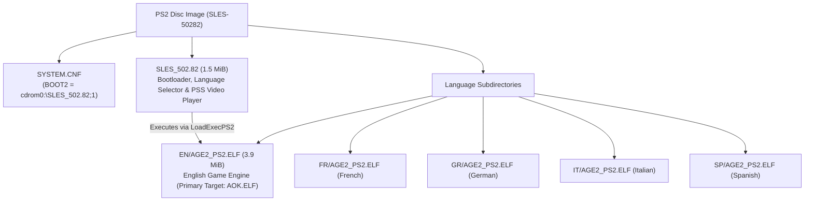

# PS2 Binary Analysis: SLES-50282 (Age of Empires II PAL)

Detailed analysis of the PlayStation 2 release of *Age of Empires II: The Age of Kings* (PAL Europe v2.00, `SLES-50282`).

---

## 1. Disc Structure and Image Architecture

The European release (`SLES-50282`) is mastered as a PlayStation 2 CD-ROM (Mode 2 Form 1, 2352 bytes/sector) with a multi-stage architecture:



### Components
1. **`SYSTEM.CNF`**: Points to `BOOT2 = cdrom0:\SLES_502.82;1`.
2. **`SLES_502.82` (1.5 MiB, 1,593,256 bytes)**:
   - Developed by Konami Computer Entertainment Tokyo (KCET).
   - Initialises the PS2 EE/GS, checks hardware/language configuration, plays the intro FMVs (`PPS_PAL/MSLOGO_2.PSS`, `PPS_PAL/ESLOGO_2.PSS`), and executes the language-specific binary via `LoadExecPS2()`.
3. **`EN/AGE2_PS2.ELF` (3.9 MiB, 4,076,904 bytes)**:
   - The full Age of Empires II game engine (Ensemble Studios' Genie Engine with KCET platform layer).
   - Copied to `orig/SLES-50282/AOK.ELF` as the primary matching target.

### Verified Hashes (v2.00)

| File | Path in repo | Size | SHA-1 |
|---|---|---|---|
| Disc Image (ISO) | `orig/SLES-50282/aoe2.iso` | 551,100,416 bytes | `77a9cec2083a7c3d82518b3ae47371b55ec2e7ce` |
| Primary Game ELF | `orig/SLES-50282/AOK.ELF` | 4,076,904 bytes | `f478e19f2059d52899b691483ef5c7522e30e17c` |
| Bootloader ELF | `orig/SLES-50282/SLES_502.82` | 1,593,256 bytes | `2f5139c1cb45c6b22b93e0c32bbea8e94a7b4a5f` |

---

## 2. Compiler & Toolchain Identification

The `.comment` section of both `SLES_502.82` and `EN/AGE2_PS2.ELF` records the compiler:

```sh
readelf -p .comment orig/SLES-50282/AOK.ELF
```

Output:
```
  [     0]  MW MIPS C Compiler (2.3.1.01)
  [    1e]  PlayStation2
```

* **Compiler:** **Metrowerks CodeWarrior for PlayStation 2, compiler version 2.3.1.01** (`MWCCPS2`).
* **Architecture:** MIPS-III (MIPS R5900 Emotion Engine), little-endian, EABI64.
* **Splat Setting:** `compiler: MWCCPS2` in `config/SLES-50282/config.yml`.
* **Linker Target:** `PS2/mwcc-2.3.1.01` in `configure.py`.

---

## 3. ELF Headers and Memory Layout

Analysis with `readelf -l` and `readelf -S`:

* **Entry Point:** `0x00100008`
* **Program Header:**
  - `LOAD`: File offset `0x0001e0` -> Virtual Address `0x00100000`, File Size `0x3e2fe0` (4,075,488 bytes), Memory Size `0x16953a0`.
* **Sections:**
  - `.shstrtab` (section names table): Metrowerks stripped standard names (`.text`, `.data`, `.rodata`, `.bss`), retaining only `.shstrtab`, `.comment`, `.reginfo`.
  - `.symtab`: Present in header, but 0 entries (stripped).
  - DWARF (`.debug_*`): Stripped.

---

## 4. Debug Facilitators and String Evidence

Although standard DWARF debug symbols are stripped, the binary contains an extensive set of debug artifacts from assertions, error handlers, and logging macros.

### 4.1 Original Source File Paths (`__FILE__`)

The binary embeds **16 original C and C++ source filenames** in assertion and error strings:

| Subsystem | Source file | Responsibility | Key string evidence |
|---|---|---|---|
| **Genie Engine Core** | `tribegam.cpp` | Main game loop (*TribeGame*) | `time=%lu, count=%lu`, `tribegam.cpp ->` |
| **Genie Engine Core** | `obmanager.cpp` | Object & zone management | `obmanager.cpp... Zone_Ptrs > PS2_MAX_ZONE_SIZE_M(=%d)` |
| **Genie Engine Core** | `com_hand.cpp` | Command handler & pre-game | `com_hand.cpp:PREGAMEMSG_CANCEL(%d)` |
| **Genie Engine / Net**| `mydplay.cpp` | DirectPlay / i.LINK sockets | `mydplay.cpp line:%d, Error: %d at sceILsockBind: sdRx self` |
| **KCET Hardware** | `kt_gpu.c` | GS / GPU rendering | `kind < numberof(func_list)` |
| **KCET Hardware** | `kt_libpad.c` | DualShock 2 controller | `n_pad > 0`, `p != NULL`, `n_pad <= numberof( buf )` |
| **KCET Hardware** | `kt_mouse.c` | USB mouse support | `mouse_number < W->n_mouse` *(reveals work struct `W`)* |
| **KCET Hardware** | `kt_keybd.c` | USB keyboard support | `keybd_number < W->n_keybd`, `ktKeybdGetStatus` |
| **KCET Hardware** | `kt_usbkeybd_drv.c` | USB keyboard driver | `ktKeybdApiSetCapsTypeRequest` |
| **KCET Hardware** | `kt_file.c` | File I/O subsystem | `kind < N_KT_FILE_KIND`, `p_string` |
| **KCET Hardware** | `kt_libcdvd_server.c` | CD/DVD RPC subsystem | `KT_USE_SCE_LIB < KT_SCE_LIB_1_6_5`, `ktSceCdInitMmode` |
| **KCET Hardware** | `kt_mc_2.c` | Memory Card manager | `n_card <= KT_MC_CARD_MAX`, `ktMcInit2`, `sceMcInit` |
| **KCET Hardware** | `kt_kernel.c` | Threads & semaphores | `ThreadID=%d, can't delete`, `SignalSema` |
| **KCET Hardware** | `kt_hd.c` | Dev filesystem driver | `host0:`, `sim:`, `atfile:` (Sony PS2 TOOL) |
| **Network Layer** | `socketee.c` | EE Sockets (i.LINK RPC) | `line: %d in socketee.c, sceSifCheckStatRpc() == 1` |
| **System Layer** | `libscf.c` | Sony system configuration | `SummerTime=%d`, `TimeNotation=%d` |
| **Bootloader (`SLES_502.82`)** | `pss_main.c` | PSS/MPEG2 video playback | `sceSifInitIopHeap() Init Success` |
| **Bootloader (`SLES_502.82`)** | `pss_audiodec.c`| Audio decoder for FMVs | `audioDecPause() rSdBlockTrans, timeout` |
| **Bootloader (`SLES_502.82`)** | `net_iopmodule.c`| IOP module loader | `p->device >= 0 && p->device < N_KT_LOADDEV` |

> [!NOTE]
> In contrast, the PC binary (`age2_x1.exe`) has **zero** source filenames in its strings. The PS2 binary provides the exact file division needed to reconstruct the source tree.

### 4.2 Function Names and Engine Constants

* **Functions:**
  - `RESFILE_load2()` (SLP / DRS resource file loader)
  - `th_Receiver()` (direct play receiving thread)
  - `ktMcInit2()` (memory card init)
  - `ktSceCdInitMmode()` (CD/DVD drive mode setting)
  - `ktWaitSyncV()` (V-Sync wait routine)
* **Constants & Macros:**
  - `PS2_MAX_ZONE_SIZE_M`
  - `KT_MOUSE_MAX_NUM`, `KT_KEYBD_MAX_NUM`, `KT_MC_CARD_MAX`
  - `N_KT_FILE_KIND`, `N_KT_LOADDEV`
* **Save Game Identifiers (Memory Card):**
  - `-50282age2_acn`, `-50282age2_g`, `-50282age2_s`
* **UI Screen Identifiers:**
  - `Single Player Menu`
  - `Game Setup Screen`
  - `MP Setup Screen`

---

## 5. Decompilation Strategy for PS2

1. **Splat Mapping:**
   Use the identified `.cpp` and `.c` files to name segments in `config/SLES-50282/config.yml` rather than using anonymous auto-generated function names.
2. **PC Cross-Referencing:**
   Cross-reference functions in `tribegam.cpp`, `obmanager.cpp`, and `com_hand.cpp` between PS2 MIPS assembly and PC x86 disassembly. Because both share Ensemble's Genie engine, algorithms and struct layouts can be matched between platforms.
3. **Toolchain Configuration:**
   Target Metrowerks CodeWarrior 2.3.1.01 (`mwccps2.exe`) with flags `-O3 -inline on -msext on -char signed -sym off -Iinclude -lang=c++` running under `wibo` on Linux.

---

## 6. C++ Game Engine Matching & Virtual Table Analysis

### 6.1 Emotion Engine 128-bit ABI & Register Saving
Starting at VRAM `0x137810` (file offset `0x379e0`), the binary transitions from KCET 64-bit frames (`sd`/`ld`) to Metrowerks CodeWarrior 128-bit Emotion Engine quadword frames (`sq`/`lq`):
- `sq $ra, 0x20($sp)`, `sq $s1, 0x10($sp)`, `sq $s0, 0x0($sp)`
- `paddub $dst, $src, $zero` utilized as 128-bit register move instruction.
- Branch delay-slot filling on FPU and ALU operations requires Metrowerks `-O3` (`-opt level=3`).

### 6.2 Virtual Tables & Inheritance Hierarchy
* **Base Virtual Table `__vt__8BaseList` (`0x4D7200`):**
  A 20-entry virtual method table for core Genie Engine dynamic container/collection objects:
  - `vtable[2] = 0x138A50` (`__ct__8BaseListFi`, constructor)
  - `vtable[10] = 0x138A40` (`Reset__8BaseListFi`, virtual reset)
  - `vtable[11] = 0x138AB0` (`Clear__8BaseListFv`, virtual clear)
* **Inheritance Chain Evidence:**
  At `0x366850`, constructor/destructor sequence overwrites `0x4D7200` (base vtable) with derived vtable `0x4DC9F0`, and subsequently with `0x4DF570` (most derived vtable), validating standard C++ inheritance layout in Metrowerks MIPS.

### 6.3 Verified Matched Targets
| Unit / Function | VRAM | Match Status | Description |
|---|---|---|---|
| `ScreenObj::AspectRatio()` | `0x137A20` | **100.0%** (24 / 24 B) | FPU single-precision division with `div.s` in `jr $ra` delay slot. |
| `BaseList::Reset(int)` | `0x138A40` | **100.0%** (12 / 12 B) | Method clearing count and updating capacity. |
| `BaseList::BaseList(int)` | `0x138A50` | **100.0%** (96 / 96 B) | Constructor with explicit vtable assignment (`__vt__8BaseList`) and `Free()` invocation. |
| `BaseList::Clear()` | `0x138AB0` | **100.0%** (44 / 44 B) | Method invoking `Free()` with quadword stack save/restore. |
| `kt_mouse::func_00135058` | `0x135058` | **100.0%** (52 / 52 B) | Port write buffer entry locator (`buffer + mouse_number * 0xB0 + 0x20 + write_idx * 0x24`). |
| `kt_mouse::func_001350E0` | `0x1350E0` | **100.0%** (52 / 52 B) | Port read buffer entry locator (`buffer + mouse_number * 0xB0 + 0x20 + read_idx * 0x24`). |
| `kt_mouse::func_00135258` | `0x135258` | **100.0%** (128 / 128 B) | Safe port status getter with `mouse_number < W->n_mouse` assertion. |
| `kt_mouse::func_001352D8` | `0x1352D8` | **100.0%** (232 / 232 B) | Mouse packet payload reader and byte copier for device types 1..3. |
| `kt_mouse::func_00135530` | `0x135530` | **100.0%** (104 / 104 B) | Free port search loop across `W->buffer` inspecting `port[1] == -1`. |
| `kt_mouse::func_001356E8` | `0x1356E8` | **100.0%** (176 / 176 B) | Safe port state setter with line 0x259 assertion and guard clause. |
| `kt_mouse::func_00135798` | `0x135798` | **100.0%** (212 / 212 B) | Safe packet payload setter with line 0x276 assertion, payload clamped to 8 B, and `memcpy`. |

### 6.4 Reverse Engineered `BaseList` Linked List Architecture (`0x138A40`–`0x138D50`)
Disassembly of the contiguous block following `BaseList::Clear()` reveals Ensemble Studios' generic serializable linked list container implementation:
* **Fixed Node Memory Pool (`0x50A8C0`):**
  Array `s_node_pool[1000]` storing 8-byte nodes (`void *item; ListNode *next;`).
* **Node Allocator (`0x138AE0`, 108 B):**
  Searches pool for an unallocated entry (`node->item == NULL`), initializes it via `memset(node, 0, 8)`, and returns pointer.
* **Node Deallocator (`0x138B50`, 80 B):**
  Binary searches pool array (4200 max span) to locate the node pointer and clears `node->item = NULL`.
* **Deserializer `Load(void *stream)` (`0x138BA0`, 172 B):**
  Clears existing list via `Free()`, reads 16-bit count headers, invokes virtual factory `((BaseItemCreator*)this)->CreateItem(stream, count)` (vtable index 3 at offset +12), allocates nodes via `AllocNode()`, and appends them in FIFO order.
* **Visitor `Action()` (`0x138C50`, 72 B):**
  Iterates linked list from `m_head`, invoking item virtual method `item->vtable[6]()` (`ListItem::Action()`).
* **Serializer `Save(void *stream)` (`0x138CA0`, 104 B):**
  Iterates linked list from `m_head`, invoking `item->vtable[7](stream)` (`ListItem::Save()`), and terminates with a 16-bit zero write via stream write (`func_226f70`).
* **List Drain `Free()` (`0x138D10`, 56 B):**
  Loops while `m_head != NULL`, calling node deletion routine `func_139580(this)`.

#### 6.4.1 BaseList Matching Results (100.0% Complete Unit)

| Function / Method | VRAM Address | Match Status | Description |
|---|---|---|---|
| `BaseList::Reset(int)` | `0x138A40` | **100.0%** (12 / 12 B) | Capacity setter and head pointer reset (`m_head = NULL`). |
| `BaseList::BaseList(int)` | `0x138A50` | **100.0%** (96 / 96 B) | Constructor binding `__vt__8BaseList`, draining list, and invoking `__vec_ctor`. |
| `BaseList::Clear()` | `0x138AB0` | **100.0%** (44 / 44 B) | Resets capacity and head pointer to 0 after invoking `Free()`. |
| `BaseList::AllocNode()` | `0x138AE0` | **100.0%** (108 / 108 B) | Linear scan over `s_node_pool[1000]`, clearing matching node via `memset`. |
| `BaseList::FreeNode(ListNode*)` | `0x138B50` | **100.0%** (80 / 80 B) | Binary search over node pool span 4200 clearing `node->item = NULL`. |
| `BaseList::Load(void*)` | `0x138BA0` | **100.0%** (172 / 172 B) | Deserializer reading count headers, invoking virtual factory, and appending nodes. |
| `BaseList::Action()` | `0x138C50` | **100.0%** (72 / 72 B) | Iterates list invoking `item->Action()` at vtable offset 24. |
| `BaseList::Save(void*)` | `0x138CA0` | **100.0%** (104 / 104 B) | Iterates list invoking `item->Save(stream)` at vtable offset 28 + trailing terminator. |
| `BaseList::Free()` | `0x138D10` | **100.0%** (56 / 56 B) | Head node drainage loop invoking node deallocator `func_139580(this)`. |


