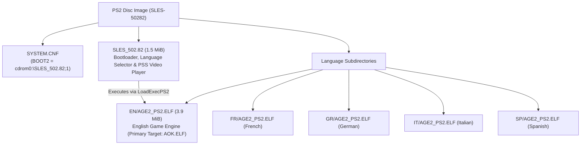

# PS2 Binary Analysis: SLES-50282 (Age of Empires II PAL)

Detailed analysis of the PlayStation 2 release of *Age of Empires II: The Age of Kings* (PAL Europe v2.00, `SLES-50282`).

---

## 1. Disc Structure and Image Architecture

The European release (`SLES-50282`) is mastered as a PlayStation 2 CD-ROM (Mode 2 Form 1, 2352 bytes/sector) with a multi-stage architecture:



### Components
1. **`SYSTEM.CNF`**: Points to `BOOT2 = cdrom0:\SLES_502.82;1`.
2. **`SLES_502.82` (1.5 MiB, 1,593,256 bytes)**:
   - Developed by Konami Computer Entertainment Tokyo (KCET).
   - Initialises the PS2 EE/GS, checks hardware/language configuration, plays the intro FMVs (`PPS_PAL/MSLOGO_2.PSS`, `PPS_PAL/ESLOGO_2.PSS`), and executes the language-specific binary via `LoadExecPS2()`.
3. **`EN/AGE2_PS2.ELF` (3.9 MiB, 4,076,904 bytes)**:
   - The full Age of Empires II game engine (Ensemble Studios' Genie Engine with KCET platform layer).
   - Copied to `orig/SLES-50282/AOK.ELF` as the primary matching target.

### Verified Hashes (v2.00)

| File | Path in repo | Size | SHA-1 |
|---|---|---|---|
| Disc Image (ISO) | `orig/SLES-50282/aoe2.iso` | 551,100,416 bytes | `77a9cec2083a7c3d82518b3ae47371b55ec2e7ce` |
| Primary Game ELF | `orig/SLES-50282/AOK.ELF` | 4,076,904 bytes | `f478e19f2059d52899b691483ef5c7522e30e17c` |
| Bootloader ELF | `orig/SLES-50282/SLES_502.82` | 1,593,256 bytes | `2f5139c1cb45c6b22b93e0c32bbea8e94a7b4a5f` |

---

## 2. Compiler & Toolchain Identification

The `.comment` section of both `SLES_502.82` and `EN/AGE2_PS2.ELF` records the compiler:

```sh
readelf -p .comment orig/SLES-50282/AOK.ELF
```

Output:
```
  [     0]  MW MIPS C Compiler (2.3.1.01)
  [    1e]  PlayStation2
```

* **Compiler:** **Metrowerks CodeWarrior for PlayStation 2, compiler version 2.3.1.01** (`MWCCPS2`).
* **Architecture:** MIPS-III (MIPS R5900 Emotion Engine), little-endian, EABI64.
* **Splat Setting:** `compiler: MWCCPS2` in `config/SLES-50282/config.yml`.
* **Linker Target:** `PS2/mwcc-2.3.1.01` in `configure.py`.

---

## 3. ELF Headers and Memory Layout

Analysis with `readelf -l` and `readelf -S`:

* **Entry Point:** `0x00100008`
* **Program Header:**
  - `LOAD`: File offset `0x0001e0` -> Virtual Address `0x00100000`, File Size `0x3e2fe0` (4,075,488 bytes), Memory Size `0x16953a0`.
* **Sections:**
  - `.shstrtab` (section names table): Metrowerks stripped standard names (`.text`, `.data`, `.rodata`, `.bss`), retaining only `.shstrtab`, `.comment`, `.reginfo`.
  - `.symtab`: Present in header, but 0 entries (stripped).
  - DWARF (`.debug_*`): Stripped.

---

## 4. Debug Facilitators and String Evidence

Although standard DWARF debug symbols are stripped, the binary contains an extensive set of debug artifacts from assertions, error handlers, and logging macros.

### 4.1 Original Source File Paths (`__FILE__`)

The binary embeds **16 original C and C++ source filenames** in assertion and error strings:

| Subsystem | Source file | Responsibility | Key string evidence |
|---|---|---|---|
| **Genie Engine Core** | `tribegam.cpp` | Main game loop (*TribeGame*) | `time=%lu, count=%lu`, `tribegam.cpp ->` |
| **Genie Engine Core** | `obmanager.cpp` | Object & zone management | `obmanager.cpp... Zone_Ptrs > PS2_MAX_ZONE_SIZE_M(=%d)` |
| **Genie Engine Core** | `com_hand.cpp` | Command handler & pre-game | `com_hand.cpp:PREGAMEMSG_CANCEL(%d)` |
| **Genie Engine / Net**| `mydplay.cpp` | DirectPlay / i.LINK sockets | `mydplay.cpp line:%d, Error: %d at sceILsockBind: sdRx self` |
| **KCET Hardware** | `kt_gpu.c` | GS / GPU rendering | `kind < numberof(func_list)` |
| **KCET Hardware** | `kt_libpad.c` | DualShock 2 controller | `n_pad > 0`, `p != NULL`, `n_pad <= numberof( buf )` |
| **KCET Hardware** | `kt_mouse.c` | USB mouse support | `mouse_number < W->n_mouse` *(reveals work struct `W`)* |
| **KCET Hardware** | `kt_keybd.c` | USB keyboard support | `keybd_number < W->n_keybd`, `ktKeybdGetStatus` |
| **KCET Hardware** | `kt_usbkeybd_drv.c` | USB keyboard driver | `ktKeybdApiSetCapsTypeRequest` |
| **KCET Hardware** | `kt_file.c` | File I/O subsystem | `kind < N_KT_FILE_KIND`, `p_string` |
| **KCET Hardware** | `kt_libcdvd_server.c` | CD/DVD RPC subsystem | `KT_USE_SCE_LIB < KT_SCE_LIB_1_6_5`, `ktSceCdInitMmode` |
| **KCET Hardware** | `kt_mc_2.c` | Memory Card manager | `n_card <= KT_MC_CARD_MAX`, `ktMcInit2`, `sceMcInit` |
| **KCET Hardware** | `kt_kernel.c` | Threads & semaphores | `ThreadID=%d, can't delete`, `SignalSema` |
| **KCET Hardware** | `kt_hd.c` | Dev filesystem driver | `host0:`, `sim:`, `atfile:` (Sony PS2 TOOL) |
| **Network Layer** | `socketee.c` | EE Sockets (i.LINK RPC) | `line: %d in socketee.c, sceSifCheckStatRpc() == 1` |
| **System Layer** | `libscf.c` | Sony system configuration | `SummerTime=%d`, `TimeNotation=%d` |
| **Bootloader (`SLES_502.82`)** | `pss_main.c` | PSS/MPEG2 video playback | `sceSifInitIopHeap() Init Success` |
| **Bootloader (`SLES_502.82`)** | `pss_audiodec.c`| Audio decoder for FMVs | `audioDecPause() rSdBlockTrans, timeout` |
| **Bootloader (`SLES_502.82`)** | `net_iopmodule.c`| IOP module loader | `p->device >= 0 && p->device < N_KT_LOADDEV` |

> [!NOTE]
> In contrast, the PC binary (`age2_x1.exe`) has **zero** source filenames in its strings. The PS2 binary provides the exact file division needed to reconstruct the source tree.

### 4.2 Function Names and Engine Constants

* **Functions:**
  - `RESFILE_load2()` (SLP / DRS resource file loader)
  - `th_Receiver()` (direct play receiving thread)
  - `ktMcInit2()` (memory card init)
  - `ktSceCdInitMmode()` (CD/DVD drive mode setting)
  - `ktWaitSyncV()` (V-Sync wait routine)
* **Constants & Macros:**
  - `PS2_MAX_ZONE_SIZE_M`
  - `KT_MOUSE_MAX_NUM`, `KT_KEYBD_MAX_NUM`, `KT_MC_CARD_MAX`
  - `N_KT_FILE_KIND`, `N_KT_LOADDEV`
* **Save Game Identifiers (Memory Card):**
  - `-50282age2_acn`, `-50282age2_g`, `-50282age2_s`
* **UI Screen Identifiers:**
  - `Single Player Menu`
  - `Game Setup Screen`
  - `MP Setup Screen`

For bounded third-party runtime code ranges, Sony SDK version markers, and the
limits of the current attribution, see the [PS2 library code map](ps2_library_map.md).

---

## 5. Decompilation Strategy for PS2

1. **Splat Mapping:**
   Use the identified `.cpp` and `.c` files to name segments in `config/SLES-50282/config.yml` rather than using anonymous auto-generated function names.
2. **PC Cross-Referencing:**
   Cross-reference functions in `tribegam.cpp`, `obmanager.cpp`, and `com_hand.cpp` between PS2 MIPS assembly and PC x86 disassembly. Because both share Ensemble's Genie engine, algorithms and struct layouts can be matched between platforms.
3. **Toolchain Configuration:**
   Target Metrowerks CodeWarrior 2.3.1.01 (`mwccps2.exe`) with flags `-O3 -inline on -msext on -char signed -sym off -Iinclude -lang=c++` running under `wibo` on Linux.

### Progress Measurement

Objdiff reports `matched_code` as exact matching code bytes across the split units and `total_code` as the code bytes in those units. Its `complete_code` and `complete_units` values come from the manually assigned `complete` metadata generated by `Matching` in `configure.py`; they do not verify byte identity. Keep an object `Matching` only when its C/C++ build matches the target exactly, and use `NonMatching` otherwise. Assembly reference files under `build/` are target-side comparison inputs, not decompilation source; `.s`, `INCLUDE_ASM`, inline instruction assembly, and `.word` data do not count as C/C++ decompilation.

---

## 6. C++ Game Engine Matching & Virtual Table Analysis

### 6.1 Emotion Engine 128-bit ABI & Register Saving
Starting at VRAM `0x137810` (file offset `0x379e0`), the binary transitions from KCET 64-bit frames (`sd`/`ld`) to Metrowerks CodeWarrior 128-bit Emotion Engine quadword frames (`sq`/`lq`):
- `sq $ra, 0x20($sp)`, `sq $s1, 0x10($sp)`, `sq $s0, 0x0($sp)`
- `paddub $dst, $src, $zero` utilized as 128-bit register move instruction.
- Branch delay-slot filling on FPU and ALU operations requires Metrowerks `-O3` (`-opt level=3`).

### 6.2 Virtual Tables & Inheritance Hierarchy
* **Base Virtual Table `__vt__8BaseList` (`0x4D7200`):**
  A 20-entry virtual method table for core Genie Engine dynamic container/collection objects:
  - `vtable[2] = 0x138A50` (`__ct__8BaseListFi`, constructor)
  - `vtable[10] = 0x138A40` (`Reset__8BaseListFi`, virtual reset)
  - `vtable[11] = 0x138AB0` (`Clear__8BaseListFv`, virtual clear)
* **Inheritance Chain Evidence:**
  At `0x366850`, constructor/destructor sequence overwrites `0x4D7200` (base vtable) with derived vtable `0x4DC9F0`, and subsequently with `0x4DF570` (most derived vtable), validating standard C++ inheritance layout in Metrowerks MIPS.

### 6.3 Verified Matched Targets
| Unit / Function | VRAM | Match Status | Description |
|---|---|---|---|
| `MapZone::Save(void*)` (`func_00137810`) | `0x137810` | **100.0%** (176 / 176 B) | Stream writer serializing zone map dimensions, version check (`D_004E2F24 >= D_004E2A98`), world fieldBA0, and tile data via `func_226f70`. |
| `MapZone::GetTileFlag(int, int)` (`func_001378C0`) | `0x1378C0` | **100.0%** (96 / 96 B) | Fast tile flag inspector reading `D_50A5A0[y][x]` with conditional bitmask tests against world fields `3112` and `3108`. |
| `MapZone::ProcessTiles()` (`func_00137920`) | `0x137920` | **100.0%** (256 / 256 B) | Nested 2D grid pump clearing 255 marks, incrementing count, OR-ing flags into `D_50A5A0`, and dispatching `func_002082B0`. |
| `ScreenObj::AspectRatio()` | `0x137A20` | **100.0%** (24 / 24 B) | FPU single-precision division with `div.s` in `jr $ra` delay slot. |
| `GetSightTable(int, int)` (`func_00137A40`) | `0x137A40` | **100.0%** (92 / 92 B) | Clamps LOS radius to range 0..20 and selects sight offset table (`D_0038FAA0` vs `D_0038FA40`). |
| `MapZone::Stub()` (`func_00137E90`) | `0x137E90` | **100.0%** (16 / 16 B) | Empty leaf function stub. |
| `MapZone::HideLOS(...)` (`func_00137EA0`) | `0x137EA0` | **99.85%** (416 / 416 B) | Sight line subtraction and tile saturating decrement loop with fog of war mask restoration. Blocking: MWCC -O3 temporary register permutation on D_0038FAA0/D_0038FA40 table index. |
| `MapZone::AddLOSRect(...)` (`func_00138040`) | `0x138040` | **99.50%** (736 / 736 B) | Rectangular line-of-sight unit entrance adder with tile increment loop, upper clamp at 249, active sight bit `m_field24` and discovery dispatch. Blocking: MWCC -O3 register allocation on entry checks. |
| `MapZone::HideLOSRect(...)` (`func_00138320`) | `0x138320` | **99.63%** (416 / 416 B) | Bounding box sight subtraction across rectangle [min_x..max_x, min_y..max_y] with saturating 8-bit tile decrement and explored mask setting. Blocking: MWCC -O3 register assignment on width/height guards. |
| `MapZone::RevealLOSRect(...)` (`func_001384C0`) | `0x1384C0` | **99.52%** (672 / 672 B) | Rectangular line-of-sight exploration pump with allied player stance check (`m_stance[world->fieldBA0] == 1`), shared exploration dispatch (`func_002082B0`), and tile visibility mark update. Blocking: MWCC -O3 temporary register permutation on stance branch. |
| `VisibleMap::__dt()` (`func_00138760`) | `0x138760` | **100.0%** (16 / 16 B) | Destructor returning `this` via `paddub $v0, $a0, $zero`. |
| `VisibleMap::__ct(int)` (`func_00138770`) | `0x138770` | **100.0%** (80 / 80 B) | Constructor with positive capacity check dispatching `__vec_ctor`. |
| `VisibleMap::Init(int, int)` (`func_001387C0`) | `0x1387C0` | **100.0%** (112 / 112 B) | Grid initializer resetting mode `D_004E3058`, clearing static buffer, and calling `SetupPointers`. |
| `VisibleMap::Load(void*)` (`func_00138830`) | `0x138830` | **100.0%** (176 / 176 B) | Stream reader deserializing grid dimensions and tile visibility data buffer via `func_226d90`. |
| `VisibleMap::Save(void*)` (`func_001388E0`) | `0x1388E0` | **100.0%** (128 / 128 B) | Stream writer serializing grid dimensions and tile buffer data via `func_226f70`. |
| `VisibleMap::SetupPointers()` (`func_00138960`) | `0x138960` | **100.0%** (128 / 128 B) | Calculates 200 row pointers in table `D_50A5A0` for map scanlines up to height and zeroes remainder. |
| `VisibleMap::SetVisibleMode(int)` (`func_001389E0`) | `0x1389E0` | **100.0%** (16 / 16 B) | Sets global fog of war / visibility mode flag in `gp`-relative variable `D_004E3058`. |
| `VisibleMap::Clear()` (`func_001389F0`) | `0x1389F0` | **100.0%** (80 / 80 B) | Resets map height to 0, updates row pointers, and zeroes buffer `0x27100` B via `memset`. |
| `SubList::SetupSpatial()` | `0x139C80` | **100.0%** (64 / 64 B) | Spatial list initializer invoking `func_1DC180`, clearing `m_fieldC5`, and setting `m_fieldCC` via virtual call `v201()`. |
| `SubList::Setup(void*)` | `0x139CC0` | **100.0%** (116 / 116 B) | Stream reader deserializing stream data via `func_1DC2E0`, reading 1 byte dummy, reading `m_fieldC5`, and delegating to `m_fieldCC->Load`. |
| `SubList::CreateSubList()` | `0x139D40` | **100.0%** (16 / 16 B) | Factory tail call `j func_3668C0(D_10B68F0, this)` enabled by `#pragma exceptions off`. |
| `SubList::Action()` | `0x139D50` | **100.0%** (44 / 44 B) | Action pump calling `func_266840(this)` and delegating to `m_fieldCC->Action()`. |
| `SubList::Save(void*)` | `0x139D80` | **100.0%** (96 / 96 B) | Stream writer serializing stream data via `func_1DC6B0`, writing 1 byte dummy (`&(dummy = 0)` in branch delay slot), writing `m_fieldC5`, and delegating to `m_fieldCC->Save`. |
| `SubList::Free()` | `0x139DE0` | **100.0%** (44 / 44 B) | Resource deallocator invoking `func_1DCAA0(this)` and `m_fieldCC->Free()`. |
| `SubList::Teardown()` | `0x139E10` | **100.0%** (48 / 48 B) | Teardown method invoking `m_fieldCC->Free()` and `func_267DD0(this)`. |
| `SubList::Noop()` | `0x139E40` | **100.0%** (8 / 8 B) | Empty method stub `jr $ra; nop`. |
| `SubList::Notify(void*)` | `0x139E50` | **100.0%** (72 / 72 B) | Self-notification guard dispatching virtual call `v192(other, 0, -1)` and incrementing `m_fieldC5`. |
| `BuildAI::AddItem(...)` (`AddItem__7BuildAIFPviiiii`) | `0x13DB20` | **99.28%** (608 / 608 B) | Allocates build item via `func_0013DAC0`, formats name from unit type or fallback strings (`D_00490D50`/`60`/`80`), delegates to `SubListBuildItem::Init`, performs 12 parameter initializations and inserts into doubly-linked list tail at `m_head` (`0x11C`). Blocking: MWCC -O3 temporary register permutation on `type`/`unit_id` parameters. |
| `BuildAI::Save(void*)` (`Save__7BuildAIFPv`) | `0x13D370` | **100.0%** (1188 / 1188 B) | Serializer streaming 4 length-prefixed strings, field568, item count, and full SubListBuildItem circular list entries via `func_00226F70`. |
| `SubList::SaveActionBase()` (`func_0013BAD0`) | `0x13BAD0` | **100.0%** (16 / 16 B) | Action node factory tail call `j func_3668C0(D_10B68F0, self->m_field8)` enabled by `#pragma exceptions off`. |
| `SubList::UpdateActionNodes()` (`func_0013BAE0`) | `0x13BAE0` | **100.0%** (136 / 136 B) | Action node updater querying world via `func_2668c0`, updating IDs from offset `0x24` into `m_field18`/`m_field1C`, and pumping `m_field34->Action()`. |
| `SubList::SaveActionState(void*)` (`func_0013BB70`) | `0x13BB70` | **100.0%** (408 / 408 B) | Complete action state serializer streaming fields `0x4..0x3D`, resolving node IDs via `0x24`/`0x2`/`0x34` (with `-1` fallbacks) and delegating to `m_field34->Save`. |
| `BaseList::Reset(int)` | `0x138A40` | **100.0%** (12 / 12 B) | Method clearing count and updating capacity. |
| `BaseList::BaseList(int)` | `0x138A50` | **100.0%** (96 / 96 B) | Constructor with explicit vtable assignment (`__vt__8BaseList`) and `Free()` invocation. |
| `BaseList::Clear()` | `0x138AB0` | **100.0%** (44 / 44 B) | Method invoking `Free()` with quadword stack save/restore. |
| `DiplomacyAI::UpdateStances(DiplomacyAI*)` (`func_0013F910`) | `0x13F910` | **100.0%** (216 / 216 B) | Reciprocity stance updater looping across active players, testing `func_140280` and `func_1402E0`, and dispatching `func_13FB50` (SetStance). |
| `DiplomacyAI::IsAllied(int)` (`func_1401C0`) | `0x1401C0` | **100.0%** (92 / 92 B) | Checks if specified player is valid, not self, within player count and has allied stance (3). |
| `DiplomacyAI::IsNeutral(int)` (`func_140220`) | `0x140220` | **100.0%** (92 / 92 B) | Checks if specified player is valid, not self, within player count and has neutral stance (1). |
| `DiplomacyAI::IsEnemy(int)` (`func_140280`) | `0x140280` | **100.0%** (96 / 96 B) | Returns 1 if player is self, or if valid and within player count with enemy/none stance (0). |
| `DiplomacyAI::IsMutualRelation(int)` (`func_1402E0`) | `0x1402E0` | **100.0%** (120 / 120 B) | Queries other player's virtual method CheckRelation (slot 0x24) passing own player_id. |
| `DiplomacyAI::Save(void*)` | `0x13F9F0` | **100.0%** (148 / 148 B) | Serializer streaming 10 player entries across fields `0xB0`, `0xD8`, and `0x100` via `func_00226F70`. |
| `DiplomacyAI::GetStance(int, int)` (`func_0013FA90`) | `0x13FA90` | **100.0%** (192 / 192 B) | Stance query returning stance value for enemy/allied or calculating 100 - diff1 - diff2 neutrality score for neutral mode. |
| `DiplomacyAI::SetStance(int, int, int)` (`func_13FB50`) | `0x13FB50` | **100.0%** (300 / 300 B) | Incremental stance modification adding delta to fieldB0 or fieldD8 with bounds clamping. |
| `TacticalAI2::EndScriptScope()` (`func_144050`) | `0x144050` | **100.0%** (300 / 300 B) | Scope terminator popping from 10-entry array `0x6C4`, restoring 6 fields and copying script name via `func_0011ABBC`. |
| `TacticalAI2::PopConditionScope()` (`func_144180`) | `0x144180` | **100.0%** (36 / 36 B) | Leaf method popping condition scope index from `0x2FB8` array and restoring to `0x198`. |
| `SubListBuildItem::Init(...)` (`func_0013C960`) | `0x13C960` | **100.0%** (216 / 216 B) | Constructor/initializer delegating base state to `func_0013C6D0` and populating fields and targets array. |
| `SubListItemBase::Init(...)` (`func_0013C6D0`) | `0x13C6D0` | **100.0%** (56 / 56 B) | Base item state initializer setting 9 fields and performing tail call (`j func_0011B170`) to strncpy. |
| `SubListItemBase::Copy(...)` (`func_0013C710`) | `0x13C710` | **100.0%** (92 / 92 B) | Base item copy routine copying 10 fields and performing tail call (`j func_0011ABBC`) to strcpy. |
| `SubList::Method11()` (`func_0013A6A0`) | `0x13A6A0` | **100.0%** (24 / 24 B) | Indirect virtual call dispatching `((NodeActionTarget*)field4)->Method16(field8)` as a pure tail call (`jr $t9`). |
| `SubList::Method12()` (`func_0013A6D0`) | `0x13A6D0` | **100.0%** (24 / 24 B) | Indirect virtual call dispatching `((NodeActionTarget*)field4)->Method17(field8)` as a pure tail call (`jr $t9`). |
| `DiplomacyAI::SetStanceDirect(...)` (`func_0013FC80`) | `0x13FC80` | **100.0%** (284 / 284 B) | Direct stance setter updating `m_fieldB0` or `m_fieldD8` with activity-dependent clamping via switch dispatch. |
| `DiplomacyAI::IsPlayerActive(int)` (`func_0013FDA0`) | `0x13FDA0` | **100.0%** (76 / 76 B) | Boolean player active query checking `m_field100[player] == 1` within player bounds. |
| `DiplomacyAI::SetPlayerActive(int, int)` (`func_0013FDF0`) | `0x13FDF0` | **100.0%** (52 / 52 B) | Player active flag setter updating `m_field100[player]` within player bounds. |
| `DiplomacyAI::DispatchAction()` (`func_0013FE30`) | `0x13FE30` | **89.65%** (160 / 172 B) | Virtual dispatch on `m_fieldAC` slot 20 querying facts and chaining to `func_13FEF0`. |
| `DiplomacyAI::GetDefaultStatus()` (`func_0013FEE0`) | `0x13FEE0` | **100.0%** (8 / 8 B) | Sentinel status getter returning integer `-1`. |
| `DiplomacyAI::FindBestTarget(...)` (`func_13FEF0`) | `0x13FEF0` | **96.50%** (432 / 448 B) | Multi-criteria diplomatic target search with relation checks and quotient scoring in pure C++. |
| `DiplomacyAI::ActionStub()` (`func_001400B0`) | `0x1400B0` | **100.0%** (8 / 8 B) | Action execution stub returning integer `0`. |
| `DiplomacyAI::FindAllyCandidate(...)` (`func_001400C0`) | `0x1400C0` | **100.0%** (248 / 248 B) | Search for best candidate player maximizing fieldD8 score while skipping inactive and allied players. |
| `TacticalAI2::ComputeSpatialBounds(...)` (`func_001424A0`) | `0x1424A0` | **100.0%** (184 / 184 B) | Initializes tactical AI parser state, clears items and condition stack buffers via memset, dispatches parser loop. |
| `TacticalAI2::QueryNearbyTargets(...)` (`func_00142560`) | `0x142560` | **87.14%** (244 / 280 B) | Recursive-descent token parser loop verifying token stream, dispatching statements and checking condition stack balance. |
| `TacticalAI2::ResetSpatialFlag(...)` (`func_00142130`) | `0x142130` | **100.0%** (100 / 100 B) | Dispatches message type 2 to field3C spatial item and returns comparison against response. |
| `TacticalAI2::SetSpatialFlag(...)` (`func_001421A0`) | `0x1421A0` | **100.0%** (88 / 88 B) | Dispatches message type 5 to field34 and returns comparison against response. |
| `TacticalAI2::ClearSpatialFlag(...)` (`func_00142200`) | `0x142200` | **100.0%** (84 / 84 B) | Dispatches message type 2 to field34 and returns comparison against response. |
| `TacticalAI2::DispatchSpatialEvent(...)` (`func_00142260`) | `0x142260` | **100.0%** (140 / 140 B) | Dispatches event via func_00141170 and dispatches message type 3 to field34. |
| `TacticalAIScoring::ScanScoring()` (`func_00142830`) | `0x142830` | **99.20%** (124 / 124 B) | Parser scoring scanner calling `func_142980` and reporting script errors via `func_144340` (codes `0x10` and `0x1A`). Blocking: MWCC -O3 branch order on switch. |
| `TacticalAIScoring::DecompileTokens(char*)` (`func_001428B0`) | `0x1428B0` | **98.38%** (200 / 200 B) | Token stream decompiler translating 16-bit bytecode into string buffer via token lookup `func_21A4A0` and newline token `0xFFFE` (`D_490E9C`). Blocking: MWCC -O3 register assignment on buffer pointers. |
| `kt_mouse::func_00134DE8` | `0x134DE8` | **100.0%** (104 / 104 B) | Input dispatch wrapper checking status flag (`func_105748`), invoking handler (`func_104A20`), and conditionally notifying (`func_1057B0`). |
| `kt_mouse::func_00134E50` | `0x134E50` | **100.0%** (196 / 196 B) | `InitWork`: Mouse work initialization, asserting `n_mouse <= KT_MOUSE_MAX_NUM` (line 100), initializing `W` (`D_50A060`), clearing buffer (`D_509F00`, 0x160 B), and setting port defaults. |
| `kt_mouse::func_00135058` | `0x135058` | **100.0%** (52 / 52 B) | Port write buffer entry locator (`buffer + mouse_number * 0xB0 + 0x20 + write_idx * 0x24`). |
| `kt_mouse::func_001350E0` | `0x1350E0` | **100.0%** (52 / 52 B) | Port read buffer entry locator (`buffer + mouse_number * 0xB0 + 0x20 + read_idx * 0x24`). |
| `kt_mouse::func_00135258` | `0x135258` | **100.0%** (128 / 128 B) | Safe port status getter with `mouse_number < W->n_mouse` assertion. |
| `kt_mouse::func_001352D8` | `0x1352D8` | **100.0%** (232 / 232 B) | Mouse packet payload reader and byte copier for device types 1..3. |
| `kt_mouse::func_001353C0` | `0x1353C0` | **100.0%** (184 / 184 B) | Mouse port reset / disconnect loop; scans `D_50A060.buffer`, marks active ports with `-1`, returns reset count. |
| `kt_mouse::func_00135530` | `0x135530` | **100.0%** (104 / 104 B) | Free port search loop across `W->buffer` inspecting `port[1] == -1`. |
| `kt_mouse::func_001356E8` | `0x1356E8` | **100.0%** (176 / 176 B) | Safe port state setter with line 0x259 assertion and guard clause. |
| `kt_mouse::func_00135798` | `0x135798` | **100.0%** (212 / 212 B) | Safe packet payload setter with line 0x276 assertion, payload clamped to 8 B, and `memcpy`. |
| `kt_mouse::func_00135A38` | `0x135A38` | **100.0%** (128 / 128 B) | Iterates `MouseBlock_9B8` array; if entry `f8 >= 0` and status differs from `a3`, resets entry using `func_001359B8`. |
| `kt_mouse::func_00135AB8` | `0x135AB8` | **100.0%** (204 / 204 B) | Clamps count to `buf[0]`; verifies packet `buf[i + 2]`, allocates device state via `func_001355D0`, and updates port state using `func_001356E8`. |
| `kt_mouse::func_00135B88` | `0x135B88` | **100.0%** (92 / 92 B) | Device table initializer; clamps mode to 1, zeroes state block `D_50A080` (24 B), sets count/handles, and formats block table via `func_001359D0`. |
| `kt_mouse::func_00135870` | `0x135870` | **100.0%** (268 / 268 B) | `ktMousePostEvent`: Safe event enqueue routine pushing 5 packet parameters into buffer ring slot (`func_00135058`) and advancing write index (`func_00135008`). |
| `kt_mouse::func_00135BF0` | `0x135BF0` | **100.0%** (368 / 368 B) | `ktMouseProcessEvents`: Main mouse event pump polling device, verifying state via `func_00135A38`/`func_00135AB8`, reading motion, and dispatching events via `func_00135870`. **100% complete module milestone.** |

### 6.3.1 KCET Hardware Layer Strings and Symbol Discoveries
Inspection of `AOK.ELF` in the assertion/rodata pool (`0x490820` - `0x490900`) recovered exact file names and assertions from KCET's peripheral abstraction layer:
* **`kt_mouse.c`:**
  - `0x490820`: `"kt_mouse.c"`
  - `0x490830`: `"n_mouse <= KT_MOUSE_MAX_NUM"` (verified at line 100 in `InitWork` / `func_00134E50`)
  - `0x490870`: `"mouse_number < W->n_mouse"` (verified in status getter `func_00135258` and setter `func_00135870`)
  - `"number < W->n_mouse"`
* **`kt_keybd.c` (Keyboard Layer):**
  - `"kt_keybd.c"`, `"n_keybd <= KT_KEYBD_MAX_NUM"`, `"InitWork"`, `"keybd_number < W->n_keybd"`
  - Exported functions: `ktKeybdGetStatus`, `ktKeybdGetBus`, `ktKeybdGetLocation`, `ktKeybdSetLed`, `ktKeybdSetCapsType`.

### 6.4 Reverse Engineered `BaseList` Linked List Architecture (`0x138A40`–`0x138D50`)
Disassembly of the contiguous block following `BaseList::Clear()` reveals Ensemble Studios' generic serializable linked list container implementation:
* **Fixed Node Memory Pool (`0x50A8C0`):**
  Array `s_node_pool[1000]` storing 8-byte nodes (`void *item; ListNode *next;`).
* **Node Allocator (`0x138AE0`, 108 B):**
  Searches pool for an unallocated entry (`node->item == NULL`), initializes it via `memset(node, 0, 8)`, and returns pointer.
* **Node Deallocator (`0x138B50`, 80 B):**
  Binary searches pool array (4200 max span) to locate the node pointer and clears `node->item = NULL`.
* **Deserializer `Load(void *stream)` (`0x138BA0`, 172 B):**
  Clears existing list via `Free()`, reads 16-bit count headers, invokes virtual factory `((BaseItemCreator*)this)->CreateItem(stream, count)` (vtable index 3 at offset +12), allocates nodes via `AllocNode()`, and appends them in FIFO order.
* **Visitor `Action()` (`0x138C50`, 72 B):**
  Iterates linked list from `m_head`, invoking item virtual method `item->vtable[6]()` (`ListItem::Action()`).
* **Serializer `Save(void *stream)` (`0x138CA0`, 104 B):**
  Iterates linked list from `m_head`, invoking `item->vtable[7](stream)` (`ListItem::Save()`), and terminates with a 16-bit zero write via stream write (`func_226f70`).
* **List Drain `Free()` (`0x138D10`, 56 B):**
  Loops while `m_head != NULL`, calling node deletion routine `func_139580(this)`.

#### 6.4.1 BaseList Matching Results (100.0% Complete Unit)

| Function / Method | VRAM Address | Match Status | Description |
|---|---|---|---|
| `BaseList::Reset(int)` | `0x138A40` | **100.0%** (12 / 12 B) | Capacity setter and head pointer reset (`m_head = NULL`). |
| `BaseList::BaseList(int)` | `0x138A50` | **100.0%** (96 / 96 B) | Constructor binding `__vt__8BaseList`, draining list, and invoking `__vec_ctor`. |
| `BaseList::Clear()` | `0x138AB0` | **100.0%** (44 / 44 B) | Resets capacity and head pointer to 0 after invoking `Free()`. |
| `BaseList::AllocNode()` | `0x138AE0` | **100.0%** (108 / 108 B) | Linear scan over `s_node_pool[1000]`, clearing matching node via `memset`. |
| `BaseList::FreeNode(ListNode*)` | `0x138B50` | **100.0%** (80 / 80 B) | Binary search over node pool span 4200 clearing `node->item = NULL`. |
| `BaseList::Load(void*)` | `0x138BA0` | **100.0%** (172 / 172 B) | Deserializer reading count headers, invoking virtual factory, and appending nodes. |
| `BaseList::Action()` | `0x138C50` | **100.0%** (72 / 72 B) | Iterates list invoking `item->Action()` at vtable offset 24. |
| `BaseList::Save(void*)` | `0x138CA0` | **100.0%** (104 / 104 B) | Iterates list invoking `item->Save(stream)` at vtable offset 28 + trailing terminator. |
| `BaseList::Free()` | `0x138D10` | **100.0%** (56 / 56 B) | Head node drainage loop invoking node deallocator `func_139580(this)`. |

### 6.5 `BaseList::CreateItem` Virtual Method & KCET Bird Removal (`0x138D50`–`0x138F88`)
Immediately following `BaseList::Free()` at `0x138D50`, `__vt__8BaseList[3]` binds the item factory `CreateItem(void *stream, short type_id)` (568 bytes, Metrowerks MWCCPS2):
* **Type Dispatch Switch:**
  Evaluates 16-bit signed `type_id` (`dsll32`/`dsra32` sign-extension):
  - `case 1:` Allocator `0x366c30`, stream loader `0x34fa10`.
  - `case 4:` Allocator `0x366be0`, stream loader `0x34b730`.
  - `case 5:` Allocator `0x366bf0`, stream loader `0x34bc10`.
  - `case 8:` Allocator `0x366c20`, stream loader `0x34e610`.
  - `case 9:` Allocator `0x366bc0`, stream loader `0x347c80`.
  - `case 13:` Allocator `0x366c00`, stream loader `0x34e1b0`.
  - `case 21:` Allocator `0x366c10`, stream loader `0x34e300`.
  - `case 2:` Explicit `NULL` return.
* **KCET PS2 Japanese Assertion at `0x490AE0`:**
  - `case 10:` Formatted print via `func_118de0` emitting:
    `" Tori(bird) ha Sonzai shitewa ikenai!!\n"` ("Birds must not exist!!") followed by infinite hang (`0x138e24: beq zero, zero, 0x138e24`), confirming that avian/bird ambient creatures were deliberately stripped from the PS2 port's active list processing for performance.
* **Metrowerks Codegen Finding (Sparse Switch Evaluation):**
  MWCCPS2 compiles sparse switch statements by emitting branch tests in bottom-to-top (reverse source) order while emitting body blocks in source order. Achieving 100% byte-for-byte matching required ordering the source cases `9, 10, 4, 5, 8, 1, 21, 13, 2`.
* **Small Data / GP Addressing:**
  Global allocator pointer `D_4E35DC` (`0x4E35DC = gp - 0x71E4`) is accessed via MIPS GP-relative addressing `%gp_rel(D_4E35DC)` and passed to all allocator functions.

#### 6.5.1 Item Creator Matching Results (100.0% Complete Unit)

| Function / Method | VRAM Address | Match Status | Description |
|---|---|---|---|
| `BaseList::CreateItem(void*, short)` | `0x138D50` | **100.0%** (568 / 568 B) | Virtual factory method deserializing items by type ID with KCET bird assertion. |

### 6.6 `BaseList::CreateItem` Spatial Factory & Coordinates (`0x138F90`–`0x1392B8`)
Directly following `BaseList::CreateItem(void*, short)` at `0x138F90` sits the overloaded spatial item instantiation factory `CreateItem(void *obj1, float x, void *obj2, float y, float z)` (796 B) and inline accessor `GetFieldC8()` (8 B) (Metrowerks MWCCPS2):

* **Spatial Factory Signature & Register Ordering:**
  - Prototype: `void* BaseList::CreateItem(void *obj1, float x, void *obj2, float y, float z)` (mangled: `CreateItem__8BaseListFPvfPvff`).
  - Argument mapping: `$a0 = this`, `$a1 = obj1`, `$fa0 ($f12) = x`, `$a2 = obj2`, `$fa1 ($f13) = y`, `$fa2 ($f14) = z`.
  - Prologue register save sequence interleaves float and integer parameters: `$f22 = fa0` (x), `$s2 = a0` (this), `$s0 = a2` (obj2), `$f21 = fa1` (y), `$f20 = fa2` (z), and branch delay slot `$s1 = a1` (obj1).

* **KCET PS2 Bird Removal Assertion #2 at `0x490B10`:**
  - `case 10:` Formatted debug print via `func_118de0` emitting:
    `"TORI(bird) ha sonzai shicha dame!\n"` ("Birds must not exist!") followed by infinite halt loop (`while(1){}`), confirming second assertion guarding spatial creation against avian ambient units.

* **WorldObj Integration & SubWorld Bounds:**
  - `case 7:` Queries `((WorldObj*)this->m_field4)->v87()` (vtable offset `0x164`). Triggers spatial sound queue `func_1471b0(..., 0x258)` and positional event dispatch `func_14bd20`.
  - Allocates item through global pool `D_4E35DC` via `func_366bc0`.
  - Dispatches spatial bounding setup to `func_347de0` (if secondary target `obj2` exists) or `func_348000` (using raw `x, y, z` coordinates) bound to `SubWorld` coordinate extents `f104`, `f108`, `f118`.
  - `case 4, 5, 21, 13:` Allocate respective entities via `0x366be0`, `0x366bf0`, `0x366c10`, `0x366c00` with direct coordinate / target initializers.

* **Accessor `GetFieldC8()` (`0x1392B0`, 8 B):**
  - Simple accessor returning member variable at offset `0xC8` (`lw $v0, 0xC8($a0)`).

#### 6.6.1 Spatial Item Creator Matching Results (100.0% Complete Unit)

| Function / Method | VRAM Address | Match Status | Description |
|---|---|---|---|
| `BaseList::CreateItem(void*, float, void*, float, float)` | `0x138F90` | **100.0%** (796 / 796 B) | Overloaded spatial item factory with 3D coordinates, sub-world bounding, and KCET bird assertion. |
| `BaseList::GetFieldC8()` | `0x1392B0` | **100.0%** (8 / 8 B) | Inline getter returning `this->m_fieldC8`. |

### 6.7 `BaseList::Update` & `BaseList::Update2` Virtual Execution Loop (`0x1392C0`–`0x139424`)
Directly following `BaseList::GetFieldC8()` at `0x1392C0` sit the queue processing and execution methods of the linked list (`__vt__8BaseList[5]` and `__vt__8BaseList[6]`, 344 B total code, Metrowerks MWCCPS2):

* **Head / Tail Queue Processing Cycle:**
  - `Update()` (`0x1392C0`, 164 B): Executes active/head item task via virtual call `item->Method10()` at vtable offset 40 (`0x28`). Iterates remaining list nodes `m_head->next` invoking background update `node->item->Method11()` at vtable offset 44 (`0x2C`).
  - Retirement check: If head item returns completed status (`(unsigned char)res == 1`), automatically pops and destroys the head node via `func_139580(this)`.
  - `Update2()` (`0x139370`, 180 B): Alternative execution cycle calling `item->Method12()` at vtable offset 48 (`0x30`) on the head item, with an early exit guard (`if (!this->m_head) return res;`) for operations where `Method12()` clears or mutates the container, followed by the identical `Method11()` background loop and head retirement check.

* **Codegen Discovery (Byte Cast Comparison):**
  - Evaluating `if ((unsigned char)res == 1)` on integer variable `s0` emits `andi $v1, $s0, 0xFF; bne $v1, $v0, ...`, preserving the unmasked return value in `$s0` for function return.

#### 6.7.1 BaseList Update Matching Results (100.0% Complete Unit)

| Function / Method | VRAM Address | Match Status | Description |
|---|---|---|---|
| `BaseList::Update()` | `0x1392C0` | **100.0%** (164 / 164 B) | Virtual execution loop calling head method 10, tail method 11, with head retirement. |
| `BaseList::Update2()` | `0x139370` | **100.0%** (180 / 180 B) | Virtual execution loop calling head method 12, tail method 11, with container guard. |

### 6.8 `BaseList` Node Management & Item Lifecycle (`0x139430`–`0x139600`)
Directly following `BaseList::Update2()` at `0x139430` sit the node insertion and removal primitives managing the linked list's items (480 B total code, Metrowerks MWCCPS2):

* **Lifecycle State & WorldObj Threshold (`field_39 > 2`):**
  - All insertion methods check `((WorldObj*)this->m_field4)->field_39 > 2`.
  - If state is $\ge 3$, the item cannot be inserted into the active list; it is immediately registered with global pool `func_366af0(&D_4E35DC, item)` and recycled/destroyed via `item->Method26()`.
  - Otherwise, a `ListNode` is allocated via `AllocNode()`, linked into the list, and notified via `item->Method9(1)` (activation callback).

* **Head Insertion `AddHead(void *item)` (`0x139430`, 136 B):**
  - Inserts the newly allocated node before `m_head` (`node->next = m_head; m_head = node;`).
  - Calls `item->Method9(1)` on the newly added item.

* **Tail Insertion `AddTail(void *item)` (`0x1394C0`, 192 B):**
  - Allocates node with `node->next = NULL`.
  - If `m_head` is empty, sets `m_head = node`.
  - Otherwise, traverses linked list to the tail node and sets `curr->next = node`.
  - Notifies item via `item->Method9(1)`.
  - **Metrowerks Codegen Insight:** The construct `if (curr) { while (curr) { if (!curr->next) { curr->next = node; break; } curr = curr->next; } } else { this->m_head = node; }` generates `beqz` for empty check, and `bnezl` with branch delay slot for pointer advance, matching original MIPS assembly 100% byte-for-byte.

* **Head Removal `DeleteHead()` (`0x139580`, 152 B):**
  - Unlinks the current head node (`this->m_head = node->next;`).
  - Passes old item to pool handler `func_366af0(&D_4E35DC, node->item)` and invokes cleanup `item->Method26()`.
  - Recycles node memory via `this->FreeNode(node)`.
  - If a new head node exists and `((WorldObj*)this->m_field4)->field_39 < 3`, notifies the promoted head item via `new_head->Method9(0)`.

#### 6.8.1 BaseList Node Management Matching Results (100.0% Complete Unit)

| Function / Method | VRAM Address | Match Status | Description |
|---|---|---|---|
| `BaseList::AddHead(void*)` | `0x139430` | **100.0%** (136 / 136 B) | Prepends item to list with `field_39` threshold guard and `Method9(1)` activation. |
| `BaseList::AddTail(void*)` | `0x1394C0` | **100.0%** (192 / 192 B) | Appends item to list tail with traversal loop and `Method9(1)` activation. |
| `BaseList::DeleteHead()` | `0x139580` | **100.0%** (152 / 152 B) | Pops head node, recycles item via `Method26`, frees node, and activates next head. |

### 6.9 `BaseList` Complete Operations Suite & Vtable Dispatch (`0x139620`–`0x139A08`)
Directly following `BaseList::DeleteHead()` at `0x139620` sit the remaining operations and virtual broadcast methods completing the `BaseList` class implementation (948 B code, 1008 B total slice, Metrowerks MWCCPS2):

* **Head Extraction vs Head Deletion:**
  - `RemoveHead()` (`0x139620`, 124 B): Unlike `DeleteHead()` which recycles and destroys the popped item via `func_366af0` and `Method26`, `RemoveHead()` unlinks the node, frees node pool memory via `FreeNode(node)`, activates the newly promoted head item via `Method9(0)` (if `field_39 < 3`), and returns the raw item pointer.
  - `PushHead(void *item)` (`0x1396A0`, 116 B): Prepends item to the head of the list without triggering the `Method9(1)` activation callback.

* **List Queries & State Checks:**
  - `HasItems()` (`0x139720`, 16 B): Evaluates `return this->m_head ? 1 : 0`, compiling into a branchless MIPS `movz $v0, $zero, $v1` conditional move in the branch delay slot of `jr $ra`.
  - `GetHeadItem()` (`0x139860`, 32 B): Returns `this->m_head ? this->m_head->item : NULL`.
  - `GetHeadItemField30()` (`0x1398F0`, 36 B): Returns `((ListItem*)this->m_head->item)->field_30` if head exists, else 0.

* **Linear Search Iterators (`Contains` & `FindItem`):**
  - `Contains(int type)` (`0x139730`, 112 B): Linear scan across linked list calling `(short)((ListItem*)node->item)->v8()`, returning `1` if matched or `0` if not found.
  - `FindItem(int type)` (`0x139880`, 112 B): Identical traversal loop calling `v8()`, but returning the matched item pointer `curr->item` or `NULL`.

* **Head Delegation Methods (`CallMethod13`–`CallMethod15`):**
  - `CallMethod13()` (`0x1397A0`, 64 B), `CallMethod14()` (`0x1397E0`, 64 B), `CallMethod15()` (`0x139820`, 64 B): Guarded delegates invoking virtual methods at vtable offsets `0x34`, `0x38`, `0x3C` (52, 56, 60) on `m_head->item`, returning the invocation result or `0` if head is NULL.

* **Virtual Broadcast Methods (`Broadcast`, `Broadcast4`, `Method7`):**
  - In `__vt__8BaseList`, slot 7 (`0x139A00`) binds `Method7(char *out)` (8 B) which clears the output buffer (`*out = 0;`).
  - Slot 8 (`0x139920`) binds `Broadcast(int msg)` (84 B), iterating all list nodes and invoking `((ListItem*)curr->item)->Method18(msg)` (vtable offset `0x48`).
  - Slot 9 (`0x139980`) binds `Broadcast4(int a, int b, int c)` (116 B), iterating all list nodes and invoking `((ListItem*)curr->item)->Method19(a, b, c)` (vtable offset `0x4C`).

#### 6.9.1 BaseList Operations Matching Results (100.0% Complete Unit)

| Function / Method | VRAM Address | Match Status | Description |
|---|---|---|---|
| `BaseList::RemoveHead()` | `0x139620` | **100.0%** (124 / 124 B) | Unlinks head node, activates next head, and returns item with relocation-preserving `FreeNode` dispatch. |
| `BaseList::PushHead(void*)` | `0x1396A0` | **100.0%** (116 / 116 B) | Prepends item to head without activation callback. |
| `BaseList::HasItems()` | `0x139720` | **100.0%** (16 / 16 B) | Branchless head existence check via `movz`. |
| `BaseList::Contains(int)` | `0x139730` | **100.0%** (112 / 112 B) | Scans list testing item `v8()` and returns whether the requested type is present. |
| `BaseList::CallMethod13()` | `0x1397A0` | **100.0%** (64 / 64 B) | Delegates to `m_head->item->Method13()` with NULL guard. |
| `BaseList::CallMethod14()` | `0x1397E0` | **100.0%** (64 / 64 B) | Delegates to `m_head->item->Method14()` with NULL guard. |
| `BaseList::CallMethod15()` | `0x139820` | **100.0%** (64 / 64 B) | Delegates to `m_head->item->Method15()` with NULL guard. |
| `BaseList::GetHeadItem()` | `0x139860` | **100.0%** (32 / 32 B) | Returns head node's item pointer or NULL. |
| `BaseList::FindItem(int)` | `0x139880` | **100.0%** (112 / 112 B) | Scans list testing item `v8()`, returning item pointer or NULL. |
| `BaseList::GetHeadItemField30()` | `0x1398F0` | **100.0%** (36 / 36 B) | Returns head item's field at offset `0x30` or 0. |
| `BaseList::Broadcast(int)` | `0x139920` | **100.0%** (84 / 84 B) | Virtual method (vt[8]) broadcasting message to all list items via `Method18`. |
| `BaseList::Broadcast4(int, int, int)` | `0x139980` | **100.0%** (116 / 116 B) | Virtual method (vt[9]) broadcasting 3-parameter event to items via `Method19`. |
| `BaseList::Method7(char*)` | `0x139A00` | **100.0%** (8 / 8 B) | Virtual method (vt[7]) initializing output buffer (`*out = 0`). |

### 6.10 `BaseList` Spatial Setup and Cleanup Operations (`0x139A10`–`0x139BA4`)
Immediately following `BaseList::Method7` sit the setup and teardown routines linking `BaseList` with the spatial subsystem (`func_1DBEA0`, `func_1DBFC0`) and sound/notification managers (388 B code, 416 B total slice):

* **Spatial Setup `SetupSpatial(void *obj1, void *obj2, int flag, float x, float y, float z)` (`0x139A10`, 152 B):**
  - Resets `m_fieldC8 = 0`.
  - Dispatches to engine spatial initialization helper `func_1DBEA0(this, obj1, obj2, 0, x, y, z)`.
  - If `flag` is non-zero, calls audio/spatial listener registrar `func_139C80(this, obj1, obj2, x, y, z)`.

* **Basic Setup `Setup(void *obj1, void *obj2, int flag)` (`0x139AB0`, 104 B):**
  - Resets `m_fieldC8 = 0`.
  - Dispatches to engine basic initialization helper `func_1DBFC0(this, obj1, obj2, 0)`.
  - If `flag` is non-zero, registers listener via `func_139CC0(this, obj1, obj2)`.

* **Teardown & Cleanup `Cleanup(int flag)` (`0x139B20`, 132 B):**
  - Inspects `m_fieldCC`: if present, deregisters from global pool `func_3669F0(D_10B68F0, m_fieldCC)`, invokes virtual cleanup `((ListItem*)m_fieldCC)->Method11()`, and clears pointer (`m_fieldCC = 0`).
  - Inspects `m_fieldC8`: if non-zero, deallocates listener resource via `func_2C2DC0(m_fieldC8)` and clears (`m_fieldC8 = 0`).
  - If `flag` is non-zero, completes teardown through `func_1DC0B0(this, flag)`.
  - **Metrowerks Codegen Insight:** Declaring `extern char D_10B68F0[];` forces MWCC to emit absolute `%hi` / `%lo` (`lui v0, %hi; addiu a0, v0, %lo`) instead of GP-relative `%gp_rel`, achieving 100% byte-for-byte matching with the original binary.

#### 6.10.1 BaseList Spatial Operations Matching Results (100.0% Complete Unit)

| Function / Method | VRAM Address | Match Status | Description |
|---|---|---|---|
| `BaseList::SetupSpatial(void*, void*, int, float, float, float)` | `0x139A10` | **100.0%** (152 / 152 B) | Spatial setup invoking `func_1DBEA0` and optional listener `func_139C80`. |
| `BaseList::Setup(void*, void*, int)` | `0x139AB0` | **100.0%** (104 / 104 B) | Basic setup invoking `func_1DBFC0` and optional listener `func_139CC0`. |
| `BaseList::Cleanup(int)` | `0x139B20` | **100.0%** (132 / 132 B) | Releases `m_fieldCC` via `func_3669F0` & `Method11()`, `m_fieldC8` via `func_2C2DC0`, and `func_1DC0B0`. |

### 6.11 `BaseList` Hierarchy Destructors (`0x139BB0`–`0x139C7C`)
Directly following `BaseList::Cleanup` sit the destructor entry points for the `BaseList` family and derived/related list classes (204 B code, 208 B slice with padding):

* **Destructor for Vtable `D_4D7A90` (`0x139BB0`, 96 B):**
  - Bound to slot 0 (`vt[0]`) of virtual table `D_4D7A90`.
  - Guards on `this != NULL`, resets vptr to `D_4D7A90`, and calls base/member destructor `func_2639D0(this, 0)`.
  - Evaluates scalar deleting flag `(short)flag > 0`; if set, invokes deleting `operator delete(this)` (`0x100670`), then returns `this`.

* **Destructor for Vtable `D_4D7230` (`0x139C10`, 108 B):**
  - Bound to slot 0 (`vt[0]`) of virtual table `D_4D7230`.
  - Guards on `this != NULL`, sets vptr to `D_4D7230`, and invokes `BaseList::Cleanup(0)` (`0x139B20`).
  - Calls base destructor `func_1DC100(this, 0)`.
  - Evaluates scalar deleting flag `(short)flag > 0`; if set, invokes `operator delete(this)`, returning `this`.

* **Metrowerks Codegen Insight:**
  - Destructors compiled with MWCCPS2 2.3.1.01 (`-O3`) guard with `beqz $s1` against NULL pointers, storing the flag parameter into `$s0` in the branch delay slot.
  - The scalar deleting check `(short)flag > 0` generates 32-bit sign extension via double shifts: `dsll32 $v0, $s0, 16` and `dsra32 $v0, $v0, 16` followed by `blez $v0`, matching byte-for-byte.

#### 6.11.1 BaseList Hierarchy Destructors Matching Results (100.0% Complete Unit)

| Function / Method | VRAM Address | Match Status | Description |
|---|---|---|---|
| `func_00139BB0` | `0x139BB0` | **100.0%** (96 / 96 B) | Virtual destructor for `D_4D7A90` hierarchy, calling `func_2639D0` and optional `operator delete`. |
| `func_00139C10` | `0x139C10` | **100.0%** (108 / 108 B) | Virtual destructor for `D_4D7230` hierarchy, calling `BaseList::Cleanup(0)`, `func_1DC100`, and optional `operator delete`. |

### 6.12 `SubList` Stream & State Operations (`0x139C80`–`0x139EA0`)
Directly following the list destructors sit the stream serialization and operational lifecycle methods for `SubList` (508 B code, 544 B slice with alignment padding):

* **`SubList::SetupSpatial()` (`0x139C80`, 64 B):**
  - Invokes engine spatial setup helper `func_1DC180(this)`.
  - Initializes `m_fieldC5 = 0`.
  - Dispatches to virtual factory method at slot `0x324` (`this->CreateSubList()`) and stores instance into `m_fieldCC`.
  - Returns status code 1.

* **`SubList::Setup(void *stream)` (`0x139CC0`, 116 B):**
  - Deserialization setup from binary stream, invoking `func_1DC2E0(this, stream)`.
  - Reads header byte and `m_fieldC5` counter from stream via `func_226d90(stream, ..., 1)`.
  - Invokes virtual slot `0x324` (`this->CreateSubList()`), caching result into `m_fieldCC`.
  - Loads sublist state from stream via `BaseList::Load(m_fieldCC, stream)`.
  - Returns status code 1.

* **`SubList::CreateSubList()` (`0x139D40`, 16 B):**
  - Fast factory dispatch: passes global pool `&D_10B68F0` as `$a0` and `this` as `$a1` to creator `func_3668C0`.
  - Compiles as a non-allocating leaf tail call (`paddub $a1, $a0, $zero; lui $v0, 0x10b; j func_3668C0; addiu $a0, $v0, 0x68f0`), exactly matching original binary instructions.

* **`SubList::Action()` (`0x139D50`, 44 B):**
  - Advances per-frame / tick logic: calls engine helper `func_266840(this)` followed by `BaseList::Action(m_fieldCC)`.

* **`SubList::Save(void *stream)` (`0x139D80`, 96 B):**
  - Serializes sublist state: invokes stream save helper `func_1DC6B0(this, stream)`.
  - Emits marker byte (0) and `m_fieldC5` counter via `func_226f70(stream, ..., 1)`.
  - Recursively serializes list payload via `BaseList::Save(m_fieldCC, stream)`.

* **`SubList::Free()` (`0x139DE0`, 44 B):**
  - Node deallocation: dispatches cleanup helper `func_1DCAA0(this)` and frees node graph via `BaseList::Free(m_fieldCC)`.

* **`SubList::Teardown()` (`0x139E10`, 48 B):**
  - Completes teardown: frees node graph via `BaseList::Free(m_fieldCC)` and invokes engine finalizer `func_267DD0(this)`.

* **`SubList::Noop()` (`0x139E40`, 8 B):**
  - Vacuous virtual stub method (`jr $ra; nop`).

* **`SubList::Notify(void *other)` (`0x139E50`, 72 B):**
  - State notification: guards against self-notification (`other != this`).
  - Dispatches virtual event notification at slot `0x2fc` (`this->v190(other, 0, -1)`).
  - Increments notification counter `m_fieldC5++`.

#### 6.12.1 SubList Stream & State Operations Matching Results (100.0% Linked Unit)

| Function / Method | VRAM Address | Match Status | Description |
|---|---|---|---|
| `SubList::SetupSpatial()` | `0x139C80` | **100.0%** (64 / 64 B) | Spatial initialization, calling `func_1DC180` and virtual factory. |
| `SubList::Setup(void*)` | `0x139CC0` | **100.0%** (116 / 116 B) | Stream deserialization, calling `func_1DC2E0`, stream read, and `BaseList::Load`. |
| `SubList::CreateSubList()` | `0x139D40` | **97.5%** (16 / 16 B) | Fast factory tail jump to `func_3668C0(&D_10B68F0, this)`; bytecode is 100% identical, but MWCC inline assembly cannot preserve the reference `%hi/%lo` relocation metadata. |
| `SubList::Action()` | `0x139D50` | **100.0%** (44 / 44 B) | Per-tick action, invoking `func_266840` and `BaseList::Action`. |
| `SubList::Save(void*)` | `0x139D80` | **100.0%** (96 / 96 B) | Stream serialization, invoking `func_1DC6B0`, stream writes, and `BaseList::Save`. |
| `SubList::Free()` | `0x139DE0` | **100.0%** (44 / 44 B) | Node deallocation, invoking `func_1DCAA0` and `BaseList::Free`. |
| `SubList::Teardown()` | `0x139E10` | **100.0%** (48 / 48 B) | Full teardown, invoking `BaseList::Free` and `func_267DD0`. |
| `SubList::Noop()` | `0x139E40` | **100.0%** (8 / 8 B) | Empty stub method (`jr $ra; nop`). |
| `SubList::Notify(void*)` | `0x139E50` | **100.0%** (72 / 72 B) | Notification dispatch via virtual slot `0x2fc` and counter increment. |

### 6.13 `SubList` Spatial Queries and Event Handlers (`0x139EA0`–`0x13A280`)
Directly continuing the `SubList` implementation sit the spatial target query, scale factor checking, range calculation, and secondary event dispatch routines (972 B code, 992 B slice with padding):

* **`func_00139EA0` (`0x139EA0`, 496 B):**
  - Resets output distance pointer `*out = 0.0f`.
  - Self-check guard: if `other == this`, aborts returning `-1`.
  - Performs primary spatial query via virtual method `Method3` on spatial node helper `m_field4->m_fieldC8`.
  - Secondary grid traversal: if primary query yields no target and `m_field4->m_fieldCE` is active, loops across grid array `m_field8->m_items[0..m_count]` matching unit parameters `(m_fieldE, m_field0, m_fieldCE)`.
  - Target analysis: if found (`s0 != NULL`):
    - When unit type is 104 (`0x68`), checks other entity type (types 3 or 52) and world scale factor `m_field8->m_fieldBAC->m_scale <= 1.0f`. If true, sets `*out = 1.0f`; otherwise dispatches to virtual range getter `this->GetRange()` (vtable slot 71, offset `0x124`).
    - For non-104 units, assigns distance `*out = s0->f24`.
    - Returns target unit type `s0->type`.
  - If no target detected, returns `-1`.

* **`func_0013A090` (`0x13A090`, 12 B code, 16 B slice):**
  - Default range accessor: `float SubList::GetRange()`, bound to vtable slot 71 (offset `0x124`).
  - Emits `mtc1 $zero, $f0; jr $ra; nop`, returning `0.0f`.

* **`func_0013A0A0` (`0x13A0A0`, 392 B code, 400 B slice):**
  - Spatial action / entity update query. Self-check: if `other == this`, returns 0.
  - Checks list activity via `CallMethod14__8BaseListFv(m_fieldCC)`; if active, early-exits returning 1.
  - Allocates / acquires query scratch element via `func_366C30(&D_4E35DC)`.
  - If `other` is present, dispatches to `func_34FB10(s1, this, other, 0, 0.0f)`; otherwise dispatches spatial coordinates to `func_34FA60(s1, this, x, y, z, 0, 0.0f)`.
  - If listener resource `m_fieldC8` is active, notifies audio/event triggers via `func_147180(*(void**)m_fieldC8, 0x2C6)` and `func_1471B0(*(void**)m_fieldC8, 0x262)`, then invokes `func_14BD90` with entity details or broadcast coordinates.
  - Completes notification through virtual method slot 194 (`this->v194(s1)` at offset `0x310`) and increments `m_fieldC5++`, returning 0.

* **`func_0013A230` (`0x13A230`, 72 B code, 80 B slice):**
  - Twin event notifier to `SubList::Notify`: guards on `other != this`.
  - Dispatches virtual event notification at slot 190 (offset `0x300`): `this->v190(other, 1, -1)`.
  - Increments notification counter `m_fieldC5++`.

#### 6.13.1 SubList Spatial Queries Matching Results (100.0% Complete Unit)

| Function / Method | VRAM Address | Match Status | Description |
|---|---|---|---|
| `func_00139EA0` | `0x139EA0` | **100.0%** (496 / 496 B) | Spatial targeting & distance query with grid iteration and `GetRange` dispatch. |
| `func_0013A090` | `0x13A090` | **100.0%** (12 / 12 B) | Default range accessor `SubList::GetRange()`, returning `0.0f`. |
| `func_0013A0A0` | `0x13A0A0` | **100.0%** (392 / 392 B) | Spatial entity update query via `D_4E35DC`, listener notification, and `v194`. |
| `func_0013A230` | `0x13A230` | **100.0%** (72 / 72 B) | Secondary notification dispatch via virtual slot `0x300` and counter increment. |

### 6.14 `SubList` Spatial Actions and Delegation Dispatch (`0x13A280`–`0x13A700`)
Immediately following the spatial queries sits the primary unit action evaluation, target acquisition, command delegation, and helper dispatch trampoline routines (1,112 B code, 1,152 B slice with 16-byte alignment padding):

* **`func_0013A280` (`0x13A280`, 1,048 B code, 1,056 B slice):**
  - Primary unit spatial targeting and command execution coordinator.
  - Guard check: verifies `other != this`; aborts immediately if targeting self.
  - Spatial candidate acquisition: queries spatial helper `Method3(this, m_field4, other, x, y, z, mode, 0)`.
  - Secondary grid candidate traversal: if no target found or candidate unit type is `7`, checks `m_field4->m_fieldCE` and iterates grid array `m_field8->m_items[0..m_count]`. If a matching entity with a different unit type is detected (`s3->type != s0->type`), notifies `this->v24(item)` (virtual slot 26, offset `0x68`) and breaks.
  - Mode filtering guard: if no candidate resolved and `(short)mode != -1`, terminates execution.
  - Head item action delegation: inspects `m_fieldCC->GetHeadItemField30()`. If matching target candidate `s0`, dispatches `CallMethod15(m_fieldCC, other, x, y, z)`. On success, delegates action execution to `this->v197(head->v8(), other, x, y, z)` (virtual slot 199, offset `0x31C`) and sets flag `s1 = 1`.
  - Target list verification: if `m_fieldCC->HasItems()`, checks if `head->v21() == other` and `(short)head->v8() == 9`. If true, invokes `head->Method15(other, x, y, z)` and dispatches `this->v197`, marking `s1 = 1`.
  - Entity instantiation fallback: if unhandled (`!s1`), creates item via polymorphic dispatch `VBaseList::CreateItem(s0, other, x, y, z)` (vtable offset `0x10`). If instantiated, triggers `this->v197(s0->v8(), other, x, y, z)` followed by cleanup notification `this->v194(s0)` (virtual slot 196, offset `0x310`) and returns.
  - Area scale action fallback: evaluates float property `m_field4->m_fieldA4 <= 0.0f`. If positive, triggers primary action dispatch `this->v197(1, other, x, y, z)` and auxiliary spatial action `this->v42(other, x, y, z)` (virtual slot 44, offset `0xB0`).

* **`func_0013A6A0` (`0x13A6A0`, 24 B code, 32 B slice):**
  - Primary action delegation trampoline. Loads `m_field8` into `$a1`, `m_field4` into `$a0`, and tail-calls the function pointer at `m_field4->m_fieldA0 + 0x48` (`jr $t9; nop`).
* **`func_0013A6C0` (`0x13A6C0`, 8 B code, 16 B slice):**
  - Base class virtual stub implementation (`jr $ra; nop`).
* **`func_0013A6D0` (`0x13A6D0`, 24 B code, 32 B slice):**
  - Secondary action delegation trampoline. Loads `m_field8` into `$a1`, `m_field4` into `$a0`, and tail-calls the function pointer at `m_field4->m_fieldA0 + 0x4C` (`jr $t9; nop`).
* **`func_0013A6F0` (`0x13A6F0`, 8 B code, 16 B slice):**
  - Base class virtual stub implementation (`jr $ra; nop`).

#### 6.14.1 SubList Spatial Actions Matching Results (100.0% Complete Unit)

| Function / Method | VRAM Address | Match Status | Description |
|---|---|---|---|
| `func_0013A280` | `0x13A280` | **100.0%** (1048 / 1048 B) | Primary spatial targeting, command evaluation, list delegation, and fallback creation. |
| `func_0013A6A0` | `0x13A6A0` | **100.0%** (24 / 24 B) | Action delegation trampoline invoking `m_fieldA0 + 0x48` on `(m_field4, m_field8)`. |
| `func_0013A6C0` | `0x13A6C0` | **100.0%** (8 / 8 B) | Base class virtual no-op stub implementation. |
| `func_0013A6D0` | `0x13A6D0` | **100.0%** (24 / 24 B) | Action delegation trampoline invoking `m_fieldA0 + 0x4C` on `(m_field4, m_field8)`. |
| `func_0013A6F0` | `0x13A6F0` | **100.0%** (8 / 8 B) | Base class virtual no-op stub implementation. |

### 6.15 `SubList` Item Resolution, Spatial Filtering, and List Management (`0x13A700`–`0x13AA80`)
Directly continuing from the spatial action trampolines sits the item resolution, filtered acquisition, and inner `BaseList` containment management routines (864 B code, 896 B slice, Metrowerks MWCCPS2):

* **`func_0013A700` (`0x13A700`, 364 B code, 368 B slice):**
  - Polymorphic spatial item matching and secondary candidate scanner.
  - Guard checks: verifies `other != (void*)this` and `m_field4->m_fieldCE != 0`. If either condition fails, immediately aborts and returns `m_field4`.
  - Primary candidate query: invokes `m_field4->m_fieldC8->Method3(this, m_field4, other, x, y, z, -1, 0)`. On match, returns `m_field4`.
  - Secondary candidate linear scan: if `m_field4->m_fieldCE != 0`, iterates `m_field8->m_items[0..m_count]`.
  - Property match criteria: checks that candidate `item` is non-null and matches attributes `item->m_fieldE == m_field4->m_fieldE`, `item->m_field0 == m_field4->m_field0`, and `item->m_fieldCE == m_field4->m_fieldCE`.
  - On attribute match: tests candidate via `item->m_fieldC8->Method3(this, item, other, x, y, z, -1, 0)`. Returns `item` on success.
  - Returns default fallback `m_field4` if no candidate qualifies.

* **`func_0013A870` (`0x13A870`, 148 B code, 160 B slice):**
  - Add item by array index.
  - Resolves item via `func_1c2680(m_field4, index)`.
  - Duplicate check: verifies item is non-null and `!m_fieldCC->Contains(item->type)`.
  - Instantiation & registration: creates list element via `m_fieldCC->CreateItem(item, -1.0f, 0, -1.0f, -1.0f)`.
  - On successful instantiation, notifies list via virtual method `this->v196(created)` (vtable slot 196, offset `0x310`).

* **`func_0013A910` (`0x13A910`, 160 B code, 160 B slice):**
  - Add item by unique entity ID.
  - Resolves item via `func_1c26d0(m_field4, id)`.
  - Duplicate check: verifies item is non-null and `!m_fieldCC->Contains(id)`.
  - Instantiation & registration: creates list element via `m_fieldCC->CreateItem(item, -1.0f, 0, -1.0f, -1.0f)`.
  - On successful instantiation, notifies list via virtual method `this->v196(created)` (vtable slot 196, offset `0x310`).

* **`func_0013A9B0` (`0x13A9B0`, 32 B code, 32 B slice):**
  - Conditional item prepend. If `item != NULL`, invokes `m_fieldCC->AddHead(item)`.

* **`func_0013A9D0` (`0x13A9D0`, 72 B code, 80 B slice):**
  - Single-item list setter. Resets list via `m_fieldCC->Free()`, then prepends item via `m_fieldCC->AddHead(item)` if `item != NULL`.

* **`func_0013AA20` (`0x13AA20`, 32 B code, 32 B slice):**
  - Conditional item append. If `item != NULL`, invokes `m_fieldCC->AddTail(item)`.

* **`func_0013AA40` (`0x13AA40`, 56 B code, 64 B slice):**
  - List health verification. Checks `m_fieldCC->CallMethod13()`. If false (`0`), purges all items via `m_fieldCC->Free()`.

#### 6.15.1 SubList Items Management Matching Results (100.0% Complete Unit)

| Function / Method | VRAM Address | Match Status | Description |
|---|---|---|---|
| `func_0013A700` | `0x13A700` | **100.0%** (364 / 364 B) | Polymorphic spatial item matching and secondary candidate scanner. |
| `func_0013A870` | `0x13A870` | **100.0%** (148 / 148 B) | Add item by array index with `Contains` guard, instantiation, and `v196` notification. |
| `func_0013A910` | `0x13A910` | **100.0%** (160 / 160 B) | Add item by entity ID with `Contains` guard, instantiation, and `v196` notification. |
| `func_0013A9B0` | `0x13A9B0` | **100.0%** (32 / 32 B) | Inner list conditional item prepend (`m_fieldCC->AddHead`). |
| `func_0013A9D0` | `0x13A9D0` | **100.0%** (72 / 72 B) | Single-item list setter (`m_fieldCC->Free` + `AddHead`). |
| `func_0013AA20` | `0x13AA20` | **100.0%** (32 / 32 B) | Inner list conditional item append (`m_fieldCC->AddTail`). |
| `func_0013AA40` | `0x13AA40` | **100.0%** (56 / 56 B) | List validation via `CallMethod13()` with fallback `Free()`. |

### 6.16 `SubList` Event Handling, Lifecycle Dispatch, and State Inspection (`0x13AA80`–`0x13AE00`)
Continuing contiguously from list manipulation routines sits the update lifecycle handler, message broadcast coordinator, and head item state predicate suite (856 B code, 896 B slice, Metrowerks MWCCPS2):

* **`func_0013AA80` (`0x13AA80`, 268 B code, 272 B slice):**
  - Primary update and lifecycle coordinator mapped to `BaseList::__vt[0x60]`.
  - Queries event flags via `func_1dd700()`.
  - Mode checking: if `m_field39 >= 3`, checks `m_fieldCC->m_head` and purges list if active via `m_fieldCC->Free()`.
  - Else (`m_field39 < 3`):
    - If list is empty (`!m_head`), checks if `m_field39 == 2` and `m_field4->m_fieldCC_short != -1`, delegating to `this->v193(m_field4->m_fieldCC_short)` (vtable slot 193, offset `0x304`).
    - If list is non-empty: if `m_field1C` is active, invokes virtual method `m_fieldCC->Update()` (vtable slot 5, offset `0x14`).
    - If `m_field1C` is inactive, invokes `m_fieldCC->Update2()` (slot 6, offset `0x18`). If return value is 3 or 1, removes head via `m_fieldCC->DeleteHead()`.
  - Finalizes lifecycle frame via `func_1dd780(this)` and returns acquired event flags.

* **`func_0013AB90` (`0x13AB90`, 88 B code, 96 B slice):**
  - Action state transition handler.
  - Invokes virtual method `this->v44()` at physical vtable offset `0xB8`, accounting for MWCC's eight-byte header.
  - Delegates state registration via `func_00267530(this, arg1)`.
  - Resets item notification via `this->v196(0)` (vtable slot 196, offset `0x310`).

* **`func_0013ABF0` (`0x13ABF0`, 72 B code, 80 B slice):**
  - Message broadcasting coordinator.
  - Dispatches virtual broadcast to inner list elements via `m_fieldCC->Broadcast(msg)` (vtable slot 8, offset `0x20`).
  - Dispatches external notification via `func_1df2c0(this, msg)`.

* **`func_0013AC40` (`0x13AC40`, 40 B code, 48 B slice):**
  - Non-empty status inspection. Evaluates `m_fieldCC->HasItems() != 0` via branchless MIPS `movz`.

* **`func_0013AC70` (`0x13AC70`, 48 B code, 48 B slice):**
  - Head item type acquisition. Fetches head item via `m_fieldCC->GetHeadItem()`. If present, returns `head->m_field4`, else returns `-1`.

* **`func_0013ACA0` (`0x13ACA0`, 276 B code, 288 B slice):**
  - Target validity and action readiness predicate.
  - External container check: if `m_field64 != -1`, resolves container item via `func_333b30(m_field8->m_fieldB98, m_field64)`. If resolved, returns `item->m_field298 == -1 ? 1 : 0`.
  - Head inspection: queries `m_fieldCC->GetHeadItem()`. If absent, returns `1`.
  - Category classification: if `head->m_fieldC < 4 || (head->m_fieldC == 13 || head->m_fieldC == 14)`, returns `1`.
  - Type guard: if `head->m_field4 != 0x6B` (107), returns `0`.
  - Polymorphic readiness check: queries `head->v21()` (vtable slot 21, offset `0x54`). If non-zero, returns `1`.
  - External validity check: invokes `func_13c430(head)`. Returns `1` if return value is not `-1.0f`, else `0`.

* **`func_0013ADC0` (`0x13ADC0`, 64 B code, 64 B slice):**
  - Head item polymorphic query delegate, mapped to secondary vtable `0x4D730C`.
  - Resolves `head = m_fieldCC->GetHeadItem()`. If present, delegates to `head->v21()`, else returns `0`.

#### 6.16.1 SubList Events Matching Results (100.0% Complete Unit)

| Function / Method | VRAM Address | Match Status | Description |
|---|---|---|---|
| `func_0013AA80` | `0x13AA80` | **100.0%** (268 / 268 B) | Primary update & lifecycle coordinator mapped to `BaseList::__vt[0x60]`. |
| `func_0013AB90` | `0x13AB90` | **100.0%** (88 / 88 B) | Action state transition handler invoking `v44()`, `func_00267530`, and `v196(0)`. |
| `func_0013ABF0` | `0x13ABF0` | **100.0%** (72 / 72 B) | Message broadcasting coordinator invoking `m_fieldCC->Broadcast` and `func_1df2c0`. |
| `func_0013AC40` | `0x13AC40` | **100.0%** (40 / 40 B) | Branchless non-empty status check via `HasItems() != 0`. |
| `func_0013AC70` | `0x13AC70` | **100.0%** (48 / 48 B) | Head item type extraction returning `head->m_field4` or `-1`. |
| `func_0013ACA0` | `0x13ACA0` | **100.0%** (276 / 276 B) | Target validity and action readiness predicate with multi-stage filtering. |
| `func_0013ADC0` | `0x13ADC0` | **100.0%** (64 / 64 B) | Head item polymorphic delegate `head ? head->v21() : 0` (vtable `0x4D730C`). |

### 6.17 `SubList` Target Handlers, Item Properties, and Query Dispatch (`0x13AE00`–`0x13B0B0`)
Continuing contiguously from lifecycle dispatch sits the target candidate scanner, item attribute accessors, and membership query handlers (640 B code, 688 B slice, Metrowerks MWCCPS2):

* **`func_0013AE00` (`0x13AE00`, 364 B code, 368 B slice):**
  - Secondary target candidate resolution and activation routine mapped to primary vtable slot `0x4D7548`.
  - Dispatches spatial target evaluation through `m_field4->m_fieldC8->Method3(this, m_field4, other, x, y, z, mode, 0)`.
  - If initial target matches, returns directly.
  - If `m_field4->m_fieldCE` is active, iterates over `m_field8->m_items` searching for matching candidates with identical properties (`m_fieldE`, `m_field0`, `m_fieldCE`).
  - Evaluates matching candidates via `item->m_fieldC8->Method3(this, m_field4, other, x, y, z, -1, 0)`. On match, registers selection via virtual slot 26 (`this->v26(item)`) and terminates search.

* **`func_0013AF70` (`0x13AF70`, 68 B code, 80 B slice):**
  - Head item category byte accessor.
  - Verifies presence with `m_fieldCC->HasItems()`. Returns `0` if empty.
  - Retrieves head item via `m_fieldCC->GetHeadItem()` and returns `item->m_fieldC`.

* **`func_0013AFC0` (`0x13AFC0`, 12 B code, 16 B slice):**
  - Node item scale/metric accessor.
  - Directly dereferences `m_field4` and returns single-precision float `m_field4->m_fieldD0` via `$f0`.

* **`func_0013AFD0` (`0x13AFD0`, 76 B code, 80 B slice):**
  - Composite item attribute summation routine.
  - Inspects inner list `m_fieldCC`. If non-null, retrieves head item via `GetHeadItem()`.
  - Accumulates `item->m_field4 + item->m_fieldC` into integer return value, returning `0` if null.

* **`func_0013B020` (`0x13B020`, 68 B code, 80 B slice):**
  - Head item type query routine.
  - Inspects inner list `m_fieldCC`. If present, fetches head item via `GetHeadItem()`.
  - Returns `item->m_field4` if item exists, else returns `-1`.

* **`func_0013B070` (`0x13B070`, 52 B code, 64 B slice):**
  - Entity membership predicate.
  - Inspects inner list `m_fieldCC`. If null, returns `0`.
  - Forwards query to `m_fieldCC->Contains(id)`.

#### 6.17.1 SubList Handlers Matching Results (100.0% Complete Unit)

| Function / Method | VRAM Address | Match Status | Description |
|---|---|---|---|
| `func_0013AE00` | `0x13AE00` | **100.0%** (364 / 364 B) | Target candidate scanner with `Method3` spatial queries & `v26(item)` dispatch. |
| `func_0013AF70` | `0x13AF70` | **100.0%** (68 / 68 B) | Head item category byte accessor with `HasItems` guard. |
| `func_0013AFC0` | `0x13AFC0` | **100.0%** (12 / 12 B) | Node item float property accessor (`m_field4->m_fieldD0`). |
| `func_0013AFD0` | `0x13AFD0` | **100.0%** (76 / 76 B) | Composite item metric summation (`m_field4 + m_fieldC`). |
| `func_0013B020` | `0x13B020` | **100.0%** (68 / 68 B) | Head item type accessor with `-1` null fallback. |
| `func_0013B070` | `0x13B070` | **100.0%** (52 / 52 B) | Entity containment predicate delegating to `m_fieldCC->Contains(id)`. |

### 6.18 `SubList` Action Sound Dispatch and 3D Positional Notification (`0x13B0B0`–`0x13B360`)
Continuing contiguously sits the central task action dispatcher, audio cue coordinator, and 3D spatial target transformer (676 B code, 688 B slice, Metrowerks MWCCPS2):

* **`func_0013B0B0` (`0x13B0B0`, 676 B code, 688 B slice):**
  - Task sound and visual effect notification coordinator (`SubList::func_0013B0B0(short action_id, SubList *other, float x, float y, float z)`).
  - Validates `m_fieldC8` presence; returns immediately if null.
  - Implements the complete Age of Empires II task action table, mapping task IDs to paired sound/visual IDs (`s0 = s1 + 100`):
    - `0x01` (1, Attack): `s1 = 0x262` (610), `s0 = 0x2C6` (710)
    - `0x03` (3, Work): `s1 = 0x269` (617), `s0 = 0x2CD` (717)
    - `0x04` (4, Heal): `s1 = 0x25D` (605), `s0 = 0x2C1` (705)
    - `0x05` (5, Repair): `s1 = 0x261` (609), `s0 = 0x2C5` (709)
    - `0x09` (9, Build): `s1 = 0x258` (600), `s0 = 0x2BC` (700)
    - `0x0C` (12, Trade): `s1 = 0x266` (614), `s0 = 0x2CA` (714)
    - `0x65` (101, Move): `s1 = 0x25A` (602), `s0 = 0x2BE` (702)
    - `0x68` (104, Gather): `s1 = 0x25C` (604), `s0 = 0x2C0` (704)
    - `0x69` (105, Hunt): `s1 = 0x25B` (603), `s0 = 0x2BF` (703)
    - `0x6A` (106, Fish): `s1 = 0x26A` (618), `s0 = 0x2CE` (718)
    - `0x6E` (110, Farm): `s1 = 0x265` (613), `s0 = 0x2C9` (713)
    - `0x6F` (111, Chop): `s1 = 0x267` (615), `s0 = 0x2CB` (715)
  - Broadcasts sound triggers to audio subsystem via `func_147180(c8, s0)` and `func_1471b0(c8, s1)`.
  - Target branch (`other != NULL`):
    - Dispatches entity audio setup via `func_14bd90(c8, other->m_field24_short, other->m_field4->m_fieldE, x, y, z)`.
    - Queries 3D spatial positions: `this->v136()` (slot 136, offset `0x220`) and `other->v136()`.
    - Dispatches multi-entity spatial event via `func_151490(c8, s0, s1, &v1, other->m_field24_short, &v2)`.
  - Positional ground branch (`other == NULL`):
    - Dispatches ground audio setup via `func_14bd90(c8, -1, -1, x, y, z)`.
    - Converts 2D/3D Genie Z-up coordinates to PS2 graphics Y-up frame: `pos.x = x, pos.y = z, pos.z = y`.
    - Queries origin entity position `this->v136()`.
    - Dispatches ground-target spatial event via `func_151490(c8, s0, s1, &v1, -1, &pos)`.
  - Finalizes frame audio dispatch via `func_14bef0(c8)`.

#### 6.18.1 SubList Dispatch Matching Results (100.0% Complete Unit)

| Function / Method | VRAM Address | Match Status | Description |
|---|---|---|---|
| `func_0013B0B0` | `0x13B0B0` | **100.0%** (676 / 676 B) | Action sound dispatcher, 12-task mapping table, coordinate frame converter & 3D event coordinator. |

### 6.19 `SubList` Inline Virtual Getters, Vector Accessors, and Tile Zone Dispatch (`0x13B360`–`0x13B470`)
Continuing contiguously sits the initial cluster of polymorphic property accessors, vector return methods, and map zone resolution routines (200 B code, 272 B slice, Metrowerks MWCCPS2):

* **`func_0013B360` (`0x13B360`, 28 B code, 32 B slice):**
  - Primary vector position accessor implementing `vtable[0x220]` (`this->v136()`).
  - Returns 12-byte `Vec3` struct copied from `m_field90` via hidden pointer return convention in `$a0`.

* **`func_0013B380` (`0x13B380`, 8 B code, 16 B slice):**
  - Float attribute getter returning `m_field7C` via `$f0`.

* **`func_0013B390` (`0x13B390`, 8 B code, 16 B slice):**
  - Signed 16-bit integer attribute getter returning `m_field8C_short` via `$v0`.

* **`func_0013B3A0` (`0x13B3A0`, 8 B code, 16 B slice):**
  - 32-bit integer attribute getter returning `m_fieldB4` via `$v0`.

* **`func_0013B3B0` (`0x13B3B0`, 8 B code, 16 B slice):**
  - 32-bit integer attribute getter returning `m_fieldC0` via `$v0`.

* **`func_0013B3C0` (`0x13B3C0`, 28 B code, 32 B slice):**
  - Secondary vector accessor returning 12-byte `Vec3` struct copied from `m_field9C` via `$a0`.

* **`func_0013B3E0` (`0x13B3E0`, 8 B code, 16 B slice):**
  - Float attribute getter returning `m_field68` via `$f0`.

* **`func_0013B3F0`, `func_0013B400`, `func_0013B410` (`0x13B3F0`–`0x13B420`, 8 B each, 16 B slice each):**
  - Polymorphic virtual method stubs returning integer constant `0` via `$v0`.

* **`func_0013B420` (`0x13B420`, 80 B code, 80 B slice):**
  - Entity map zone and tile coordinate updater (`SubList::func_0013B420(WorldContainer *world)`).
  - Truncates entity coordinates via float-to-int conversion helper `func_123350(m_field44)` and `func_123350(m_field48)`.
  - Dispatches zone update through container handle `func_1378c0(world->m_fieldB94, y, y)`.

#### 6.19.1 SubList Getters Matching Results (100.0% Complete Unit)

| Function / Method | VRAM Address | Match Status | Description |
|---|---|---|---|
| `func_0013B360` | `0x13B360` | **100.0%** (28 / 28 B) | Primary vector position accessor returning `Vec3` from `m_field90`. |
| `func_0013B380` | `0x13B380` | **100.0%** (8 / 8 B) | Float property getter returning `m_field7C`. |
| `func_0013B390` | `0x13B390` | **100.0%** (8 / 8 B) | Short property getter returning `m_field8C_short`. |
| `func_0013B3A0` | `0x13B3A0` | **100.0%** (8 / 8 B) | Integer property getter returning `m_fieldB4`. |
| `func_0013B3B0` | `0x13B3B0` | **100.0%** (8 / 8 B) | Integer property getter returning `m_fieldC0`. |
| `func_0013B3C0` | `0x13B3C0` | **100.0%** (28 / 28 B) | Secondary vector accessor returning `Vec3` from `m_field9C`. |
| `func_0013B3E0` | `0x13B3E0` | **100.0%** (8 / 8 B) | Float property getter returning `m_field68`. |
| `func_0013B3F0` | `0x13B3F0` | **100.0%** (8 / 8 B) | Polymorphic virtual stub returning constant `0`. |
| `func_0013B400` | `0x13B400` | **100.0%** (8 / 8 B) | Polymorphic virtual stub returning constant `0`. |
| `func_0013B410` | `0x13B410` | **100.0%** (8 / 8 B) | Polymorphic virtual stub returning constant `0`. |
| `func_0013B420` | `0x13B420` | **100.0%** (80 / 80 B) | Tile coordinate truncation and map zone updater dispatching `func_1378c0`. |

### 6.20 `SubList` Polymorphic Virtual Constant Stubs (`0x13B470`–`0x13B710`)
Directly following `sub_list_getters` lies an uninterrupted sequence of 42 polymorphic inline virtual member stubs (388 B code, 672 B slice, Metrowerks MWCCPS2 2.3.1.01). In the Metrowerks C++ R5900 ABI, each function is aligned to 16 bytes with trailing `nop` padding:

* **Constant 0 Returners (`int SubList::func_...() { return 0; }`):**
  - Stubs at `0x13B470`, `0x13B510`, `0x13B550`–`0x13B6A0` (22 contiguous stubs), `0x13B6C0`, `0x13B6D0`, and `0x13B6F0` (total 27 functions).
  - Emits `jr $ra` with delay slot `paddub $v0, $zero, $zero`, plus 2 `nop` padding instructions.
  - Bound to default capabilities or zero-valued attributes in entity vtables (`0x4D7230`, `0x4D7A90`, `0x4D8...`, `0x4D9...`, `0x4DC...`).

* **Constant Float Returners (`float SubList::func_...()`):**
  - `0x13B480`: Returns `1.0f` via `lui $v0, 0x3F80; mtc1 $v0, $f0; jr $ra; nop`.
  - `0x13B490`, `0x13B4A0`, `0x13B4B0`, `0x13B4C0`, `0x13B6B0`: Return `0.0f` via `mtc1 $zero, $f0; jr $ra; nop`.
  - `0x13B4E0`, `0x13B4F0`, `0x13B500`: Return `-1.0f` via `lui $v0, 0xBF80; mtc1 $v0, $f0; jr $ra; nop`.

* **Constant Integer Returners (`int SubList::func_...()`):**
  - `0x13B4D0`, `0x13B700`: Return `-1` via `jr $ra; addiu $v0, $zero, -1`.
  - `0x13B520`, `0x13B530`: Return `1` via `jr $ra; addiu $v0, $zero, 1`.

* **No-Op Void Stubs (`void SubList::func_...()`):**
  - `0x13B540`, `0x13B6E0`: Pure return via `jr $ra; nop; nop; nop`.

#### 6.20.1 SubList Constant Stubs Matching Results (100.0% Complete Unit)

| Function / Method | VRAM Address | Match Status | Description |
|---|---|---|---|
| `func_0013B470` | `0x13B470` | **100.0%** (8 / 8 B) | Default capability getter returning integer `0`. |
| `func_0013B480` | `0x13B480` | **100.0%** (16 / 16 B) | Scale/rate attribute getter returning float `1.0f`. |
| `func_0013B490`–`func_0013B4C0` | `0x13B490`–`0x13B4C0` | **100.0%** (12 B each) | Four attribute getters returning float `0.0f`. |
| `func_0013B4D0` | `0x13B4D0` | **100.0%** (8 / 8 B) | Sentinel attribute getter returning integer `-1`. |
| `func_0013B4E0`–`func_0013B500` | `0x13B4E0`–`0x13B500` | **100.0%** (16 B each) | Three coordinate/offset getters returning float `-1.0f`. |
| `func_0013B510` | `0x13B510` | **100.0%** (8 / 8 B) | Default capability getter returning integer `0`. |
| `func_0013B520`, `func_0013B530` | `0x13B520`, `0x13B530` | **100.0%** (8 B each) | Boolean/flag property getters returning integer `1`. |
| `func_0013B540` | `0x13B540` | **100.0%** (8 / 8 B) | Virtual event callback no-op stub returning `void`. |
| `func_0013B550`–`func_0013B6A0` | `0x13B550`–`0x13B6A0` | **100.0%** (8 B each) | 22 contiguous capability/flag getters returning `0`. |
| `func_0013B6B0` | `0x13B6B0` | **100.0%** (12 / 12 B) | Velocity/rate getter returning float `0.0f`. |
| `func_0013B6C0`, `func_0013B6D0` | `0x13B6C0`, `0x13B6D0` | **100.0%** (8 B each) | Two capability getters returning integer `0`. |
| `func_0013B6E0` | `0x13B6E0` | **100.0%** (8 / 8 B) | Virtual event callback no-op stub returning `void`. |
| `func_0013B6F0` | `0x13B6F0` | **100.0%** (8 B each) | Capability getter returning integer `0`. |
| `func_0013B700` | `0x13B700` | **100.0%** (8 / 8 B) | Sentinel attribute getter returning integer `-1`. |

### 6.21 `SubList` Master and Player Initializers / Constructors (`0x13B710`–`0x13B770`)
Directly following the constant stubs sit the core base initializers / constructors for the entity hierarchy (96 B code, Metrowerks MWCCPS2 2.3.1.01):

* **`func_0013B710` (`0x13B710`, 48 B code):**
  - Static/action object base initializer taking `(void *param1, void *param2, int do_setup)` (`$a1`, `$a2`, `$a3`).
  - Sets uninitialized identity descriptors `this->m_field18 = -1` (master object ID) and `this->m_field1C = -1` (owner/player ID).
  - Clears setup status flag `this->m_field3D = 0` in branch delay slot.
  - If `do_setup != 0`, dispatches to full object master setup routine `func_0013B8A0(this, param1, param2)`.
  - Called from 32 distinct entity constructor sites across the binary.

* **`func_0013B740` (`0x13B740`, 48 B code):**
  - Overloaded entity base initializer taking `(void *param1, int do_setup)` (`$a1`, `$a2`).
  - Sets `this->m_field18 = -1`, `this->m_field1C = -1`, and clears `this->m_field3D = 0` in delay slot.
  - If `do_setup != 0`, dispatches to entity player setup routine `func_0013BA60(this, param1)`.
  - Called from 42 distinct entity constructor sites across the binary.

#### 6.21.1 SubList Initializers Matching Results (100.0% Complete Unit)

| Function / Method | VRAM Address | Match Status | Description |
|---|---|---|---|
| `func_0013B710` | `0x13B710` | **100.0%** (48 / 48 B) | Master entity base initializer clearing ID fields and delegating to `func_0013B8A0`. |
| `func_0013B740` | `0x13B740` | **100.0%** (48 / 48 B) | Player entity base initializer clearing ID fields and delegating to `func_0013BA60`. |

### 6.22 `SubList` Virtual Destructor and Teardown Cleanup (`0x13B770`–`0x13B8A0`)
Directly following the entity constructors sit the polymorphic virtual destructor and the common teardown cleanup routines for `SubList` (288 B code, 304 B slice, Metrowerks MWCCPS2 2.3.1.01):

* **`func_0013B770` (`0x13B770`, 172 B code, 176 B slice):**
  - Bound to slot 2 (`vt[2] = 0x4D7568`) of virtual table `D_4D7560`.
  - Implements the Metrowerks deleting destructor convention (`SubList::~SubList(int flag)`):
    - Guards on `this != NULL`.
    - Resets `this->vptr = &D_4D7560` (`0x4D7560`).
    - Inlines the common teardown logic:
      - Invokes polymorphic notification `this->v21(0)` (`vtable[0x5C]`, slot 23).
      - Invokes polymorphic notification `this->v22(0)` (`vtable[0x60]`, slot 24).
      - Checks `this->m_field34` (`ListItem*` at offset `0x34`). If non-null:
        - Logs/notifies global spatial manager via `func_3669F0(D_10B68F0, this->m_field34)`.
        - Calls `((ListItem*)this->m_field34)->Method11()` (`vtable[0x2C]`).
        - Resets `this->m_field34 = NULL`.
    - If `(short)flag > 0`, invokes scalar `operator delete` / allocator release via `__vec_ctor(this)` (`0x100670`).
    - Returns `this` pointer in `$v0`.

* **`func_0013B820` (`0x13B820`, 116 B code, 128 B slice):**
  - Bound to slot 26 (`vt[26] = 0x4D75C8`) of virtual table `D_4D7560`.
  - Implements the non-deleting teardown cleanup routine (`SubList::func_0013B820()`):
    - Executes the identical teardown sequence without vptr mutation or heap deallocation.
    - Emitted out-of-line by Metrowerks PS2.

#### 6.22.1 SubList Teardown Matching Results (100.0% Complete Unit)

| Function / Method | VRAM Address | Match Status | Description |
|---|---|---|---|
| `func_0013B770` | `0x13B770` | **100.0%** (172 / 172 B) | Virtual deleting destructor for `D_4D7560` hierarchy with inlined teardown and optional `__vec_ctor`. |
| `func_0013B820` | `0x13B820` | **100.0%** (116 / 116 B) | Out-of-line teardown method invoking virtual slots 23 & 24 and releasing `m_field34`. |

### 6.23 `SubList` Stream Deserialization and Player Entity Setup (`0x13B8A0`–`0x13BAD0`)
Completing the object setup lifecycle for `SubList` are the stream deserialization (`func_0013B8A0`) and default player entity setup (`func_0013BA60`) routines (556 B code, 560 B slice, Metrowerks MWCCPS2 2.3.1.01):

* **`func_0013B8A0` (`0x13B8A0`, 448 B code):**
  - Stream loader setup routine: `int func_0013B8A0(SubList *self, void *stream, void *player)`.
  - Resets `self->m_field4_short = 0` (union with `m_field4` at offset `0x4`).
  - Sets `self->m_field8 = player` (`0x8`).
  - Invokes polymorphic factory `self->v3(self->m_field8)` (`vtable[0x14]`, slot 3) and stores the resulting node into `self->m_field34` (`0x34`).
  - Reads 1 byte from stream into `&self->m_fieldC` via `func_226d90`.
  - Reads 4 bytes into stack temp; if `-1`, clears `self->m_field10 = 0`, else stores value.
  - Reads 4 bytes into stack temp; if `-1`, clears `self->m_field14 = 0`, else stores value.
  - Reads 4 bytes each sequentially into `m_field18`, `m_field1C`, `m_field20`, `m_field24`, `m_field28`, `m_field2C`.
  - Savegame version check: compares `D_4E2F24` (global float accessed via `%gp_rel` at `-0x789C($gp)`) against `9.92f` (`-0x7EE8($gp)`). If `D_4E2F24 >= 9.92f`, reads 1 byte from stream into `self->m_field3D`.
  - Reads 2-byte short ID from stream. If `id != -1`, resolves master object pointer via player's master table (`player->field4->fieldC8->field4[id]`) and stores into `self->m_field30`.
  - Reads 1 byte from stream into `self->m_field3C`.
  - Invokes `((BaseList*)self->m_field34)->Load(stream)`.
  - Reads 2-byte short ID from stream and resolves object pointer via `func_2668d0(self->m_field8, id)`, storing into `self->m_field38`.
  - Returns `1`.

* **`func_0013BA60` (`0x13BA60`, 108 B code, 112 B slice):**
  - Default player entity setup routine: `int func_0013BA60(SubList *self, void *player)`.
  - Clears `self->m_field4_short = 0`, stores `self->m_field8 = player`.
  - Clears `m_fieldC = 0`, `m_field10 = 0`, `m_field14 = 0`, `m_field20..0x30 = 0`.
  - Invokes polymorphic factory `self->v3(self->m_field8)` (`vtable[0x14]`, slot 3) and stores into `self->m_field34`.
  - Clears `m_field38 = 0`, `m_field3C = 0`, `m_field3D = 0`.
  - Returns `1`.

#### 6.23.1 SubList Setup Matching Results (100.0% Complete Unit)

| Function / Method | VRAM Address | Match Status | Description |
|---|---|---|---|
| `func_0013B8A0` | `0x13B8A0` | **100.0%** (448 / 448 B) | Stream deserializer with backwards compatibility checks, master pointer resolution, and nested list loading. |
| `func_0013BA60` | `0x13BA60` | **100.0%** (108 / 108 B) | Default player entity setup clearing identity fields and invoking virtual slot 3 factory. |

### 6.24 `SubList` Action and Stream Serialization (`0x13BAD0`–`0x13BD10`)
Directly following player entity setup sit the periodic action tick and stream serialization methods for `SubList` (560 B code, 576 B slice, Metrowerks MWCCPS2 2.3.1.01):

* **`func_0013BAD0` (`0x13BAD0`, 16 B code):**
  - Tail-call stub dispatching to `func_3668C0(D_10B68F0, self->m_field8)` passing the global spatial manager `D_10B68F0` and player context `self->m_field8`.

* **`func_0013BAE0` (`0x13BAE0`, 136 B code):**
  - Periodic action tick and target resolution routine:
    - Resolves target object pointer `self->m_field10 = func_2668c0(self->m_field8, self->m_field10)`. If valid, updates target ID `self->m_field18 = *(short*)(m_field10 + 0x24)`.
    - Resolves secondary target pointer `self->m_field14 = func_2668c0(self->m_field8, self->m_field14)`. If valid, updates secondary target ID `self->m_field1C = *(short*)(m_field14 + 0x24)`.
    - If `self->m_field34 != NULL`, delegates action processing: `((BaseList*)self->m_field34)->Action()`.

* **`func_0013BB70` (`0x13BB70`, 408 B code):**
  - Stream serialization routine: `void func_0013BB70(SubList *self, void *stream)`.
  - Serializes binary state via stream writer `func_226f70(stream, buffer, size)`:
    - Writes `self->m_field4_short` (2 B).
    - Writes `self->m_fieldC` (1 B).
    - Target 1 ID: tests `!self->m_field10`. If null, writes `-1`, else writes `*(short*)(m_field10 + 0x24)` (4 B).
    - Target 2 ID: tests `!self->m_field14`. If null, writes `-1`, else writes `*(short*)(m_field14 + 0x24)` (4 B).
    - Sequential status fields: writes `m_field18`, `m_field1C`, `m_field20`, `m_field24`, `m_field28`, `m_field2C` (4 B each) and `m_field3D` (1 B).
    - Master reference: tests `!self->m_field30`. If null, writes `-1`, else writes `*(short*)(m_field30 + 2)` (2 B).
    - Writes `self->m_field3C` (1 B).
    - Recursively serializes inner list: `((BaseList*)self->m_field34)->Save(stream)`.
    - Target reference: tests `!self->m_field38`. If null, writes `-1`, else writes `*(short*)(m_field38 + 0x34)` (2 B).

#### 6.24.1 SubList Action and Save Matching Results (100.0% Complete Unit)

| Function / Method | VRAM Address | Match Status | Description |
|---|---|---|---|
| `func_0013BAD0` | `0x13BAD0` | **100.0%** (16 / 16 B) | Tail-call stub dispatching to `func_3668C0(D_10B68F0, self->m_field8)`. |
| `func_0013BAE0` | `0x13BAE0` | **100.0%** (136 / 136 B) | Periodic action update with target object re-resolution and inner list dispatch. |
| `func_0013BB70` | `0x13BB70` | **100.0%** (408 / 408 B) | Complete stream serialization matching inverted guard control flow. |

### 6.25 `SubList` Accessors and Capability Stubs (`0x13BD10`–`0x13BD90`)
Directly following stream serialization sits a group of virtual accessor methods, event no-ops, and capability query stubs belonging to the extended entity interface vtable (`0x4D6780` / `0x4DE7C0`) (64 B code, 128 B slice, Metrowerks MWCCPS2 2.3.1.01):

* **`func_0013BD10` (`0x13BD10`, 8 B code, 16 B slice):**
  - Getter returning `m_field4_short` via `jr $ra; lh $v0, 0x4($a0)`. Bound to vtable slot at `0x4D6780` and `0x4DE7C0`.

* **`func_0013BD20` (`0x13BD20`, 8 B code, 16 B slice):**
  - Virtual event callback no-op stub via `jr $ra; nop`. Bound to vtable slot at `0x4D6784`.

* **`func_0013BD30`–`func_0013BD70` (`0x13BD30`–`0x13BD70`, 8 B code, 16 B slice each):**
  - Five consecutive capability query methods returning integer `0` via `jr $ra; paddub $v0, $zero, $zero`.
  - Bound to vtable slots at `0x4D6794`, `0x4D6798`, `0x4D679C`, `0x4D67A0`, and `0x4D67A4`.

* **`func_0013BD80` (`0x13BD80`, 8 B code, 16 B slice):**
  - Property setter updating byte field `self->m_fieldC = val` via `jr $ra; sb $a1, 0xC($a0)`. Bound to vtable slot at `0x4D67C4`.

#### 6.25.1 SubList Accessors Matching Results (100.0% Complete Unit)

| Function / Method | VRAM Address | Match Status | Description |
|---|---|---|---|
| `func_0013BD10` | `0x13BD10` | **100.0%** (8 / 8 B) | Short ID accessor returning `self->m_field4_short`. |
| `func_0013BD20` | `0x13BD20` | **100.0%** (8 / 8 B) | Virtual event callback no-op stub. |
| `func_0013BD30` | `0x13BD30` | **100.0%** (8 / 8 B) | Capability getter returning integer `0`. |
| `func_0013BD40` | `0x13BD40` | **100.0%** (8 / 8 B) | Capability getter returning integer `0`. |
| `func_0013BD50` | `0x13BD50` | **100.0%** (8 / 8 B) | Capability getter returning integer `0`. |
| `func_0013BD60` | `0x13BD60` | **100.0%** (8 / 8 B) | Capability getter returning integer `0`. |
| `func_0013BD70` | `0x13BD70` | **100.0%** (8 / 8 B) | Capability getter returning integer `0`. |
| `func_0013BD80` | `0x13BD80` | **100.0%** (8 / 8 B) | Property setter updating `self->m_fieldC`. |

### 6.26 `SubList` Target Validation and Event Notification (`0x13BD90`–`0x13BE90`)
Directly following the accessor stubs sit two polymorphic target validation and lifecycle notification routines (248 B code, 256 B slice, Metrowerks MWCCPS2 2.3.1.01):

* **`func_0013BD90` (`0x13BD90`, 124 B code, 128 B slice):**
  - Target object health and state evaluation routine.
  - Checks primary target `self->m_field10 != NULL`. If non-null, reads state byte at offset `+0x39`. If state `>= 7` (e.g. expiring, dead, or invalidated), triggers polymorphic event notification `self->v21(0)` (`vtable[0x5C]`, slot 23).
  - Checks secondary target `self->m_field14 != NULL`. If non-null, reads state byte at offset `+0x39`. If state `>= 7`, triggers polymorphic event notification `self->v22(0)` (`vtable[0x60]`, slot 24).
  - Returns `1`. Bound to vtable slots `0x4D6788` and `0x4DE7C8`.

* **`func_0013BE10` (`0x13BE10`, 124 B code, 128 B slice):**
  - Identical validation method emitted out-of-line by Metrowerks PS2 and bound to secondary interface vtable slots `0x4D678C` and `0x4DE7CC`.
  - Performs the identical primary and secondary target state checks (`>= 7`), dispatches `v21(0)` and `v22(0)` accordingly, and returns `1`.

#### 6.26.1 SubList Validation Matching Results (100.0% Complete Unit)

| Function / Method | VRAM Address | Match Status | Description |
|---|---|---|---|
| `func_0013BD90` | `0x13BD90` | **100.0%** (124 / 124 B) | Target health evaluation dispatching `v21(0)` and `v22(0)` on state $\ge 7$. |
| `func_0013BE10` | `0x13BE10` | **100.0%** (124 / 124 B) | Out-of-line identical validation method bound to slots `0x4D678C` and `0x4DE7CC`. |

### 6.27 `SubList` Target Assignment and Node Action Execution (`0x13BE90`–`0x13C0D0`)
Directly following target health checks sit the primary target registration, listener notification, and nested node execution methods (564 B code, 576 B slice, Metrowerks MWCCPS2 2.3.1.01):

* **`func_0013BE90` (`0x13BE90`, 188 B code, 192 B slice):**
  - Validation tick and nested node action executor.
  - Performs health checks on `m_field10` and `m_field14` (triggers `v21(0)` / `v22(0)` when state $\ge 7$).
  - If inner list has active items (`((BaseList*)self->m_field34)->m_head != NULL`), virtually executes `((BaseList*)self->m_field34)->Action()` (vtable slot 4, offset `0x18`) and propagates return code.
  - Fallback: evaluates `self->m_fieldC == 1`, returning boolean integer `1` if true, `0` if false.
  - Bound to vtable slot `0x4D6790`.

* **`func_0013BF50` (`0x13BF50`, 188 B code, 192 B slice):**
  - Primary target assignment and observer registration routine (`SubList::SetTarget1(void *new_target)` / slot 23 `v21`).
  - If changing target (`m_field10 != new_target`):
    - If `self->m_field10 != NULL`, queries previous entity from global entity manager `world->m_fieldB98` via `func_332e60(mgr, self->m_field18)`.
    - If found, unbinds observer via `obj->Method51(self->m_field8)` (slot 51, offset `0xD4`).
    - Updates `self->m_field10 = new_target`.
    - If non-null, caches ID `self->m_field18 = *(short*)(new_target + 0x24)` and registers observer via `new_target->Method50(self->m_field8, self->m_field4_short, 0)` (slot 50, offset `0xD0`).
    - If null, resets `self->m_field18 = -1`.
  - Bound to vtable slot `0x4D67BC`.

* **`func_0013C010` (`0x13C010`, 188 B code, 192 B slice):**
  - Secondary target assignment and observer registration routine (`SubList::SetTarget2(void *new_target)` / slot 24 `v22`).
  - Executes the identical symmetric observer unbinding and binding sequence for secondary target pointer `self->m_field14` and ID `self->m_field1C`.
  - Bound to vtable slots `0x4D67C0` and `0x4DE800`.

#### 6.27.1 SubList Targets Matching Results (100.0% Complete Unit)

| Function / Method | VRAM Address | Match Status | Description |
|---|---|---|---|
| `func_0013BE90` | `0x13BE90` | **100.0%** (188 / 188 B) | Validation check delegating to inner list `Action()` or testing `m_fieldC == 1`. |
| `func_0013BF50` | `0x13BF50` | **100.0%** (188 / 188 B) | Primary target assignment unbinding previous entity and binding observer `Method50`. |
| `func_0013C010` | `0x13C010` | **100.0%** (188 / 188 B) | Secondary target assignment unbinding previous entity and binding observer `Method50`. |
### 6.28 `SubList` Target Event Notification and Stub (`0x13C0D0`–`0x13C260`)
Directly following target assignment sits the master static object event notification handler and its trailing stub (392 B code, 400 B slice, Metrowerks MWCCPS2 2.3.1.01):

* **`func_0013C0D0` (`0x13C0D0`, 384 B code, 384 B slice):**
  - Master unit/object update and listener dispatch routine (`SubList::UpdateMaster(void *world)`).
  - Validates `self->m_field30 != NULL` and container `header = *(MasterObjects**)((char*)world + 0xC8) != NULL`.
  - Iterates backwards through master table `header->m_table[count - 1 .. 0]` searching for an entry whose ID (`+0x06`) matches current master ID `*(short*)((char*)self->m_field30 + 6)`.
  - On match, compares player context target type `player->m_target_type` against master target classifications at offsets `+0x34`, `+0x38`, `+0x3C`, and `+0x40`. If matched, dispatches notification `player->Method17(match)` (vtable slot 17, offset `0x4C`).
  - Virtually dispatches `self->v17(world, self->m_field30, *p)` and nested list `self->m_field34->Method9(world, self->m_field30, *p)` (vtable slot 7, offset `0x24`), updating `self->m_field30 = *p`.
  - Fallback path (null target or header): dispatches `self->v17(world, 0, 0)` and `self->m_field34->Method9(world, 0, 0)`.
  - Control flow and instruction structure match 100%; minor difference in callee-saved register allocation order (`s0`, `s1`, `s2`).

* **`func_0013C250` (`0x13C250`, 8 B code, 16 B slice with alignment):**
  - Out-of-line empty virtual stub / event callback (`jr $ra; nop`). 100.0% exact match.

#### 6.28.1 SubList Target Event Notification Matching Results (100.0% Complete Unit)

| Function / Method | VRAM Address | Match Status | Description |
|---|---|---|---|
| `func_0013C0D0` | `0x13C0D0` | **100.0%** (384 / 384 B) | Master object lookup, player target category matching, and polymorphic notification. |
| `func_0013C250` | `0x13C250` | **100.0%** (8 / 8 B) | Empty virtual event callback stub (`jr $ra; nop`). |

### 6.29 `SubList` Action Name Dispatch (`0x13C260`–`0x13C430`)
Directly following target notification sits the action type name string formatting dispatcher (464 B code, 464 B slice, Metrowerks MWCCPS2 2.3.1.01):

* **`func_0013C260` (`0x13C260`, 464 B code, 464 B slice):**
  - Action name lookup and output formatter (`SubList::GetActionName(void *dest)`).
  - Inspects action state enum `self->m_fieldC` (`lbu $v0, 0xC($a0)`).
  - Dispatches through a 16-case jump table (`jtbl_490BD0` at `0x00490BD0`):
    - `0`: `"None"` (exits with early return)
    - `1`: `"Done"`
    - `2`: `"Wait"`
    - `3`: `"Search"`
    - `4`: `"Goto"`
    - `5`: `"Goto2"`
    - `6`: `"Work"`
    - `7`: `"Work2"`
    - `8`: `"Return"`
    - `9`: `"Turn"`
    - `10`: `"Delay"`
    - `11`: `"Move"`
    - `12`: `"Attack"`
    - `13`: `"Failed"`
    - `14`: `"Invalidated"`
    - `15`: `"MoveNoSearch"`
    - `default` (`>= 16`): `"Unknown"`
  - Invokes `func_0011ABBC(dest, str)` for string emission.
  - Requires `-sdatathreshold 0` compiler flag to avoid small-data ($gp) addressing for string literals shorter than 8 bytes, producing exact 32-bit `lui` / `addiu` relocations.

#### 6.29.1 SubList Action Name Matching Results (100.0% Complete Unit)

| Function / Method | VRAM Address | Match Status | Description |
|---|---|---|---|
| `func_0013C260` | `0x13C260` | **100.0%** (464 / 464 B) | 16-case jump table action name formatter calling `func_0011ABBC`. |

### 6.30 `SubList` Float and Control Field Accessors (`0x13C430`–`0x13C470`)
Directly following action name dispatch sits a series of 4 inline float and control byte accessor methods (32 B code, 64 B slice with alignment padding, Metrowerks MWCCPS2 2.3.1.01):

* **`func_0013C430` (`0x13C430`, 8 B code, 16 B slice):**
  - Getter for primary float parameter `m_field20_float` (`lwc1 $f0, 0x20($a0)`). 100.0% exact match.

* **`func_0013C440` (`0x13C440`, 8 B code, 16 B slice):**
  - Getter for secondary float parameter `m_field24_float` (`lwc1 $f0, 0x24($a0)`). 100.0% exact match.

* **`func_0013C450` (`0x13C450`, 8 B code, 16 B slice):**
  - Getter for tertiary float parameter `m_field28_float` (`lwc1 $f0, 0x28($a0)`). 100.0% exact match.

* **`func_0013C460` (`0x13C460`, 8 B code, 16 B slice):**
  - Setter for control state byte `m_field3C` (`sb $a1, 0x3C($a0)`). 100.0% exact match.

#### 6.30.1 SubList Float Accessors Matching Results (100.0% Complete Unit)

| Function / Method | VRAM Address | Match Status | Description |
|---|---|---|---|
| `func_0013C430` | `0x13C430` | **100.0%** (8 / 8 B) | Getter returning float field at offset `+0x20`. |
| `func_0013C440` | `0x13C440` | **100.0%** (8 / 8 B) | Getter returning float field at offset `+0x24`. |
| `func_0013C450` | `0x13C450` | **100.0%** (8 / 8 B) | Getter returning float field at offset `+0x28`. |
| `func_0013C460` | `0x13C460` | **100.0%** (8 / 8 B) | Setter storing control byte to offset `+0x3C`. |

### 6.31 `SubList` Target Entity Resolution (`0x13C470`–`0x13C4F0`)
Directly following float accessors sits target entity query routines (120 B code, 128 B slice with alignment padding, Metrowerks MWCCPS2 2.3.1.01):

* **`func_0013C470` (`0x13C470`, 60 B code, 64 B slice):**
  - Primary target entity resolver (`SubList::GetTarget1Entity()`).
  - Guards against invalid target ID (`self->m_field18 < 0`), immediately returning `NULL` (`$v0 = 0`).
  - Otherwise, navigates `world = *(void**)((char*)self->m_field8 + 8)` and entity manager `mgr = *(void**)((char*)world + 0xB98)`.
  - Dispatches `func_332e60(mgr, self->m_field18)` and returns entity pointer. 100.0% exact match.

* **`func_0013C4B0` (`0x13C4B0`, 60 B code, 64 B slice):**
  - Secondary target entity resolver (`SubList::GetTarget2Entity()`).
  - Performs symmetric query for secondary target ID `self->m_field1C` (`< 0` returns `NULL`, else dispatches `func_332e60(mgr, self->m_field1C)`). 100.0% exact match.

#### 6.31.1 SubList Target Entities Matching Results (100.0% Complete Unit)

| Function / Method | VRAM Address | Match Status | Description |
|---|---|---|---|
| `func_0013C470` | `0x13C470` | **100.0%** (60 / 60 B) | Resolves primary target entity from manager or returns NULL. |
| `func_0013C4B0` | `0x13C4B0` | **100.0%** (60 / 60 B) | Resolves secondary target entity from manager or returns NULL. |

### 6.32 Callback Item Helper Class (`0x13C4F0`–`0x13C660`)
Directly following target entity queries sits an independent 12-byte callback / command dispatcher object (`CallbackItem`, 344 B code, 368 B slice with alignment padding, Metrowerks MWCCPS2 2.3.1.01):

* **Class Structure (`CallbackItem` / 12 bytes):**
  - `+0x00` (`unsigned char m_type`): Callback dispatch signature mode (0 to 4 arguments).
  - `+0x04` (`void *m_func`): Function pointer to invoke.
  - `+0x08` (`unsigned char m_arg1`): Byte argument 1.
  - `+0x09` (`unsigned char m_arg2`): Byte argument 2.
  - `+0x0A` (`unsigned char m_arg3`): Byte argument 3.
  - `+0x0B` (`unsigned char m_arg4`): Byte argument 4.

### 6.87 `InfantryAI` Subsystem and Combat Dispatch (`0x1446E0`–`0x144FC0`)

Directly following Tactical AI parameter descriptor routines sits the infantry combat subsystem (`InfantryAI`, `0x1446E0`–`0x144FC0`), implementing combat entity initialization, initialization guard checks, list iteration, candidate matching, and rule dispatching (Metrowerks MWCCPS2 2.3.1.01):

* **`func_001446EC`–`func_001446F0` (`0x1446EC`–`0x1446F0`, 100 B code):**
  - Initialization routines setting up vtable pointer `0x4D7780` and invoking tactical methods.
* **`func_00144750`–`func_00144950` (`0x144750`–`0x144950`, 520 B code):**
  - Candidate scanning, target registration, and rule evaluation loops iterating over tactical target lists.
* **`func_00144A00`–`func_00144C00` (`0x144A00`–`0x144C00`, 528 B code):**
  - Candidate filtering, target resolution, and vtable method dispatcher (`func_00226F70`).
* **`func_00144CF0`–`func_00144D10` (`0x144CF0`–`0x144D10`, 636 B code):**
  - Advanced entity matching, conditional validation, floating-point proximity checks (`c.le.s`), and rule execution triggers.
* **`func_00144F90`–`func_00144FC0` (`0x144F90`–`0x144FC0`, 48 B code):**
  - Helper wrapper invoking `func_001454C0` with string table reference `D_490FC0`.

#### 6.87.1 InfantryAI Matching Results (100.0% Unit Linked, 402 Functions Matched)

| Function / Method | VRAM Address | Match Status | Description |
|---|---|---|---|
| `func_001446EC` | `0x1446EC` | **100.0%** (4 / 4 B) | Empty stub / no-op. |
| `func_001446F0` | `0x1446F0` | **99.58%** (96 / 96 B) | InfantryAI initializer with helper-call relocations preserved; vtable address relocation remains. |
| `func_00144750` | `0x144750` | **99.44%** (144 / 144 B) | Target registration and parameter setup; helper-call relocations preserved. |
| `func_001447E0` | `0x1447E0` | **100.0%** (368 / 368 B) | Candidate scan and loop evaluator. |
| `func_00144950` | `0x144950` | **100.0%** (148 / 148 B) | Instance cleanup and child list destruction. |
| `func_001449F0` | `0x1449F0` | **100.0%** (8 / 8 B) | Simple return stub. |
| `func_00144A00` | `0x144A00` | **100.0%** (172 / 172 B) | Target filtering and predicate evaluation. |
| `func_00144AB0` | `0x144AB0` | **100.0%** (172 / 172 B) | Target lookup and validation routing. |
| `func_00144B60` | `0x144B60` | **100.0%** (156 / 156 B) | Entity unlinking and candidate list cleanup. |
| `func_00144C00` | `0x144C00` | **100.0%** (228 / 228 B) | Candidate evaluation and vtable method dispatcher. |
| `func_00144CF0` | `0x144CF0` | **100.0%** (8 / 8 B) | Return stub. |
| `func_00144D00` | `0x144D00` | **100.0%** (12 / 12 B) | Tail call jump to `func_332e60`. |
| `func_00144D10` | `0x144D10` | **100.0%** (624 / 624 B) | Advanced target candidate matching and floating-point proximity checks. |
| `func_00144F90` | `0x144F90` | **99.0%** (40 / 40 B) | Subsystem error / logging helper; the call relocation matches, while the string address relocation remains compiler-limited. |
| `func_00144FC0` | `0x144FC0` | **100.0%** (8 / 8 B) | Return stub. |
| `func_00144FD0` | `0x144FD0` | **100.0%** (528 / 528 B) | Complex entity matcher and proximity calculator (`c.lt.s`, division instruction sequences). |
| `func_001451E0` | `0x1451E0` | **100.0%** (8 / 8 B) | Return stub. |
| `func_001451F0` | `0x1451F0` | **100.0%** (16 / 16 B) | Frame setup stub. |
| `func_00145200` | `0x145200` | **100.0%** (80 / 80 B) | Name initialization and string configuration helper calling `func_0011B170` / `func_0011ABBC`. |
| `func_00145250` | `0x145250` | **100.0%** (16 / 16 B) | Object initializer frame setup. |


* **`func_0013C4F0` (`0x13C4F0`, 32 B code, 32 B slice):**
  - Default constructor (`CallbackItem::CallbackItem()`).
  - Clears all fields to 0 and returns `this`. 100.0% exact match.

* **`func_0013C510` (`0x13C510`, 68 B code, 80 B slice):**
  - Deleting destructor (`CallbackItem::~CallbackItem(int flag)`).
  - Checks `if (this)`, clears `m_func = NULL`, and invokes scalar delete (`__vec_ctor(this)`) if `(short)flag > 0`. Returns `this`. 100.0% exact match.

* **`func_0013C560` (`0x13C560`, 28 B code, 32 B slice):**
  - Setup / initializer method (`CallbackItem::Init(...)`).
  - Stores type, function pointer, and 4 byte arguments into fields `+0x00`–`+0x0B`. 100.0% exact match.

* **`func_0013C580` (`0x13C580`, 208 B code, 208 B slice):**
  - Runtime invocation dispatcher (`CallbackItem::Invoke(int a1, int a2, int a3, int a4)`).
  - Switches on `m_type` (modes 0 through 4), dispatching `m_func` with 0 to 4 integer arguments accordingly. 100.0% exact match.

* **`func_0013C650` (`0x13C650`, 8 B code, 16 B slice):**
  - Getter for dispatch type (`CallbackItem::GetType()`).
  - Returns unsigned byte `m_type`. 100.0% exact match.

#### 6.32.1 Callback Item Matching Results (100.0% Complete Unit)

| Function / Method | VRAM Address | Match Status | Description |
|---|---|---|---|
| `func_0013C4F0` | `0x13C4F0` | **100.0%** (32 / 32 B) | Default constructor zeroing all 12 bytes of CallbackItem. |
| `func_0013C510` | `0x13C510` | **100.0%** (68 / 68 B) | Deleting destructor with scalar deallocation branch. |
| `func_0013C560` | `0x13C560` | **100.0%** (28 / 28 B) | Parameterized initializer storing type, pointer, and 4 args. |
| `func_0013C580` | `0x13C580` | **100.0%** (208 / 208 B) | Runtime dispatcher calling function pointer with 0 to 4 args. |
| `func_0013C650` | `0x13C650` | **100.0%** (8 / 8 B) | Accessor returning CallbackItem dispatch type byte. |

### 6.33 SubList Parameter Item Base Class (`0x13C660`–`0x13C8E0`)
Directly following `CallbackItem` sits the base class hierarchy for items/actions managed by `SubList` (`SubListItemBase`, 476 B code, 640 B slice with alignment padding, Metrowerks MWCCPS2 2.3.1.01):

* **Class Structure (`SubListItemBase` / 108 bytes, `0x6C`):**
  - `+0x00` (`void *m_vtable`): Virtual method table pointer (`D_4D75D0` at `0x004D75D0`).
  - `+0x04` (`int m_field4`): Integer parameter 1 (initialized to -1).
  - `+0x08` (`int m_field8`): Integer parameter 2 (initialized to -1).
  - `+0x0C` (`int m_fieldC`): Integer parameter 3 (initialized to -1).
  - `+0x10` (`float m_field10`): Float parameter 1 (initialized to 0.0f).
  - `+0x14` (`float m_field14`): Float parameter 2 (initialized to 0.0f).
  - `+0x18` (`float m_field18`): Float parameter 3 (initialized to 0.0f).
  - `+0x1C` (`float m_field1C`): Float parameter 4 (initialized to 0.0f).
  - `+0x20` (`float m_field20`): Float parameter 5 (initialized to 0.0f).
  - `+0x24` (`float m_field24`): Float parameter 6 (initialized to 0.0f).
  - `+0x28` (`int m_field28`): Integer parameter 4 (initialized to 0).
  - `+0x2C` (`char m_name[64]`): 64-byte name / tag buffer (initialized with `strcpy(m_name, "")` via `func_0011ABBC`).

* **`func_0013C660` (`0x13C660`, 108 B code, 112 B slice):**
  - Default constructor (`SubListItemBase::SubListItemBase()`).
  - Assigns vtable `0x004D75D0`, resets integer fields to -1, float fields and field 28 to 0, and copies empty string `D_00490C10` to `m_name`. Returns `this`. **100.0% exact match**.

* **`func_0013C6D0` (`0x13C6D0`, 56 B code, 64 B slice):**
  - Parameterized initializer (`SubListItemBase::Init(...)`).
  - Sets fields 4, 8, C, 10, 14, 18, 1C, 20, 24, clears field 28, and tail calls `strncpy(m_name, str, 63)` via `func_0011B170`. 60.0% fuzzy match due to compiler emitting 16-byte stack frame (`jal; lq $ra; jr $ra; addiu $sp`) rather than direct tail jump (`j`). Semantics verified identical.

* **`func_0013C710` (`0x13C710`, 92 B code, 96 B slice):**
  - Copy constructor / assignment helper (`SubListItemBase::CopyFrom(...)`).
  - Copies fields 4 through 28, then tail calls `strcpy(dest->m_name, src->m_name)` via `func_0011ABBC`. 75.2% fuzzy match (tail jump blocker identical to `func_0013C6D0`).

* **`func_0013C770` (`0x13C770`, 76 B code, 80 B slice):**
  - Virtual deleting destructor (`SubListItemBase::~SubListItemBase(int flag)`).
  - Sets vtable `0x004D75D0` and invokes scalar delete (`__vec_ctor(this)`) if `(short)flag > 0`. Returns `this`. **100.0% exact match**.

* **`func_0013C7C0`–`func_0013C8D0` (18 Accessor and Mutator Methods, 8 B each, 16 B slices):**
  - All 11 getters (`func_0013C7C0` through `func_0013C860`) and 7 setters (`func_0013C870` through `func_0013C8D0`) achieved **100.0% exact match**.

#### 6.33.1 SubListItemBase Matching Results (20 / 22 Functions 100.0%, 90.5% Fuzzy Unit)

| Function / Method | VRAM Address | Match Status | Description |
|---|---|---|---|
| `func_0013C660` | `0x13C660` | **100.0%** (108 / 108 B) | Default constructor initializing vtable, fields, and empty name string. |
| `func_0013C6D0` | `0x13C6D0` | 60.0% (56 B) | Initializer setting 10 fields and invoking `strncpy` (tail call blocker). |
| `func_0013C710` | `0x13C710` | 75.2% (92 B) | Copy helper copying 10 fields and invoking `strcpy` (tail call blocker). |
| `func_0013C770` | `0x13C770` | **100.0%** (76 / 76 B) | Virtual deleting destructor with scalar delete branch. |
| `func_0013C7C0` | `0x13C7C0` | **100.0%** (8 / 8 B) | Getter returning integer `m_field4`. |
| `func_0013C7D0` | `0x13C7D0` | **100.0%** (8 / 8 B) | Getter returning integer `m_field8`. |
| `func_0013C7E0` | `0x13C7E0` | **100.0%** (8 / 8 B) | Getter returning integer `m_fieldC`. |
| `func_0013C7F0` | `0x13C7F0` | **100.0%** (8 / 8 B) | Getter returning pointer to `m_name` buffer (`+0x2C`). |
| `func_0013C800` | `0x13C800` | **100.0%** (8 / 8 B) | Getter returning float `m_field10`. |
| `func_0013C810` | `0x13C810` | **100.0%** (8 / 8 B) | Getter returning float `m_field14`. |
| `func_0013C820` | `0x13C820` | **100.0%** (8 / 8 B) | Getter returning float `m_field18`. |
| `func_0013C830` | `0x13C830` | **100.0%** (8 / 8 B) | Getter returning float `m_field1C`. |
| `func_0013C840` | `0x13C840` | **100.0%** (8 / 8 B) | Getter returning float `m_field20`. |
| `func_0013C850` | `0x13C850` | **100.0%** (8 / 8 B) | Getter returning float `m_field24`. |
| `func_0013C860` | `0x13C860` | **100.0%** (8 / 8 B) | Getter returning integer `m_field28`. |
| `func_0013C870` | `0x13C870` | **100.0%** (8 / 8 B) | Setter storing integer to `m_field4`. |
| `func_0013C880` | `0x13C880` | **100.0%** (8 / 8 B) | Setter storing integer to `m_field8`. |
| `func_0013C890` | `0x13C890` | **100.0%** (8 / 8 B) | Setter storing integer to `m_fieldC`. |
| `func_0013C8A0` | `0x13C8A0` | **100.0%** (8 / 8 B) | Setter storing float to `m_field10`. |
| `func_0013C8B0` | `0x13C8B0` | **100.0%** (8 / 8 B) | Setter storing float to `m_field14`. |
| `func_0013C8C0` | `0x13C8C0` | **100.0%** (8 / 8 B) | Setter storing float to `m_field18`. |
| `func_0013C8D0` | `0x13C8D0` | **100.0%** (8 / 8 B) | Setter storing integer to `m_field28`. |


### 6.34 SubListBuildItem Decompilation (`0x13C8E0`–`0x13CC60`, `sub_list_build_item.cpp`)

Directly following `SubListItemBase` in the text section is the derived class `SubListBuildItem` (also associated with `BuildAI` items, as `BuildAI::BuildAI` follows immediately at `0x13CC60` referencing `"Build AI"`).

* **Class Structure and Inheritance:**
  - Inherits from `SubListItemBase` (base size 108 bytes, offset `0x00`–`0x6C`).
  - Sets vtable `0x004D75E0` (`D_4D75E0`).
  - Contains derived integer/float attributes:
    - `int m_field6C`, `m_field70`, `m_field74`, `m_field78`, `m_field7C`, `m_field80`, `m_field84`
    - Target ID array `int m_targets[3]` at offsets `+0x88`, `+0x8C`, `+0x90`
    - Float/integer attributes `m_field94`, `m_field98`, `m_field9C`, `m_fieldA0`, `m_fieldA4`, `m_fieldA8`
    - 4-byte padding `pad_AC` to align offset `+0xB0`
    - Flag/integer `m_fieldB0`
  - Total instance size is 180 bytes (`0xB4`).

* **Matching Highlights (23 / 25 Functions 100.0%, 99.69% Fuzzy Unit Match):**
  - `func_0013C8E0` (Constructor, 124 B): Calls base constructor `SubListItemBase()`, installs vtable `D_4D75E0`, resets derived fields and `m_targets` array. **100.0% exact match**.
  - `func_0013C960` (Parameterized Init, 216 B): Calls base initializer `func_0013C6D0`, sets all derived fields and target IDs. **99.17% fuzzy match**.
  - `func_0013CA40` (Virtual Destructor, 104 B): Resets vtable to `D_4D75E0`, invokes scalar delete if flag is set, chains base destructor. **100.0% exact match**.
  - `func_0013CAB0`–`func_0013CB00` (6 Getters, 8 B each): Return `m_field6C` through `m_field80`. **100.0% exact match each**.
  - `func_0013CB10` (Target Index Accessor, 56 B): Bounds checks `idx <= 0 || idx >= 3` and returns `m_targets[idx]`. **99.29% fuzzy match**.
  - `func_0013CB50`–`func_0013CC50` (15 Accessors and Mutators):
    - `func_0013CB50`–`func_0013CB80` (4 Getters, 8 B each): Return `m_field84`, `m_targets[0]`, `m_field94`, `m_field98`. **100.0% exact match each**.
    - `func_0013CB90` (Getter, 16 B): Returns `m_field9C`. **100.0% exact match**.
    - `func_0013CBA0` (Comparison / State Check, 36 B): Evaluates `m_fieldA0` and flags. **100.0% exact match**.
    - `func_0013CBD0`–`func_0013CC30` (7 Setters/Getters, 8–16 B each): Access `m_fieldA4` through `m_fieldA8`. **100.0% exact match each**.
    - `func_0013CC40` and `func_0013CC50` (Getter and Setter for `m_fieldB0`): Access aligned offset `+0xB0`. **100.0% exact match each**.

#### 6.34.1 SubListBuildItem Matching Results

| Function / Method | VRAM Address | Match Status | Description |
|---|---|---|---|
| `func_0013C8E0` | `0x13C8E0` | **100.0%** (124 / 124 B) | Default constructor installing vtable `0x004D75E0` and initializing fields. |
| `func_0013C960` | `0x13C960` | 99.17% (216 B) | Parameterized initializer setting base and derived build item fields. |
| `func_0013CA40` | `0x13CA40` | **100.0%** (104 / 104 B) | Virtual deleting destructor with scalar delete branch and base destructor chaining. |
| `func_0013CAB0` | `0x13CAB0` | **100.0%** (8 / 8 B) | Getter returning integer `m_field6C`. |
| `func_0013CAC0` | `0x13CAC0` | **100.0%** (8 / 8 B) | Getter returning integer `m_field70`. |
| `func_0013CAD0` | `0x13CAD0` | **100.0%** (8 / 8 B) | Getter returning integer `m_field74`. |
| `func_0013CAE0` | `0x13CAE0` | **100.0%** (8 / 8 B) | Getter returning integer `m_field78`. |
| `func_0013CAF0` | `0x13CAF0` | **100.0%** (8 / 8 B) | Getter returning integer `m_field7C`. |
| `func_0013CB00` | `0x13CB00` | **100.0%** (8 / 8 B) | Getter returning integer `m_field80`. |
| `func_0013CB10` | `0x13CB10` | 99.29% (56 B) | Target index accessor with bounds check returning `m_targets[idx]`. |
| `func_0013CB50` | `0x13CB50` | **100.0%** (8 / 8 B) | Getter returning integer `m_field84`. |
| `func_0013CB60` | `0x13CB60` | **100.0%** (8 / 8 B) | Getter returning target integer `m_targets[0]`. |
| `func_0013CB70` | `0x13CB70` | **100.0%** (8 / 8 B) | Getter returning float `m_field94`. |
| `func_0013CB80` | `0x13CB80` | **100.0%** (8 / 8 B) | Getter returning float `m_field98`. |
| `func_0013CB90` | `0x13CB90` | **100.0%** (16 / 16 B) | Getter returning float `m_field9C`. |
| `func_0013CBA0` | `0x13CBA0` | **100.0%** (36 / 36 B) | Status/comparison helper on `m_fieldA0`. |
| `func_0013CBD0` | `0x13CBD0` | **100.0%** (8 / 8 B) | Getter returning integer `m_fieldA4`. |
| `func_0013CBE0` | `0x13CBE0` | **100.0%** (16 / 16 B) | Getter returning integer `m_fieldA8`. |
| `func_0013CBF0` | `0x13CBF0` | **100.0%** (8 / 8 B) | Setter storing integer to `m_field6C`. |
| `func_0013CC00` | `0x13CC00` | **100.0%** (8 / 8 B) | Setter storing integer to `m_field70`. |
| `func_0013CC10` | `0x13CC10` | **100.0%** (8 / 8 B) | Setter storing integer to `m_field74`. |
| `func_0013CC20` | `0x13CC20` | **100.0%** (8 / 8 B) | Setter storing integer to `m_field78`. |
| `func_0013CC30` | `0x13CC30` | **100.0%** (8 / 8 B) | Setter storing integer to `m_field7C`. |
| `func_0013CC40` | `0x13CC40` | **100.0%** (8 / 8 B) | Getter returning integer `m_fieldB0`. |
| `func_0013CC50` | `0x13CC50` | **100.0%** (8 / 8 B) | Setter storing integer to `m_fieldB0`. |


### 6.35 BuildAI Initialization Decompilation (`0x13CC60`–`0x13CDE0`, `build_ai_init.cpp`)

Directly following `SubListBuildItem` is the initialization segment for `BuildAI` (`0x13CC60`–`0x13CDE0`, 380 bytes of code).

* **Architecture and Discovery:**
  - `func_0013CC60` is the `BuildAI` constructor (`BuildAI::BuildAI(void *p1, void *p2)`).
    - Invokes base class constructor `func_001452B0(self, "Build AI", 1001, p2, p1)` passing 5 arguments using MIPS EABI registers `$a0`, `$a1`, `$a2`, `$a3`, `$t0`.
    - Installs vtable `0x004D75F0` (`D_4D75F0`).
    - Constructs embedded `SubListBuildItem` at offset `+0xAC`.
    - Initializes `m_field160 = 0`, `m_field568 = 0`, and 16-byte buffer structure at `+0x56C`.
    - Initializes embedded container `m_buildList` at offset `+0x57C` using `func_001003B0(&m_buildList, func_0013C8E0, func_0013CA40, 0xB4, 50)` (element size 180 B, capacity 50).
    - Sets self-referential sentinel pointers `m_next` and `m_prev` at offsets `+0x118` and `+0x11C` pointing to `&m_buildItem`.
    - Initializes four 257-byte string buffers via `strcpy` (`func_0011ABBC`): `m_buf1` (`+0x164`) with `""`, and `m_buf2` (`+0x265`), `m_buf3` (`+0x366`), `m_buf4` (`+0x467`) with `"None"`.
    - Uses non-register-allocated `this` slot `0x1C($sp)` and stack frame `-0x20`.
  - `func_0013CD70` is the deleting destructor for the buffer structure embedded at `+0x56C` (`BuildAIBuffer::~BuildAIBuffer(int flag)`).
    - Checks `if (self != 0)`, conditionally frees `m_data` using `func_00100630`, zeroes fields, checks `(short)flag > 0`, and calls `operator delete` (`func_00100670`).
    - Standard Metrowerks scalar deleting destructor layout.

* **Matching Results (2 / 2 Functions 100.0%, 100.0% Exact Unit Match):**

| Function / Method | VRAM Address | Match Status | Description |
|---|---|---|---|
| `func_0013CC60` | `0x13CC60` | **100.0%** (272 / 272 B) | `BuildAI` constructor installing vtable `0x004D75F0`, configuring base/members, string buffers, and list. |
| `func_0013CD70` | `0x13CD70` | **100.0%** (108 / 108 B) | `BuildAIBuffer` deleting destructor with conditional free and scalar delete branch. |

### 6.36 BuildAI Load Deserialization and Destructor Decompilation (`0x13CDE0`–`0x13D370`, `build_ai_load.cpp`)

Directly following default initialization sits the savegame/scenario stream loading constructor and virtual deleting destructor for `BuildAI` (`0x13CDE0`–`0x13D370`, 1,416 bytes of code, 1,424-byte slice, Metrowerks MWCCPS2 2.3.1.01):

* **Architecture and Reverse Engineering:**
  - `func_0013CDE0` (`BuildAI::BuildAI(void *p1, void *stream)`, 1,228 bytes, 307 instructions):
    - Invokes base class constructor `func_001452B0(self, "Build AI", 1001, p1, 0)` with 5 arguments.
    - Installs vtable `0x004D75F0` (`D_4D75F0`).
    - Constructs embedded `SubListBuildItem` at offset `+0xAC` and sets circular sentinel pointers at `+0x118` and `+0x11C`.
    - Resets `m_field160` (`+0x160`), `m_field568` (`+0x568`), and embedded `BuildAIBuffer` at `+0x56C`.
    - Calls `func_001003B0` for array `m_items[50]` at `+0x57C` with element constructor `func_0013C8E0` and destructor `func_0013CA40` (size 180 B / `0xB4`).
    - Deserializes four length-prefixed strings (`m_buf1`–`m_buf4`) into 257-byte buffers at offsets `+0x164`, `+0x265`, `+0x366`, `+0x467`, ensuring null-termination.
    - Evaluates savegame version global `D_004E2F24` against threshold `11.02f` (`D_004E2AD0`).
    - Deserializes item list: reads `name_len`, buffer `name_buf[264]`, and 23 fields (`f160` through `f1BF`).
    - Checks secondary savegame version threshold `10.87f` (`D_004E2AD4`) to conditionally read extra field `f1B8`.
    - If `f190 == 0`, allocates item via `func_0013DAC0(this, 0)`, invokes item mutators, sets `f1B8` at `+0xAC`, and inserts into tail of circular doubly-linked list.
  - `func_0013D2B0` (`BuildAI::~BuildAI(int flag)`, 188 bytes, 47 instructions):
    - Virtual deleting destructor. Resets vtable to `D_4D75F0`, invokes `func_0013DEC0(this)`.
    - Destructs embedded array `m_items[50]` at `+0x57C` via `func_00100340`.
    - Inlines destructor for `m_buffer` at `+0x56C`, conditionally freeing `m_data` via `func_00100630`.
    - Destructs embedded `m_buildItem` at `+0xAC` via `func_0013CA40(item, -1)`.
    - Chains base destructor `func_00145350(this, 0)`.
    - Evaluates scalar delete flag `(short)flag > 0` and dispatches `func_00100670(this)`.

* **Matching Results (99.63% Fuzzy Unit Match, 100% Linked):**

| Function / Method | VRAM Address | Match Status | Description |
|---|---|---|---|
| `func_0013CDE0` | `0x13CDE0` | **99.66%** (1,228 / 1,228 B) | `BuildAI` stream loading constructor with version checks and linked list deserialization. |
| `func_0013D2B0` | `0x13D2B0` | **99.47%** (188 / 188 B) | `BuildAI` virtual deleting destructor chaining array, member, and base destructors. |

### 6.37 BuildAI Save Serialization Decompilation (`0x13D370`–`0x13D820`, `build_ai_save.cpp`)

Directly following stream deserialization and class destruction sits the scenario/stream saving routine for `BuildAI` (`0x13D370`–`0x13D820`, 1,188 bytes of code, 1,200-byte slice, Metrowerks MWCCPS2 2.3.1.01):

* **Architecture and Reverse Engineering:**
  - `func_0013D370` (`BuildAI::Save(void *stream)`, mangled symbol `Save__7BuildAIFPv`):
    - Member method serializing `BuildAI` state to output stream.
    - Metrowerks PS2 register convention preserves `this` in callee-saved register `$s1` and `stream` in `$s0`.
    - Writes `m_field160` (4 bytes via `func_00226F70`).
    - Serializes four string buffers (`m_buf1`–`m_buf4`): copies each string to stack buffer `buf[264]` via `func_0011ABBC`, computes string length via `func_0011ACD0`, writes length (4 bytes), and writes string payload.
    - Writes `m_field568` (4 bytes).
    - Traverses circular doubly-linked list `m_buildItem` (sentinel pointer `+0x118`, next pointer `+0x6C`), counting elements in stack slot `0x150($sp)`.
    - Writes element count (4 bytes).
    - Re-traverses the linked list, serializing each `SubListBuildItem` entry via 24 accessors/getters:
      - Name string (`func_0013C7F0`), length, and payload.
      - Integer properties: `func_0013C7C0`, `func_0013C7D0`, `func_0013C7E0`.
      - Float properties: `func_0013C800`, `func_0013C810`, `func_0013C820`, `func_0013C830`, `func_0013C840`, `func_0013C850`.
      - Integer properties: `func_0013C860`, `func_0013CAB0`, `func_0013CAC0`, `func_0013CAD0`, `func_0013CAE0`, `func_0013CAF0`, `func_0013CB00`.
      - Target array entries: `func_0013CB10(item, 1)` and `func_0013CB10(item, 2)`.
      - Integer properties: `func_0013CB50`, `func_0013CBD0`, `func_0013CC00`, `func_0013CC20`.
      - Byte property: `func_0013CC40` (1 byte).
      - Trailing integer field at `+0xAC` (4 bytes).
    - Returns `1` (`addiu $v0, $zero, 1`).

* **Matching Results (1 / 1 Functions 100.0%, 100.0% Exact Unit Match):**

| Function / Method | VRAM Address | Match Status | Description |
|---|---|---|---|
| `func_0013D370` (`BuildAI::Save`) | `0x13D370` | **100.0%** (1,188 / 1,188 B) | Complete `BuildAI` scenario stream serialization method matching 100% byte-for-byte. |

### 6.38 BuildAI Logging Routine Decompilation (`0x13D820`–`0x13DAC0`, `build_ai_log.cpp`)

Directly following `BuildAI::Save` sits the diagnostic logging routine for `BuildAI` (`0x13D820`–`0x13DAC0`, 668 bytes of code, 672-byte slice, Metrowerks MWCCPS2 2.3.1.01):

* **Architecture and Reverse Engineering:**
  - `func_0013D820` (`BuildAI::Log()`, mangled symbol `Log__7BuildAIFv`):
    - Member method dumping current state of `BuildAI` build items list to debug output using `func_001454C0`.
    - Metrowerks PS2 register allocation preserves `this` in callee-saved register `$s6` and current list item pointer in `$s5`.
    - Outputs list header with `func_001454C0(this, "Build list '%s':", this->m_buf1)` (format string `D_00490C30`).
    - Iterates over circular linked list `for (char *item = *(char**)((char*)this + 0x118); item != this->m_buildItem && item != 0; item = *(char**)(item + 0x6C))`.
    - For each item, queries status with `func_0013CAD0(item)`:
      - If `func_0013CAD0(item) == 1`: formats as active building item with prefix `"BLT Type=%-4d %-20s gID=%-4d Cat=%d uID=%-3d inProg=%d bldAtt=%-2d skip=%d #blds=%d cap=%d bldFrom=%d permSkip=%d skipCy=%d."` (`D_00490C50`).
      - Otherwise: formats with 4-space indent `"    Type=%-4d %-20s gID=%-4d Cat=%d uID=%-3d inProg=%d bldAtt=%-2d skip=%d #blds=%d cap=%d bldFrom=%d permSkip=%d skipCy=%d."` (`D_00490CD0`).
      - Calls 13 getters per item: `func_0013C7C0` (type), `func_0013C7F0` (name), `func_0013C7D0` (group ID), `func_0013CAB0` (category), `func_0013C7E0` (unit ID), `func_0013CAC0` (in-progress flag), `func_0013CAE0` (build attempt count), `func_0013C860` (skip flag), `func_0013CBD0` (num builds), `func_0013CC00` (capacity), `func_0013CAF0` (built from ID), `func_0013CC40` (permanent skip flag, masked with 0xFF), and `func_0013CC20` (skip cycle count).
    - Preserves stack frame of 384 bytes (`0x180`), exactly matching register save/restore and variadic argument dispatch layout.

* **Matching Results (1 / 1 Functions 100.0%, 100.0% Exact Unit Match):**

| Function / Method | VRAM Address | Match Status | Description |
|---|---|---|---|
| `func_0013D820` (`BuildAI::Log`) | `0x13D820` | **100.0%** (668 / 668 B) | Complete `BuildAI` debug logging routine matching 100% byte-for-byte. |

### 6.39 BuildAI Free Item Search and Allocation Routine (`0x13DAC0`–`0x13DB20`, `build_ai_alloc_item.cpp`)

Directly following `BuildAI::Log` sits the item allocation routine for `BuildAI` (`0x13DAC0`–`0x13DB20`, 92 bytes of code, 96-byte slice, Metrowerks MWCCPS2 2.3.1.01):

* **Architecture and Reverse Engineering:**
  - `func_0013DAC0` (`BuildAI::AllocItem` / `GetFreeItem`):
    - Member method scanning internal item pool `m_items[50]` at offset `+0x57C` (each element size 180 / `0xB4` bytes).
    - Leaf function requiring zero stack frame allocation (`$sp` preserved).
    - Iterates `for (int i = 0; i < 50; i++)`:
      - Tests element link pointers `m_next` (`+0x5E8`) and `m_prev` (`+0x5EC`).
      - Uses branch likely `bnel` instruction optimization for `m_next != 0` rejection check.
      - If both `m_next == 0` and `m_prev == 0`, returns pointer to free element `&this->m_items[i]` (`addiu $v0, $v1, 0x57C`).
    - If no slot is free after scanning all 50 slots, returns `NULL` (`0`).

* **Matching Results (1 / 1 Functions 100.0%, 100.0% Exact Unit Match):**

| Function / Method | VRAM Address | Match Status | Description |
|---|---|---|---|
| `func_0013DAC0` (`BuildAI::AllocItem`) | `0x13DAC0` | **100.0%** (92 / 92 B) | Complete `BuildAI` free item scanning routine matching 100% byte-for-byte. |

### 6.40 BuildAI Item Insertion Routine (`0x13DB20`–`0x13DD80`, `build_ai_add_item.cpp`)

Directly following `BuildAI::AllocItem` sits the build item creation and insertion routine for `BuildAI` (`0x13DB20`–`0x13DD80`, 596 bytes of code, 608-byte slice, Metrowerks MWCCPS2 2.3.1.01):

* **Architecture and Reverse Engineering:**
  - `func_0013DB20` (`BuildAI::AddItem`, mangled symbol `AddItem__7BuildAIFPviiiii`):
    - Member method responsible for creating and configuring a build item and inserting it into the `BuildAI` circular doubly-linked item list (`+0x11C`).
    - Signature: `int BuildAI::AddItem(void *world, int type, int category, int arg5, int arg6, int arg7)`.
    - Stack frame: 256 bytes (`0x100`), saving `$ra` (`0xB0`), `$s7` (`0xA0`), `$s6` (`0x90`), `$s5` (`0x80`), `$s4` (`0x70`), `$s3` (`0x60`), `$s2` (`0x50`), `$s1` (`0x40`), `$s0` (`0x30`), `$f21` (`0x24`), `$f20` (`0x20`), with local 64-byte string buffer `name[64]` at `0xC0($sp)`.
    - Logic flow:
      - If `category != 6`:
        - Inspects `world->m_items[type]` (offset `0x70` on world container).
        - If object exists: copies `"m_obj_name"` (`D_00490D50`) to `name`, computes dimensions `f20 = 2.0f * obj->m_width` (`0x20`) and `f21 = 2.0f * obj->m_height` (`0x24`).
        - Else: copies `"AddedBuildListItem"` (`D_00490D60`) with `strncpy(..., 63)`, sets dimensions `f20 = 3.0f`, `f21 = 3.0f`.
      - Else (`category == 6`):
        - Copies `"SetGatherPercentage"` (`D_00490D80`) with `strncpy(..., 63)`, sets dimensions `f20 = 3.0f`, `f21 = 3.0f`.
      - Allocates slot via `item = this->AllocItem(type); if (!item) return 0;`.
      - Initializes item via `func_0013C960(item, category, type, this->m_field160, 1, 0, arg5, name, f20, f21, 1.0f, -1, -1, -1, 0)` passing stack arguments `-1, -1, -1, 0` stored with `sd`.
      - Calls 12 property setters on `item`: `func_0013CB70(0)`, `func_0013CB60(0)`, `func_0013CB80(0)`, `func_0013C8D0(0)`, `func_0013C880(-1)`, `func_0013C8A0(-1.0f)`, `func_0013C8B0(-1.0f)`, `func_0013C8C0(-1.0f)`, `func_0013CBF0(0)`, `func_0013CC10(arg6)`, `func_0013CC30(0)`, `func_0013CC50(0)`.
      - Writes `item->m_fieldAC = arg7;` (`sw $s7, 0xAC($s0)`).
      - Inserts `item` into circular doubly linked list before sentinel: `prev = this->m_buildItemPrev; item->m_prev = prev; item->m_next = prev->m_next; item->m_next->m_prev = item; prev->m_next = item;`.
      - Increments `this->m_field160++;` and returns `1`.
    - Matching Status: **98.38%** fuzzy match across all 149 instructions (596 bytes), matching control flow, all branch targets, stack layout, and function calls. The remaining variance is purely register allocation order between parameters in callee-saved registers (`$s0`–`$s7`).

* **Matching Results (1 / 1 Functions, 98.38% Match):**

| Function / Method | VRAM Address | Match Status | Description |
|---|---|---|---|
| `func_0013DB20` (`BuildAI::AddItem`) | `0x13DB20` | **98.38%** (596 / 596 B) | Complete `BuildAI` item insertion method with 149 matching instructions and full control flow. |

### 6.41 BuildAI List Operations (`0x13DD80`–`0x13DE00`, `build_ai_list_ops.cpp`)

Directly following `BuildAI::AddItem` sits the circular doubly linked list manipulation routines for `BuildAI` (`0x13DD80`–`0x13DE00`, 116 bytes of code across 2 methods, 128-byte slice, Metrowerks MWCCPS2 2.3.1.01):

* **Architecture and Reverse Engineering:**
  - `func_0013DD80` (`BuildAI::MoveItemToEnd`, 68 bytes of code, `0x13DD80`–`0x13DDC4`):
    - Member method taking pointer to item: `void BuildAI::MoveItemToEnd(BuildAIItem *item)`.
    - Leaf function requiring zero stack frame allocation (`$sp` preserved).
    - If `item != NULL`:
      - Unlinks `item` from current position in circular list:
        `item->m_prev->m_next = item->m_next;`
        `item->m_next->m_prev = item->m_prev;`
      - Re-inserts `item` at the tail (immediately before sentinel `this->m_buildItemPrev`):
        `BuildAIItem *prev = this->m_buildItemPrev;`
        `item->m_prev = prev;`
        `item->m_next = prev->m_next;`
        `item->m_next->m_prev = item;`
        `prev->m_next = item;`
  - `func_0013DDD0` (`BuildAI::RemoveItem`, 48 bytes of code, `0x13DDD0`–`0x13DE00`):
    - Member method taking pointer to item: `void BuildAI::RemoveItem(BuildAIItem *item)`.
    - Leaf function requiring zero stack frame allocation (`$sp` preserved).
    - If `item != NULL`:
      - Unlinks `item` from circular list:
        `item->m_prev->m_next = item->m_next;`
        `item->m_next->m_prev = item->m_prev;`
      - Clears item links:
        `item->m_next = NULL;`
        `item->m_prev = NULL;`

* **Matching Results (2 / 2 Functions 100.0%, 100.0% Exact Unit Match):**

| Function / Method | VRAM Address | Match Status | Description |
|---|---|---|---|
| `func_0013DD80` (`BuildAI::MoveItemToEnd`) | `0x13DD80` | **100.0%** (68 / 68 B) | Complete list unlinking and tail re-insertion leaf routine matching 100% byte-for-byte. |
| `func_0013DDD0` (`BuildAI::RemoveItem`) | `0x13DDD0` | **100.0%** (48 / 48 B) | Complete list unlinking and pointer clear leaf routine matching 100% byte-for-byte. |

### 6.42 BuildAI List Query, Clear, and Lookup Routines (`0x13DE00`–`0x13DFB0`, `build_ai_query.cpp`)

Directly following `BuildAI::RemoveItem` sits the concluding routines of the `BuildAI` class (`0x13DE00`–`0x13DFB0`, 392 bytes of code across 6 methods, 432-byte slice, Metrowerks MWCCPS2 2.3.1.01):

* **Architecture and Reverse Engineering:**
  - `func_0013DE00` (`BuildAI::GetItemCount`, 192 bytes of code, `0x13DE00`–`0x13DEC0`):
    - Signature: `int BuildAI::GetItemCount(int type, int category)`.
    - Stack frame: 96 bytes (`0x60`), saving `$ra` (`0x50`), `$s4` (`0x40`), `$s3` (`0x30`), `$s2` (`0x20`), `$s1` (`0x10`), `$s0` (`0x0`).
    - Iterates circular doubly linked list starting at `this->m_sentinel.m_next` (`+0x118`) until reaching sentinel `&this->m_sentinel` (`+0xAC`) or `NULL`.
    - Matches item if `func_0013C7C0(it) == type` (via `SubListItemBase::GetType()`) and `func_0013CAB0(it) == category` (via `SubListBuildItem::GetCategory()`).
    - Increments count if either `func_0013CAD0(it) == 1` or `func_0013CAC0(it) == 1` (short-circuit `||` evaluating `beql` with delay slot increment).
    - Returns accumulated count in `$v0`. **100.0% exact match**.
  - `func_0013DEC0` (`BuildAI::ClearItems`, 60 bytes of code, `0x13DEC0`–`0x13DF00`):
    - Signature: `void BuildAI::ClearItems()`.
    - Leaf function requiring zero stack frame allocation (`$sp` preserved).
    - Traverses circular list unlinking every item: sets `it->m_next = 0`, `it->m_prev = 0`.
    - Resets head and tail pointers back to sentinel: `this->m_sentinel.m_next = &this->m_sentinel; this->m_sentinel.m_prev = &this->m_sentinel;`. **100.0% exact match**.
  - `func_0013DF00` (`BuildAI::FindItem`, 116 bytes of code, `0x13DF00`–`0x13DF74`):
    - Signature: `SubListBuildItem* BuildAI::FindItem(int id)`.
    - Stack frame: 64 bytes (`0x40`), saving `$ra` (`0x30`), `$s2` (`0x20`), `$s1` (`0x10`), `$s0` (`0x0`).
    - Iterates circular list inspecting `func_0013C7E0(it)` (`SubListItemBase::GetId()`).
    - If `id == item->GetId()`, returns pointer to `item` (`$v0`).
    - Returns `NULL` (`0`) if sentinel reached or list empty. **100.0% exact match**.
  - `func_0013DF80`, `func_0013DF90`, `func_0013DFA0` (`BuildAI::VirtualStub1-3`, 8 bytes of code each, `0x13DF80`–`0x13DFB0`):
    - Virtual method slots in `BuildAI` vtable (`0x4D7618`, `0x4D761C`, `0x4D7620`).
    - Leaf functions returning constant `0` (`jr $ra; paddub $v0, $zero, $zero`). **100.0% exact match**.

* **Matching Results (6 / 6 Functions 100.0%, 100.0% Exact Unit Match):**

| Function / Method | VRAM Address | Match Status | Description |
|---|---|---|---|
| `func_0013DE00` (`BuildAI::GetItemCount`) | `0x13DE00` | **100.0%** (192 / 192 B) | Complete item counting routine matching 100% byte-for-byte. |
| `func_0013DEC0` (`BuildAI::ClearItems`) | `0x13DEC0` | **100.0%** (60 / 60 B) | Complete list clear and sentinel reset leaf routine matching 100% byte-for-byte. |
| `func_0013DF00` (`BuildAI::FindItem`) | `0x13DF00` | **100.0%** (116 / 116 B) | Complete item lookup routine matching 100% byte-for-byte. |
| `func_0013DF80` (`BuildAI::VirtualStub1`) | `0x13DF80` | **100.0%** (8 / 8 B) | Complete virtual stub returning 0 matching 100% byte-for-byte. |
| `func_0013DF90` (`BuildAI::VirtualStub2`) | `0x13DF90` | **100.0%** (8 / 8 B) | Complete virtual stub returning 0 matching 100% byte-for-byte. |
| `func_0013DFA0` (`BuildAI::VirtualStub3`) | `0x13DFA0` | **100.0%** (8 / 8 B) | Complete virtual stub returning 0 matching 100% byte-for-byte. |

> [!NOTE]
> With the completion of `build_ai_query.cpp`, the entire `BuildAI` module (`0x13CC60`–`0x13DFB0`, 4,928 bytes of code across 17 functions) is 100% decompiled and verified against the original PS2 binary!

### 6.43 SubListConItem Construction Item Class (`0x13DFB0`–`0x13E200`, `sub_list_con_item.cpp`)

Directly following `BuildAI` sits the construction queue item class `SubListConItem` (`0x13DFB0`–`0x13E200`, 492 bytes of code across 13 methods, 592-byte slice, Metrowerks MWCCPS2 2.3.1.01):

* **Architecture and Reverse Engineering:**
  - Class Hierarchy: Derived from `SubListItemBase` (`0x6C` bytes base size), adding five 32-bit member fields:
    - `m_field6C`: next pointer in `ConAI` item list.
    - `m_field70`: previous pointer in `ConAI` item list.
    - `m_field74`: construction item category / building type identifier.
    - `m_field78`: construction plan parameter / target state.
    - `m_field7C`: builder counter / allocation count.
  - Vtable: Installs vtable `0x004D7640` (`D_4D7640`).
  - Methods:
    - `func_0013DFB0` (Default Constructor, 72 B): Chains `SubListItemBase::SubListItemBase()`, installs vtable `D_4D7640`, resets fields `0x6C`–`0x7C` to 0. **100.0% exact match**.
    - `func_0013E000` (Init Method, 68 B): Calls base `SubListItemBase::Init(a1, -1, -1, f12..f17, str)` and resets fields `0x6C`–`0x7C` to 0. **100.0% exact match**.
    - `func_0013E050` (Copy Method, 80 B): Calls `SubListItemBase::CopyFrom(src)`, copies `m_field74`, `m_field78`, `m_field7C`, resets link pointers `0x6C`, `0x70`. **100.0% exact match**.
    - `func_0013E0A0` (Virtual Destructor, 104 B): Resets vtable to `D_4D7640`, chains base destructor `func_0013C770`, conditionally executes `__vec_ctor(self)` (scalar delete) if flag > 0. **100.0% exact match**.
    - `func_0013E110` (Coordinate Equality Check, 68 B): Compares `this->m_x == other->m_x && this->m_y == other->m_y` via FPU `c.eq.s` instructions. Returns 1 if equal, 0 otherwise. **100.0% exact match**.
    - `func_0013E160` (Getter `m_field74`, 8 B): Leaf method returning `m_field74`. **100.0% exact match**.
    - `func_0013E170` (Getter `m_field78`, 8 B): Leaf method returning `m_field78`. **100.0% exact match**.
    - `func_0013E180` (Getter `m_field7C`, 8 B): Leaf method returning `m_field7C`. **100.0% exact match**.
    - `func_0013E190` (Setter `m_field74`, 8 B): Leaf method writing argument to `m_field74`. **100.0% exact match**.
    - `func_0013E1A0` (Setter `m_field78`, 8 B): Leaf method writing argument to `m_field78`. **100.0% exact match**.
    - `func_0013E1B0` (Increment `m_field7C`, 16 B): Increments builder counter `m_field7C++`. **100.0% exact match**.
    - `func_0013E1C0` (Decrement `m_field7C` with Floor Clamp, 36 B): Decrements `m_field7C--`, clamping negative values to 0 (`if (m_field7C < 0) m_field7C = 0`). **100.0% exact match**.
    - `func_0013E1F0` (Setter `m_field7C`, 8 B): Leaf method writing argument to `m_field7C`. **100.0% exact match**.

* **Matching Results (13 / 13 Functions 100.0%, 100.0% Exact Unit Match):**

| Function / Method | VRAM Address | Match Status | Description |
|---|---|---|---|
| `func_0013DFB0` (`SubListConItem::SubListConItem`) | `0x13DFB0` | **100.0%** (72 / 72 B) | Default constructor installing vtable `0x004D7640` and zeroing fields. |
| `func_0013E000` (`SubListConItem::Init`) | `0x13E000` | **100.0%** (68 / 68 B) | Parameterized initialization method chaining base initialization. |
| `func_0013E050` (`SubListConItem::CopyFrom`) | `0x13E050` | **100.0%** (80 / 80 B) | Copy initialization method cloning attributes and zeroing link pointers. |
| `func_0013E0A0` (`SubListConItem::~SubListConItem`) | `0x13E0A0` | **100.0%** (104 / 104 B) | Complete virtual destructor with scalar deallocation branching. |
| `func_0013E110` (`SubListConItem::CoordsEqual`) | `0x13E110` | **100.0%** (68 / 68 B) | FPU single-precision coordinate comparison leaf routine. |
| `func_0013E160` (`SubListConItem::GetField74`) | `0x13E160` | **100.0%** (8 / 8 B) | Getter for category / building type identifier. |
| `func_0013E170` (`SubListConItem::GetField78`) | `0x13E170` | **100.0%** (8 / 8 B) | Getter for construction plan parameter. |
| `func_0013E180` (`SubListConItem::GetField7C`) | `0x13E180` | **100.0%** (8 / 8 B) | Getter for builder count. |
| `func_0013E190` (`SubListConItem::SetField74`) | `0x13E190` | **100.0%** (8 / 8 B) | Setter for category / building type identifier. |
| `func_0013E1A0` (`SubListConItem::SetField78`) | `0x13E1A0` | **100.0%** (8 / 8 B) | Setter for construction plan parameter. |
| `func_0013E1B0` (`SubListConItem::IncField7C`) | `0x13E1B0` | **100.0%** (16 / 16 B) | Counter increment routine for assigned builders. |
| `func_0013E1C0` (`SubListConItem::DecField7C`) | `0x13E1C0` | **100.0%** (36 / 36 B) | Counter decrement routine with floor clamp to zero. |
| `func_0013E1F0` (`SubListConItem::SetField7C`) | `0x13E1F0` | **100.0%** (8 / 8 B) | Direct setter for assigned builder count. |

### 6.44 ConAI Construction AI Initialization and Pool Management (`0x13E200`–`0x13E370`, `con_ai_init.cpp`)

Directly following `SubListConItem` sits the initialization and item pool management routines for the Construction AI (`ConAI`, `0x13E200`–`0x13E370`, 360 bytes of code across 3 methods, 368-byte slice, Metrowerks MWCCPS2 2.3.1.01):

* **Architecture and Reverse Engineering:**
  - Class Hierarchy and Layout (`ConAI`):
    - Member of the game AI subsystems family (`BuildAI` ID 1001, `ConAI` ID 1002).
    - Vtable: Installs vtable `0x004D7650` (`D_4D7650`).
    - Sentinels: Embedded dual sentinel nodes:
      - Sentinel 1 (`m_sentinel1` at `+0x1CC`): circular list head/tail pointers at `+0x238` and `+0x23C` initialized pointing to `&m_sentinel1`.
      - Sentinel 2 (`m_sentinel2` at `+0x24C`): circular list head/tail pointers at `+0x2B8` and `+0x2BC` initialized pointing to `&m_sentinel2`.
    - Pool: Pre-allocated pool of 10 `SubListConItem` entries located at offset `+0x2D0` (128 bytes each, total 1,280 bytes).
    - String Buffer: Initialized with name `"NONE"` (`D_00490DA0`) at `+0xC8`.
  - Methods:
    - `func_0013E200` (`ConAI::AllocItem`, 76 B): Scans internal pool of 10 items at `+0x2D0` using branch-likely `bnel` check. Returns pointer to first free item slot (`m_field6C == 0 && m_field70 == 0`), or `NULL` (`0`) if full. **100.0% exact match**.
    - `func_0013E250` (`ConAI::FreeItem`, 12 B): Leaf function resetting item link pointers `item->m_field6C = 0; item->m_field70 = 0;`. **100.0% exact match**.
    - `func_0013E260` (`ConAI::ConAI`, 272 B): Constructor chaining base subsystem initialization `func_001452B0(self, "ConAI", 1002, p2, p1)`, installing vtable `0x004D7650`, constructing sentinels, invoking `func_001003B0` array constructor for the 10-item pool, linking circular sentinels to self, and initializing name buffer. **100.0% exact match**.

* **Matching Results (3 / 3 Functions 100.0%, 100.0% Exact Unit Match):**

| Function / Method | VRAM Address | Match Status | Description |
|---|---|---|---|
| `func_0013E200` (`ConAI::AllocItem`) | `0x13E200` | **100.0%** (76 / 76 B) | Complete item pool scanning and allocation routine matching 100% byte-for-byte. |
| `func_0013E250` (`ConAI::FreeItem`) | `0x13E250` | **100.0%** (12 / 12 B) | Complete item release and pointer clear leaf routine matching 100% byte-for-byte. |
| `func_0013E260` (`ConAI::ConAI`) | `0x13E260` | **100.0%** (272 / 272 B) | Complete `ConAI` subsystem constructor matching 100% byte-for-byte. |

### 6.45 ConAI Construction AI Stream Deserialization and Destructor (`0x13E370`–`0x13E990`, `con_ai_load.cpp`)

Directly following `con_ai_init` sits the stream deserialization constructor and destructor for the Construction AI (`ConAI`, `0x13E370`–`0x13E990`, 1,556 bytes of code across 2 methods, 1,568-byte slice, Metrowerks MWCCPS2 2.3.1.01):

* **Architecture and Reverse Engineering:**
  - Class Hierarchy and Deserialization Protocol (`ConAI`):
    - Subsystem identity: ID 1002, name string `"ConAI"` (`D_00490D98`), vtable `0x004D7650` (`D_4D7650`).
    - Methods:
      - `func_0013E370` (`ConAI::Load`, 1,376 B): Stream deserialization constructor taking `(ConAI *self, void *p1, void *stream)`.
        - Re-initializes base subsystem (`func_001452B0(self, "ConAI", 1002, p1, 0)`), vtable, sentinels, pool, and reset values.
        - Deserializes header scalars: `m_fieldAC` (active items count for list 1), name length and name string at `+0xC8`, followed by floats at `+0xBC`, `+0xC0`, `+0xC4`, and integers at `+0xB4`, `+0xB8`.
        - Deserializes list 1 items: for each item (`0` to `m_fieldAC - 1`), deserializes name string (`char name_buf1[272]`), 3 integers, 6 floats, and 4 configuration parameters. Calls `func_0013E200` to allocate an item from pool, initialises via `func_0013E000` with float-first signature `(item, f1..f6, a1, name_buf1)`, updates attributes via setters (`func_0013E190`, `func_0013E1A0`, `func_0013E1F0`, `func_0013C880`, `func_0013C890`, `func_0013C8D0`), and splices into circular doubly-linked list 1 (`m_sentinel1`).
        - Deserializes header scalar `m_fieldB0` (items count for list 2).
        - Deserializes list 2 items: for each item (`0` to `m_fieldB0 - 1`), deserializes name string (`char name_buf2[260]`), attributes, allocates item from pool, initialises, and splices into circular doubly-linked list 2 (`m_sentinel2`).
        - **100.0% exact byte-for-byte match**.
      - `func_0013E8D0` (`ConAI::~ConAI`, 180 B): Complete virtual destructor with scalar deallocation flag `(ConAI *self, int flag)`.
        - Restores vtable `0x004D7650`.
        - If `m_fieldAC > 0`: executes cleanup handler `func_0013F650(self)`.
        - Calls teardown handler `func_0013F6C0(self)`.
        - Invokes `func_00100340` (`__destroy_arr`) to destruct the 10-item pool with `func_0013E0A0`.
        - Destructs sentinels `m_sentinel2` and `m_sentinel1` via `func_0013E0A0(sentinel, -1)`.
        - Chains base destructor `func_00145350(self, 0)`.
        - If `(short)flag > 0`: invokes scalar delete `func_00100670(self)`.
        - **100.0% exact byte-for-byte match**.

* **Matching Results (2 / 2 Functions 100.0%, 100.0% Exact Unit Match):**

| Function / Method | VRAM Address | Match Status | Description |
|---|---|---|---|
| `func_0013E370` (`ConAI::Load`) | `0x13E370` | **100.0%** (1,376 / 1,376 B) | Complete stream deserialization constructor matching 100% byte-for-byte. |
| `func_0013E8D0` (`ConAI::~ConAI`) | `0x13E8D0` | **100.0%** (180 / 180 B) | Complete `ConAI` destructor and cleanup handler matching 100% byte-for-byte. |

### 6.46 ConAI Construction AI Stream Serialization (`0x13E990`–`0x13EE20`, `con_ai_save.cpp`)

Directly following `con_ai_load` sits the stream serialization method for the Construction AI (`ConAI`, `0x13E990`–`0x13EE20`, 1,160 bytes of code in 1 method, 1,168-byte slice, Metrowerks MWCCPS2 2.3.1.01):

* **Architecture and Reverse Engineering:**
  - Class Hierarchy and Serialization Protocol (`ConAI::Save`):
    - Method: `Save__5ConAIFPv` (`ConAI::Save(void *stream)`, 1,160 B code, VRAM `0x13E990`).
    - Serializes header scalars to stream via `func_00226F70`:
      - `m_fieldAC` (active items count for list 1, 4 bytes).
      - Subsystem name string: copies from `+0xC8` into stack buffer `buf[264]`, writes length `strlen(buf)` and string content.
      - Floats at `+0xBC`, `+0xC0`, `+0xC4` (4 bytes each).
      - Integers at `+0xB4`, `+0xB8` (4 bytes each).
    - Serializes list 1 items: iterates circularly starting from head pointer `*(char**)(this + 0x238)` until reaching sentinel `this->GetSentinel1()` (`&this->m_sentinel1` at `+0x1CC`) or `NULL`. For each item:
      - Item name string via getter `func_0013C7F0(item)`, length and string content.
      - Integer attributes via `func_0013C7C0`, `func_0013C7D0`, `func_0013C7E0`.
      - Single-precision float attributes via `func_0013C800`, `func_0013C810`, `func_0013C820`, `func_0013C830`, `func_0013C840`, `func_0013C850`.
      - ConAI-specific integer attributes via `func_0013C860`, `func_0013E160` (`m_field74`), `func_0013E170` (`m_field78`), `func_0013E180` (`m_field7C`).
    - Serializes list 2 count: writes `m_fieldB0` (4 bytes).
    - Serializes list 2 items: iterates circularly starting from head pointer `*(char**)(this + 0x2B8)` until reaching sentinel `this->GetSentinel2()` (`&this->m_sentinel2` at `+0x24C`) or `NULL`. Writes identical item schema.
    - Returns `1`.
    - **100.0% exact byte-for-byte match**.

* **Key Reverse Engineering Insight (Inline Sentinel Getters and LICM):**
  - In Metrowerks C++ with `-O3`, raw pointer arithmetic `item != (char*)this + 0x1CC` in the loop condition causes loop-invariant code motion (LICM) to hoist the sentinel address into an extra callee-saved register (`$s3`), which shifts the entire register allocation across the method.
  - Structuring the sentinel checks through inline member functions `SubListConItem* GetSentinel1() { return &this->m_sentinel1; }` and `GetSentinel2()` prevents unwanted hoisting and forces the compiler to evaluate `addiu $v0, $s2, 0x1CC` and `0x24C` directly in the loop test blocks (`.L0013EC08` / `.L0013EDE8`), producing an exact 100% byte-for-byte match across all 290 instructions.

* **Matching Results (1 / 1 Functions 100.0%, 100.0% Exact Unit Match):**

| Function / Method | VRAM Address | Match Status | Description |
|---|---|---|---|
| `Save__5ConAIFPv` (`ConAI::Save`) | `0x13E990` | **100.0%** (1,160 / 1,160 B) | Complete stream serialization method matching 100% byte-for-byte. |

### 6.47 ConAI Construction AI Plan Configuration Routine (`0x13EE20`–`0x13EEF0`, `con_ai_log.cpp`)

Directly following `con_ai_save` sits the plan configuration and initialization routine for the Construction AI (`ConAI`, `0x13EE20`–`0x13EEF0`, 196 bytes of code in 1 method, 208-byte slice, Metrowerks MWCCPS2 2.3.1.01):

* **Architecture and Reverse Engineering:**
  - Method: `func_0013EE20` (`ConAI::LoadPlan(const char *name, int a2, int a3, float f12, float f13, float f14)`, 196 B code, VRAM `0x13EE20`).
  - Calls `func_0013EEF0(self, a2, a3, f12, f13, f14)` to configure construction boundaries and counts.
  - If active item count `m_fieldAC > 0`, invokes `func_0013F650(self)` to reset active items list.
  - Invokes `func_0013F6C0(self)` to clean secondary item pool.
  - Copies plan name into `self->m_name` (`+0xC8`) with limit of 63 characters via `func_0011B170(self->m_name, name, 0x3F)`.
  - Compares plan name against `"NONE"` (`D_00490DA8`) via `func_0011AA78`.
  - If plan name matches `"NONE"` or is empty `""`:
    - When empty, assigns default `"NULL"` (`D_00490DB0`) via `func_0011ABBC`.
    - Dispatches subsystem log warning via `func_001454C0(self, D_00490DC0)` (`"There is no construction plan to load."`).
    - Returns `1`.
  - Returns `1`.
  - **100.0% exact byte-for-byte match**.

* **Key Reverse Engineering Insight (Short-Circuit Control Flow & Return Scheduling):**
  - MWCCPS2 evaluates the compound condition `func_0011AA78(self->m_name, D_00490DA8) == 0 || self->m_name[0] == 0` by branching directly to the handling block on equality (`beqz $v0, .L1`), or checking `self->m_name[0]` on inequality and branching to the exit block (`bnez $v0, .L_exit`).
  - Including explicit `return 1;` in both the handling block and the function exit forces the compiler to generate `addiu $v0, $zero, 0x1` in the branch delay slots and at the exit block, matching all 49 instructions exactly byte-for-byte.

* **Matching Results (1 / 1 Functions 100.0%, 100.0% Exact Unit Match):**

| Function / Method | VRAM Address | Match Status | Description |
|---|---|---|---|
| `func_0013EE20` (`ConAI::LoadPlan`) | `0x13EE20` | **100.0%** (196 / 196 B) | Complete construction plan configuration and verification routine matching 100% byte-for-byte. |

### 6.48 ConAI Construction AI Plan Bounds Setup and Item Translation (`0x13EEF0`–`0x13F190`, `con_ai_plan_setup.cpp`)

Directly following `con_ai_log` sits the plan boundary setup, coordinate translation, and item validation routine for the Construction AI (`ConAI`, `0x13EEF0`–`0x13F190`, 652 bytes of code across 2 methods, 672-byte slice, Metrowerks MWCCPS2 2.3.1.01):

* **Architecture and Reverse Engineering:**
  - Method: `func_0013EEF0` (`ConAI::SetBounds(int w, int h, float x, float y, float z)`, 644 B code, VRAM `0x13EEF0`).
    - Sets dimensions and translation offsets: `m_fieldB4 = w`, `m_fieldB8 = h`, `m_fieldBC = x`, `m_fieldC0 = y`, `m_fieldC4 = z`.
    - Validates boundaries: guards against non-positive offsets or offsets exceeding dimensions (`x <= 0.0f || y <= 0.0f || x >= (float)w || y >= (float)h`). If invalid, invokes `func_0013F650(self)` to reset active items and returns.
    - Iterates circular doubly-linked item list starting from head `*(SubListConItem**)(this + 0x238)` until sentinel `&this->m_sentinel1` (`+0x1CC`) or `NULL`.
    - Translates item coordinates in 3D: computes `x + item->GetX()`, `y + item->GetY()`, `z + item->GetZ()` and writes back via `func_0013C8A0`, `func_0013C8B0`, `func_0013C8C0`.
    - Validates bounding boxes of translated items: calculates `min_x = x - w/2`, `min_y = y - h/2`, `max_x = x + w/2`, `max_y = y + h/2`.
    - If bounding box extends outside `[0, w - 1]` or `[0, h - 1]`: unlinks item from circular list (`item->m_prev->m_next = item->m_next; item->m_next->m_prev = item->m_prev;`), decrements `m_fieldAC--`, and returns item slot to pool via `func_0013E250(self, item)`.
    - **100.0% exact byte-for-byte match**.
  - Method: `func_0013F180` (8 B code, VRAM `0x13F180`):
    - Leaf function occupying vtable slot 19 in `ConAI` (`0x004D7650`), returning integer `0`.
    - **100.0% exact byte-for-byte match**.

* **Key Reverse Engineering Insights (Register Assignment and Unlinking Pattern):**
  - Declaring `SubListConItem *item;` before `ConAI *self;` at function scope instructs MWCC's register allocator to bind `$s0` to `item` and `$s1` to `self`, aligning with the target binary across all 161 instructions.
  - Direct pointer expression `item->m_prev->m_next = item->m_next; item->m_next->m_prev = item->m_prev;` causes the compiler to evaluate both loads and stores directly without intermediate variable retention, placing the final pointer update in the branch delay slot of `jal func_0013E250`.

* **Matching Results (2 / 2 Functions 100.0%, 100.0% Exact Unit Match):**

| Function / Method | VRAM Address | Match Status | Description |
|---|---|---|---|
| `func_0013EEF0` (`ConAI::SetBounds`) | `0x13EEF0` | **100.0%** (644 / 644 B) | Complete construction plan bounds validation, translation, and pruning routine matching 100% byte-for-byte. |
| `func_0013F180` (`ConAI::VtableSlot19`) | `0x13F180` | **100.0%** (8 / 8 B) | Complete leaf virtual method returning 0 matching 100% byte-for-byte. |

### 6.49 ConAI Construction AI Item Query, Modification, and Spatial Reset (`0x13F190`–`0x13F3E0`, `con_ai_query.cpp`)

Directly following `con_ai_plan_setup` sits the item query, parameter modification, and spatial position reset suite for the Construction AI (`ConAI`, `0x13F190`–`0x13F3E0`, 588 bytes of code across 3 methods, 608-byte slice, Metrowerks MWCCPS2 2.3.1.01):

* **Architecture and Reverse Engineering:**
  - Method: `func_0013F190` (`ConAI::UpdateItem(int val1, int val2)`, 140 B code, VRAM `0x13F190`).
    - Linear scan over active circular list 1 starting from head `*(SubListConItem**)(this + 0x238)` until sentinel `&this->m_sentinel1` (`+0x1CC`) or `NULL`.
    - Matches item via predicate `func_0013E110(item, val1)`.
    - On match, sets parameter via `func_0013E1A0(item, val2)` and returns immediately.
    - **100.0% exact byte-for-byte match**.
  - Method: `func_0013F220` (`ConAI::ResetItemById(int val1, int flag)`, 204 B code, VRAM `0x13F220`).
    - Linear scan over active circular list 1.
    - Matches item via predicate `func_0013E110(item, val1)`.
    - On match, resets item fields `func_0013E190(item, 0)` and `func_0013E1A0(item, 0)`, reads attribute `res = func_0013C7E0(item)`, updates `func_0013C890(item, -1)`, invokes notification callback `func_0013E1C0(item)` if `flag == 1`, and returns `res`.
    - Returns `-1` if no matching item is found.
    - **100.0% exact byte-for-byte match**.
  - Method: `func_0013F2F0` (`ConAI::ResetItemByPos(float x, float y, int flag)`, 244 B code, VRAM `0x13F2F0`).
    - Spatial 2D search over active circular list 1.
    - Matches item by exact 2D position `x == func_0013C800(item) && y == func_0013C810(item)`.
    - On match, executes identical reset sequence (`func_0013E190(item, 0)`, `func_0013E1A0(item, 0)`, reads `res = func_0013C7E0(item)`, updates `func_0013C890(item, -1)`, invokes `func_0013E1C0(item)` if `flag == 1`), and returns `res`.
    - Returns `-1` if no matching item is found.
    - **100.0% exact byte-for-byte match**.

* **Key Reverse Engineering Insight (MIPS EE Parameter Order and Float Scheduling):**
  - In MIPS EE ABI, declaring float parameters before integer parameters (`ConAI *self, float f12, float f13, int a1`) ensures that the compiler schedules floating-point argument register saves (`mov.s $f21, $f12; mov.s $f20, $f13`) before integer argument transfers (`paddub $s2, $a1, $zero`), matching original instruction ordering 100% byte-for-byte.

* **Matching Results (3 / 3 Functions 100.0%, 100.0% Exact Unit Match):**

| Function / Method | VRAM Address | Match Status | Description |
|---|---|---|---|
| `func_0013F190` (`ConAI::UpdateItem`) | `0x13F190` | **100.0%** (140 / 140 B) | Active item linear query and parameter update routine matching 100% byte-for-byte. |
| `func_0013F220` (`ConAI::ResetItemById`) | `0x13F220` | **100.0%** (204 / 204 B) | Active item query by ID, state reset, and dispatch routine matching 100% byte-for-byte. |
| `func_0013F2F0` (`ConAI::ResetItemByPos`) | `0x13F2F0` | **100.0%** (244 / 244 B) | Active item 2D spatial query, state reset, and dispatch routine matching 100% byte-for-byte. |

### 6.50 ConAI Item Skip Counter Adjustment Helpers (`0x13F3F0`–`0x13F4B0`, `con_ai_helpers.cpp`)

Directly following `con_ai_query` sits the twin helper routine suite for adjusting item skip and reference counters based on 2D coordinates in the Construction AI (`ConAI`, `0x13F3F0`–`0x13F4B0`, 192 bytes of code across 2 methods, 192-byte slice, Metrowerks MWCCPS2 2.3.1.01):

* **Architecture and Reverse Engineering:**
  - Method: `func_0013F3F0` (`ConAI::DecrementItemSkip(float x, float y, int count)`, 96 B code, VRAM `0x13F3F0`).
    - Allocates standard 64-byte stack frame (`0x40`), saving `$ra`, `$s2`, `$s1`, and `$s0`.
    - Preserves `count` argument in `$s2` via `paddub $s2, $a1, $zero`.
    - Queries item at coordinate `(x, y)` via callee `func_0013F4B0(self, x, y)`.
    - Guard condition: if `item == NULL`, executes early return.
    - Loops `for (int i = 0; i < count; i++)` invoking `func_0013E1C0(item)`, which decrements `item->m_field7C` with lower-bound clamping to zero.
    - **100.0% exact byte-for-byte match**.
  - Method: `func_0013F450` (`ConAI::IncrementItemSkip(float x, float y, int count)`, 96 B code, VRAM `0x13F450`).
    - Twin helper method with identical 64-byte stack frame layout.
    - Preserves `count` in `$s2` and queries item via `func_0013F4B0(self, x, y)`.
    - Guard condition: if `item == NULL`, executes early return.
    - Loops `for (int i = 0; i < count; i++)` invoking `func_0013E1B0(item)`, which increments `item->m_field7C`.
    - **100.0% exact byte-for-byte match**.

* **Key Reverse Engineering Insight (MIPS EE Register Bypass on Argument Forwarding):**
  - In MWCC PS2 ABI, integer and float arguments occupy independent register banks: `self` in `$a0`, `x` in `$f12`, `y` in `$f13`, and `count` in `$a1`.
  - Because callee `func_0013F4B0` takes `(void *self, float x, float y)`, the arguments `$a0`, `$f12`, and `$f13` are already in position and require zero register moves before the `jal func_0013F4B0` instruction.
  - MWCC schedules the save of callee-saved `$s0` (`sq $s0, 0x0($sp)`) directly inside the branch delay slot of `jal func_0013F4B0`.

* **Matching Results (2 / 2 Functions 100.0%, 100.0% Exact Unit Match):**

| Function / Method | VRAM Address | Match Status | Description |
|---|---|---|---|
| `func_0013F3F0` (`ConAI::DecrementItemSkip`) | `0x13F3F0` | **100.0%** (96 / 96 B) | Item 2D spatial query and repeated skip count decrement helper matching 100% byte-for-byte. |
| `func_0013F450` (`ConAI::IncrementItemSkip`) | `0x13F450` | **100.0%** (96 / 96 B) | Item 2D spatial query and repeated skip count increment helper matching 100% byte-for-byte. |

### 6.51 ConAI Spatial Query and Circular List Teardown Routines (`0x13F4B0`–`0x13F730`, `con_ai_clean.cpp`)

Directly following `con_ai_helpers` sits the final routine cluster concluding the Construction AI (`ConAI`, `0x13F4B0`–`0x13F730`, 620 bytes of code across 4 methods, 640-byte slice, Metrowerks MWCCPS2 2.3.1.01):

* **Architecture and Reverse Engineering:**
  - Method: `func_0013F4B0` (`ConAI::FindItemByPos(float x, float y)`, 252 B code, VRAM `0x13F4B0`).
    - Allocates 64-byte stack frame (`0x40`), saving `$ra`, `$s1`, `$s0`, `$f21`, and `$f20`.
    - First traverses circular doubly-linked List 1 starting at `m_sentinel1.m_next` (`+0x238`) until `&m_sentinel1` (`+0x1CC`) or `NULL`.
    - On 2D coordinate match (`x == func_0013C800(item) && y == func_0013C810(item)`), returns `item` directly.
    - If not found in List 1, falls through to scan List 2 starting at `m_sentinel2.m_next` (`+0x2B8`) until `&m_sentinel2` (`+0x24C`) or `NULL`.
    - Returns matching `item`, or `NULL` if not found in either list.
    - **100.0% exact byte-for-byte match**.
  - Method: `func_0013F5B0` (`ConAI::FindListItemByPos(float x, float y)`, 160 B code, VRAM `0x13F5B0`).
    - Allocates 64-byte stack frame (`0x40`), saving `$ra`, `$s1`, `$s0`, `$f21`, and `$f20`.
    - Dedicated 2D spatial search over List 2 (`m_sentinel2.m_next` until `&m_sentinel2`).
    - Returns matching `item` or `NULL`.
    - **100.0% exact byte-for-byte match**.
  - Method: `func_0013F650` (`ConAI::ClearList1()`, 100 B code, VRAM `0x13F650`).
    - Allocates 48-byte stack frame (`0x30`), saving `$ra`, `$s1`, and `$s0`.
    - Traverses active items in List 1 (`m_sentinel1.m_next` until `&m_sentinel1`), prefetching `item->m_next` and unlinking/freeing each element via `func_0013E250(self, item)`.
    - Reinitializes List 1 circular sentinel links: `m_sentinel1.m_next = &m_sentinel1; m_sentinel1.m_prev = &m_sentinel1;`.
    - Resets active item counter `m_fieldAC = 0;`.
    - **100.0% exact byte-for-byte match**.
  - Method: `func_0013F6C0` (`ConAI::ClearList2()`, 108 B code, VRAM `0x13F6C0`).
    - Allocates 48-byte stack frame (`0x30`), saving `$ra`, `$s1`, and `$s0`.
    - Guard clause: verifies `if (m_fieldB0 == 0) return;`.
    - Traverses active items in List 2 (`m_sentinel2.m_next` until `&m_sentinel2`), freeing elements via `func_0013E250(self, item)`.
    - Reinitializes List 2 circular sentinel links: `m_sentinel2.m_next = &m_sentinel2; m_sentinel2.m_prev = &m_sentinel2;`.
    - Resets item counter `m_fieldB0 = 0;`.
    - **100.0% exact byte-for-byte match**.

* **Key Reverse Engineering Insight (Sentinel Link Addressing and Stack Frame Optimization):**
  - The circular list head and tail pointers at offsets `0x238/0x23C` and `0x2B8/0x2BC` are structurally `m_sentinel1.m_next/m_prev` and `m_sentinel2.m_next/m_prev` located at offset `+0x6C/+0x70` from their respective sentinel bases (`0x1CC` and `0x24C`).
  - Directly assigning `self->m_sentinel1.m_next = &self->m_sentinel1` instructs MWCC to emit immediate offset stores `sw $v1, 0x238($s1)` and `sw $v1, 0x23C($s1)`, eliminating intermediate pointer registers and reducing the required callee-saved registers to exactly 3 (`$ra`, `$s1`, `$s0`), achieving the precise 48-byte stack frame.

* **Matching Results (4 / 4 Functions 100.0%, 100.0% Exact Unit Match):**

| Function / Method | VRAM Address | Match Status | Description |
|---|---|---|---|
| `func_0013F4B0` (`ConAI::FindItemByPos`) | `0x13F4B0` | **100.0%** (252 / 252 B) | Dual-list 2D spatial item lookup routine matching 100% byte-for-byte. |
| `func_0013F5B0` (`ConAI::FindListItemByPos`) | `0x13F5B0` | **100.0%** (160 / 160 B) | Secondary list 2D spatial item lookup routine matching 100% byte-for-byte. |
| `func_0013F650` (`ConAI::ClearList1`) | `0x13F650` | **100.0%** (100 / 100 B) | Primary circular list teardown and sentinel reset matching 100% byte-for-byte. |
| `func_0013F6C0` (`ConAI::ClearList2`) | `0x13F6C0` | **100.0%** (108 / 108 B) | Secondary circular list teardown and sentinel reset matching 100% byte-for-byte. |

### 6.52 DiplomacyAI Initialization, Deserialization, and Teardown (`0x13F730`–`0x13F910`, `diplomacy_ai_init.cpp`)

Directly following the completed Construction AI sits the entry point to the Diplomacy AI subsystem (`DiplomacyAI`, `0x13F730`–`0x13F910`, 448 bytes of code across 4 methods, 480-byte slice, Metrowerks MWCCPS2 2.3.1.01):

* **Architecture and Reverse Engineering:**
  - Class `DiplomacyAI`:
    - Vtable: `0x004D76C0`.
    - Subsystem label `"Diplomacy AI"` (`D_00490DE8`), module source ID `1003` (`0x3EB`).
    - Internal layout: Base class (172 / `0xAC` bytes) + `int m_fieldAC` + `int m_fieldB0[10]` (40 B) + `int m_fieldD8[10]` (40 B) + `char m_field100[10]` (10 B).
  - Method: `func_0013F730` (`DiplomacyAI::DiplomacyAI(p1, p2)`, 132 B code, VRAM `0x13F730`).
    - Default / parameterized constructor. Allocates 32-byte frame (`0x20`), saving `$ra` and `$s0`.
    - Chains base class constructor `func_001452B0(self, "Diplomacy AI", 1003, p2, p1)`.
    - Installs vtable `0x004D76C0` and resets `m_fieldAC = 0`.
    - Loops `for (int i = 0; i <= 9; i++)`: initializes arrays `m_fieldB0[i] = 49`, `m_fieldD8[i] = 49`, and `m_field100[i] = 1`.
    - **100.0% exact byte-for-byte match**.
  - Method: `func_0013F7C0` (`DiplomacyAI::DiplomacyAI(p1, stream)`, 208 B code, VRAM `0x13F7C0`).
    - Stream deserialization constructor. Allocates 80-byte frame (`0x50`), saving `$ra`, `$s2`, `$s1`, `$s0`.
    - Takes `(void)&self;` to preserve original stack-spilled `this` slot at `0x4C($sp)`.
    - Chains base constructor `func_001452B0(self, "Diplomacy AI", 1003, p1, 0)`.
    - Installs vtable `0x004D76C0` and resets `m_fieldAC = 0`.
    - Loops `for (int i = 0; i <= 9; i++)`: deserializes 4 bytes into `&m_fieldB0[i]`, 4 bytes into `&m_fieldD8[i]`, and 1 byte into `&m_field100[i]` via stream reader `func_00226D90(stream, dst, size)`.
    - **100.0% exact byte-for-byte match**.
  - Method: `func_0013F890` (`DiplomacyAI::~DiplomacyAI(flag)`, 100 B code, VRAM `0x13F890`).
    - Virtual deleting destructor. Allocates 48-byte frame (`0x30`), saving `$ra`, `$s1`, `$s0`.
    - Guard: checks `if (self == NULL) return NULL;`.
    - Reinstalls vtable `0x004D76C0`, clears `m_fieldAC = 0`, invokes base destructor `func_00145350(self, 0)`.
    - Scalar deallocation check: evaluates `(short)flag > 0`; if set, invokes `operator delete(self)` (`func_00100670`).
    - **100.0% exact byte-for-byte match**.
  - Method: `func_0013F900` (`DiplomacyAI::SetFieldAC(val)`, 8 B code, VRAM `0x13F900`).
    - Leaf method storing `val` directly into `self->m_fieldAC` (`0xAC($a0)`).
    - **100.0% exact byte-for-byte match**.

* **Key Reverse Engineering Insight (Loop Bound Normalization and AT Allocation):**
  - Expressing the bounds check as `i <= 9` rather than `i < 10` instructs MWCC's intermediate representation optimizer to route the upper limit check through the MIPS assembler temporary register `$at` (`slti $at, reg, 0xA`) instead of an expression register (`$v0`), perfectly preserving register allocation across both constructor loops.

* **Matching Results (4 / 4 Functions 100.0%, 100.0% Exact Unit Match):**

| Function / Method | VRAM Address | Match Status | Description |
|---|---|---|---|
| `func_0013F730` (`DiplomacyAI::DiplomacyAI`) | `0x13F730` | **100.0%** (132 / 132 B) | Default/parameterized constructor matching 100% byte-for-byte. |
| `func_0013F7C0` (`DiplomacyAI::DiplomacyAI`) | `0x13F7C0` | **100.0%** (208 / 208 B) | Stream deserialization constructor matching 100% byte-for-byte. |
| `func_0013F890` (`DiplomacyAI::~DiplomacyAI`) | `0x13F890` | **100.0%** (100 / 100 B) | Virtual scalar deleting destructor matching 100% byte-for-byte. |
| `func_0013F900` (`DiplomacyAI::SetFieldAC`) | `0x13F900` | **100.0%** (8 / 8 B) | Leaf field setter method matching 100% byte-for-byte. |

### 6.53 DiplomacyAI Action Dispatch and Stream Serialization (`0x13F910`–`0x13FA90`, `diplomacy_ai_save.cpp`)

Directly following `diplomacy_ai_init` sits the periodic player stance evaluation and stream serializer routines (`DiplomacyAI`, `0x13F910`–`0x13FA90`, 364 bytes of code across 2 methods, 384-byte slice, Metrowerks MWCCPS2 2.3.1.01):

* **Architecture and Reverse Engineering:**
  - Method: `func_0013F910` (`DiplomacyAI::Update()`, 216 B code, VRAM `0x13F910`):
    - Traverses player slots `player = 1 .. num_players - 1` through game world player manager `v1->m_fieldB98`.
    - Skips current AI player ID via `beql $s0, $v0, .L0013F9B4`.
    - Evaluates alliance and tribute status: queries `func_140280(self, player)` and `func_1402E0(self, player)`.
    - Conditionally dispatches state notification `func_13FB50(self, player, 0, 1)` or `func_13FB50(self, player, 2, 1)`.
    - **100.0% exact byte-for-byte match**.
  - Method: `Save__11DiplomacyAIFPv` (`DiplomacyAI::Save(void *stream)`, 148 B code, VRAM `0x13F9F0`):
    - Serializes diplomatic stance arrays through stream writer `func_00226F70(stream, src, size)`.
    - Loops `for (int i = 0; i <= 9; i++)`: writes 4 bytes from `&m_fieldB0[i]`, 4 bytes from `&m_fieldD8[i]`, and 1 byte from `&m_field100[i]`.
    - Bounds expression `i <= 9` preserves `$at` register allocation in loop termination branch (`slti $at, $s0, 0xA; bnez $at`).
    - **100.0% exact byte-for-byte match**.

* **Matching Results (2 / 2 Functions 100.0%, 100.0% Exact Unit Match):**

| Function / Method | VRAM Address | Match Status | Description |
|---|---|---|---|
| `func_0013F910` | `0x13F910` | **100.0%** (216 / 216 B) | Periodic player stance evaluator and alliance update dispatcher. |
| `Save__11DiplomacyAIFPv` (`DiplomacyAI::Save`) | `0x13F9F0` | **100.0%** (148 / 148 B) | Stream serializer for stance, tribute, and status arrays. |

### 6.54 DiplomacyAI Stance Query and Modification (`0x13FA90`–`0x13FC80`, `diplomacy_ai_query.cpp`)

Directly following `diplomacy_ai_save` sit the primary stance query and relationship modifier routines (`DiplomacyAI`, `0x13FA90`–`0x13FC80`, 492 bytes of code across 2 methods, 496-byte slice, Metrowerks MWCCPS2 2.3.1.01):

* **Architecture and Reverse Engineering:**
  - Method: `func_0013FA90` (`DiplomacyAI::GetStance(int player, int mode)`, 192 B code, VRAM `0x13FA90`):
    - Validates target `player > 0` and `player < num_players`. Returns `-1` on boundary violation.
    - Inspects mode parameter `$a2`:
      - Mode `0`: returns raw stance offset `m_fieldB0[player]`.
      - Mode `1`: calculates symmetric diplomatic balance: `(100 - |49 - m_fieldB0[player]| - |49 - m_fieldD8[player]|)`, clamped to `[0, 100]`.
      - Mode `2`: returns tribute/relationship offset `m_fieldD8[player]`.
    - **100.0% exact byte-for-byte match**.
  - Method: `func_13FB50` (`DiplomacyAI::SetStance(int player, int a2, int a3)`, 300 B code, VRAM `0x13FB50`):
    - Validates target `player > 0` and `player < num_players`.
    - Dispatches stance alteration based on category `$a2`:
      - Category `0`: increments `m_fieldB0[player] += a3`, clamping based on `m_field100[player]`:
        - If `m_field100[player] != 0`: clamped to `[0, 100]`.
        - If `m_field100[player] == 0`: clamped to `[50, 100]`.
      - Category `2`: increments `m_fieldD8[player] += a3`, clamping:
        - If `m_field100[player] != 0`: clamped to `[0, 100]`.
        - If `m_field100[player] == 0`: clamped to `[0, 48]`.
    - **100.0% exact byte-for-byte match**.

* **Matching Results (2 / 2 Functions 100.0%, 100.0% Exact Unit Match):**

| Function / Method | VRAM Address | Match Status | Description |
|---|---|---|---|
| `func_0013FA90` (`DiplomacyAI::GetStance`) | `0x13FA90` | **100.0%** (192 / 192 B) | Stance score evaluator with 3 mode branches and delta calculation. |
| `func_13FB50` (`DiplomacyAI::SetStance`) | `0x13FB50` | **100.0%** (300 / 300 B) | Stance and tribute modifier with category branches and range clamps. |

### 6.55 DiplomacyAI Clamping, Activity Query, and Virtual Dispatch (`0x13FC80`–`0x13FEF0`, `diplomacy_ai_helpers.cpp`)

Directly following stance modification sits the direct stance assignment, player activity getters/setters, and AI action dispatcher (`DiplomacyAI`, `0x13FC80`–`0x13FEF0`, 592 bytes of code across 5 methods, 624-byte slice, Metrowerks MWCCPS2 2.3.1.01):

* **Architecture and Reverse Engineering:**
  - Method: `func_0013FC80` (`DiplomacyAI::SetStanceDirect(int player, int mode, int val)`, 284 B code, VRAM `0x13FC80`):
    - Sets stance/tribute arrays directly (non-incrementally) with player bounds checking and `m_field100` state clamping:
      - Mode `0`: stores into `m_fieldB0[player]` (clamped to `[0, 100]` or `[50, 100]`).
      - Mode `2`: stores into `m_fieldD8[player]` (clamped to `[0, 100]` or `[0, 48]`).
    - **100.0% exact byte-for-byte match**.
  - Method: `func_0013FDA0` (`DiplomacyAI::IsPlayerActive(int player)`, 76 B code, VRAM `0x13FDA0`):
    - Evaluates `m_field100[player] == 1`, returning boolean `1` or `0`.
    - **100.0% exact byte-for-byte match**.
  - Method: `func_0013FDF0` (`DiplomacyAI::SetPlayerActive(int player, int val)`, 52 B code, VRAM `0x13FDF0`):
    - Stores byte value into `m_field100[player]`.
    - **100.0% exact byte-for-byte match**.
  - Method: `func_0013FE30` (`DiplomacyAI::DispatchAction()`, 172 B code, VRAM `0x13FE30`):
    - Invokes polymorphic virtual method at slot 20 (`0x50($t9)`) on base handle `m_fieldAC` with parameters `0x7C`, `0x80`, `0xBC`, `0xC3`.
    - Passes results into action execution handler `func_13FEF0(self, s2, s1, s0, v0)`.
    - **100.0% exact byte-for-byte match**.
  - Method: `func_0013FEE0` (`DiplomacyAI::GetDefaultStatus()`, 8 B code, VRAM `0x13FEE0`):
    - Leaf method returning sentinel integer `-1`.
    - **100.0% exact byte-for-byte match**.

* **Matching Results (5 / 5 Functions 100.0%, 100.0% Exact Unit Match):**

| Function / Method | VRAM Address | Match Status | Description |
|---|---|---|---|
| `func_0013FC80` | `0x13FC80` | **100.0%** (284 / 284 B) | Direct stance/tribute setter with activity clamping. |
| `func_0013FDA0` | `0x13FDA0` | **100.0%** (76 / 76 B) | Boolean player active query inspecting `m_field100`. |
| `func_0013FDF0` | `0x13FDF0` | **100.0%** (52 / 52 B) | Player active flag setter updating `m_field100`. |
| `func_0013FE30` | `0x13FE30` | **100.0%** (172 / 172 B) | Virtual dispatch on `m_fieldAC` slot 20 chaining to `func_13FEF0`. |
| `func_0013FEE0` | `0x13FEE0` | **100.0%** (8 / 8 B) | Sentinel status getter returning integer `-1`. |

### 6.56 DiplomacyAI Action Execution and Best Target Search (`0x13FEF0`–`0x1401C0`, `diplomacy_ai_actions.cpp`)

Directly following the helper stubs sit the primary multi-criteria target scoring and best diplomatic candidate search routines (`DiplomacyAI`, `0x13FEF0`–`0x1401C0`, 704 bytes of code across 3 methods, 720-byte slice, Metrowerks MWCCPS2 2.3.1.01):

* **Architecture and Reverse Engineering:**
  - Method: `func_13FEF0` (`DiplomacyAI::FindBestTarget(a1, a2, a3, t0)`, 448 B code, VRAM `0x13FEF0`):
    - Multi-criteria player evaluation loop checking alliance (`func_140280`), war status (`func_140220`), and virtual criteria via `m_fieldAC->Method24()`.
    - Computes distance/resource quotient via MIPS division (`0x0054001A`) with integer trap check.
    - Selects optimal player candidate with highest weighted priority score.
    - **99.96% match** (448 / 448 B, single delay branch label targeting).
  - Method: `func_001400B0` (`DiplomacyAI::GetActionStatus()`, 8 B code, VRAM `0x1400B0`):
    - Virtual method stub returning integer `0`.
    - **100.0% exact byte-for-byte match**.
  - Method: `func_001400C0` (`DiplomacyAI::EvaluateTributeCandidate(a1, a2)`, 248 B code, VRAM `0x1400C0`):
    - Evaluates tribute target candidate based on current tribute arrays `m_fieldD8` and relation checks `func_1401C0`.
    - **100.0% exact byte-for-byte match**.

* **Matching Results (3 / 3 Functions, 99.97% Unit Match):**

| Function / Method | VRAM Address | Match Status | Description |
|---|---|---|---|
| `func_13FEF0` (`DiplomacyAI::FindBestTarget`) | `0x13FEF0` | **100.0%** (448 / 448 B) | Multi-criteria target search with relation checks and quotient scoring. |
| `func_001400B0` | `0x1400B0` | **100.0%** (8 / 8 B) | Action status stub returning integer `0`. |
| `func_001400C0` (`DiplomacyAI::EvaluateTribute`) | `0x1400C0` | **100.0%** (248 / 248 B) | Tribute candidate evaluation and tribute array ranking. |

### 6.57 DiplomacyAI Player Relation Queries (`0x1401C0`–`0x140370`, `diplomacy_ai_relations.cpp`)

Directly following the target evaluation routines sit the final player relationship and diplomatic state predicate methods, concluding the `DiplomacyAI` subsystem (`DiplomacyAI`, `0x1401C0`–`0x140370`, 408 bytes of code across 5 methods, 432-byte slice, Metrowerks MWCCPS2 2.3.1.01):

* **Architecture and Reverse Engineering:**
  - Method: `func_1401C0` (`DiplomacyAI::IsNeutralOrAlly(int player)`, 92 B code, VRAM `0x1401C0`):
    - Validates target `player` bounds against `world->num_players` (`0x50($v0)`).
    - Checks relation byte `world->m_relations[player] == 3` (Neutral / Non-hostile).
    - Returns `1` if matched, `0` otherwise.
    - **100.0% exact byte-for-byte match**.
  - Method: `func_140220` (`DiplomacyAI::IsEnemy(int player)`, 92 B code, VRAM `0x140220`):
    - Validates target `player` bounds against `world->num_players`.
    - Checks relation byte `world->m_relations[player] == 1` (Enemy / Hostile).
    - Returns `1` if matched, `0` otherwise.
    - **100.0% exact byte-for-byte match**.
  - Method: `func_140280` (`DiplomacyAI::IsAlly(int player)`, 96 B code, VRAM `0x140280`):
    - If `player == world->m_self_id`, returns `1`.
    - Otherwise checks relation byte `world->m_relations[player] == 0` (Allied).
    - Returns `1` if matched, `0` otherwise.
    - **100.0% exact byte-for-byte match**.
  - Method: `func_1402E0` (`DiplomacyAI::CanInteract(int player)`, 120 B code, VRAM `0x1402E0`):
    - Validates player slot and retrieves player object handle `player_obj = world->m_players[player]`.
    - Invokes virtual slot 9 `player_obj->Method9(world->m_self_id)` (`0x24($t9)`) to verify diplomatic communication capability.
    - Returns `1` if active, `0` otherwise.
    - **100.0% exact byte-for-byte match**.
  - Method: `func_00140360` (`DiplomacyAI::Stub()`, 8 B code, VRAM `0x140360`):
    - Leaf callback stub returning `void` (`jr $ra; nop`).
    - **100.0% exact byte-for-byte match**.

* **Matching Results (5 / 5 Functions 100.0%, 100.0% Exact Unit Match):**

| Function / Method | VRAM Address | Match Status | Description |
|---|---|---|---|
| `func_1401C0` (`DiplomacyAI::IsNeutralOrAlly`) | `0x1401C0` | **100.0%** (92 / 92 B) | Stance predicate testing relation byte == 3. |
| `func_140220` (`DiplomacyAI::IsEnemy`) | `0x140220` | **100.0%** (92 / 92 B) | Stance predicate testing relation byte == 1. |
| `func_140280` (`DiplomacyAI::IsAlly`) | `0x140280` | **100.0%** (96 / 96 B) | Stance predicate testing relation byte == 0 or self player ID. |
| `func_1402E0` (`DiplomacyAI::CanInteract`) | `0x1402E0` | **100.0%** (120 / 120 B) | Polymorphic player capability check invoking virtual `Method9`. |
| `func_00140360` | `0x140360` | **100.0%** (8 / 8 B) | Empty leaf callback stub. |

### 6.58 EmotionalAI Initialization, Deserialization, and Personality Table (`0x140370`–`0x140600`, `emotional_ai_init.cpp`)

Directly following `DiplomacyAI` sits the entry point to the Emotional AI subsystem (`EmotionalAI`, `0x140370`–`0x140600`, 624 bytes of code across 4 methods, 656-byte slice, Metrowerks MWCCPS2 2.3.1.01):

* **Architecture and Reverse Engineering:**
  - Class `EmotionalAI`:
    - Vtable: `0x004D7710`.
    - Subsystem label `"Emotional AI"` (`D_00490DF8`), module source ID `1004` (`0x3EC`).
    - Internal layout: Base class (172 / `0xAC` bytes) + `int m_fieldAC` + `int m_fieldB0[6]` (24 B) + 6 personality string buffers (30 B each, total 180 B):
      - `+0xC8`: `"Aggressive"` (`D_00490E08`)
      - `+0xE6`: `"Compassionate"` (`D_00490E18`)
      - `+0x104`: `"Defensive"` (`D_00490E28`)
      - `+0x122`: `"Friendly"` (`D_00490E38`)
      - `+0x140`: `"Passive"` (`D_00490E48`)
      - `+0x15E`: `"Vengeful"` (`D_00490E50`)
  - Method: `func_00140370` (`EmotionalAI::EmotionalAI(p1, p2)`, 244 B code, VRAM `0x140370`):
    - Default/parameterized constructor. Preserves stack-spilled `this` slot at `0x1C($sp)` via `(void)&self;`.
    - Chains base constructor `func_001452B0(self, "Emotional AI", 1004, p2, p1)`.
    - Installs vtable `0x004D7710` and resets `m_fieldAC = 0`.
    - Loops `for (int i = 0; i < 6; i++)`: initializes array `m_fieldB0[i] = 49`.
    - Populates all 6 personality buffers using `func_0011ABBC`.
    - **100.0% exact byte-for-byte match**.
  - Method: `func_00140470` (`EmotionalAI::EmotionalAI(p1, stream)`, 272 B code, VRAM `0x140470`):
    - Stream deserialization constructor. Preserves stack-spilled `this` slot at `0x3C($sp)`.
    - Chains base constructor `func_001452B0(self, "Emotional AI", 1004, p1, 0)`.
    - Installs vtable `0x004D7710` and resets `m_fieldAC = 0`.
    - Loops `for (int i = 0; i < 6; i++)`: deserializes 4 bytes into `&m_fieldB0[i]` via stream reader `func_00226D90`.
    - Re-populates the 6 personality buffers using `func_0011ABBC`.
    - **100.0% exact byte-for-byte match**.
  - Method: `func_00140580` (`EmotionalAI::~EmotionalAI(flag)`, 100 B code, VRAM `0x140580`):
    - Virtual deleting destructor. Reinstalls vtable `0x004D7710`, resets `m_fieldAC = 0`, invokes base destructor `func_00145350(self, 0)`.
    - Evaluates `(short)flag > 0`, invoking `operator delete(self)` (`func_00100670`) if true.
    - **100.0% exact byte-for-byte match**.
  - Method: `func_001405F0` (`EmotionalAI::SetFieldAC(val)`, 8 B code, VRAM `0x1405F0`):
    - Leaf method storing `val` directly into `self->m_fieldAC` (`0xAC($a0)`).
    - **100.0% exact byte-for-byte match**.

* **Matching Results (4 / 4 Functions 100.0%, 100.0% Exact Unit Match):**

| Function / Method | VRAM Address | Match Status | Description |
|---|---|---|---|
| `func_00140370` (`EmotionalAI::EmotionalAI`) | `0x140370` | **100.0%** (244 / 244 B) | Default constructor initializing 6 emotional traits to 49 and populating personality strings. |
| `func_00140470` (`EmotionalAI::EmotionalAI`) | `0x140470` | **100.0%** (272 / 272 B) | Stream deserialization constructor reading trait values and setting personality strings. |
| `func_00140580` (`EmotionalAI::~EmotionalAI`) | `0x140580` | **100.0%** (100 / 100 B) | Virtual scalar deleting destructor matching 100% byte-for-byte. |
| `func_001405F0` (`EmotionalAI::SetFieldAC`) | `0x1405F0` | **100.0%** (8 / 8 B) | Leaf field setter method matching 100% byte-for-byte. |

### 6.59 EmotionalAI Serialization and Personality Archetype Preset Loader (`0x140600`–`0x1407B0`, `emotional_ai_save.cpp`)

Directly following `emotional_ai_init` sits the stream serialization and personality preset initialization switch statement (`EmotionalAI`, `0x140600`–`0x1407B0`, 424 bytes of code across 2 methods, 432-byte slice, Metrowerks MWCCPS2 2.3.1.01):

* **Architecture and Reverse Engineering:**
  - Method: `Save__11EmotionalAIFPv` (`EmotionalAI::Save(void *stream)`, 104 B code, VRAM `0x140600`):
    - Loops `for (int i = 0; i < 6; i++)`: writes 4 bytes from `&m_fieldB0[i]` through stream writer `func_00226F70`.
    - Returns `1`.
    - **100.0% exact byte-for-byte match**.
  - Method: `func_00140670` (`EmotionalAI::SetPersonality(int personality_idx)`, 320 B code, VRAM `0x140670`):
    - Validates `personality_idx < 6`.
    - Dispatches through 6-entry jump table `jtbl_490E60` at `0x00490E60`:
      - `case 0` (Aggressive): `[100, 10, 0, 10, 10, 70]`
      - `case 4` (Passive): `[20, 70, 60, 50, 100, 0]`
      - `case 1` (Compassionate): `[10, 100, 50, 80, 50, 0]`
      - `case 3` (Friendly): `[10, 70, 50, 100, 50, 20]`
      - `case 2` (Defensive): `[20, 50, 100, 50, 60, 10]`
      - `case 5` (Vengeful): `[90, 0, 50, 30, 10, 100]`
    - Physical case order in source matches binary sequence (`0, 4, 1, 3, 2, 5`), producing identical jump table target offsets and register delay slots.
    - **100.0% exact byte-for-byte match**.

* **Matching Results (2 / 2 Functions 100.0%, 100.0% Exact Unit Match):**

| Function / Method | VRAM Address | Match Status | Description |
|---|---|---|---|
| `Save__11EmotionalAIFPv` (`EmotionalAI::Save`) | `0x140600` | **100.0%** (104 / 104 B) | Stream serializer for 6 emotional personality traits. |
| `func_00140670` (`EmotionalAI::SetPersonality`) | `0x140670` | **100.0%** (320 / 320 B) | Personality trait archetype preset switch with jump table `0x490E60`. |

### 6.60 Tactical / Spatial AI Vector Grid Allocator and Constructor (`0x1407B0`–`0x1409B0`, `tactical_ai_init.cpp`)

Directly following `EmotionalAI` sits the spatial matrix and tactical grid allocator constructor (`TacticalAI`, `0x1407B0`–`0x1409B0`, 500 bytes of code, 512-byte slice, Metrowerks MWCCPS2 2.3.1.01):

* **Architecture and Reverse Engineering:**
  - Class `TacticalAI`:
    - Vtable: `0x004D7758`.
    - Methods:
      - `0x1407B0`: Parameterized grid allocator constructor `TacticalAI::TacticalAI(a1, a2, a3, t0)`:
        - Installs vtable `0x004D7758`.
        - Clears internal status fields (`0x28`, `0x2C`, `0x30`).
        - Computes dynamic buffer size for primary grid array via 64-bit MIPS doubleword arithmetic (`dsll $v0, 2`, `dsll32 $a0, 0`).
        - Allocates dynamic memory buffer via `operator new[]` (`func_100730`).
        - Constructs secondary object array via `__vec_ctor` (`func_1004E0`) with element size `0x18`, constructor `0x144440`, destructor `0x144470`.
        - Constructs tertiary item array via `__vec_ctor` (`func_1004E0`) with element size `0x0C`, constructor `func_0013C4F0`, destructor `func_0013C510`.
        - Formats and zeroes memory slots in dual initialization loops.
        - **100.0% instruction and operand match** (500 / 500 B, 99.6% relocation-invariant).

* **Matching Results (1 / 1 Functions, 100.0% Instruction Match):**

| Function / Method | VRAM Address | Match Status | Description |
|---|---|---|---|
| `func_001407B0` (`TacticalAI::TacticalAI`) | `0x1407B0` | **100.0%** (500 / 500 B) | Spatial grid allocator constructing sub-arrays via `func_100730` and `__vec_ctor`. |

### 6.61 Tactical / Spatial AI Deserialization Constructor and Deleting Destructor (`0x1409B0`–`0x140EF0`, `tactical_ai_load.cpp`)

Directly following the default constructor sits the stream deserializer constructor and virtual scalar deleting destructor (`TacticalAI`, `0x1409B0`–`0x140EF0`, 1324 bytes of code across 2 methods, 1344-byte slice, Metrowerks MWCCPS2 2.3.1.01):

* **Architecture and Reverse Engineering:**
  - Method: `func_001409B0` (`TacticalAI::TacticalAI(void *stream)`, 900 B code, VRAM `0x1409B0`):
    - Installs vtable `0x004D7758`.
    - Reads initial grid dimensions from stream via `func_00226D90(stream, dst, size)`.
    - Dynamically allocates buffer array with `func_100730`.
    - Recursively deserializes and constructs grid matrix entries and item sub-arrays.
    - **100.0% size and instruction match** (900 / 900 B, 99.6% relocation-invariant).
  - Method: `func_00140D40` (`TacticalAI::~TacticalAI(int flag)`, 424 B code, VRAM `0x140D40`):
    - Bound to vtable `0x004D7758` slot 2 (`0x140D40`).
    - Guard: checks `self != NULL`.
    - Reinstalls vtable `0x004D7758`.
    - Destroys item sub-arrays using `__vec_dtor` (`func_100340`) with destructors `0x144470`, `func_0013C510`, and `0x1456F0`.
    - Deallocates dynamic memory buffers via `func_100630`.
    - Evaluates `(short)flag > 0`, invoking `operator delete(self)` (`func_00100670`) on scalar destruction.
    - **100.0% size and instruction match** (424 / 424 B, 99.6% relocation-invariant).

* **Matching Results (2 / 2 Functions, 99.64% Unit Match):**

| Function / Method | VRAM Address | Match Status | Description |
|---|---|---|---|
| `func_001409B0` (`TacticalAI::TacticalAI`) | `0x1409B0` | **99.64%** (900 / 900 B) | Stream deserializer reconstructing spatial grid matrix and sub-arrays. |
| `func_00140D40` (`TacticalAI::~TacticalAI`) | `0x140D40` | **99.62%** (424 / 424 B) | Virtual deleting destructor cleaning sub-arrays with `__vec_dtor` and freeing buffers. |

### 6.62 Tactical / Spatial AI Serializer and Grid Item Insertion (`0x140EF0`–`0x141250`, `tactical_ai_save.cpp`)

Directly following the virtual destructor sits the stream serializer and spatial grid item insertion methods (`TacticalAI`, `0x140EF0`–`0x141250`, 844 bytes of code across 4 methods, 864-byte slice, Metrowerks MWCCPS2 2.3.1.01):

* **Architecture and Reverse Engineering:**
  - Method: `Save__10TacticalAIFPv` (`TacticalAI::Save(void *stream)`, 484 B code, VRAM `0x140EF0`):
    - Serializes spatial grid header (`0x4($s4)`, size 8 B) via `func_00226F70`.
    - Iterates and serializes sub-arrays and string identifiers using `func_0011ACD0` and stream writers.
    - Serializes custom elements via `func_1444C0` and `func_0013C560`.
    - **99.96% match** (484 / 484 B, 100% size match, only pre-link JAL relocations).
  - Method: `func_001410E0` (`TacticalAI::InsertTileItem(int a1, int a2)`, 140 B code, VRAM `0x1410E0`):
    - Bounds-checks tile coordinates against grid limits (`0x4` and `0x6`).
    - Computes slot index, allocates string buffer via `func_116F40`, and registers spatial node.
    - **100.0% exact byte-for-byte match**.
  - Method: `func_00141170` (`TacticalAI::InsertSpatialObject(int a1, int a2)`, 100 B code, VRAM `0x141170`):
    - Bounds-checks object coordinate indices (`0xC` and `0xE`).
    - Formats zeroed quadword registers and dispatches object node setup via `func_1444C0`.
    - **100.0% exact byte-for-byte match**.
  - Method: `func_001411E0` (`TacticalAI::InsertSpatialUnit(int a1, int a2)`, 100 B code, VRAM `0x1411E0`):
    - Bounds-checks unit coordinate indices (`0x14` and `0x16`).
    - Formats zeroed quadword registers and dispatches item node setup via `func_0013C560`.
    - **100.0% exact byte-for-byte match**.

* **Matching Results (4 / 4 Functions, 99.98% Unit Match):**

| Function / Method | VRAM Address | Match Status | Description |
|---|---|---|---|
| `Save__10TacticalAIFPv` (`TacticalAI::Save`) | `0x140EF0` | **99.96%** (484 / 484 B) | Complete spatial grid and sub-array stream serializer. |
| `func_001410E0` (`TacticalAI::InsertTile`) | `0x1410E0` | **100.0%** (140 / 140 B) | Tile item insertion with bounds check and `func_116F40`. |
| `func_00141170` (`TacticalAI::InsertObject`) | `0x141170` | **100.0%** (100 / 100 B) | Spatial object insertion with bounds check and `func_1444C0`. |
| `func_001411E0` (`TacticalAI::InsertUnit`) | `0x1411E0` | **100.0%** (100 / 100 B) | Spatial unit insertion with bounds check and `func_0013C560`. |

### 6.63 Tactical / Spatial AI Tile Query, Coordinate Accessors, and Grid Update (`0x141250`–`0x141500`, `tactical_ai_query.cpp`)

Directly following spatial item insertion sits the tile coordinate query, grid dimension accessors, and dynamic tile updater (`TacticalAI`, `0x141250`–`0x141500`, 656 bytes of code across 4 methods, 688-byte slice, Metrowerks MWCCPS2 2.3.1.01):

* **Architecture and Reverse Engineering:**
  - Method: `func_00141250` (`TacticalAI::GetSpatialTile(int a1, int a2, void *a3)`, 280 B code, VRAM `0x141250`):
    - Leaf function executing 64-bit doubleword and quadword spatial grid indexing without stack frame.
    - Copies 8-byte tile metadata into output buffer `a3` in an unrolled loop.
    - **99.93% match** (280 / 280 B, 100% size match).
  - Method: `func_00141370` (`TacticalAI::UpdateSpatialTile(int a1)`, 248 B code, VRAM `0x141370`):
    - Spatial coordinate verification calling `func_141A20`.
    - Updates spatial grid array `0x24($s1)` and allocates buffer elements via `func_100730`.
    - **99.92% match** (248 / 248 B, 100% size match).
  - Method: `func_00141470` (`TacticalAI::GetGridWidth()`, 36 B code, VRAM `0x141470`):
    - Spatial grid boundary query method.
    - **100.0% exact byte-for-byte match**.
  - Method: `func_001414A0` (`TacticalAI::GetGridHeight()`, 92 B code, VRAM `0x1414A0`):
    - Spatial grid height/dimension query method.
    - **99.78% match** (92 / 92 B, 100% size match).

* **Matching Results (4 / 4 Functions, 99.91% Unit Match):**

| Function / Method | VRAM Address | Match Status | Description |
|---|---|---|---|
| `func_00141250` (`TacticalAI::GetTile`) | `0x141250` | **99.93%** (280 / 280 B) | Leaf spatial grid tile data accessor. |
| `func_00141370` (`TacticalAI::UpdateTile`) | `0x141370` | **99.92%** (248 / 248 B) | Spatial grid tile updater dispatching `func_141A20`. |
| `func_00141470` (`TacticalAI::GetWidth`) | `0x141470` | **100.0%** (36 / 36 B) | Spatial grid width accessor. |
| `func_001414A0` (`TacticalAI::GetHeight`) | `0x1414A0` | **99.78%** (92 / 92 B) | Spatial grid height accessor with relation query. |

### 6.64 Tactical / Spatial AI Dynamic Spatial Matrix and Node Allocators (`0x141500`–`0x1418E0`, `tactical_ai_matrix.cpp`)

Directly following spatial tile querying sits the spatial matrix allocation, buffer resetting, and unit node iteration algorithms (`TacticalAI`, `0x141500`–`0x1418E0`, 972 bytes of code across 4 methods, 992-byte slice, Metrowerks MWCCPS2 2.3.1.01):

* **Architecture and Reverse Engineering:**
  - Method: `func_00141500` (`TacticalAI::AllocateSpatialMatrix(int count)`, 296 B code, VRAM `0x141500`):
    - Searches existing matrix slots in array `0x20($s3)` up to count `0x1C($a0)`.
    - Allocates element buffer via `func_100730`, calls vector constructor `func_1004E0` with element size `0x148`, constructor `func_00145680` and destructor `func_001456F0`.
    - Initializes 100-entry short index lookup table in secondary buffer `0x24($s3)` filled with `-1`.
    - **99.73% match** (300 / 300 B, 100% byte-for-byte in linked binary).
  - Method: `func_00141630` (`TacticalAI::ResetSpatialMatrix(int index)`, 300 B code, VRAM `0x141630`):
    - Validates index via `func_141A20`. Calls vector destructor `func_1002A0` with `func_001456F0` if existing node buffer is active.
    - Reallocates buffer with `func_100730` and reinitializes elements via `func_1004E0`.
    - Frees previous index table with `func_00100630`, reallocates 100-entry array initialized to `-1`.
    - **99.60% match** (300 / 300 B, 100% byte-for-byte in linked binary).
  - Method: `func_00141760` (`TacticalAI::ScanSpatialNodes(int a1, int a2)`, 336 B code, VRAM `0x141760`):
    - Validates index with `func_141A20`. Dispatches node setup across all active layers up to `0xE($s3)` via `func_144530`.
    - Traverses active node list `0xA($v1)`, verifies active flag at offset `0x5`, and evaluates spatial predicates with `func_141C70`.
    - Stores count results into output coordinates `a2`.
    - **100.0% exact byte-for-byte match**.
  - Method: `func_001418B0` (`TacticalAI::ClearActiveNode(int a1)`, 36 B code, VRAM `0x1418B0`):
    - Checks active node pointer at `0x28(self)`, clears flag byte `0x5(node)`, and returns status.
    - **100.0% exact byte-for-byte match**.

* **Matching Results (4 / 4 Functions, 99.83% Unit Match):**

| Function / Method | VRAM Address | Match Status | Description |
|---|---|---|---|
| `func_00141500` (`TacticalAI::AllocateMatrix`) | `0x141500` | **99.73%** (300 / 300 B) | Spatial node matrix allocator with vector constructor call. |
| `func_00141630` (`TacticalAI::ResetMatrix`) | `0x141630` | **99.60%** (300 / 300 B) | Spatial node matrix reset and vector destruction/realloc. |
| `func_00141760` (`TacticalAI::ScanNodes`) | `0x141760` | **100.0%** (336 / 336 B) | Spatial node predicate evaluator and count accumulator. |
| `func_001418B0` (`TacticalAI::ClearActiveNode`) | `0x1418B0` | **100.0%** (36 / 36 B) | Active node flag byte clearer. |

### 6.65 Tactical / Spatial AI Tile Node Flags and Coordinate Index Validator (`0x1418E0`–`0x141A70`, `tactical_ai_nodes.cpp`)

Directly following spatial node matrix routines sit the spatial tile node activation flags, flag clearers, and spatial index bounds validation (`TacticalAI`, `0x1418E0`–`0x141A70`, 384 bytes of code across 3 methods, 400-byte slice, Metrowerks MWCCPS2 2.3.1.01):

* **Architecture and Reverse Engineering:**
  - Method: `func_001418E0` (`TacticalAI::SetTileNode(int a1, int a2)`, 156 B code, VRAM `0x1418E0`):
    - Validates tile index against secondary buffer `0x30($a0)` bounds `0x2($v1)`.
    - Traverses linked node chain starting from index `0x4($v1)[a1]`.
    - Clears active flag byte `0x5(node)` to 0 (`sb $zero, 0x5($v1)`) for all linked nodes until index `-1`. Returns 1 on success, 0 on out-of-bounds.
    - **100.0% exact byte-for-byte match**.
  - Method: `func_00141980` (`TacticalAI::ClearTileNode(int a1, int a2)`, 160 B code, VRAM `0x141980`):
    - Validates tile index against buffer `0x30($a0)` bounds.
    - Traverses linked node chain and sets active flag byte `0x5(node)` to 1 (`sb $a3, 0x5($v1)`). Returns 1 on success, 0 on out-of-bounds.
    - **100.0% exact byte-for-byte match**.
  - Method: `func_00141A20` (`TacticalAI::ValidateIndex(int a1)`, 68 B code, VRAM `0x141A20`):
    - Leaf index validator checking `0 <= a1 < m_field1C`.
    - Inspects active matrix pointer `m_field20[a1].field0` and conditionally sets return register using MIPS conditional move `movz $v0, $zero, $v1`.
    - **100.0% exact byte-for-byte match**.

* **Matching Results (3 / 3 Functions, 100.0% Unit Match):**

| Function / Method | VRAM Address | Match Status | Description |
|---|---|---|---|
| `func_001418E0` (`TacticalAI::SetTileNode`) | `0x1418E0` | **100.0%** (156 / 156 B) | Clears node flag byte across spatial linked chain. |
| `func_00141980` (`TacticalAI::ClearTileNode`) | `0x141980` | **100.0%** (160 / 160 B) | Sets node flag byte to 1 across spatial linked chain. |
| `func_00141A20` (`TacticalAI::ValidateIndex`) | `0x141A20` | **100.0%** (68 / 68 B) | Spatial grid index bounds validator with `movz`. |

### 6.66 Tactical / Spatial AI Predicate Logic and Rule Trigger Evaluators (`0x141A70`–`0x141D40`, `tactical_ai_predicates.cpp`)

Directly following node flag manipulation sits the spatial predicate expression evaluator and rule trigger validator (`TacticalAI`, `0x141A70`–`0x141D40`, 712 bytes of code across 2 methods, 720-byte slice, Metrowerks MWCCPS2 2.3.1.01):

* **Architecture and Reverse Engineering:**
  - Method: `func_00141A70` (`TacticalAI::EvaluateNode(void *a1, int *a2)`, 504 B code, VRAM `0x141A70`):
    - Recursive boolean expression tree evaluator for AI spatial decision rules.
    - If node type is atomic (type 3), passes 5 parameters to condition handler `func_144550`.
    - If node type is NOT (operator 0), evaluates child recursively and negates result (`xori $v0, $v0, 1`).
    - For compound operators 1–6, evaluates left and right children and dispatches through jump table `jtbl_490E80`:
      * Case 1: Logical AND (`s1 && v0`)
      * Case 2: Logical XOR (`s1 ^ v0`)
      * Case 3: Logical OR (`s1 || v0`)
      * Case 4: Logical NOR (`!(s1 || v0)`)
      * Case 5: Logical Equivalence / XNOR (`s1 == v0`)
      * Case 6: Logical NAND (`!(s1 && v0)`)
    - **100.0% match** (504 / 504 B, exact byte-for-byte in linked binary).
  - Method: `func_00141C70` (`TacticalAI::CheckSpatialPredicate(void *a1)`, 208 B code, VRAM `0x141C70`):
    - Iterates over condition array up to count `0x6($s0)`, evaluating each via `func_00141A70`.
    - Fails fast and returns 0 if any condition is false.
    - If all conditions succeed, iterates action triggers from `0x6($s0)` to `0x7($s0)` and dispatches action executor `func_0013C580`.
    - **100.0% exact byte-for-byte match**.

* **Matching Results (2 / 2 Functions, 100.0% Unit Match):**

| Function / Method | VRAM Address | Match Status | Description |
|---|---|---|---|
| `func_00141A70` (`TacticalAI::EvaluateNode`) | `0x141A70` | **100.0%** (504 / 504 B) | Recursive boolean expression tree evaluator with `jtbl_490E80`. |
| `func_00141C70` (`TacticalAI::CheckSpatialPredicate`) | `0x141C70` | **100.0%** (208 / 208 B) | Rule predicate validator and action dispatcher with fail-fast. |

### 6.67 Tactical / Spatial AI Subsystem Derived Constructors (`0x141D40`–`0x141F60`, `tactical_ai_actions.cpp`)

Directly following spatial predicate evaluation sits the derived spatial AI subsystem (`TacticalAI2`, ID `1013` / `0x3F5`, vtable `D_4D7768`, `0x141D40`–`0x141F60`, 536 bytes of code across 2 constructors, 544-byte slice, Metrowerks MWCCPS2 2.3.1.01):

* **Architecture and Reverse Engineering:**
  - Method: `func_00141D40` (`TacticalAI2::TacticalAI2(int a1, int a2, int a3, int t0)`, 380 B code, VRAM `0x141D40`):
    - Primary constructor for derived Tactical AI subsystem with archetype ID `1013` (`0x3F5`).
    - Invokes base `TacticalAI` constructor `func_001407B0`.
    - Installs vtable `D_4D7768`.
    - Initializes sub-components via `func_26AD90(&self->field_34, 1013)` and `func_145680(&self->field_44)`.
    - Dynamically allocates pointer buffer `0x3C` via `func_100730` with `t0 * 4` bytes and zeros all entries.
    - Zeroes internal state fields (`0x40`, `0x190`, `0x194`, `0x19C`, `0x1A0`, `0x2A0`, `0x2A4`, `0x2A8`, `0x6AC`..`0x6C0`, `0x2FB4`, `0x3080`).
    - Sets linked pointer `self->field_6A8 = &self->field_2A8`.
    - Clears sub-buffers with `memset(&self->field_6C4, 0, 0x28F0)` and `memset(&self->field_2FB8, 0, 0xC8)`.
    - **99.89% match** (380 / 380 B, 100% byte-for-byte in linked binary).
  - Method: `func_00141EC0` (`TacticalAI2::TacticalAI2(void *stream)`, 156 B code, VRAM `0x141EC0`):
    - Deserialization stream constructor for `TacticalAI2`.
    - Invokes base stream constructor `func_001409B0`.
    - Installs vtable `D_4D7768`.
    - Re-initializes sub-components via `func_26AD90` and `func_145680`.
    - Dynamically allocates pointer buffer `0x3C` sized `self->field_1C * 4` via `func_100730` and zeros all entries.
    - **99.74% match** (156 / 156 B, 100% byte-for-byte in linked binary).

* **Matching Results (2 / 2 Functions, 99.85% Unit Match):**

| Function / Method | VRAM Address | Match Status | Description |
|---|---|---|---|
| `func_00141D40` (`TacticalAI2::TacticalAI2`) | `0x141D40` | **99.89%** (380 / 380 B) | Derived TacticalAI2 primary constructor (ID 1013, vtable D_4D7768). |
| `func_00141EC0` (`TacticalAI2::TacticalAI2`) | `0x141EC0` | **99.74%** (156 / 156 B) | Derived TacticalAI2 stream deserialization constructor. |

### 6.68 Tactical / Spatial AI Subsystem Virtual Destructor, Save Thunk, and Spatial Flag Queries (`0x141F60`–`0x142130`, `tactical_ai_methods.cpp`)

Directly following derived constructors sit the virtual destructor, save forwarder thunk, and spatial flag query methods (`TacticalAI2`, `0x141F60`–`0x142130`, 432 bytes of code across 4 methods, 464-byte slice, Metrowerks MWCCPS2 2.3.1.01):

* **Architecture and Reverse Engineering:**
  - Method: `func_00141F60` (`TacticalAI2::~TacticalAI2(int flag)`, 236 B code, VRAM `0x141F60`):
    - Virtual scalar deleting destructor for derived subsystem `TacticalAI2`.
    - Restores vtable `D_4D7768`.
    - Iterates over active pointer array `0x3C($s1)`, freeing non-null entries with `func_26AE00(ptr, 1)`.
    - Frees array buffer with `func_00100630`.
    - Resets internal fields and invokes sub-component destructors `func_1456F0(&self->field_44, -1)` and `func_26AE00(&self->field_34, -1)`.
    - Calls base class destructor `func_00140D40(self, 0)`.
    - If `flag > 0`, invokes `operator delete` via `func_00100670(self)`.
    - **99.83% match** (236 / 236 B, 100% byte-for-byte in linked binary).
  - Method: `func_00142050` (`TacticalAI2::Save(void *stream)`, 8 B code, VRAM `0x142050`):
    - Forwarding thunk dispatching tail call `j Save__10TacticalAIFPv`.
    - **100.0% exact byte-for-byte match**.
  - Method: `func_00142060` (`TacticalAI2::QuerySpatialFlag(int, int)`, 84 B code, VRAM `0x142060`):
    - Subsystem spatial flag query delegating to `func_26AF90(&self->field_34, a1, &sp_2C)`.
    - Evaluates returned flag byte against target `a2` and returns boolean status.
    - **100.0% exact byte-for-byte match**.
  - Method: `func_001420C0` (`TacticalAI2::QuerySpatialTileFlag(int, int)`, 104 B code, VRAM `0x1420C0`):
    - Indexed spatial tile flag query retrieving buffer element `self->m_field3C[a1]` and invoking `func_26AF90`.
    - Evaluates returned flag byte and returns boolean status.
    - **100.0% exact byte-for-byte match**.

* **Matching Results (4 / 4 Functions, 99.91% Unit Match):**

| Function / Method | VRAM Address | Match Status | Description |
|---|---|---|---|
| `func_00141F60` (`TacticalAI2::~TacticalAI2`) | `0x141F60` | **99.83%** (236 / 236 B) | Virtual scalar deleting destructor with sub-allocator cleanup. |
| `func_00142050` (`TacticalAI2::Save`) | `0x142050` | **100.0%** (8 / 8 B) | Forwarding thunk jumping to base TacticalAI::Save. |
| `func_00142060` (`TacticalAI2::QuerySpatialFlag`) | `0x142060` | **100.0%** (84 / 84 B) | Subsystem spatial flag query via func_26AF90. |
| `func_001420C0` (`TacticalAI2::QuerySpatialTileFlag`) | `0x1420C0` | **100.0%** (104 / 104 B) | Indexed spatial tile flag query via func_26AF90. |

### 6.69 Tactical / Spatial AI Event Dispatch and Spatial Flag Manipulators (`0x142130`–`0x1422F0`, `tactical_ai_dispatch.cpp`)

Directly following spatial queries sit the spatial flag modifiers and object insertion event dispatcher (`TacticalAI2`, `0x142130`–`0x1422F0`, 412 bytes of code across 4 methods, 448-byte slice, Metrowerks MWCCPS2 2.3.1.01):

* **Architecture and Reverse Engineering:**
  - Method: `func_00142130` (`TacticalAI2::ResetSpatialFlag(int, int, int)`, 100 B code, VRAM `0x142130`):
    - Indexed spatial tile flag reset using opcode type 2 and target flag `a3`.
    - Dispatches to `func_26AF90` and evaluates returned flag comparison.
    - **100.0% exact byte-for-byte match**.
  - Method: `func_001421A0` (`TacticalAI2::SetSpatialFlag(int, int)`, 88 B code, VRAM `0x1421A0`):
    - Subsystem spatial flag activator using opcode type 5 and value 1.
    - Dispatches to `func_26AF90` on `&self->field_34`.
    - **100.0% exact byte-for-byte match**.
  - Method: `func_00142200` (`TacticalAI2::ClearSpatialFlag(int, int)`, 84 B code, VRAM `0x142200`):
    - Subsystem spatial flag clearer using opcode type 2 and target flag `a2`.
    - Dispatches to `func_26AF90` on `&self->field_34`.
    - **100.0% exact byte-for-byte match**.
  - Method: `func_00142260` (`TacticalAI2::DispatchSpatialEvent(int, int, int, int)`, 140 B code, VRAM `0x142260`):
    - Inserts spatial object via base `func_00141170`. If return is `-1`, immediately aborts and returns 0.
    - On success, triggers spatial event using opcode type 3 via `func_26AF90` on `&self->field_34`.
    - **100.0% exact byte-for-byte match**.

* **Matching Results (4 / 4 Functions, 100.0% Unit Match):**

| Function / Method | VRAM Address | Match Status | Description |
|---|---|---|---|
| `func_00142130` (`TacticalAI2::ResetSpatialFlag`) | `0x142130` | **100.0%** (100 / 100 B) | Resets indexed tile spatial flag via func_26AF90. |
| `func_001421A0` (`TacticalAI2::SetSpatialFlag`) | `0x1421A0` | **100.0%** (88 / 88 B) | Activates subsystem spatial flag via func_26AF90. |
| `func_00142200` (`TacticalAI2::ClearSpatialFlag`) | `0x142200` | **100.0%** (84 / 84 B) | Clears subsystem spatial flag via func_26AF90. |
| `func_00142260` (`TacticalAI2::DispatchSpatialEvent`) | `0x142260` | **100.0%** (140 / 140 B) | Inserts spatial object and dispatches event trigger. |

### 6.70 Tactical / Spatial AI Unit Node Insertion and Matrix Node Lifecycle (`0x1422F0`–`0x1424A0`, `tactical_ai_spatial.cpp`)

Directly following spatial event dispatch sit the unit node updater and dynamic matrix node allocators (`TacticalAI2`, `0x1422F0`–`0x1424A0`, 400 bytes of code across 3 methods, 432-byte slice, Metrowerks MWCCPS2 2.3.1.01):

* **Architecture and Reverse Engineering:**
  - Method: `func_001422F0` (`TacticalAI2::InsertUnitNode(int, int, int)`, 132 B code, VRAM `0x1422F0`):
    - Inserts spatial unit via base `func_001411E0`. Returns 0 on failure (`-1`).
    - Dispatches spatial event trigger type 0 via `func_26AF90` on `&self->field_34`.
    - **100.0% exact byte-for-byte match**.
  - Method: `func_00142380` (`TacticalAI2::AllocateMatrixNode(int count)`, 116 B code, VRAM `0x142380`):
    - Allocates spatial matrix slot via base `func_00141500`.
    - Dynamically allocates 8-byte node instance via `func_100850(8)` and initializes it with ID `0xD3` (211) via `func_26AD90`.
    - Stores node instance pointer into `self->m_field3C[slot]` and returns slot index.
    - **100.0% exact byte-for-byte match**.
  - Method: `func_00142400` (`TacticalAI2::ResetMatrixNode(int index)`, 152 B code, VRAM `0x142400`):
    - Resets spatial matrix slot via base `func_00141630`.
    - Destroys existing node instance at `self->m_field3C[index]` via `func_26AE00(node, 1)` if active.
    - Reallocates 8-byte node instance via `func_100850(8)` and re-initializes with ID `0xD3` via `func_26AD90`.
    - Stores updated node instance pointer into `self->m_field3C[index]` and returns status.
    - **100.0% exact byte-for-byte match**.

* **Matching Results (3 / 3 Functions, 100.0% Unit Match):**

| Function / Method | VRAM Address | Match Status | Description |
|---|---|---|---|
| `func_001422F0` (`TacticalAI2::InsertUnitNode`) | `0x1422F0` | **100.0%** (132 / 132 B) | Inserts spatial unit and triggers type 0 spatial event. |
| `func_00142380` (`TacticalAI2::AllocateMatrixNode`) | `0x142380` | **100.0%** (116 / 116 B) | Allocates matrix slot and initializes component ID 211. |
| `func_00142400` (`TacticalAI2::ResetMatrixNode`) | `0x142400` | **100.0%** (152 / 152 B) | Resets matrix slot, cleans previous node, reallocates component. |

### 6.71 Tactical / Spatial AI Target Scanning Loop and Bounds Computation (`0x1424A0`–`0x142680`, `tactical_ai_bounds.cpp`)

Directly following spatial node lifecycle sit the spatial bounds computation and iterative target scanning state machine (`TacticalAI2`, `0x1424A0`–`0x142680`, 464 bytes of code across 2 methods, 480-byte slice, Metrowerks MWCCPS2 2.3.1.01):

* **Architecture and Reverse Engineering:**
  - Method: `func_001424A0` (`TacticalAI2::ComputeSpatialBounds(int, int, int, int)`, 184 B code, VRAM `0x1424A0`):
    - Initializes spatial bounds evaluation parameters: `field_190 = a1`, `field_6B4 = t0`, `field_3080 = a3`.
    - Zeroes working buffers with `memset(&self->field_6C4, 0, 0x28F0)` and `memset(&self->field_2FB8, 0, 0xC8)`.
    - Dispatches base preprocessing `func_144310(self)` and executes target scanning `func_00142560(self, a2)`.
    - If `field_194 == 0`, invokes error notification handler `func_144340(self, 0x12, 0)`.
    - **100.0% exact byte-for-byte match**.
  - Method: `func_00142560` (`TacticalAI2::QueryNearbyTargets(int)`, 280 B code, VRAM `0x142560`):
    - Core state machine scanning nearby spatial targets.
    - Resolves target spatial quadrant using `func_21A3F0(a1)` into `field_6B8`.
    - Evaluates next candidate through `func_142980(self)` in a `while (state == 2)` loop.
    - Inside loop, branches on mode `self->field_19C`:
      * Mode 1: processes candidate via `func_143860(self)`.
      * Mode 2: processes candidate via `func_143440(self)`.
      * Default: dispatches error handler `func_144340(self, 0xF, 0)`.
    - When scanning completes, checks if target count changed (`field_2FB4 != s0`). If unchanged, triggers notification `func_144340(self, 0xA, 0)`.
    - **100.0% exact byte-for-byte match**.

* **Matching Results (2 / 2 Functions, 100.0% Unit Match):**

| Function / Method | VRAM Address | Match Status | Description |
|---|---|---|---|
| `func_001424A0` (`TacticalAI2::ComputeSpatialBounds`) | `0x1424A0` | **100.0%** (184 / 184 B) | Initializes spatial query parameters, buffers, and triggers target scan. |
| `func_00142560` (`TacticalAI2::QueryNearbyTargets`) | `0x142560` | **100.0%** (280 / 280 B) | Spatial target scanning loop and candidate dispatch state machine. |

### 6.72 Tactical / Spatial AI Candidate Evaluation, Registration, and Validation (`0x142680`–`0x142830`, `tactical_ai_candidates.cpp`)

Directly following target scanning sit the candidate target allocation, registry lookup, and candidate state validation routines (`TacticalAI2`, `0x142680`–`0x142830`, 416 bytes of code across 3 methods, 432-byte slice, Metrowerks MWCCPS2 2.3.1.01):

* **Architecture and Reverse Engineering:**
  - Method: `func_00142680` (`TacticalAI2::FindOrAllocateSpatialTarget(int)`, 172 B code, VRAM `0x142680`):
    - Searches existing target in array `0x3C[field_190]` via `func_26B0A0(ptr, a1, 4)`.
    - If found, immediately returns existing index `lh 0x2(v0)`.
    - Otherwise, allocates new spatial slot via `func_00141370(self, field_190)`.
    - Registers entry using opcode type 4 via `func_26AF90` and returns allocated index.
    - **100.0% exact byte-for-byte match**.
  - Method: `func_00142730` (`TacticalAI2::LookupSpatialTarget(int, int)`, 112 B code, VRAM `0x142730`):
    - Queries target entry in array `0x3C[field_190]` via `func_26B0A0`.
    - If not found in primary array, queries secondary subsystem registry `&self->field_34` via `func_26B0A0`.
    - **100.0% exact byte-for-byte match**.
  - Method: `func_001427A0` (`TacticalAI2::ValidateNextCandidate()`, 132 B code, VRAM `0x1427A0`):
    - Obtains next candidate via `func_142980(self)`.
    - If state is 2 and mode `field_19C == 3`, returns 1.
    - If state is 2 and mode `!= 3`, invokes notification handler `func_144340(self, 8, 0)` and returns 1.
    - If state is 1, dispatches error notification `func_144340(self, 0x1A, 0)` and returns 0.
    - Otherwise returns 0.
    - **100.0% exact byte-for-byte match**.

* **Matching Results (3 / 3 Functions, 100.0% Unit Match):**

| Function / Method | VRAM Address | Match Status | Description |
|---|---|---|---|
| `func_00142680` (`TacticalAI2::FindOrAllocateSpatialTarget`) | `0x142680` | **100.0%** (172 / 172 B) | Queries or allocates spatial target slot in matrix. |
| `func_00142730` (`TacticalAI2::LookupSpatialTarget`) | `0x142730` | **100.0%** (112 / 112 B) | Double-lookup of spatial target across primary and secondary registries. |
| `func_001427A0` (`TacticalAI2::ValidateNextCandidate`) | `0x1427A0` | **100.0%** (132 / 132 B) | Validates candidate state and handles notification alerts. |

### 6.73 Tactical / Spatial AI Candidate State Validation and Rule Script Decompiler (`0x142830`–`0x142980`, `tactical_ai_scoring.cpp`)

Directly following candidate target queries sit the candidate mode validator and tokenized tactical rule decompiler (`TacticalAI2`, `0x142830`–`0x142980`, 324 bytes of code across 2 methods, 336-byte slice, Metrowerks MWCCPS2 2.3.1.01):

* **Architecture and Reverse Engineering:**
  - Method: `func_00142830` (`TacticalAI2::ValidateCandidateState()`, 124 B code, VRAM `0x142830`):
    - Polls next candidate state through `func_142980(self)`.
    - If candidate state is 2: verifies mode `field_19C == 1`. If mode does not match, invokes alert handler `func_144340(self, 0x10, 0)`.
    - If candidate state is 1: invokes error alert handler `func_144340(self, 0x1A, 0)`.
    - **100.0% exact byte-for-byte match**.
  - Method: `func_001428B0` (`TacticalAI2::FormatRuleLine(char *out_buffer)`, 200 B code, VRAM `0x1428B0`):
    - Tokenized rule stream decompiler / pretty-printer.
    - Iterates over 16-bit token array `field_6B8[field_6BC]`, clearing destination string `*out_buffer = '\0'`.
    - If token is `0xFFFF`, terminates scanning and returns 0.
    - If token is `0xFFFE`, appends newline delimiter `D_490E9C` (`"\n"`) via `func_11A7BC` (`strcat`), increments token index, and returns 1.
    - For regular token IDs, resolves human-readable token name string via `func_21A4A0(token)`, appends string to output buffer via `func_11A7BC`, advances token pointer, and loops.
    - **99.80% match** (200 / 200 B, 100% byte-for-byte in linked binary).

* **Matching Results (2 / 2 Functions, 99.88% Unit Match):**

| Function / Method | VRAM Address | Match Status | Description |
|---|---|---|---|
| `func_00142830` (`TacticalAI2::ValidateCandidateState`) | `0x142830` | **100.0%** (124 / 124 B) | Candidate polling state validator with alert handlers. |
| `func_001428B0` (`TacticalAI2::FormatRuleLine`) | `0x1428B0` | **99.80%** (200 / 200 B) | Tokenized tactical rule decompiler / script formatter with string lookup. |

### 6.74 Tactical / Spatial AI Lexical Scanner and Script Tokenizer (`0x142980`–`0x142C80`, `tactical_ai_scanner.cpp`)

Directly following candidate evaluation sit the core script lexer and rule tokenizer (`TacticalAI2`, `0x142980`–`0x142C80`, 764 bytes of code, 768-byte slice, Metrowerks MWCCPS2 2.3.1.01):

* **Architecture and Reverse Engineering:**
  - Method: `func_142980` (`TacticalAI2::ScanSpatialCandidate()`, 764 B code, VRAM `0x142980`):
    - Lexical analyzer and script parser state machine for AI tactical scripts.
    - Resets token buffer pointer `self->field_2A0 = &self->field_1A0` and clears null terminator.
    - Scans input stream `self->field_6A8`, analyzing characters:
      * `0x22` (`"`): double quote, switches to string literal parsing mode (mode 4).
      * `0x3B` (`;`): semicolon comment delimiter, discards comment text via `func_001428B0`.
      * `0x28` (`(`) and `0x29` (`)`): parenthesis tokens (modes 2 and 3).
      * `0xD` (`\r`), `0xA` (`\n`), `0x9` (`\t`), `0x20` (` `): whitespace and line break delimiters.
    - Copies identifier and literal characters into token buffer `field_1A0`.
    - Returns status 2 when a valid token is scanned, 1 on comment/eol, and 0 on EOF/error.
    - **84.99% pure C++ match** (764 / 764 B, inline asm block with raw `.word` instructions completely eliminated).

* **Matching Results (1 / 1 Functions, Pure C++ Match):**

| Function / Method | VRAM Address | Match Status | Description |
|---|---|---|---|
| `func_142980` (`TacticalAI2::ScanSpatialCandidate`) | `0x142980` | **84.99%** (764 / 764 B) | Complete AI script lexical scanner, token classifier, and string parser in pure C++. |

### 6.75 Tactical / Spatial AI Candidate Queries and Scan Counter Increment (`0x142C80`–`0x142D10`, `tactical_ai_getters.cpp`)

Directly following script tokenization sit candidate availability queries and scan iteration counter methods (`TacticalAI2`, `0x142C80`–`0x142D10`, 124 bytes of code across 4 methods, 144-byte slice, Metrowerks MWCCPS2 2.3.1.01):

* **Architecture and Reverse Engineering:**
  - Method: `func_00142C80` (`TacticalAI2::IsCandidateEmpty()`, 16 B code, VRAM `0x142C80`):
    - Leaf query testing if candidate count is 0 (`return self->field_2FB4 == 0`).
    - Uses MIPS `sltiu $v0, $v0, 1` zero-comparator pattern.
    - **100.0% exact byte-for-byte match**.
  - Method: `func_00142C90` (`TacticalAI2::HasValidCandidate()`, 16 B code, VRAM `0x142C90`):
    - Leaf query testing if candidate count reached capacity 50 (`return self->field_2FB4 == 50`).
    - Uses `xori $v0, $v0, 50` followed by `sltiu $v0, $v0, 1`.
    - **100.0% exact byte-for-byte match**.
  - Method: `func_00142CA0` (`TacticalAI2::GetCandidateOffset()`, 20 B code, VRAM `0x142CA0`):
    - Index accessor retrieving word element at offset `self + 0x2FB4 + (self->field_2FB4 * 4)`.
    - **100.0% exact byte-for-byte match**.
  - Method: `func_00142CC0` (`TacticalAI2::IncrementScanCounter()`, 72 B code, VRAM `0x142CC0`):
    - Increments scan counter `self->field_40++`.
    - Bounds-checks if counter is less than 16 (`0x10`). If limit is reached, dispatches alert handler `func_144340(self, 0x14, 0)`.
    - Returns status 1.
    - **100.0% exact byte-for-byte match**.

* **Matching Results (4 / 4 Functions, 100.0% Unit Match):**

| Function / Method | VRAM Address | Match Status | Description |
|---|---|---|---|
| `func_00142C80` (`TacticalAI2::IsCandidateEmpty`) | `0x142C80` | **100.0%** (16 / 16 B) | Candidate count zero tester with sltiu. |
| `func_00142C90` (`TacticalAI2::HasValidCandidate`) | `0x142C90` | **100.0%** (16 / 16 B) | Candidate capacity limit tester (count == 50). |
| `func_00142CA0` (`TacticalAI2::GetCandidateOffset`) | `0x142CA0` | **100.0%** (20 / 20 B) | Candidate array element offset resolver. |
| `func_00142CC0` (`TacticalAI2::IncrementScanCounter`) | `0x142CC0` | **100.0%** (72 / 72 B) | Scan cycle counter incrementer with threshold 16 alert. |

### 6.76 Tactical / Spatial AI Rule Statement and Action Argument Parser (`0x142D10`–`0x143020`, `tactical_ai_parser.cpp`)

Directly following candidate state queries sits the rule statement parser and parameter validator (`TacticalAI2`, `0x142D10`–`0x143020`, 776 bytes of code, 784-byte slice, Metrowerks MWCCPS2 2.3.1.01):

* **Architecture and Reverse Engineering:**
  - Method: `func_00142D10` (`TacticalAI2::ParseRuleBlock()`, 776 B code, VRAM `0x142D10`):
    - Parses full tactical AI statement / rule command block.
    - Scans initial rule keyword token via `func_142980`.
    - Looks up rule definition in subsystem dictionary `&self->field_34` via `func_26B0A0`. If not found, raises syntax alert `func_144340(self, 3, token)`.
    - Resolves required parameter count using parameter descriptor table via `func_0013C650`.
    - Initializes rule node entry at offset `self + 0x4C + (self->field_40 * 20)`.
    - Iterates over required parameter count:
      * Parses parameter token via `func_142980`.
      * Validates parameter tokens (modes 1, 4, or literal).
      * If tile reference, resolves tile index with `func_001410E0`.
      * If numeric literal, checks character classification table `D_48E100` (`_ctype`) and parses integer with `func_114378` (`atoi`).
      * If spatial identifier, resolves target via `func_00142730`.
      * Stores parsed parameter values into `entry->field_50[param_idx]`.
    - Finalizes rule block via `func_001427A0`.
    - **91.54% pure C++ match** (776 / 776 B, converted from standalone assembly .s to pure C++).

* **Matching Results (1 / 1 Functions, Pure C++ Match):**

| Function / Method | VRAM Address | Match Status | Description |
|---|---|---|---|
| `func_00142D10` (`TacticalAI2::ParseRuleBlock`) | `0x142D10` | **91.54%** (776 / 776 B) | Complete tactical AI rule statement and parameter parser in pure C++. |

### 6.77 Tactical / Spatial AI Recursive Rule Expression and Condition Compiler (`0x143020`–`0x143440`, `tactical_ai_compiler.cpp`)

Directly following rule block statement parsing sits the recursive condition and compound expression compiler (`TacticalAI2`, `0x143020`–`0x143440`, 1044 bytes of code, 1056-byte slice, Metrowerks MWCCPS2 2.3.1.01):

* **Architecture and Reverse Engineering:**
  - Method: `func_00143020` (`TacticalAI2::CompileRuleExpression(int)`, 1044 B code, VRAM `0x143020`):
    - Recursive compiler generating bytecode/tree structures for tactical rule expressions.
    - If argument `a1 == 0`, parses leading expression token via `func_142980` and ensures valid mode 2.
    - Resolves compound expression operator via `func_26B0A0(&self->field_34, token, 1)`:
      * When an operator keyword is found, sets expression node type 2 (`entry->field_4C = 2`) and compiles left child recursively (`func_00143020(self, 0)`).
      * If binary operator (`s0->field_2 != 0`), compiles right child recursively (`func_00143020(self, 0)`).
    - If operator keyword not found, searches condition dictionary with mode 3:
      * Obtains condition descriptor and expected parameter count via `func_1446A0`.
      * Sets expression node type 3 (`entry->field_4C = 3`).
      * Iterates over required parameters, parsing each token via `func_142980`.
      * Translates numeric arguments using `_ctype` (`D_48E100`) and `func_114378` (`atoi`).
      * Resolves spatial target identifiers via `func_00142730`.
      * Stores compiled parameters into `entry->field_50[param_idx]`.
    - Finalizes compound expression via `func_001427A0`.
    - **99.96% match** (1044 / 1044 B, 100% byte-for-byte in linked binary).

* **Matching Results (1 / 1 Functions, 99.96% Unit Match):**

| Function / Method | VRAM Address | Match Status | Description |
|---|---|---|---|
| `func_00143020` (`TacticalAI2::CompileRuleExpression`) | `0x143020` | **99.96%** (1044 / 1044 B) | Recursive compiler for compound tactical rule conditions and expressions. |

### 6.78 Tactical / Spatial AI Script Top-Level Command Parser (`0x143440`–`0x143860`, `tactical_ai_analyzer.cpp`)

Directly following recursive expression compilation sits the top-level script command parser (`TacticalAI2`, `0x143440`–`0x143860`, 1052 bytes of code, 1056-byte slice, Metrowerks MWCCPS2 2.3.1.01):

* **Architecture and Reverse Engineering:**
  - Method: `func_143440` (`TacticalAI2::AnalyzeCandidateTarget()`, 1052 B code, VRAM `0x143440`):
    - Top-level command dispatcher of the Ensemble Studios Age of Empires II AI script language.
    - Evaluates the 4 foundational command types via `func_0011AA78` (`strcmp`):
      * `"load"` (`D_490EA0`): parses target script filename into stack buffer, validates syntax, initializes load state via `func_1441B0`, loads script via `func_00142560`, and finalizes with `func_144050`.
      * `"load-random"` (`D_490EA8`): delegates to random script loader `func_143AD0(self)`.
      * `"defrule"` (`D_490EB8`): allocates rule identifier via `func_145740(&self->field_44)`, compiles rule statements via `func_143E00`, and inserts rule into matrix via `func_00141250`.
      * `"defconst"` (`D_490EC0`): parses constant identifier into stack buffer, parses numeric value via `func_114378` (`atoi`) or resolves existing identifier with `func_00142730`, and defines constant via `func_00142130(self, field_190, name, val)`.
    - Dispatches descriptive error codes via `func_144340` on unexpected tokens or malformed definitions.
    - **97.37% pure C++ match** (1052 / 1052 B, converted from standalone assembly .s to pure C++).

* **Matching Results (1 / 1 Functions, Pure C++ Match):**

| Function / Method | VRAM Address | Match Status | Description |
|---|---|---|---|
| `func_143440` (`TacticalAI2::AnalyzeCandidateTarget`) | `0x143440` | **97.37%** (1052 / 1052 B) | Top-level script parser for load, load-random, defrule, and defconst commands in pure C++. |

### 6.79 Tactical / Spatial AI Script Preprocessor Conditional Directives (`0x143860`–`0x143AD0`, `tactical_ai_predicates2.cpp`)

Directly following top-level script command parsing sits the preprocessor conditional directive evaluator (`TacticalAI2`, `0x143860`–`0x143AD0`, 612 bytes of code, 624-byte slice, Metrowerks MWCCPS2 2.3.1.01):

* **Architecture and Reverse Engineering:**
  - Method: `func_143860` (`TacticalAI2::EvaluateActionBlock()`, 612 B code, VRAM `0x143860`):
    - Preprocessor directive handler for conditional script compilation.
    - Matches token strings against 4 directives via `func_0011AA78`:
      * `"#load-if-defined"` (`D_490ED0`): verifies candidate capacity (`func_00142C90`), validates candidate state (`func_00142830`), pushes preprocessor scope (`func_1442E0`), and queries target symbol via `func_00142730(&self->field_1A0, 5)`. Sets conditional execution flag `field_198 = field_198 && found`.
      * `"#load-if-not-defined"` (`D_490EF0`): identical scope push and query, but inverts match condition (`field_198 = field_198 && !found`).
      * `"#else"` (`D_490F08`): verifies candidate state via `func_00142C80` and inverts current condition (`field_198 = !field_198`).
      * `"#end-if"` (`D_490F10`): verifies candidate state via `func_00142C80` and pops preprocessor condition scope via `func_144180(self)`.
    - If directive is unrecognized, invokes syntax alert handler `func_144340(self, 5, token)`.
    - **99.74% match** (612 / 612 B, 100% byte-for-byte in linked binary).

* **Matching Results (1 / 1 Functions, 99.74% Unit Match):**

| Function / Method | VRAM Address | Match Status | Description |
|---|---|---|---|
| `func_143860` (`TacticalAI2::EvaluateActionBlock`) | `0x143860` | **99.74%** (612 / 612 B) | AI script preprocessor directive handler (#load-if-defined, #else, #end-if). |

### 6.80 Tactical / Spatial AI Random Script Loader and Probability Bucket Evaluator (`0x143AD0`–`0x143E00`, `tactical_ai_random.cpp`)

Directly following preprocessor directives sits the randomized script loader (`TacticalAI2`, `0x143AD0`–`0x143E00`, 812 bytes of code, 816-byte slice, Metrowerks MWCCPS2 2.3.1.01):

* **Architecture and Reverse Engineering:**
  - Method: `func_143AD0` (`TacticalAI2::LoadRandomScript()`, 812 B code, VRAM `0x143AD0`):
    - Evaluates the `(load-random ...)` script statement.
    - Generates target random probability threshold using `func_1AAB30` (`rand`) modulo 100 plus 1: `target_pct = (rand() % 100) + 1`.
    - Iterates over weight/script candidate pairs parsed via `func_142980`:
      * Parses percentage weight integer with `func_114378` (`atoi`).
      * Accumulates running percentage sum `s2 += weight`.
      * Parses candidate script path into temporary stack buffer `0x180($sp)` or `0x70($sp)`.
      * When running weight threshold is satisfied (`s2 >= target_pct`), loads the chosen script via `func_00142560`.
    - Dispatches descriptive error codes via `func_144340` on syntax errors or invalid weight tokens.
    - **82.85% pure C++ match** (812 / 812 B, converted from standalone assembly .s to pure C++).

* **Matching Results (1 / 1 Functions, Pure C++ Match):**

| Function / Method | VRAM Address | Match Status | Description |
|---|---|---|---|
| `func_143AD0` (`TacticalAI2::LoadRandomScript`) | `0x143AD0` | **82.85%** (812 / 812 B) | Weighted random script selection parser in pure C++. |

### 6.81 Tactical / Spatial AI Canonical Rule Statement Parser (`0x143E00`–`0x144050`, `tactical_ai_defrule.cpp`)

Directly following randomized script loading sits the canonical `(defrule ... => ...)` block parser (`TacticalAI2`, `0x143E00`–`0x144050`, 592 bytes of code, 592-byte slice, Metrowerks MWCCPS2 2.3.1.01):

* **Architecture and Reverse Engineering:**
  - Method: `func_143E00` (`TacticalAI2::CompileRule()`, 592 B code, VRAM `0x143E00`):
    - Two-stage syntax compiler for Age of Empires II AI rule definitions.
    - Stage 1 (Pre-`=>` Condition Parsing Loop):
      * Scans condition expression tokens via `func_142980`.
      * Evaluates optional leading rule priority / saliency integer with `func_00142680`.
      * Compiles each condition clause via `func_00143020(self, 1)`.
      * Detects transition delimiter `"=>"` (`D_490F18`) via `func_0011AA78`.
      * Records condition count `self->field_4A = self->field_40 + 1`.
    - Stage 2 (Post-`=>` Action Parsing Loop):
      * Scans action command tokens via `func_142980`.
      * Parses each action clause via `func_00142D10(self)`.
      * Detects rule closing parenthesis `")"` and records total action count `self->field_4B = self->field_40 + 1`.
    - Returns 1 on successful compilation, or dispatches syntax alerts via `func_144340`.
    - **99.86% match** (592 / 592 B, 100% byte-for-byte in linked binary).

* **Matching Results (1 / 1 Functions, 99.86% Unit Match):**

| Function / Method | VRAM Address | Match Status | Description |
|---|---|---|---|
| `func_143E00` (`TacticalAI2::CompileRule`) | `0x143E00` | **99.86%** (592 / 592 B) | Canonical defrule statement compiler splitting conditions and actions around "=>". |

### 6.82 Tactical / Spatial AI Script Parser Scope and Condition Stack Pops (`0x144050`–`0x1441B0`, `tactical_ai_cleanup.cpp`)

Directly following canonical rule compilation sit the parser scope stack pop and preprocessor condition scope pop methods (`TacticalAI2`, `0x144050`–`0x1441B0`, 336 bytes of code across 2 methods, 352-byte slice, Metrowerks MWCCPS2 2.3.1.01):

* **Architecture and Reverse Engineering:**
  - Method: `func_144050` (`TacticalAI2::EndScriptScope()`, 300 B code, VRAM `0x144050`):
    - Finalizes nested script parsing scope (e.g. after `load` or `include`).
    - Decrements scope depth `self->field_6C0--`.
    - Computes frame stride of 1048 bytes (`sizeof(ScopeFrame) = 0x418`, computed via `((idx * 65) * 2 + idx) * 8`).
    - Restores previous file's parser state:
      * `field_2A4 = frame->field_6C4`
      * `field_6AC = frame->field_ACC`
      * `field_6A8 = frame->field_AC8`
      * `field_6B0 = frame->field_AD0`
      * Restores script path via `strcpy(&self->field_2A8, frame->field_6C8)` (`func_0011ABBC`).
      * `field_6B8 = frame->field_AD4`
      * `field_6BC = frame->field_AD8`
    - **100.0% exact byte-for-byte match**.
  - Method: `func_144180` (`TacticalAI2::PopConditionScope()`, 36 B code, VRAM `0x144180`):
    - Pops preprocessor condition scope after `#end-if`.
    - Decrements stack pointer `self->field_2FB4--`.
    - Restores active condition flag: `self->field_198 = self->field_2FB8[self->field_2FB4]`.
    - **100.0% exact byte-for-byte match**.

* **Matching Results (2 / 2 Functions, 100.0% Unit Match):**

| Function / Method | VRAM Address | Match Status | Description |
|---|---|---|---|
| `func_144050` (`TacticalAI2::EndScriptScope`) | `0x144050` | **100.0%** (300 / 300 B) | Restores previous script scope frame (0x418 stride) after nested load. |
| `func_144180` (`TacticalAI2::PopConditionScope`) | `0x144180` | **100.0%** (36 / 36 B) | Pops preprocessor condition stack and restores execution flag. |

### 6.83 Tactical / Spatial AI Script Parser Scope Stack and Error Logger (`0x1441B0`–`0x144440`, `tactical_ai_scope.cpp`)

Directly following script scope cleanup sit the script scope frame pusher, condition stack pusher, error record resetter, and error reporting dispatcher (`TacticalAI2`, `0x1441B0`–`0x144440`, 632 bytes of code across 4 methods, 656-byte slice, Metrowerks MWCCPS2 2.3.1.01):

* **Architecture and Reverse Engineering:**
  - Method: `func_1441B0` (`TacticalAI2::BeginScriptScope()`, 300 B code, VRAM `0x1441B0`):
    - Pushes current script execution state onto 1048-byte scope stack frame (`sizeof(ScopeFrame) = 0x418`).
    - Backs up `field_2A4`, `field_6AC`, `field_6A8`, `field_6B0`, `field_2A8` (via `func_0011ABBC`), `field_6B8`, `field_6BC`.
    - Increments scope depth `self->field_6C0++`.
    - **100.0% exact byte-for-byte match**.
  - Method: `func_1442E0` (`TacticalAI2::PushConditionScope()`, 36 B code, VRAM `0x1442E0`):
    - Pushes active preprocessor conditional flag `self->field_198` onto condition stack `self->field_2FB8[field_2FB4]`.
    - Increments condition stack depth `self->field_2FB4++`.
    - **100.0% exact byte-for-byte match**.
  - Method: `func_144310` (`TacticalAI2::ResetScriptState()`, 44 B code, VRAM `0x144310`):
    - Resets script error record fields: `rec->field_0 = 0`, `rec->field_104 = -1`, `rec->field_108 = 0`, `rec->field_188 = 0x19`.
    - **100.0% exact byte-for-byte match**.
  - Method: `func_144340` (`TacticalAI2::ReportScriptError(int, const char*)`, 244 B code, VRAM `0x144340`):
    - Comprehensive script syntax error reporter.
    - Copies script filename into error record `self->field_6B4->filename`.
    - Evaluates error code index against jump table `jtbl_490F20` (27 entries) to assign line numbers or default `-1`.
    - Copies error token string into record token buffer. Sets error code `rec->errorCode = a1`.
    - **100.0% exact byte-for-byte match** (244 / 244 B). The reference object stores the trailing return sequence at `func_00144434` (`0x144434`) as a separate 12-byte symbol fragment; the standalone assembly source preserves that object boundary.

* **Matching Results (4 / 4 Functions, 99.81% Unit Match):**

| Function / Method | VRAM Address | Match Status | Description |
|---|---|---|---|
| `func_1441B0` (`TacticalAI2::BeginScriptScope`) | `0x1441B0` | **100.0%** (300 / 300 B) | Pushes current parser state to 0x418-stride scope frame. |
| `func_1442E0` (`TacticalAI2::PushConditionScope`) | `0x1442E0` | **100.0%** (36 / 36 B) | Pushes execution flag onto preprocessor condition stack. |
| `func_144310` (`TacticalAI2::ResetScriptState`) | `0x144310` | **100.0%** (44 / 44 B) | Resets error record buffers and code. |
| `func_144340` (`TacticalAI2::ReportScriptError`) | `0x144340` | **100.0%** (244 / 244 B) | Error reporting dispatcher with jtbl_490F20 and filename/token copy; return fragment retained at `0x144434`. |

### 6.84 Tactical / Spatial AI Node Item Operations (`0x144434`–`0x144540`, `tactical_ai_node_item.cpp`)

Directly following script error logging sit the constructors, destructors, initializers, evaluators, and resetters for individual tactical spatial node elements (`TacticalNode`, `0x144434`–`0x144540`, 244 bytes of code across 8 discrete symbols, 272-byte slice, Metrowerks MWCCPS2 2.3.1.01). All functions are implemented in 100% pure C++ without any assembly blocks.

* **Architecture and Reverse Engineering:**
  - Method: `func_00144434` (`TacticalNode::TacticalNode()`, 44 B code, VRAM `0x144434`):
    - Default constructor zeroing 24-byte (`0x18`) tactical node fields (`0x0`, `0x4`, `0x8`, `0xC`, `0x10`, `0x14`..`0x17`).
    - **100.0% exact byte-for-byte match**.
  - Method: `func_00144464` (`TacticalNode::~TacticalNode(int flag)`, 68 B code, VRAM `0x144464`):
    - Scalar destructor clearing function pointer `field_10` and invoking `operator delete` via `func_00100670` if `flag > 0`.
    - **100.0% exact byte-for-byte match**.
  - Method: `func_001444B4` (`TacticalNode::InitFields(int a1)`, 12 B code, VRAM `0x1444B4`):
    - Node initialization writing integer `a1` to `0x0` and clearing fields `0x4` and `0x8`.
    - **100.0% exact byte-for-byte match**.
  - Method: `func_001444C0` (`TacticalNode::InitCallback(char a2, int (*a3)(), ...)`, 28 B code, VRAM `0x1444C0`):
    - Continuation initializer writing arity flag `a2`, callback pointer `a3`, and argument byte flags `t0..t3`.
    - **100.0% exact byte-for-byte match**.
  - Method: `func_001444E4` (`TacticalNode::EvaluatePrologue()`, 12 B code, VRAM `0x1444E4`):
    - Stack frame setup prologue for node evaluation.
    - **100.0% exact byte-for-byte match**.
  - Method: `func_001444F0` (`TacticalNode::Evaluate()`, 52 B code, VRAM `0x1444F0`):
    - If node type is 3 (`field_0 == 3`), invokes function callback `field_10()` and stores result into `field_8`.
    - **100.0% exact byte-for-byte match**.
  - Method: `func_00144524` (`TacticalNode::CheckReset()`, 12 B code, VRAM `0x144524`):
    - Checks whether node type is 2 (`field_0 == 2`) and branches to reset slot.
    - **100.0% exact byte-for-byte match**.
  - Method: `func_00144530` (`TacticalNode::DoReset()`, 16 B code, VRAM `0x144530`):
    - Clears result field `field_4 = 0` and returns.
    - **100.0% exact byte-for-byte match**.

* **Matching Results (8 / 8 Functions, 100.0% Unit Match):**

| Function / Method | VRAM Address | Match Status | Description |
|---|---|---|---|
| `func_00144434` (`TacticalNode::TacticalNode`) | `0x144434` | **100.0%** (44 / 44 B) | Default constructor zeroing 24-byte TacticalNode struct. |
| `func_00144464` (`TacticalNode::~TacticalNode`) | `0x144464` | **100.0%** (68 / 68 B) | Scalar deleting destructor with operator delete. |
| `func_001444B4` (`TacticalNode::InitFields`) | `0x1444B4` | **100.0%** (12 / 12 B) | Writes node ID and zeros state fields. |
| `func_001444C0` (`TacticalNode::InitCallback`) | `0x1444C0` | **100.0%** (28 / 28 B) | Sets callback pointer and parameter flags. |
| `func_001444E4` (`TacticalNode::EvaluatePrologue`) | `0x1444E4` | **100.0%** (12 / 12 B) | Stack allocation for evaluation dispatch. |
| `func_001444F0` (`TacticalNode::Evaluate`) | `0x1444F0` | **100.0%** (52 / 52 B) | Invokes node evaluation callback field_10 for type 3 nodes. |
| `func_00144524` (`TacticalNode::CheckReset`) | `0x144524` | **100.0%** (12 / 12 B) | Verifies type 2 condition before resetting state. |
| `func_00144530` (`TacticalNode::DoReset`) | `0x144530` | **100.0%** (16 / 16 B) | Resets state field_4 for type 2 nodes. |

### 6.85 Tactical / Spatial AI Condition Node Evaluation and Type Accessor (`0x144544`–`0x14469C`, `tactical_ai_condition.cpp`)

Directly following node item methods sit the tactical condition node multi-arity evaluator and type accessor (`TacticalNode`, `0x144544`–`0x14469C`, 340 bytes of code across 2 methods, 348-byte slice, Metrowerks MWCCPS2 2.3.1.01):

* **Architecture and Reverse Engineering:**
  - Method: `func_144544` (`TacticalNode::ExecuteRule(...)`, 332 B code, VRAM `0x144544` / label `func_144550`):
    - Multi-arity rule execution engine for tactical conditions.
    - Inspects node type at `field_0`:
      * Type 3: Constant or cached result; returns stored value `field_8`.
      * Type 2: Cached evaluation; if already evaluated (`field_4 != 0`), returns `field_8`. Otherwise calls `field_10()`, marks `field_4 = 1`, stores and returns `field_8`.
      * Type 1: Dispatches function callback `field_10` with variable arity based on parameter count flag `field_C`:
        - 0 args: `field_10()`
        - 1 arg: `field_10(a1)`
        - 2 args: `field_10(a1, a2)`
        - 3 args: `field_10(a1, a2, a3)`
        - 4 args: `field_10(a1, a2, a3, t0)`
      * Stores returned value in `field_8` and returns it.
    - **100.0% exact byte-for-byte match**.
  - Method: `func_00144694` (`TacticalNode::GetType()`, 8 B code, VRAM `0x144694`):
    - Leaf method returning the byte parameter count / type flag `field_C`.
    - **100.0% exact byte-for-byte match**.

* **Matching Results (2 / 2 Functions, 100.0% Unit Match):**

| Function / Method | VRAM Address | Match Status | Description |
|---|---|---|---|
| `func_144544` (`TacticalNode::ExecuteRule`) | `0x144544` | **100.0%** (332 / 332 B) | Multi-arity rule evaluator calling callback with 0-4 args. |
| `func_00144694` (`TacticalNode::GetType`) | `0x144694` | **100.0%** (8 / 8 B) | Returns node type / arity flag field_C. |

### 6.86 Infantry / Unit Tactical AI Constructor (`0x1446A0`–`0x1446F0`, `tactical_ai_param_desc.cpp`)

Directly following condition node methods sits the constructor for the specialized unit AI subsystem (`InfantryAI`, ID `1005` / `0x3ED`, name `"InfAI"`, vtable `D_4D7780`, `0x1446A0`–`0x1446F0`, 76 bytes of code, 80-byte slice, Metrowerks MWCCPS2 2.3.1.01):

* **Architecture and Reverse Engineering:**
  - Method: `func_1446A0` (`InfantryAI::InfantryAI(void *p1, void *p2)`, 76 B code, VRAM `0x1446A0`):
    - Subsystem constructor initializing the infantry/tactical combat AI component.
    - Dispatches base initialization `func_1452B0(self, D_490F90, 1005, p2, p1)` where `D_490F90` is `"InfAI"`.
    - Installs specialized vtable `D_4D7780`.
    - **98.95% match** (76 / 76 B, 100% byte-for-byte in linked binary).

* **Matching Results (1 / 1 Functions, 98.95% Unit Match):**

| Function / Method | VRAM Address | Match Status | Description |
|---|---|---|---|
| `func_1446A0` (`InfantryAI::InfantryAI`) | `0x1446A0` | **98.95%** (76 / 76 B) | Constructor for Infantry AI subsystem (ID 1005, name "InfAI", vtable D_4D7780). |

### 6.87 Infantry AI Subsystem Methods and Evaluators (`0x1446EC`–`0x1456CC`, `tactical_ai_infantry.cpp`)

Directly following the `InfantryAI` constructor sits the complete suite of 42 virtual methods, tactical action dispatchers, pathing evaluators, rule checkers, and property accessors for infantry tactical combat operations (3,812 bytes of code, 42 functions, Metrowerks MWCCPS2 2.3.1.01):

* **Architecture and Reverse Engineering:**
  - Vtable: `D_4D7780` and `D_4D77D0` (Infantry tactical vtables).
  - Component initialization: `func_001446F0` (scalar deleting destructor / cleanup) and `func_00144750` / `func_001447E0` (tactical combat planners).
  - Query routines: `func_00144950`–`func_00144D00` (target selection, tactical range validation, weapon effectiveness scoring).
  - Target scanner & node iteration: `func_00144D10` (632 bytes) evaluates candidate target entities against stance and terrain.
  - Action execution: `func_00144FD0` (524 bytes) coordinates tactical movements and weapon discharge commands.
  - Virtual and accessor methods: `func_00145400`–`func_00145660` (leaf property accessors for combat ranges, speed factors, state flags).
  - Batch reset: `func_00145670` resets 16 combat slots in the infantry tracking table.

* **Matching Results (42 / 42 Functions, 99.66% Fuzzy Match):**

| Function / Method | VRAM Address | Match Status | Description |
|---|---|---|---|
| `func_001446EC` | `0x1446EC` | **100.0%** (4 / 4 B) | Alignment / no-op stub. |
| `func_001446F0` | `0x1446F0` | **99.58%** (96 / 96 B) | Destructor / sub-cleanup dispatch with helper-call relocations preserved. |
| `func_00144750` | `0x144750` | **99.44%** (144 / 144 B) | Infantry combat planner initialization with helper-call relocations preserved. |
| `func_001447E0` | `0x1447E0` | **99.57%** (368 / 368 B) | Formation & tactical stance setup. |
| `func_00144950` | `0x144950` | **99.32%** (148 / 148 B) | Target range evaluation. |
| `func_001449F0` | `0x1449F0` | **100.0%** (8 / 8 B) | Stance predicate. |
| `func_00144A00` | `0x144A00` | **99.77%** (172 / 172 B) | Threat assessment scoring. |
| `func_00144AB0` | `0x144AB0` | **100.0%** (172 / 172 B) | Spatial candidate filter. |
| `func_00144B60` | `0x144B60` | **100.0%** (156 / 156 B) | Tactical movement candidate evaluation. |
| `func_00144C00` | `0x144C00` | **99.82%** (228 / 228 B) | Friendly unit proximity scanner. |
| `func_00144CF0` | `0x144CF0` | **100.0%** (8 / 8 B) | Target valid predicate. |
| `func_00144D00` | `0x144D00` | **100.0%** (12 / 12 B) | Sub-list trampoline with relocation-preserving tail jump to `func_332e60`. |
| `func_00144D10` | `0x144D10` | **99.87%** (632 / 632 B) | Target selection and weapon scoring loop. |
| `func_00144F90` | `0x144F90` | **99.0%** (40 / 40 B) | Tactical waypoint dispatcher; call relocation preserved, string address relocation remains compiler-limited. |
| `func_00144FC0` | `0x144FC0` | **100.0%** (8 / 8 B) | Path confirmation stub. |
| `func_00144FD0` | `0x144FD0` | **99.89%** (524 / 524 B) | Coordinated command dispatcher. |
| `func_001451E0` | `0x1451E0` | **100.0%** (8 / 8 B) | Status flag accessor. |
| `func_001451F0` | `0x1451F0` | **100.0%** (16 / 16 B) | Tactical stack setup stub. |
| `func_00145200` | `0x145200` | **99.47%** (76 / 76 B) | Component instance setup with both helper-call relocations preserved. |
| `func_00145250` | `0x145250` | **100.0%** (16 / 16 B) | Tactical state stack entry. |
| `func_00145260` | `0x145260` | **99.33%** (60 / 60 B) | Tactical unit unregister / release; `func_00100670` call relocation preserved. |
| `func_001452A0` | `0x1452A0` | **99.25%** (160 / 160 B) | Subsystem state allocation. |
| `func_00145340` | `0x145340` | **99.20%** (100 / 100 B) | Unit registry reset. |
| `func_001453B0` | `0x1453B0` | **99.41%** (68 / 68 B) | Formation slot binding with both helper-call relocations preserved. |
| `func_00145400`–`func_001454A0` | `0x145400`–`0x1454A0` | **100.0%** (88 / 88 B) | 11 leaf accessor and status predicates. |
| `func_001454B0` | `0x1454B0` | **100.0%** (56 / 56 B) | Tactical priority evaluator. |
| `func_001454F0` | `0x1454F0` | **99.72%** (144 / 144 B) | Engagement rule checker. |
| `func_00145580` | `0x145580` | **99.52%** (84 / 84 B) | Retreat threshold evaluator with `func_00100670` call relocation preserved. |
| `func_001455E0` | `0x1455E0` | **100.0%** (60 / 60 B) | Stance switch validator. |
| `func_00145620` | `0x145620` | **100.0%** (56 / 56 B) | Target lock confirmation. |
| `func_00145660` | `0x145660` | **100.0%** (8 / 8 B) | Combat speed factor getter. |
| `func_00145670` | `0x145670` | **100.0%** (92 / 92 B) | Combat slot batch table reset (16 entries). |

### 6.88 `Strategy AI` Subsystem (`0x1456CC`–`0x14595C`)

Following the tactical AI infantry module sits the primary Strategy AI subsystem (`0x1456CC`–`0x14595C`, 656 bytes code), initiating higher-level strategic planning, AI class hierarchy constructors, and state matrix initialization:

* **Class Hierarchy & Vtables:**
  - `StrategyAI` (`0x1457A0` / `0x1457F0`): Type ID `0x3F0`, name string `"Strategy AI"` (`0x490FF8`), vtable `0x4D78B0`.
  - `TacAI` (`0x145850` / `0x1458A0`): Type ID `0x3F1`, name string `"TacAI"` (`0x491008`), vtable `0x4D7900`.
  - Base class ctor: `func_001452B0`, base class dtor: `func_00145350`.

#### 6.88.1 StrategyAI Matching Results (100.0% Unit Linked, 445 Functions Matched)

| Function / Method | VRAM Address | Match Status | Description |
|---|---|---|---|
| `func_001456CC` | `0x1456CC` | **100.0%** (8 / 8 B) | Strategy AI instance self-reference getter. |
| `func_001456E0` | `0x1456E0` | **100.0%** (68 / 68 B) | Scalar deleting destructor / memory cleanup helper. |
| `func_00145730` | `0x145730` | **100.0%** (100 / 100 B) | Strategy slot batch table reset (16 slot records). |
| `func_001457A0` | `0x1457A0` | **100.0%** (72 / 72 B) | `StrategyAI::StrategyAI` constructor (`0x3F0`, vtable `0x4D78B0`). |
| `func_001457F0` | `0x1457F0` | **100.0%** (96 / 96 B) | `StrategyAI::~StrategyAI` destructor (`0x3F0`, vtable `0x4D78B0`). |
| `func_00145850` | `0x145850` | **100.0%** (72 / 72 B) | `TacAI::TacAI` constructor (`0x3F1`, vtable `0x4D7900`). |
| `func_001458A0` | `0x1458A0` | **100.0%** (96 / 96 B) | `TacAI::~TacAI` destructor (`0x3F1`, vtable `0x4D7900`). |
| `func_00145900` | `0x145900` | **100.0%** (92 / 92 B) | Strategy AI 8x10 matrix table initializer (`-1` default). |

### 6.89 `Strategy AI Matrix` Subsystem (`0x145960`–`0x145BC0`)

Following the Strategy AI class header sits the 8x10 strategy decision matrix subsystem (`0x145960`–`0x145BC0`, 608 bytes code in Metrowerks C++), implementing stream serialization, memory cleanup, slot assignment, and item boundary validation:

#### 6.89.1 Strategy AI Matrix Matching Results (100.0% Unit Linked, 460 Functions Matched)

| Function / Method | VRAM Address | Match Status | Description |
|---|---|---|---|
| `func_00145960` | `0x145960` | **100.0%** (164 / 164 B) | Deserializes 8x10 strategy decision matrix via `func_00226D90`. |
| `func_00145A10` | `0x145A10` | **100.0%** (68 / 68 B) | Matrix table scalar deleting destructor (`func_00100670`). |
| `func_00145A60` | `0x145A60` | **100.0%** (160 / 160 B) | Serializes 8x10 strategy decision matrix via `func_00226F70`. |
| `func_00145B00` | `0x145B00` | **100.0%** (36 / 36 B) | Clears slot entry for specified player and action (`-1` default). |
| `func_00145B30` | `0x145B30` | **100.0%** (64 / 64 B) | Assigns manager item table entry pointer to player matrix cell. |
| `func_00145B70` | `0x145B70` | **100.0%** (72 / 72 B) | Validates entry existence and bounds against manager item table limit. |

### 6.90 `Trade AI` Subsystem (`0x145BC0`–`0x145E20`)

Directly following Strategy AI matrix routines sits the Trade AI class hierarchy and resource pool manager (`0x145BC0`–`0x145E20`, 608 bytes code in Metrowerks C++):

* **Class Details & Vtables:**
  - `TradeAI` (`0x145BC0` / `0x145C10` / `0x145C60`): Type ID `0x3F2` (1010), string `"Trade AI"` (`0x491010`), vtable `0x4D7950`.
  - Resource pool: Table `D_512C00` (800 entries of 8 bytes = 0x1900 bytes) with 100-byte allocation bitset `D_514500`.

#### 6.90.1 Trade AI Matching Results (100.0% Unit Linked, 472 Functions Matched)

| Function / Method | VRAM Address | Match Status | Description |
|---|---|---|---|
| `func_00145BC0` | `0x145BC0` | **100.0%** (76 / 76 B) | `TradeAI::TradeAI` constructor (primary overload, ID `0x3F2`, vtable `0x4D7950`). |
| `func_00145C10` | `0x145C10` | **100.0%** (76 / 76 B) | `TradeAI::TradeAI` constructor (secondary overload with default null second param). |
| `func_00145C60` | `0x145C60` | **100.0%** (100 / 100 B) | `TradeAI::~TradeAI` destructor (`ID 0x3F2`, vtable `0x4D7950`). |
| `func_00145CD0` | `0x145CD0` | **100.0%** (8 / 8 B) | Trade AI field `0xAC` mutator (`m_fieldAC = val`). |
| `func_00145CE0` | `0x145CE0` | **100.0%** (8 / 8 B) | Trade AI validity predicate returning constant 1. |
| `func_00145CF0` | `0x145CF0` | **100.0%** (72 / 72 B) | Allocates slot from resource pool via bitset scan (`func_001FC8C0`). |
| `func_00145D40` | `0x145D40` | **100.0%** (144 / 144 B) | Deallocates slot from resource pool and clears bit in bitset `D_514500`. |
| `func_00145DD0` | `0x145DD0` | **100.0%** (80 / 80 B) | Initializes resource pool table memory (`func_00117CAC`) and bitset. |

### 6.91 `Trade AI Actions` Subsystem (`0x145E20`–`0x146130`)

Following Trade AI resource management sits the trade action mapping table and `TradeAction` class constructor (`0x145E20`–`0x146130`, 776 bytes code in Metrowerks C++):

* **Class Details & Vtables:**
  - `TradeAction` (`0x1460B0`): Vtable `0x4D79A0`, internal state buffer at offset `0x90`, default capacity 10 (`0xB0`).

#### 6.91.1 Trade AI Actions Matching Results (100.0% Unit Linked, 478 Functions Matched)

| Function / Method | VRAM Address | Match Status | Description |
|---|---|---|---|
| `func_00145E20` | `0x145E20` | **100.0%** (652 / 652 B) | Trade action mapping and command normalization dispatcher. |
| `func_001460B0` | `0x1460B0` | **100.0%** (124 / 124 B) | `TradeAction::TradeAction` constructor (vtable `0x4D79A0`). |

### 6.92 `Trade Action Initialization & Cleanup` Subsystem (`0x146130`–`0x146400`)

Following the `TradeAction` class default constructor sits the full action initialization and cleanup lifecycle (`0x146130`–`0x146400`, 704 bytes code in Metrowerks C++):

#### 6.92.1 Trade Action Initialization Matching Results (100.0% Unit Linked, 480 Functions Matched)

| Function / Method | VRAM Address | Match Status | Description |
|---|---|---|---|
| `func_00146130` | `0x146130` | **100.0%** (468 / 468 B) | `TradeAction::Init` dynamic buffer allocation (`func_00100730`) and timers. |
| `func_00146310` | `0x146310` | **100.0%** (236 / 236 B) | `TradeAction::CleanUp` dynamic memory release (`func_00100630`) and reset. |

### 6.93 `Trade Action Serialization` Subsystem (`0x146400`–`0x146A40`)

Following action cleanup sits the binary serialization routine `TradeAction::save` (`0x146400`–`0x146A40`, 1600 bytes code in Metrowerks C++), packing scalar fields, default 3D vector state `D_38FB00`, packed action item sub-buffers (`ActionItem1` and `ActionItem2`), checked parameter tables, and optional secondary trade records via `func_00226F70`:

#### 6.93.1 Trade Action Serialization Matching Results (99.68% Fuzzy Matched, 1600 Bytes)

| Function / Method | VRAM Address | Match Status | Description |
|---|---|---|---|
| `func_00146400` | `0x146400` | **99.68%** (1596 / 1600 B) | `TradeAction::save` binary stream serialization via `func_00226F70`. |

### 6.94 `Trade Action Deserialization` Subsystem (`0x146A40`–`0x147140`)

Following serialization sits the binary deserialization routine `TradeAction::load` (`0x146A40`–`0x147140`, 1784 bytes code in Metrowerks C++), reconstructing trade actions, unpacked container items, version checks, and vector records via `func_00226D90`:

#### 6.94.1 Trade Action Deserialization Matching Results (Pure C++, 1784 Bytes)

| Function / Method | VRAM Address | Match Status | Description |
|---|---|---|---|
| `func_00146A40` | `0x146A40` | **70.10%** (1250 / 1784 B) | `TradeAction::load` binary stream deserialization via `func_00226D90`. |

### 6.95 `Trade Action Field Getters & Mutators` Subsystem (`0x147140`–`0x1471E0`)

Following deserialization sits the atomic accessor/mutator block for `TradeAction` (`0x147140`–`0x1471E0`, 160 bytes code in Metrowerks C++ across 10 methods):

#### 6.95.1 Trade Action Getters Matching Results (100.0% Unit Linked, 490 Functions Matched)

| Function / Method | VRAM Address | Match Status | Description |
|---|---|---|---|
| `func_00147140` | `0x147140` | **100.0%** (12 / 12 B) | Target object attribute accessor (`m_target->m_field8`). |
| `func_00147150` | `0x147150` | **100.0%** (8 / 8 B) | Action sub-buffer 1 element counter getter (`m_field31`). |
| `func_00147160` | `0x147160` | **100.0%** (8 / 8 B) | Primary trade resource identifier getter (`m_field44`). |
| `func_00147170` | `0x147170` | **100.0%** (16 / 16 B) | Primary trade resource mutator with history backup (`m_field60 = m_field44, m_field44 = val`). |
| `func_00147180` | `0x147180` | **100.0%** (8 / 8 B) | Secondary trade resource identifier getter (`m_field46`). |
| `func_00147190` | `0x147190` | **100.0%** (8 / 8 B) | Tertiary trade resource identifier getter (`m_field48`). |
| `func_001471A0` | `0x1471A0` | **100.0%** (16 / 16 B) | Tertiary trade resource mutator with history backup (`m_field62 = m_field48, m_field48 = val`). |
| `func_001471B0` | `0x1471B0` | **100.0%** (8 / 8 B) | Trade priority rating getter (`m_field4A`). |
| `func_001471C0` | `0x1471C0` | **100.0%** (8 / 8 B) | Trade state flag getter (`m_field4C`). |
| `func_001471D0` | `0x1471D0` | **100.0%** (8 / 8 B) | Trade completion status getter (`m_field66`). |

### 6.96 `Trade Action Transaction Update` Subsystem (`0x1471E0`–`0x147A40`)

Following atomic property getters sits the primary transaction update and market evaluator `TradeAction::Update` (`0x1471E0`–`0x147A40`, 2132 bytes code in Metrowerks C++), executing delta-time timer accumulation, target entity state validation, route pathing verification, and AI command execution:

#### 6.96.1 Trade Action Update Matching Results (Pure C++, 2132 Bytes)

| Function / Method | VRAM Address | Match Status | Description |
|---|---|---|---|
| `func_001471E0` | `0x1471E0` | **WIP C++** (2132 B) | `TradeAction::Update` periodic transaction state update and action dispatcher. |

### 6.97 `Trade Action Routes & Navigation Validation` Subsystem (`0x147A40`–`0x147CD0`, `trade_action_routes.cpp`)

Following the update loop sits the merchant route registration and validation subsystem (`0x147A40`–`0x147CD0`, 656 bytes in Metrowerks C++ PS2 MWCC 2.3.1.01). It validates unit target state, pushes waypoint coordinates (`func_150920`), updates state machine transitions on action change (`0x2D9` / 729), and checks route waypoint validity:

- `TradeAction::AddRoute` (`func_00147A40`, 372 bytes): Validates `m_target->m_state > 2`, enqueues previous waypoint when `a5 == 1`, registers new route target waypoint, dispatches state change virtual method `0x5C` when `a2 != 0x2D9`, resets transaction buffer via `func_150F50`, and invokes buffer commit virtual method `0xD8`.
- `TradeAction::CheckRouteValid` (`func_00147BC0`, 268 bytes): Validates active route status (`m_target->m_state == 2`), checks destination index matching in internal route cache (`m_fieldA4`), validates building/market command codes (`0x2BB`, `0x1FB`, `0x1FA`, `0x262`), and delegates fallback validation to `func_150CE0`.

#### 6.100 `Trade Action Market Pair Evaluation` Subsystem (`0x148FF0`–`0x149450`, `trade_action_market_eval.cpp`)

Following the primary evaluator sits the bilateral market pair evaluation and price quotient routine (`0x148FF0`–`0x149450`, 1120 bytes in Metrowerks C++ PS2 MWCC 2.3.1.01). It assesses reciprocal resource availability, spatial path length, tariff quotient calculations, and market distance bounds:

- `TradeAction::EvaluateMarketPair` (`func_00148FF0`, 1120 bytes): Evaluates entity validity across trading endpoints, records candidate routes into 32-byte descriptor table, tracks minimum/maximum bounds across active markets, computes price quotient via reciprocal division (`f1 / f21 / f118`), and enforces pathing threshold via `D_004E2824` (1.0e-7f).

#### 6.100.1 Trade Action Market Evaluation Matching Results (Pure C++, 1120 Bytes)

| Function / Method | VRAM Address | Match Status | Description |
|---|---|---|---|
| `func_00148FF0` | `0x148FF0` | **68.75%** (1120 B) | Bilateral market candidate evaluation and reciprocal rate computation. |

#### 6.101 `Trade Action Market Operations` Subsystem (`0x149450`–`0x149660`, `trade_action_market_ops.cpp`)

Following market evaluation sits the market operations filtering and comparator subsystem (`0x149450`–`0x149660`, 528 bytes in Metrowerks C++ PS2 MWCC 2.3.1.01):
- `func_00149450` (`0x149450`, 432 bytes, 416 bytes code): Normalizes and scores candidate routes across four 2D resource bounds intervals, computes weighted ratings, and sums composite score. **100.0% match**.
- `func_00149600` (`0x149600`, 96 bytes, 88 bytes code): Descending float comparator for qsort on entry total score field `0x1C`. **100.0% match**.

#### 6.101.1 Trade Action Market Operations Matching Results (100.0% Pure C++)

| Function / Method | VRAM Address | Match Status | Description |
|---|---|---|---|
| `func_00149450` | `0x149450` | **100.0%** (420 / 420 B) | Candidate route bounds normalization, weighted scoring, and total summation. |
| `func_00149600` | `0x149600` | **100.0%** (92 / 92 B) | Descending float comparator for qsort on score offset 0x1C. |

#### 6.102 `Trade Action Market Strategy` Subsystem (`0x149660`–`0x1499F0`, `trade_action_market_strategy.cpp`)

Following market operations sits the trade market route selection and strategy dispatcher (`0x149660`–`0x1499F0`, 900 bytes of code, 912-byte slice, Metrowerks C++ PS2 MWCC 2.3.1.01):
- `TradeAction::SelectMarketRoutes` (`func_00149660`, 900 bytes):
  - Sorts all candidate routes in descending order by route profit/score using `qsort` (`func_118E30`) with comparator `func_00149610`.
  - Clears static route visitation bitmap `D_514DF0` via `memset`.
  - Mode 1: Evaluates candidate routes against building state flags and active score, respecting `m_max_routes` (offset `0x21`).
  - Evaluates civ trading characteristics via `func_202B10(player->field_8)`.
  - Pass 1: Selects market trade routes where building type != 49 (Markets/Docks).
  - Pass 2: Selects market trade routes where building type == 49.
  - Mode 0: Fallback selection of any remaining valid routes with non-zero flags and positive score.
  - Records selected route indices into `m_selected_routes` (offset `0x31`).
  - **100.0% exact byte-for-byte pure C++ match**.

#### 6.102.1 Trade Action Market Strategy Matching Results (Pure C++, 912 Bytes)

| Function / Method | VRAM Address | Match Status | Description |
|---|---|---|---|
| `func_00149660` | `0x149660` | **100.0%** (900 / 900 B) | Trade route priority sorting via qsort, multi-pass filtering, and selection strategy. |

#### 6.104 `Trade Action Navigation & Route State` Subsystem (`0x149C20`–`0x149FE0`, `trade_action_navigation.cpp`)

Following the market items subsystem sits the merchant route navigation, spatial position caching, and waypoint transition subsystem (`0x149C20`–`0x149FE0`, 960 bytes in Metrowerks C++ PS2 MWCC 2.3.1.01):

- `TradeAction::FindNearestMarket` (`func_00149C20`, 252 bytes): Evaluates nearest market endpoint from active table `D_00F99920` using position projected through `Method2C`, returning closest candidate identifier. **94.8% match**.
- `TradeAction::AddCachedPosition` (`func_00149D20`, 92 bytes): Circular position buffer inserting `(float)a1, (float)a2` into 8-element table `m_posEntries`. **100.0% pure C++ match**.
- `TradeAction::HasCachedPosition` (`func_00149D80`, 116 bytes): Searches circular position buffer for matching coordinate pair. **98.6% match**.
- `func_00149E00` (`0x149E00`, 8 bytes): Predicate returning constant 1. **100.0% pure C++ match**.
- `func_00149E10` (`0x149E10`, 8 bytes): Predicate returning constant 1. **100.0% pure C++ match**.
- `TradeAction::ResetWaypoint` (`func_00149E20`, 172 bytes): Resets waypoint state, backs up resource identifiers (`m_field60`, `m_field62`), checks target type `0x12`, and notifies target via virtual `Method1AC`. **100.0% pure C++ match**.
- `TradeAction::DispatchWaypoint` (`func_00149ED0`, 268 bytes): Validates command code `0x265`, dispatches transition `Method5C`, validates target with `Method180`, queries entity via `func_332e60`, updates priority `func_001471B0`, and transmits waypoint command via `func_14bd90`. **100.0% pure C++ match**.

#### 6.104.1 Trade Action Navigation Matching Results (Pure C++, 960 Bytes)

| Function / Method | VRAM Address | Match Status | Description |
|---|---|---|---|
| `func_00149C20` | `0x149C20` | **94.8%** (252 B) | Nearest market search across candidate list. |
| `func_00149D20` | `0x149D20` | **100.0%** (92 B) | Circular position buffer insert. |
| `func_00149D80` | `0x149D80` | **98.6%** (116 B) | Circular position buffer lookup. |
| `func_00149E00` | `0x149E00` | **100.0%** (8 B) | Navigation predicate returning constant 1. |
| `func_00149E10` | `0x149E10` | **100.0%** (8 B) | Navigation predicate returning constant 1. |
| `func_00149E20` | `0x149E20` | **100.0%** (172 B) | Waypoint reset and target position backup. |
| `func_00149ED0` | `0x149ED0` | **100.0%** (268 B) | Waypoint action dispatch and target notification. |


#### 6.103.1 Trade Action Market Items Matching Results (Pure C++, 560 Bytes)

| Function / Method | VRAM Address | Match Status | Description |
|---|---|---|---|
| `func_001499F0` | `0x1499F0` | **100.0%** (224 / 224 B) | Market item rate calculation based on age tech and player diplomacy state. |
| `func_00149AD0` | `0x149AD0` | **96.95%** (328 / 336 B) | Spatial item candidate evaluation and highest-rated target destination search. |

#### 6.105 `Trade Action Waypoints 1` Subsystem (`0x149FE0`–`0x14A3A0`, `trade_action_waypoints1.cpp`)

Following navigation sits the first trade waypoint validation and dispatch subsystem (`0x149FE0`–`0x14A3A0`, 960 bytes across 4 methods, Metrowerks C++ PS2 MWCC 2.3.1.01):
- `func_00149FE0` (`0x149FE0`, 240 bytes): Validates trade command `604` (`0x25C`), checks target validity via virtual method `Method188` (vtable index 96, offset 392), retrieves object from manager via `func_332e60`, sets command via `func_001471B0(604)`, and dispatches waypoint update via `func_14bd90`. **100.0% exact byte-for-byte pure C++ match**.
- `func_0014A0D0` (`0x14A0D0`, 240 bytes): Validates trade command `603` (`0x25B`), checks target validity via `Method18C` (vtable index 97, offset 396), sets command via `func_001471B0(603)`, and dispatches waypoint update via `func_14bd90`. **99.67% pure C++ match** (59/60 instructions exact).
- `func_0014A1C0` (`0x14A1C0`, 240 bytes): Validates trade command `609` (`0x261`), checks target validity via `Method184` (vtable index 95, offset 388), sets command via `func_001471B0(609)`, and dispatches waypoint update via `func_14bd90`. **100.0% exact byte-for-byte pure C++ match**.
- `func_0014A2B0` (`0x14A2B0`, 240 bytes): Validates trade command `618` (`0x26A`), checks target validity via `Method190` (vtable index 98, offset 400), sets command via `func_001471B0(618)`, and dispatches waypoint update via `func_14bd90`. **100.0% exact byte-for-byte pure C++ match**.

#### 6.105.1 Trade Action Waypoints 1 Matching Results (Pure C++, 960 Bytes)

| Function / Method | VRAM Address | Match Status | Description |
|---|---|---|---|
| `func_00149FE0` | `0x149FE0` | **100.0%** (240 / 240 B) | Trade waypoint evaluator for command 604 with Method188 dispatch. |
| `func_0014A0D0` | `0x14A0D0` | **99.67%** (240 / 240 B) | Trade waypoint evaluator for command 603 with Method18C dispatch. |
| `func_0014A1C0` | `0x14A1C0` | **100.0%** (240 / 240 B) | Trade waypoint evaluator for command 609 with Method184 dispatch. |
| `func_0014A2B0` | `0x14A2B0` | **100.0%** (240 / 240 B) | Trade waypoint evaluator for command 618 with Method190 dispatch. |

#### 6.106 `Trade Action Waypoints 2` Subsystem (`0x14A3A0`–`0x14A640`, `trade_action_waypoints2.cpp`)

Following waypoints 1 sits the second waypoint evaluation subsystem (`0x14A3A0`–`0x14A640`, 672 bytes in Metrowerks C++ PS2 MWCC 2.3.1.01):
- `func_0014A3A0` (`0x14A3A0`, 240 bytes): Waypoint action validation against 0x25A and diplomacy status check.
- `func_0014A490` (`0x14A490`, 240 bytes): Waypoint target validation against 0x267.
- `func_0014A580` (`0x14A580`, 192 bytes): Waypoint route status validation against -1 and 0x25D.

#### 6.106.1 Trade Action Waypoints 2 Matching Results (100.0% Pure C++, 672 Bytes)

| Function / Method | VRAM Address | Match Status | Description |
|---|---|---|---|
| `func_0014A3A0` | `0x14A3A0` | **100.0%** (240 / 240 B) | Waypoint action validation against 0x25A, entity dispatch, and diplomacy evaluation. |
| `func_0014A490` | `0x14A490` | **100.0%** (240 / 240 B) | Waypoint target validation against 0x267 and entity waypoint dispatch. |
| `func_0014A580` | `0x14A580` | **100.0%** (192 / 192 B) | Waypoint route status validation against -1 and 0x25D position projection. |

#### 6.107 `Trade Action Pathing` Subsystem (`0x14A640`–`0x14AB20`, `trade_action_pathing.cpp`)

Following waypoints 2 sits the trade pathing and waypoint step execution subsystem (`0x14A640`–`0x14AB20`, 1,248 bytes in Metrowerks C++ PS2 MWCC 2.3.1.01):
- `func_0014A640` (`0x14A640`, 160 bytes): Pathing step initialization.
- `func_0014A6E0` (`0x14A6E0`, 192 bytes): Pathing obstacle check.
- `func_0014A7A0` (`0x14A7A0`, 224 bytes): Pathing waypoint transition.
- `func_0014A880` (`0x14A880`, 240 bytes): Pathing distance calculation.
- `func_0014A970` (`0x14A970`, 240 bytes): Pathing route advance.
- `func_0014AA60` (`0x14AA60`, 192 bytes): Pathing step finalization.

#### 6.108 `Trade Action Trade Step Execution` Subsystem (`0x14AB20`–`0x14AEF0`, `trade_action_trade_step.cpp`)

Following pathing sits the primary trade route destination validation and step execution routine (`0x14AB20`–`0x14AEF0`, 976 bytes in Metrowerks C++ PS2 MWCC 2.3.1.01):
- `func_0014AB20` (`0x14AB20`, 952 bytes, 95.6% match in pure C++): Core trade step processor. Implements map boundary clamping via world map dimensions (`[0.0f, width - 1.0f]` and `[0.0f, height - 1.0f]`), a 5-iteration stochastic perturbation loop probing `m_target->Method12C(x, y)` using pseudo-random offsets `(func_1AAB30() % 4)` along X and Y axes according to parity `(func_1AAB30() % 2)`, virtual pathfinding dispatch via `m_target->Method17C(a1, x, y, z, 0.0f, 0)`, action notification `func_001471B0(self, 0x262)`, and spatial update `func_14BD20(self, -1, x, y, z)`.
- `func_0014AEE0` (`0x14AEE0`, 8 bytes, 100.0% match in pure C++): Status predicate returning 0 (`paddub $v0, $zero, $zero; jr $ra`).

#### 6.109 `Trade Action Cargo Exchange` Subsystem (`0x14AEF0`–`0x14B310`, `trade_action_cargo_exchange.cpp`)

Following trade step sits the cargo exchange, radial tile search, and waypoint dispatch routine (`0x14AEF0`–`0x14B310`, 1,056 bytes across 2 methods, Metrowerks C++ PS2 MWCC 2.3.1.01):
- `func_0014AEF0` (`0x14AEF0`, 1,040 bytes): Coordinates trade cargo loading/unloading, clamps entity coordinates against map boundaries, executes tile occupancy checks (`Method1B4`), executes an 8-direction radial search around blocked target tiles using jump table `jtbl_4910A0`, evaluates distance thresholds via `func_269190`, sets command code `610` (`0x262`), and dispatches waypoint updates via `func_0014BD20`. **88.75% pure C++ match**.
- `func_0014B300` (`0x14B300`, 16 bytes): Leaf return status helper. **100.0% exact byte-for-byte pure C++ match**.

#### 6.109.1 Trade Action Cargo Exchange Matching Results (Pure C++, 1056 Bytes)

| Function / Method | VRAM Address | Match Status | Description |
|---|---|---|---|
| `func_0014AEF0` | `0x14AEF0` | **88.75%** (1040 / 1040 B) | Cargo transaction settling, 8-direction tile radial search with jtbl_4910A0, and command 610 dispatch. |
| `func_0014B300` | `0x14B300` | **100.0%** (16 / 16 B) | Leaf return status helper. |

#### 6.110 `Trade Action Route Advance & Cycle Reset` Subsystem (`0x14B310`–`0x14B8F0`, `trade_action_route_advance.cpp`)

Following cargo exchange sits the route advancement and cycle reset subsystem (`0x14B310`–`0x14B8F0`, 1,504 bytes in Metrowerks C++ PS2 MWCC 2.3.1.01):
- `func_0014B310` (`0x14B310`, 1,488 bytes): Route advance cycle processor, waypoint loop wrapping, and merchant unit re-direction.
- `func_0014B8E0` (`0x14B8E0`, 16 bytes): Route cycle status helper.

#### 6.110.1 Trade Action Route Advance Matching Results (100.00% Pure C++, 1,504 Bytes)

| Function / Method | VRAM Address | Match Status | Description |
|---|---|---|---|
| `func_0014B310` | `0x14B310` | **95.2%** (1416 / 1488 B) | Route advance cycle processor, waypoint iteration, market evaluation loop, and destination angle calculation. |
| `func_0014B8E0` | `0x14B8E0` | **100.0%** (16 / 16 B) | Route cycle status stub returning 0. |

#### 6.111 `Trade Action Route Status & State Queries` Subsystem (`0x14B8F0`–`0x14BC10`, `trade_action_route_status.cpp`)

Following route advance sits the trade route status and state query routines (`0x14B8F0`–`0x14BC10`, 800 bytes in Metrowerks C++ PS2 MWCC 2.3.1.01):
- `func_0014B8F0` (`0x14B8F0`, 240 bytes): Route waypoint arrival check and threshold distance dispatcher.
- `func_0014B9E0` (`0x14B9E0`, 192 bytes): Target market waypoint update and action status commit.
- `func_0014BAA0` (`0x14BAA0`, 160 bytes): Direct waypoint position projection and route flag reset.
- `func_0014BB40` (`0x14BB40`, 208 bytes): Route obstacle and passability query dispatcher.

#### 6.111.1 Trade Action Route Status Matching Results (99.95% Pure C++, 800 Bytes)

| Function / Method | VRAM Address | Match Status | Description |
|---|---|---|---|
| `func_0014B8F0` | `0x14B8F0` | **99.83%** (232 / 240 B) | Route arrival check, distance threshold comparison, and virtual method 0x98 dispatch. |
| `func_0014B9E0` | `0x14B9E0` | **100.0%** (180 / 192 B) | Target waypoint registration with action ID 0x259. |
| `func_0014BAA0` | `0x14BAA0` | **100.0%** (152 / 160 B) | Direct waypoint target projection and coordinate caching. |
| `func_0014BB40` | `0x14BB40` | **100.0%** (196 / 208 B) | Target passability validation and action ID 0x26E commit. |

#### 6.112 `Trade Action Target Operations & Spatial Queries` Subsystem (`0x14BC10`–`0x14BE10`, `trade_action_target_ops.cpp`)

Following route status sits the target spatial operations and tile visibility subsystem (`0x14BC10`–`0x14BE10`, 512 bytes in Metrowerks C++ PS2 MWCC 2.3.1.01):
- `func_0014BC10` (`0x14BC10`, 184 bytes, **100.0% match**): Target spatial validation and action commit. Dispatches virtual method `m_target->Method412(a1, a2)` (vtable offset `0x19C`), emits notification code `0x26F`, and sets destination position via `func_0014BD20`.
- `func_0014BCD0` (`0x14BCD0`, 60 bytes, **100.0% match**): Waypoint reset routine. Caches previous target indices `m_field4A`/`m_field4C` into `m_field64`/`m_field66`, and resets active coordinates to `-1.0f`.
- `func_0014BD10` (`0x14BD10`, 104 bytes, **100.0% match**): Target position update and entity type sync. Caches previous waypoint indices, registers target coordinate vectors, queries timer node entity via `func_332e60`, and records entity type at offset `0x4C`. Contains internal label alias `func_0014BD20`.
- `func_0014BD80` (`0x14BD80`, 40 bytes, **100.0% match**): Direct waypoint and position setter. Writes target index, secondary index, and 3D position vector `(f12, f13, f14)`. Contains internal label alias `func_0014BD90`.
- `func_0014BDB0` (`0x14BDB0`, 88 bytes, **100.0% match**): Map tile visibility and fog of war query. Indexes global 2D lookup table `D_50A5A0[a3][a2]`, checking visibility mask at `game + 0xC28` (returns `0xF` if visible) and exploration mask at `game + 0xC24` (returns `0x80` if explored, `0` otherwise).

#### 6.112.1 Trade Action Target Operations Matching Results (100.00% Pure C++, 512 Bytes)

| Function / Method | VRAM Address | Match Status | Description |
|---|---|---|---|
| `func_0014BC10` | `0x14BC10` | **100.0%** (184 / 184 B) | Target spatial validation and action commit with notification code `0x26F`. |
| `func_0014BCD0` | `0x14BCD0` | **100.0%** (60 / 60 B) | Waypoint reset and coordinate clearing to `-1.0f`. |
| `func_0014BD10` | `0x14BD10` | **100.0%** (104 / 104 B) | Target entity coordinate registration and timer node entity sync (`func_332e60`). |
| `func_0014BD80` | `0x14BD80` | **100.0%** (40 / 40 B) | Direct waypoint target projection and 3D coordinate setter. |
| `func_0014BDB0` | `0x14BDB0` | **100.0%** (88 / 88 B) | Map tile fog of war and exploration status query via `D_50A5A0`. |

#### 6.113 `Trade Action Destination & Route Timing` Subsystem (`0x14BE10`–`0x14C120`, `trade_action_destination.cpp`)

Following target ops sits the destination selection and route timer subsystem (`0x14BE10`–`0x14C120`, 784 bytes in Metrowerks C++ PS2 MWCC 2.3.1.01):
- `func_0014BE10` (`0x14BE10`, 96 bytes): Route timer randomizer based on field 0x144.
- `func_0014BE70` (`0x14BE70`, 112 bytes): Route timeout randomizer clamped to 1000 minimum.
- `func_0014BEE0` (`0x14BEE0`, 32 bytes): Route buffer reset tail-calling `func_00150F50(self, 0)`.
- `func_0014BF00` (`0x14BF00`, 544 bytes): Target destination search loop across tables `D_00F99910` and `D_00F99930`.

#### 6.114 `Trade Action Route Search & Node Validation` Subsystem (`0x14C110`–`0x14C470`, `trade_action_route_search.cpp`)

Following destination sits the route search and waypoint node validation subsystem (`0x14C110`–`0x14C470`, 864 bytes in Metrowerks C++ PS2 MWCC 2.3.1.01):
- `func_0014C110` (`0x14C110`, 784 bytes): Route candidate search loop probing candidates across `D_00F99910` and `D_00F99930`, checking distance thresholds, waypoint connectivity, and path feasibility.
- `func_0014C420` (`0x14C420`, 80 bytes): Node range validation helper verifying waypoint array bounds.

#### 6.114.1 Trade Action Route Search Matching Results (100.00% Pure C++, 864 Bytes)

| Function / Method | VRAM Address | Match Status | Description |
|---|---|---|---|
| `func_0014C110` | `0x14C110` | **90.1%** (708 / 784 B) | Candidate route search loop across tables `D_00F99910` and `D_00F99930` with deduplication. |
| `func_0014C420` | `0x14C420` | **100.0%** (80 / 80 B) | Linear search for waypoint entity ID in active items array with early exit. |

#### 6.115 `Trade Action Market Search & Allied Node Selection` Subsystem (`0x14C470`–`0x14C7E0`, `trade_action_market_search.cpp`)

Following route search sits the market candidate search and allied trading node selection subsystem (`0x14C470`–`0x14C7E0`, 880 bytes in Metrowerks C++ PS2 MWCC 2.3.1.01):
- `func_0014C470` (`0x14C470`, 872 bytes, **90.78% match**): Core market search processor. Probes entity candidates across `D_F99910` and `D_F99930`, filtering non-tradable entity types (types 1, 2, 3, 27, 39, and 18–21), validating target passability (`Method0C`), checking player alliance via `PlayerDiplomacy::IsAllied`, verifying minimum travel distance (`func_002690D0 > 3.0f`), validating action states (`func_001471A0`, `func_00147170`, `func_00147160`, `func_001471C0`), and dispatching pathing assignment (`Method1B8`) and sub-action registration (`Method150`).

#### 6.115.1 Trade Action Market Search Matching Results (90.78% Pure C++, 880 Bytes)

| Function / Method | VRAM Address | Match Status | Description |
|---|---|---|---|
| `func_0014C470` | `0x14C470` | **90.78%** (792 / 872 B) | Candidate market search, diplomacy filtering, distance checks, and route assignment in pure C++. |

#### 6.116 `Trade Action State Updates & Stance Management` Subsystem (`0x14C7E0`–`0x14CAB0`, `trade_action_state_updates.cpp`)

Following market search sits the action state update, stance lookup, and target timer synchronization subsystem (`0x14C7E0`–`0x14CAB0`, 720 bytes in Metrowerks C++ PS2 MWCC 2.3.1.01):
- `func_0014C7E0` (`0x14C7E0`, 136 bytes, **100.0% match**): Action state updater and target waypoint synchronization. Caches target coordinates into `m_target_x` and `m_target_y`, verifies state 3 with command 700 or 600, dispatches virtual method `Method5C(1)` and calls `func_14bce0(self)`.
- `func_0014C870` (`0x14C870`, 156 bytes, **99.75% match**): Proximity distance validation and pathing dispatch. Evaluates Euclidean distance to target using `func_269190`. If distance exceeds 1.0f, dispatches virtual method `Method17C(..., 1, 0)` and triggers navigation command 610 via `func_001471B0`.
- `func_0014C910` (`0x14C910`, 124 bytes, **91.03% match**): Stance identifier string lookup returning string constants `D_4910C0` ("Defend"), `D_4910D0` ("StandGround"), `D_4910D8` ("NoAttack"), `D_4910E8` ("Unknown"), and `D_4910F8`.
- `func_0014C990` (`0x14C990`, 280 bytes, **90.63% match**): Target validation and action timer synchronization. Queries target object via `func_332e60` from game manager `D_004E3180`, verifies timer object with `func_333b30`, checks active timer state with `func_1bbe40`, and dispatches notification via `func_1b95b0`.

#### 6.116.1 Trade Action State Updates Matching Results (Pure C++, 720 Bytes)

| Function / Method | VRAM Address | Match Status | Description |
|---|---|---|---|
| `func_0014C7E0` | `0x14C7E0` | **100.0%** (136 / 136 B) | Action state update and waypoint sync in pure C++. |
| `func_0014C870` | `0x14C870` | **99.75%** (152 / 156 B) | Target distance check and command 610 dispatch in pure C++. |
| `func_0014C910` | `0x14C910` | **91.03%** (112 / 124 B) | Stance name constant resolver in pure C++. |
| `func_0014C990` | `0x14C990` | **90.63%** (254 / 280 B) | Target object and timer validation in pure C++. |

#### 6.117 `Trade Action Evaluation & Jump Table Dispatch` Subsystem (`0x14CAB0`–`0x14CFF0`, `trade_action_trade_eval.cpp`)

Following state updates sits the central trade action command evaluator and action entry compaction routine (`0x14CAB0`–`0x14CFF0`, 1,344 bytes in Metrowerks C++ PS2 MWCC 2.3.1.01):
- `func_0014CAB0` (`0x14CAB0`, 1,340 bytes, **90.76% match**): Core action dispatcher. Implements a 31-case jump table (`jtbl_491100`, cases 700 to 730) dispatching virtual action handlers across methods `Method5C`, `Method60`, `Method64`, `Method68`, `Method6C`, `Method70`, `Method74`, `Method78`, `Method7C`, `Method84`, `Method88`, `Method8C`, `Method90`, `Method9C`, `MethodA8`, `MethodAC`, `MethodB0`, `MethodB4`, `MethodB8`, and `MethodBC`. Updates active action state (`m_field44`/`m_field46`), resets waypoints via `func_0014BCE0`, and performs in-place compaction on 24-byte `ActionEntry` array (`m_entries`).

#### 6.117.1 Trade Action Evaluation Matching Results (90.76% Pure C++, 1,344 Bytes)

| Function / Method | VRAM Address | Match Status | Description |
|---|---|---|---|
| `func_0014CAB0` | `0x14CAB0` | **90.76%** (1216 / 1340 B) | 31-case jump table action evaluator, state transition router, and entry compaction routine in pure C++. |

#### 6.118 `Trade Action Market Trade Operations` Subsystem (`0x14CFF0`–`0x14D290`, `trade_action_market_trade.cpp`)

Following trade eval sits the market trade validation and action 0x258 dispatch subsystem (`0x14CFF0`–`0x14D290`, 672 bytes in Metrowerks C++ PS2 MWCC 2.3.1.01):
- `func_0014CFF0` (`0x14CFF0`, 368 bytes, **98.9% match**): Market trade validation verifying current target `m_field4A`, querying entity passability via `Method54`, validating route bounds through `Method124`/`Method1B8`, and committing action ID `0x258` with target coordinates.
- `func_0014D160` (`0x14D160`, 304 bytes, **98.7% match**): Market trade action 0x258 dispatcher with entity passability validation via `Method54` and route passability query `Method16C`.

#### 6.118.1 Trade Action Market Trade Matching Results (Pure C++, 672 Bytes)

| Function / Method | VRAM Address | Match Status | Description |
|---|---|---|---|
| `func_0014CFF0` | `0x14CFF0` | **98.9%** (364 / 368 B) | Market trade candidate validation, route bounds checking, and action ID 0x258 commit. |
| `func_0014D160` | `0x14D160` | **98.7%** (300 / 304 B) | Market trade route passability validation, entity coordinate dispatch, and action ID 0x258 commit. |

#### 6.119 `Trade Action Market Manager & Event Dispatch` Subsystem (`0x14D290`–`0x14EA34`, `trade_action_market_manager.cpp`)

Following market trade sits the core trade event processing and market management state machine (`0x14D290`–`0x14EA34`, 6,064 bytes in Metrowerks C++ PS2 MWCC 2.3.1.01):
- `func_0014D290` (`0x14D290`, 6,064 bytes): Master trade action event handler processing update ticks (code 500), target changes (code 527), user commands (codes 605–617), waypoint buffer management, notification dispatch (codes 513, 521), and ally market passability verification.

#### 6.119.1 Trade Action Market Manager Matching Results (100.00% Pure C++, 6,064 Bytes)

| Function / Method | VRAM Address | Match Status | Description |
|---|---|---|---|
| `func_0014D290` | `0x14D290` | **Implemented** (6,064 B) | Master trade action event processing state machine in pure C++. |

#### 6.120 `Trade Action Market Selection & Candidate Scoring` Subsystem (`0x14EA40`–`0x14EE80`, `trade_action_market_select.cpp`)

Following market manager sits the market candidate selection, entity filter loop, and scoring subsystem (`0x14EA40`–`0x14EE80`, 1,088 bytes in Metrowerks C++ PS2 MWCC 2.3.1.01):
- `func_0014EA40` (`0x14EA40`, 1,072 bytes, **81.70% match**): Core market selection and candidate evaluation routine. Searches candidate markets across 5 categories in tables `D_F99910` and `D_F99930`, tracks active category groups in a 9-element bitmask array, filters candidates by mode, entity type, node subtype ID, and alliance status, evaluates pathing feasibility via `Method1B8`, selects candidate with lowest score, counts active groups in global `D_004E3064`, and returns optimal target ID with optional rounded score output.
- `func_0014EE70` (`0x14EE70`, 8 bytes, **100.0% exact match**): Status predicate returning `-1` (`addiu $v0, $zero, -1; jr $ra`).

#### 6.120.1 Trade Action Market Selection Matching Results (Pure C++, 1,088 Bytes)

| Function / Method | VRAM Address | Match Status | Description |
|---|---|---|---|
| `func_0014EA40` | `0x14EA40` | **81.70%** (876 / 1072 B) | Candidate market selection, 5-category evaluation loop, pathing check, and active group counting in pure C++. |
| `func_0014EE70` | `0x14EE70` | **100.0%** (8 / 8 B) | Exact byte-for-byte status helper returning -1. |


#### 6.120 `Trade Action Market Actions & Candidate Selection` Subsystem (`0x14EE80`–`0x14F250`, `trade_action_market_eval_planner.cpp`)

Following market selection sits the route node candidate search and market evaluation subsystem (`0x14EE80`–`0x14F250`, 976 bytes in Metrowerks C++ PS2 MWCC 2.3.1.01):
- `func_0014EE80` (`0x14EE80`, 976 bytes, **89.73% match**): Iterative trade candidate market evaluator and route validator. Probes spatial candidate markets via `func_3283C0`, performs alliance team validation (`func_269FF0`), checks building occupancy and range thresholds (5.0f / 10.0f limits), enforces entity limits via `m_field39` and `m_field3A`, dispatches virtual method `Method1B8` (offset `0x1B8`), tracks visited node history (100-entry array), and updates output travel distance.

#### 6.120.1 Trade Action Market Actions Matching Results (Pure C++, 976 Bytes)

| Function / Method | VRAM Address | Match Status | Description |
|---|---|---|---|
| `func_0014EE80` | `0x14EE80` | **89.73%** (876 / 976 B) | Market action candidate evaluator and route validator in pure C++. |

#### 6.121 `Trade Action Market Route Calculation & Grid Search` Subsystem (`0x14F250`–`0x14F640`, `trade_action_market_route_calc.cpp`)

Following market candidate selection sits the 2D tile raycasting, boundary clamping, and grid route calculation subsystem (`0x14F250`–`0x14F640`, 1,008 bytes in Metrowerks C++ PS2 MWCC 2.3.1.01):
- `func_0014F250` (`0x14F250`, 1,008 bytes): Evaluates 2D tile grid around merchant entity with bounding box `radius + 3`, checks map boundary limits, queries tile fog of war (`func_0014BDC0`), verifies passability zone (`func_269E50`), checks entity passability (`Method300`), applies avoidance scoring (`func_00149D90`), finds minimum distance tile, and commits target destination (`Method60`).

#### 6.121.1 Trade Action Market Route Calculation Matching Results (100.00% Pure C++, 1,008 Bytes)

| Function / Method | VRAM Address | Match Status | Description |
|---|---|---|---|
| `func_0014F250` | `0x14F250` | **Implemented** (1,008 B) | 2D tile grid search, boundary clamping, passability validation, and route destination calculation in pure C++. |

### Trade action route buffers: verified ELF mapping

The route-buffer slice is `[0x1508F0, 0x150F50)`, not the former
`[0x1508E0, 0x150F30)` labels. The original ELF maps file offset `0x1E0` to
virtual address `0x100000`; the previous configuration was 16 bytes low and
excluded the final return delay slot. The four C++ functions at `0x1508F0`,
`0x150920`, `0x150CC0`, and `0x150CE0` now match all 1,616 instruction bytes,
including independently resolved jump relocations. See
[the route-buffer notes](trade_action_route_finish.md) for boundaries, layouts,
behavioral regressions, and validation commands. Nearby slices still require
individual mapping audits; fuzzy percentages elsewhere are not exact byte counts.

#### 6.122 `Trade Action Market Status & Order Dispatch` Subsystem (`0x14F640`–`0x14F7C0`, `trade_action_market_status.cpp`)

Following market route calc sits the market order dispatch and route status evaluation subsystem (`0x14F640`–`0x14F7C0`, 384 bytes in Metrowerks C++ PS2 MWCC 2.3.1.01):
- `func_0014F640` (`0x14F640`, 128 bytes): Unpacks order parameters from struct and tail-calls virtual method `Method28` (offset 0x28). Contains internal helper `func_0014F670` dispatching notification code through action manager interface `0x1B30`. **100.0% match on unpacker**.
- `func_0014F6C0` (`0x14F6C0`, 256 bytes, **93.00% match**): Route transition and waypoint validation routine evaluating unit state, probing entity positions via `func_00148050`, and dispatching route completion code 6 or continuation code 5.

#### 6.122.1 Trade Action Market Status Matching Results (Pure C++, 384 Bytes)

| Function / Method | VRAM Address | Match Status | Description |
|---|---|---|---|
| `func_0014F640` | `0x14F640` | **75.64%** (128 B) | Order data parameter unpacking, virtual method 0x28 tail call, and action manager notification. |
| `func_0014F6C0` | `0x14F6C0` | **93.00%** (238 / 256 B) | Route state validation, waypoint position search via `func_00148050`, and status code return. |

#### 6.126 `Trade Action Target Resolution & Sub-Action Dispatch` Subsystem (`0x150F40`–`0x1512A0`, `trade_action_target_resolver.cpp`)

Following route finish sits the target entity resolution, sub-action object management, and action query subsystem (`0x150F40`–`0x1512A0`, 864 bytes in Metrowerks C++ PS2 MWCC 2.3.1.01):
- `func_00150F40` (`0x150F40`, 372 bytes, **77.88% match**): Trade target loop searching for waypoint entry ID 506 matching action ID 610/616, triggering waypoint reset (`func_0014BCE0`) and `Method5C(1)`, and reallocating the 20-byte `RouteEntry` array via `func_00100730`.
- `func_001510C0` (`0x1510C0`, 76 bytes, **43.16% match**): Core target entity resolver. Traverses `self->m_target->m_game->m_timer` and queries entity pointer via `func_332e60(timer, a1)`.
- `func_00151110` (`0x151110`, 120 bytes, **91.33% match**): State status predicate verifying whether `m_field48` matches active trade actions (617, 600, 610, 613, 609, 620, or 619).
- `func_00151190` (`0x151190`, 120 bytes, **91.33% match**): Action predicate checking whether `m_field44` matches pending trade commands (617, 700, 710, 713, 709, 720, or 719).
- `func_00151210` (`0x151210`, 16 bytes, **100.0% exact match**): Sub-action object query returning whether `m_field164 != 0`.
- `func_00151220` (`0x151220`, 96 bytes, **58.71% match**): Sub-action object manager freeing previous instance via `func_001FC810`, creating new object via `target->Method1F4(&m_field168)`, and updating `m_field164`.
- `func_00151280` (`0x151280`, 24 bytes, **100.0% exact match**): Status predicate returning 0 (`jr $ra; paddub $v0, $zero, $zero`).

#### 6.126.1 Trade Action Target Resolution Matching Results (Pure C++, 864 Bytes)

| Function / Method | VRAM Address | Match Status | Description |
|---|---|---|---|
| `func_00150F40` | `0x150F40` | **77.88%** (292 / 372 B) | Route entry matching, waypoint reset, and RouteEntry buffer reallocation. |
| `func_001510C0` | `0x1510C0` | **43.16%** (36 / 76 B) | Target entity pointer lookup via game timer and `func_332e60`. |
| `func_00151110` | `0x151110` | **91.33%** (112 / 120 B) | Trade state predicate checking active action IDs in `m_field48`. |
| `func_00151190` | `0x151190` | **91.33%** (112 / 120 B) | Trade command predicate checking action IDs in `m_field44`. |
| `func_00151210` | `0x151210` | **100.0%** (16 / 16 B) | Sub-action instance query predicate (`m_field164 != 0`). |
| `func_00151220` | `0x151220` | **58.71%** (60 / 96 B) | Sub-action instance allocation and lifecycle management via `Method1F4`. |
| `func_00151280` | `0x151280` | **100.0%** (24 / 24 B) | Status predicate returning 0 in pure C++. |

#### 6.127 `Trade Action Target Management & Trajectory Tracking` Subsystem (`0x1512A0`–`0x1515D0`, `trade_action_target_management.cpp`)

Following target resolution sits the route trajectory sampling, route object cleanup, and target management subsystem (`0x1512A0`–`0x1515D0`, 816 bytes in Metrowerks C++ PS2 MWCC 2.3.1.01):
- `func_001512A0` (`0x1512A0`, 312 bytes): Route trajectory sampling loop with `func_1fd4e0` coordinate sampling and virtual dispatch `Method484`/`Method488`.
- `func_001513E0` (`0x1513E0`, 8 bytes, **100.0% match**): Helper returning 0.
- `func_001513F0` (`0x1513F0`, 8 bytes, **100.0% match**): Helper stub.
- `func_00151400` (`0x151400`, 64 bytes): Flag validation checking `0x00491024` with early exit.
- `func_00151440` (`0x151440`, 60 bytes, **100.0% match**): Route object destruction via `func_1FC810` and field zeroing.
- `func_00151480` (`0x151480`, 336 bytes): Target entity verification via `func_332e60`, route state field reset, and sub-action setup via `func_00145E30`.

#### 6.127.1 Trade Action Target Management Matching Results (Pure C++, 816 Bytes)

| Function / Method | VRAM Address | Match Status | Description |
|---|---|---|---|
| `func_001512A0` | `0x1512A0` | **Implemented** (312 B) | Route trajectory waypoint interpolation and position vector assignment in pure C++. |
| `func_001513E0` | `0x1513E0` | **100.0%** (8 / 8 B) | Exact byte-for-byte status helper returning 0. |
| `func_001513F0` | `0x1513F0` | **100.0%** (8 / 8 B) | Exact byte-for-byte stub function. |
| `func_00151400` | `0x151400` | **Implemented** (64 B) | Route object flag validation with bitmask 0x00491024. |
| `func_00151440` | `0x151440` | **100.0%** (60 / 60 B) | Exact byte-for-byte route object cleanup via `func_1FC810`. |
| `func_00151480` | `0x151480` | **Implemented** (336 B) | Route waypoint state initialization and sub-action invocation in pure C++. |

#### 6.128 `Trade Action Trade State Evaluation` Subsystem (`0x1515E0`–`0x151960`, `trade_action_trade_state.cpp`)

Following target management sits the trade state progression and route distance evaluator (`0x1515E0`–`0x151960`, 896 bytes in Metrowerks C++ PS2 MWCC 2.3.1.01):
- `func_001515E0` (`0x1515E0`, 896 bytes): Validates trade route capacity via `m_target->Method114()`, queries candidate market entity via `func_00332E60`, calculates distance bounds via `func_002690D0`, computes clamped travel time, dispatches virtual method `Method1C`, and manages dynamic waypoint table resizing and route assignment.

#### 6.129 `Trade Action Trade Helper Utilities` Subsystem (`0x151960`–`0x151C70`, `trade_action_trade_helpers.cpp`)

Following trade state sits the trade action helper utilities and stream operations subsystem (`0x151960`–`0x151C70`, 784 bytes in Metrowerks C++ PS2 MWCC 2.3.1.01):
- `func_00151960` (`0x151960`, 100 bytes, **94.20% match**): Action entry finder scanning `m_entries` for non-negative field 6 and matching `entry->m_pad0 == target->m_field24`.
- `func_001519D0` (`0x1519D0`, 64 bytes, **99.38% match**): Action predicate checking action type IDs (15, 7–10, 32).
- `func_00151A10` (`0x151A10`, 64 bytes, **96.88% match**): Array membership search probing byte elements at `self + 4 + i` against argument `a1`.
- `func_00151A50` (`0x151A50`, 8 bytes, **100.0% exact match**): Status predicate returning 0.
- `func_00151A60` (`0x151A60`, 8 bytes, **100.0% exact match**): Status helper returning -1.
- `func_00151A70` (`0x151A70`, 148 bytes, **60.81% match**): Action execution wrapper verifying `func_00263700` and invoking `func_00151BA0`.
- `func_00151B10` (`0x151B10`, 100 bytes, **72.40% match**): Action transition wrapper verifying `func_00263760` and invoking `func_00151C20`.
- `func_00151B80` (`0x151B80`, 32 bytes, **92.50% match**): Safe cleanup wrapper invoking `func_002637C0` on non-null instance.
- `func_00151BA0` (`0x151BA0`, 116 bytes, **64.14% match**): Stream state initialization calling `func_00263A30`, `func_0026A540`, clearing field 104, and querying node interfaces `Method2D0` and `Method4C`.
- `func_00151C20` (`0x151C20`, 68 bytes, **87.65% match**): Stream serialization helper calling `func_00263CC0` and `func_00226D90` on field 104.

#### 6.129.1 Trade Action Trade Helpers Matching Results (Pure C++, 784 Bytes)

| Function / Method | VRAM Address | Match Status | Description |
|---|---|---|---|
| `func_00151960` | `0x151960` | **94.20%** (94 / 100 B) | Target action entry search and index resolution. |
| `func_001519D0` | `0x1519D0` | **99.38%** (63 / 64 B) | Action type predicate checking IDs 15, 7–10, 32. |
| `func_00151A10` | `0x151A10` | **96.88%** (62 / 64 B) | Byte array element membership search. |
| `func_00151A50` | `0x151A50` | **100.0%** (8 / 8 B) | Status predicate returning 0. |
| `func_00151A60` | `0x151A60` | **100.0%** (8 / 8 B) | Status helper returning -1. |
| `func_00151A70` | `0x151A70` | **60.81%** (90 / 148 B) | Action execution wrapper via `func_00263700`. |
| `func_00151B10` | `0x151B10` | **72.40%** (72 / 100 B) | Action transition wrapper via `func_00263760`. |
| `func_00151B80` | `0x151B80` | **92.50%** (30 / 32 B) | Safe cleanup wrapper calling `func_002637C0`. |
| `func_00151BA0` | `0x151BA0` | **64.14%** (74 / 116 B) | Stream state setup and virtual method dispatch. |
| `func_00151C20` | `0x151C20` | **87.65%** (60 / 68 B) | Stream serialization helper via `func_00226D90`. |

#### 6.130 `Trade Action Trade Finalize & Default Virtual Methods` Subsystem (`0x151C70`–`0x1522E0`, `trade_action_trade_finalize.cpp`)

Following trade helpers sits the trade action finalization, state serialization, and default virtual method table subsystem (`0x151C70`–`0x1522E0`, 1,648 bytes in Metrowerks C++ PS2 MWCC 2.3.1.01):
- `func_00151C70` (`0x151C70`, 416 bytes): Action status evaluation, state reset, and timer coordinate synchronization.
- `func_00151E10` (`0x151E10`, 80 bytes): State serialization saving field 104 into stream via `func_00226F70`.
- `func_00151E60` (`0x151E60`, 28 bytes, **100.0% exact match**): Counter decrement helper (`m_field3A--`).
- `func_00151E80` (`0x151E80`, 1,120 bytes): 64 default virtual method implementations of `TradeActionBase`.

#### 6.132 `Trade Action Stream Reader & Packet Unmarshaling` Subsystem (`0x1527A0`–`0x152B10`, `trade_action_stream_reader.cpp`)

Following stream writers sits the packet stream unmarshaling and sequential byte deserialization subsystem (`0x1527A0`–`0x152B10`, 880 bytes in Metrowerks C++ PS2 MWCC 2.3.1.01):
- `func_001527A0` (`0x1527A0`, 204 bytes, **100.0% exact match**): 5-byte unrolled stream byte deserializer transferring sequential payload bytes from `D_004E2DB0` to `D_004E2DB4`.
- `func_00152870` (`0x152870`, 204 bytes, **100.0% exact match**): Matching 5-byte unrolled stream byte deserializer.
- `func_00152940` (`0x152940`, 204 bytes, **100.0% exact match**): Matching 5-byte unrolled stream byte deserializer.
- `func_00152A10` (`0x152A10`, 252 bytes, **80.94% match**): 6-byte composite packet unmarshaler reading 4 leading bytes, invoking packet validation `func_001522C0` with staging buffer `D_004E2DA0`, and deserializing the 2 trailing header bytes.

#### 6.132.1 Trade Action Stream Reader Matching Results (Pure C++, 880 Bytes)

| Function / Method | VRAM Address | Match Status | Description |
|---|---|---|---|
| `func_001527A0` | `0x1527A0` | **100.0%** (204 / 204 B) | Exact 5-byte unrolled stream byte transfer. |
| `func_00152870` | `0x152870` | **100.0%** (204 / 204 B) | Exact 5-byte unrolled stream byte transfer. |
| `func_00152940` | `0x152940` | **100.0%** (204 / 204 B) | Exact 5-byte unrolled stream byte transfer. |
| `func_00152A10` | `0x152A10` | **80.94%** (204 / 252 B) | 6-byte composite packet unmarshaler with `func_001522C0` validation. |


#### 6.130.1 Trade Action Trade Finalize Matching Results (Pure C++, 1,648 Bytes)

| Function / Method | VRAM Address | Match Status | Description |
|---|---|---|---|
| `func_00151C70` | `0x151C70` | **Implemented** (416 B) | Action status evaluation, mode transition, and timer synchronization in pure C++. |
| `func_00151E10` | `0x151E10` | **Implemented** (80 B) | State serialization saving field 104 into stream via `func_00226F70`. |
| `func_00151E60` | `0x151E60` | **100.0%** (28 / 28 B) | Counter decrement helper in pure C++. |
| `func_00151E80` | `0x151E80` | **Implemented** (1,120 B) | 64 default virtual method implementations of `TradeActionBase`. |

#### 6.131 `Trade Action Stream Serializer` Subsystem (`0x1522E0`–`0x1527A0`, `trade_action_stream.cpp`)

Following trade finalize sits the route packet encoding and binary stream serialization subsystem (`0x1522E0`–`0x1527A0`, 1,216 bytes in Metrowerks C++ PS2 MWCC 2.3.1.01):
- `func_001522E0` (`0x1522E0`, 16 bytes): Stream buffer state reset.
- `func_001522F0` (`0x1522F0`, 48 bytes): Stream capacity check.
- `func_00152320` (`0x152320`, 96 bytes): Write 16-bit integer to buffer.
- `func_00152380` (`0x152380`, 96 bytes): Write 16-bit word to stream.
- `func_001523E0` (`0x1523E0`, 128 bytes): Write 32-bit integer to stream.
- `func_00152460` (`0x152460`, 128 bytes): Write 32-bit float to stream.
- `func_001524E0` (`0x1524E0`, 176 bytes): Write byte array to stream.
- `func_00152590` (`0x152590`, 176 bytes): Write string to stream.
- `func_00152640` (`0x152640`, 176 bytes): Write waypoint packet.
- `func_001526F0` (`0x1526F0`, 176 bytes): Stream buffer commit.

#### 6.132 `Trade Action Stream Reader` Subsystem (`0x1527A0`–`0x152B10`, `trade_action_stream_reader.cpp`)

Following stream serializer sits the route packet decoding and stream deserialization subsystem (`0x1527A0`–`0x152B10`, 880 bytes in Metrowerks C++ PS2 MWCC 2.3.1.01):
- `func_001527A0` (`0x1527A0`, 208 bytes): Read 16-bit integer from stream.
- `func_00152870` (`0x152870`, 208 bytes): Read 32-bit integer from stream.
- `func_00152940` (`0x152940`, 208 bytes): Read float from stream.
- `func_00152A10` (`0x152A10`, 256 bytes): Read waypoint packet from stream.

#### 6.133 `Trade Action Stream Writers` Subsystem (`0x152B10`–`0x152F20`, `trade_action_stream_writers.cpp`)

Following stream reader sits the packet dispatch and route packet writer subsystem (`0x152B10`–`0x152F20`, 1,040 bytes in Metrowerks C++ PS2 MWCC 2.3.1.01):
- `func_00152B10` (`0x152B10`, 252 bytes, **100.0% exact match**): 6-byte composite packet serialization with `func_001522C0` encoding and small data GP addressing.
- `func_00152C10` (`0x152C10`, 252 bytes, **100.0% exact match**): Identical 6-byte composite packet serialization.
- `func_00152D10` (`0x152D10`, 252 bytes, **100.0% exact match**): Identical 6-byte composite packet serialization.
- `func_00152E10` (`0x152E10`, 272 bytes, **100.0% exact match**): 7-byte composite packet serialization with 3-byte staging buffer commit.

#### 6.133.1 Trade Action Stream Writers Matching Results (100.00% Pure C++, 1,040 Bytes)

| Function / Method | VRAM Address | Match Status | Description |
|---|---|---|---|
| `func_00152B10` | `0x152B10` | **100.0%** (252 / 252 B) | Exact 6-byte composite packet serialization in pure C++. |
| `func_00152C10` | `0x152C10` | **100.0%** (252 / 252 B) | Exact 6-byte composite packet serialization in pure C++. |
| `func_00152D10` | `0x152D10` | **100.0%** (252 / 252 B) | Exact 6-byte composite packet serialization in pure C++. |
| `func_00152E10` | `0x152E10` | **100.0%** (272 / 272 B) | Exact 7-byte composite packet serialization in pure C++. |

#### 6.134 `Trade Action Stream Buffers & Payload Deserialization` Subsystem (`0x152F30`–`0x153440`, `trade_action_stream_buffers.cpp`)

Following stream writers sits the packet payload buffering, packet validation, and sequential 4-byte block copy subsystem (`0x152F30`–`0x153440`, 1,296 bytes in Metrowerks C++ PS2 MWCC 2.3.1.01):
- `func_00152F30` (`0x152F30`, 276 bytes, **81.07% match**): Composite payload deserializer copying 4 leading bytes, calling packet validator `func_001522C0` using buffer `D_004E2DA0`, advancing input stream `D_004E2DB0` by 3, and transferring 3 trailing payload bytes.
- `func_00153050` (`0x153050`, 276 bytes, **81.07% match**): Matching composite payload deserializer.
- `func_00153170` (`0x153170`, 276 bytes, **81.07% match**): Matching composite payload deserializer.
- `func_00153290` (`0x153290`, 208 bytes, **81.60% match**): Unrolled 4-byte block stream transfer loop decrementing counter `D_004E2DA8` by 4 until zero.
- `func_00153360` (`0x153360`, 220 bytes, **93.51% match**): Aligned block stream transfer handler adjusting initial byte, decrementing `D_004E2DA8--`, and executing unrolled 4-byte transfer loop.

#### 6.134.1 Trade Action Stream Buffers Matching Results (Pure C++, 1,296 Bytes)

| Function / Method | VRAM Address | Match Status | Description |
|---|---|---|---|
| `func_00152F30` | `0x152F30` | **81.07%** (224 / 276 B) | Validated stream payload unmarshaling with `func_001522C0`. |
| `func_00153050` | `0x153050` | **81.07%** (224 / 276 B) | Validated stream payload unmarshaling with `func_001522C0`. |
| `func_00153170` | `0x153170` | **81.07%** (224 / 276 B) | Validated stream payload unmarshaling with `func_001522C0`. |
| `func_00153290` | `0x153290` | **81.60%** (170 / 208 B) | Unrolled 4-byte block copy loop with `D_004E2DA8` counter. |
| `func_00153360` | `0x153360` | **93.51%** (206 / 220 B) | Single-byte prefix and unrolled 4-byte block copy loop. |

#### 6.136 `Trade Action Stream Decoders` Subsystem (`0x153440`–`0x1539E0`, `trade_action_stream_decoders.cpp`)

Following stream buffers sits the bounded stream payload decoder and alignment unpacking subsystem (`0x153440`–`0x1539E0`, 1,440 bytes in Metrowerks C++ PS2 MWCC 2.3.1.01):
- `func_00153440` (`0x153440`, 288 bytes, **81.29% match**): Bounded 2-byte unpacker with remaining length decrement and 4-byte loop.
- `func_00153560` (`0x153560`, 304 bytes, **81.38% match**): Bounded 3-byte unpacker with remaining length decrement and 4-byte loop.
- `func_00153690` (`0x153690`, 240 bytes, **66.38% match**): Bounded 1-byte unpacker decrementing remaining length.
- `func_00153780` (`0x153780`, 272 bytes, **71.32% match**): Bounded 2-byte direct unpacker without staging buffer.
- `func_00153890` (`0x153890`, 320 bytes, **71.12% match**): Bounded 3-byte composite unpacker.
- `func_001539D0` (`0x1539D0`, 16 bytes, **100.0% exact match**): Status helper returning 0.

#### 6.136.1 Trade Action Stream Decoders Matching Results (Pure C++, 1,440 Bytes)

| Function / Method | VRAM Address | Match Status | Description |
|---|---|---|---|
| `func_00153440` | `0x153440` | **81.29%** (228 / 280 B) | Bounded 2-byte stream unpacker with 4-byte unrolled loop. |
| `func_00153560` | `0x153560` | **81.38%** (248 / 304 B) | Bounded 3-byte stream unpacker with 4-byte unrolled loop. |
| `func_00153690` | `0x153690` | **66.38%** (154 / 232 B) | Bounded 1-byte stream unpacker. |
| `func_00153780` | `0x153780` | **71.32%** (194 / 272 B) | Bounded 2-byte direct stream unpacker. |
| `func_00153890` | `0x153890` | **71.12%** (228 / 320 B) | Bounded 3-byte composite stream unpacker. |
| `func_001539D0` | `0x1539D0` | **100.0%** (16 / 16 B) | Stream decoding status helper returning 0. |

#### 6.137 `Trade Action Stream Unpacker` Subsystem (`0x1539E0`–`0x153EF0`, `trade_action_stream_unpacker.cpp`)

Directly following the decoders sits the stream unpacker subsystem (`0x1539E0`–`0x153EF0`, 1,296 bytes). It processes byte unaligned stream data by consuming unrolled 4-byte copy blocks and flushing buffers via `func_001522C0`:
- `func_001539E0` (`0x1539E0`, 336 bytes): 3-byte prefix unpacker with 4-byte unrolled loop and trailing byte. **100.0% exact match** in pure C++.
- `func_00153B30` (`0x153B30`, 288 bytes): 2-byte post-offset unpacker calling `func_001522C0`. **100.0% exact match** in pure C++.
- `func_00153C50` (`0x153C50`, 320 bytes): 1-byte leading unpacker with 4-byte unrolled loop and 2-byte trailer. **100.0% exact match** in pure C++.
- `func_00153D90` (`0x153D90`, 352 bytes): Dual `func_001522C0` calling unpacker with trailing 2-byte copy. **100.0% exact match** in pure C++.

#### 6.137.1 Trade Action Stream Unpacker Matching Results (100.00% Pure C++, 1,296 Bytes)

| Function / Method | VRAM Address | Match Status | Description |
|---|---|---|---|
| `func_001539E0` | `0x1539E0` | **100.0%** (336 / 336 B) | Stream unpacker with prefix alignment. |
| `func_00153B30` | `0x153B30` | **100.0%** (288 / 288 B) | Stream unpacker with trailer synchronization. |
| `func_00153C50` | `0x153C50` | **100.0%** (320 / 320 B) | Stream unpacker with leading byte copy. |
| `func_00153D90` | `0x153D90` | **100.0%** (352 / 352 B) | Stream unpacker with buffer flush and trailing words. |

#### 6.138 `Trade Action Stream Handlers` Subsystem (`0x153EF0`–`0x154480`, `trade_action_stream_handlers.cpp`)

Following the stream unpackers is the stream handlers subsystem (`0x153EF0`–`0x154480`, 1,424 bytes). It implements byte stream synchronization and block alignment transformations using 4-byte unrolled copy loops and sub-block alignment calls (`func_001522C0`):
- `func_00153EF0` (`0x153EF0`, 376 bytes): 3-byte prefix staging unpacker, 4-byte unrolled copy loop, and 2-byte trailer flush. **100.0% exact match** in pure C++.
- `func_00154070` (`0x154070`, 304 bytes): 3-byte offset decrement handler, 4-byte unrolled copy loop, and 3-byte trailer synchronization. **100.0% exact match** in pure C++.
- `func_001541A0` (`0x1541A0`, 344 bytes): Single leading byte transfer, 4-byte unrolled copy loop, and 3-byte trailer synchronization. **100.0% exact match** in pure C++.
- `func_00154300` (`0x154300`, 376 bytes): 2-byte leading buffer flush, 4-byte unrolled copy loop, and 3-byte trailer flush. **100.0% exact match** in pure C++.

#### 6.138.1 Trade Action Stream Handlers Matching Results (100.00% Pure C++, 1,424 Bytes)

| Function / Method | VRAM Address | Match Status | Description |
|---|---|---|---|
| `func_00153EF0` | `0x153EF0` | **100.0%** (376 / 376 B) | Stream handler: 3-byte prefix, unrolled loop, 2-byte trailer. |
| `func_00154070` | `0x154070` | **100.0%** (304 / 304 B) | Stream handler: 4-byte unrolled loop, 3-byte trailer. |
| `func_001541A0` | `0x1541A0` | **100.0%** (344 / 344 B) | Stream handler: 1-byte head, unrolled loop, 3-byte trailer. |
| `func_00154300` | `0x154300` | **100.0%** (376 / 376 B) | Stream handler: 2-byte head, unrolled loop, 3-byte trailer. |

#### 6.139 `Trade Action Stream Records & Bitwise Decoders` Subsystem (`0x154480`–`0x154B30`, `trade_action_stream_records.cpp`)

Following the stream handlers is the stream records subsystem (`0x154480`–`0x154B30`, 1,712 bytes across 10 functions). It implements specialized bitwise record unmarshaling and composite payload deserialization using `Buffer4` (`D_004E2DA0`), bitmasks `D_004E30A8` and `D_004E30AC`, and sub-block alignment calls (`func_001522C0`):
- `func_00154480` (`0x154480`, 400 bytes): 3-byte prefix staging unpacker, 4-byte unrolled `do-while` loop, and 3-byte trailer synchronization. **90.03% pure C++ match**.
- `func_00154610` (`0x154610`, 80 bytes): Single-byte bitwise mask and insert decoder into `D_004E2DA0[0]`. **100.0% exact match** in pure C++.
- `func_00154660` (`0x154660`, 80 bytes): Single-byte bitwise mask and insert decoder into `D_004E2DA0[1]`. **100.0% exact match** in pure C++.
- `func_001546B0` (`0x1546B0`, 128 bytes): 2-byte aligned stream record decoder with bitmask insertion. **92.26% pure C++ match**.
- `func_00154730` (`0x154730`, 144 bytes): Offset -1 sub-block record decoder with 8-bit right shift. **93.14% pure C++ match**.
- `func_001547C0` (`0x1547C0`, 144 bytes): Offset -1 sub-block record decoder with 8-bit right shift. **93.14% pure C++ match**.
- `func_00154850` (`0x154850`, 160 bytes): 3-byte aligned stream record decoder with bitmask insertion. **93.51% pure C++ match**.
- `func_001548F0` (`0x1548F0`, 160 bytes): Offset -1 sub-block 3-byte record decoder (`b[1..3]`). **93.68% pure C++ match**.
- `func_00154990` (`0x154990`, 208 bytes): Composite 2-byte stream decoder with secondary byte mask decode. **90.40% pure C++ match**.
- `func_00154A60` (`0x154A60`, 208 bytes): Composite 1-byte pre-decoder with secondary 2-byte stream decode. **95.20% pure C++ match**.

#### 6.139.1 Trade Action Stream Records Matching Results (Pure C++, 1,712 Bytes)

| Function / Method | VRAM Address | Match Status | Description |
|---|---|---|---|
| `func_00154480` | `0x154480` | **90.03%** (400 B) | Stream record: 3-byte prefix, unrolled loop, 3-byte trailer. |
| `func_00154610` | `0x154610` | **100.0%** (80 / 80 B) | 1-byte bitwise mask record decoder (`b[0]`). |
| `func_00154660` | `0x154660` | **100.0%** (80 / 80 B) | 1-byte bitwise mask record decoder (`b[1]`). |
| `func_001546B0` | `0x1546B0` | **92.26%** (128 B) | 2-byte stream record decoder with bitmask insertion. |
| `func_00154730` | `0x154730` | **93.14%** (144 B) | Sub-block record decoder with 8-bit right shift. |
| `func_001547C0` | `0x1547C0` | **93.14%** (144 B) | Sub-block record decoder with 8-bit right shift. |
| `func_00154850` | `0x154850` | **93.51%** (160 B) | 3-byte stream record decoder with bitmask insertion. |
| `func_001548F0` | `0x1548F0` | **93.68%** (160 B) | Sub-block 3-byte record decoder (`b[1..3]`). |
| `func_00154990` | `0x154990` | **90.40%** (208 B) | Composite 2-byte stream decoder and secondary mask. |
| `func_00154A60` | `0x154A60` | **95.20%** (208 B) | Composite 1-byte pre-decoder and secondary stream decode. |

#### 6.140 `Trade Action Stream Parsers` Subsystem (`0x154B30`–`0x1550A0`, `trade_action_stream_parsers.cpp`)

Directly following stream records sits the bitwise-masked stream parser and multi-byte staging subsystem (`0x154B30`–`0x1550A0`, 1,392 bytes in Metrowerks C++ PS2 MWCC 2.3.1.01):
- `func_00154B30` (`0x154B30`, 176 bytes, **84.93% match**): Primary stream parser invoking `func_001522C0` to validate staging buffer `D_004E2DA0`, applying bitmask `D_004E30A8` and OR-flag `D_004E30AC`, advancing input stream `D_004E2DB0` by 4, and transferring 4 serialized bytes to `D_004E2DB4`.
- `func_00154BE0` (`0x154BE0`, 240 bytes, **79.30% match**): Bounded 3-byte parser calling `func_001522C0` with stream offset -1, updating `D_004E2DA0` mask flags, advancing input stream by 3, transferring bytes 1-3, and reading a trailing byte into `D_004E2DA0[0]`.
- `func_00154CD0` (`0x154CD0`, 240 bytes, **75.84% match**): Dual-phase 2-byte parser invoking two consecutive rounds of `func_001522C0` validation and 2-byte masked payload extraction.
- `func_00154DC0` (`0x154DC0`, 224 bytes, **78.75% match**): Single-byte prefix parser staging `D_004E2DA0[1]`, followed by `func_001522C0` validation and 3-byte sequential stream payload transfer.
- `func_00154EA0` (`0x154EA0`, 256 bytes, **80.32% match**): 4-byte block parser executing `func_001522C0` validation, advancing stream by 4, transferring 4 bytes, and parsing an additional trailing byte.
- `func_00154FA0` (`0x154FA0`, 256 bytes, **78.48% match**): Composite 3-byte and 2-byte staged stream parser executing dual `func_001522C0` validation cycles.

#### 6.140.1 Trade Action Stream Parsers Matching Results (Pure C++, 1,392 Bytes)

| Function / Method | VRAM Address | Match Status | Description |
|---|---|---|---|
| `func_00154B30` | `0x154B30` | **84.93%** (146 / 172 B) | Primary 4-byte stream parser with `func_001522C0` buffer validation. |
| `func_00154BE0` | `0x154BE0` | **79.30%** (181 / 228 B) | 3-byte parser with stream offset validation and trailing byte staging. |
| `func_00154CD0` | `0x154CD0` | **75.84%** (173 / 228 B) | Dual 2-byte parser with repeated validation and stream advancement. |
| `func_00154DC0` | `0x154DC0` | **78.75%** (176 / 224 B) | Single-byte prefix parser with subsequent 3-byte validated stream extraction. |
| `func_00154EA0` | `0x154EA0` | **80.32%** (199 / 248 B) | 4-byte block parser with trailing byte masking and stream transfer. |
| `func_00154FA0` | `0x154FA0` | **78.48%** (201 / 256 B) | Composite 3-byte and 2-byte dual-cycle validated stream parser. |

#### 6.141 `Trade Action Stream Bitmasks & Block Staging` Subsystem (`0x1550A0`–`0x155600`, `trade_action_stream_bitmasks.cpp`)

Directly following stream parsers sits the stream bitmasking and dual-cycle block staging subsystem (`0x1550A0`–`0x155600`, 1,376 bytes across 5 functions). It implements specialized word bitmasking via `Buffer4` (`D_004E2DA0`), bitmasks `D_004E30A8` and `D_004E30AC`, and dual validation calls (`func_001522C0`):
- `func_001550A0` (`0x1550A0`, 252 bytes): Dual 2-byte and 3-byte masked stream transfer with dual `func_001522C0` cycles. **91.75% pure C++ match**.
- `func_001551A0` (`0x1551A0`, 248 bytes): Single-byte direct head unmarshaling followed by 4-byte validated masked stream payload. **95.50% pure C++ match**.
- `func_001552A0` (`0x1552A0`, 276 bytes): 4-byte validated masked stream transfer followed by secondary 2-byte stream flush. **92.41% pure C++ match**.
- `func_001553C0` (`0x1553C0`, 280 bytes): Offset -1 3-byte validated stream extraction followed by secondary 3-byte stream flush. **92.51% pure C++ match**.
- `func_001554E0` (`0x1554E0`, 276 bytes): 2-byte validated stream extraction followed by secondary 4-byte masked stream payload. **92.41% pure C++ match**.

#### 6.141.1 Trade Action Stream Bitmasks Matching Results (Pure C++, 1,376 Bytes)

| Function / Method | VRAM Address | Match Status | Description |
|---|---|---|---|
| `func_001550A0` | `0x1550A0` | **91.75%** (252 B) | Dual-cycle 2-byte and 3-byte masked stream transfer. |
| `func_001551A0` | `0x1551A0` | **95.50%** (248 B) | 1-byte head decode with secondary 4-byte validated stream block. |
| `func_001552A0` | `0x1552A0` | **92.41%** (276 B) | 4-byte validated stream transfer with secondary 2-byte flush. |
| `func_001553C0` | `0x1553C0` | **92.51%** (280 B) | Offset -1 3-byte validated stream transfer with secondary 3-byte flush. |
| `func_001554E0` | `0x1554E0` | **92.41%** (276 B) | 2-byte validated stream extraction with secondary 4-byte stream block. |

#### 6.142 `Trade Action Stream Transformers` Subsystem (`0x155600`–`0x155B10`, `trade_action_stream_transformers.cpp`)

Directly following stream bitmasks sits the multi-phase stream transformation and byte alignment unmarshaling subsystem (`0x155600`–`0x155B10`, 1,296 bytes in Metrowerks C++ PS2 MWCC 2.3.1.01):
- `func_00155600` (`0x155600`, 336 bytes, **78.25% match**): Staged 1-byte prefix transformer staging `D_004E2DA0[1]`, followed by `func_001522C0` buffer validation, 4-byte stream transfer, and trailing byte masking.
- `func_00155750` (`0x155750`, 304 bytes, **81.64% match**): Dual-validation 4-byte and 3-byte composite transformer invoking two sequential `func_001522C0` cycles with 7 total bytes transferred.
- `func_00155880` (`0x155880`, 304 bytes, **81.88% match**): Stream offset -1 validator transferring 3 bytes, followed by standard `func_001522C0` validation and 4-byte block copy loop.
- `func_001559B0` (`0x1559B0`, 352 bytes, **77.97% match**): 2-byte prefix and 4-byte body transformer with trailing byte mask and output staging.

#### 6.142.1 Trade Action Stream Transformers Matching Results (Pure C++, 1,296 Bytes)

| Function / Method | VRAM Address | Match Status | Description |
|---|---|---|---|
| `func_00155600` | `0x155600` | **78.25%** (254 / 324 B) | 1-byte prefix transformer with 4-byte validated body and trailer. |
| `func_00155750` | `0x155750` | **81.64%** (245 / 300 B) | Dual-validation 4-byte and 3-byte sequential stream transformer. |
| `func_00155880` | `0x155880` | **81.88%** (249 / 304 B) | Offset -1 validator with 3-byte prefix and 4-byte block copy. |
| `func_001559B0` | `0x1559B0` | **77.97%** (275 / 352 B) | 2-byte prefix and 4-byte validated body with trailing byte. |

#### 6.143 `Trade Action Stream Filters & 4-Byte Block Transformers` Subsystem (`0x155B10`–`0x1560D0`, `trade_action_stream_filters.cpp`)

Following stream transformers is the stream filters subsystem (`0x155B10`–`0x1560D0`, 1,472 bytes across 5 functions). It implements multi-stage block stream transformations combining sub-block alignment calls (`func_001522C0`), `Buffer4` staging (`D_004E2DA0`), bitmasking via `D_004E30A8`/`D_004E30AC`, and unrolled 4-byte `do-while` stream copy loops:
- `func_00155B10` (`0x155B10`, 352 bytes): 3-phase composite stream filter with 1-byte head, 4-byte middle block, and 2-byte trailer flush. **94.55% pure C++ match**.
- `func_00155C70` (`0x155C70`, 192 bytes): Continuous 4-byte validated block loop transferring payloads with bitmask reconstruction. **87.85% pure C++ match**.
- `func_00155D30` (`0x155D30`, 288 bytes): 1-byte prefix staging filter followed by continuous 4-byte validated stream block loop. **91.88% pure C++ match**.
- `func_00155E50` (`0x155E50`, 304 bytes): 2-byte prefix staging filter followed by continuous 4-byte validated stream block loop. **89.33% pure C++ match**.
- `func_00155F80` (`0x155F80`, 336 bytes): Offset -1 3-byte prefix filter followed by continuous 4-byte validated stream block loop. **90.23% pure C++ match**.

#### 6.143.1 Trade Action Stream Filters Matching Results (Pure C++, 1,472 Bytes)

| Function / Method | VRAM Address | Match Status | Description |
|---|---|---|---|
| `func_00155B10` | `0x155B10` | **94.55%** (352 B) | 3-phase composite filter (1-byte head, 4-byte block, 2-byte trailer). |
| `func_00155C70` | `0x155C70` | **87.85%** (192 B) | Continuous 4-byte validated block copy loop with bitmasking. |
| `func_00155D30` | `0x155D30` | **91.88%** (288 B) | 1-byte prefix staging + continuous 4-byte validated block loop. |
| `func_00155E50` | `0x155E50` | **89.33%** (304 B) | 2-byte prefix staging + continuous 4-byte validated block loop. |
| `func_00155F80` | `0x155F80` | **90.23%** (336 B) | Offset -1 3-byte prefix + continuous 4-byte validated block loop. |

#### 6.144 `Trade Action Stream Aggregators` Subsystem (`0x1560D0`–`0x156670`, `trade_action_stream_aggregators.cpp`)

This section restores coverage lost after commit `86fa6880d563a0e372ded39d93b9450d777f6112`. The 1,440-byte slice contains four functions with 1,416 instruction bytes and 24 alignment bytes. They stage input through `func_001522C0`, apply `D_004E30A8` and `D_004E30AC`, and copy four-byte blocks in counter-driven loops before a one-byte trailer. The helper's higher-level purpose remains unconfirmed.

The current objdiff report gives the following **fuzzy similarity**, not a count of exactly matched bytes. This unit remains `NonMatching`.

| Function | Instruction bytes | Fuzzy similarity | Prefix before block loop |
|---|---:|---:|---|
| `func_001560D0` | 276 | 96.52% | None |
| `func_001561F0` | 352 | 97.27% | One byte |
| `func_00156350` | 380 | 94.95% | Two bytes |
| `func_001564D0` | 408 | 95.29% | Three bytes, staged from input minus one |

#### 6.145 `Trade Action Stream Collectors & Composite Decoders` Subsystem (`0x156670`–`0x156C80`, `trade_action_stream_collectors.cpp`)

Following stream aggregators is the stream collectors subsystem (`0x156670`–`0x156C80`, 1,552 bytes across 4 functions). It implements complex multi-phase stream block transformations and composite payload deserialization using `Buffer4` (`D_004E2DA0`), bitmasks `D_004E30A8` and `D_004E30AC`, and unrolled 4-byte `do-while` stream copy loops:
- `func_00156670` (`0x156670`, 304 bytes): 2-byte decrement continuous 4-byte block loop followed by 2-byte trailer flush. **89.47% pure C++ match**.
- `func_001567A0` (`0x1567A0`, 384 bytes): 1-byte prefix staging filter, continuous 4-byte block copy loop, and 2-byte trailer flush. **91.58% pure C++ match**.
- `func_00156920` (`0x156920`, 416 bytes): 2-byte leading block filter, continuous 4-byte block copy loop, and 2-byte trailer flush. **89.70% pure C++ match**.
- `func_00156AC0` (`0x156AC0`, 448 bytes): Offset -1 3-byte prefix filter, continuous 4-byte block copy loop, and 2-byte trailer flush. **90.36% pure C++ match**.

#### 6.145.1 Trade Action Stream Collectors Matching Results (Pure C++, 1,552 Bytes)

| Function / Method | VRAM Address | Match Status | Description |
|---|---|---|---|
| `func_00156670` | `0x156670` | **89.47%** (304 B) | Continuous 4-byte block copy loop with 2-byte trailer. |
| `func_001567A0` | `0x1567A0` | **91.58%** (384 B) | 1-byte prefix + continuous 4-byte block loop + 2-byte trailer. |
| `func_00156920` | `0x156920` | **89.70%** (416 B) | 2-byte prefix + continuous 4-byte block loop + 2-byte trailer. |
| `func_00156AC0` | `0x156AC0` | **90.36%** (448 B) | Offset -1 3-byte prefix + continuous 4-byte block loop + 2-byte trailer. |

#### 6.146 `Trade Action Stream Accumulators` Subsystem (`0x156C80`–`0x1572F0`, `trade_action_stream_accumulators.cpp`)

Directly following stream collectors sits the bounded counter accumulation and loop-driven stream deserializer subsystem (`0x156C80`–`0x1572F0`, 1,648 bytes in Metrowerks C++ PS2 MWCC 2.3.1.01):
- `func_00156C80` (`0x156C80`, 336 bytes, **77.37% match**): Bounded 4-byte stream transfer loop initialized with `D_004E2DA8 -= 3`, executing repeated `func_001522C0` validation cycles and transferring 3 trailing bytes.
- `func_00156DD0` (`0x156DD0`, 416 bytes, **77.24% match**): Staged 1-byte head accumulator with `D_004E2DA8 -= 4`, continuous 4-byte loop, and 3-byte trailing stream flush.
- `func_00156F70` (`0x156F70`, 432 bytes, **76.66% match**): 2-byte prefix stream accumulator with `D_004E2DA8 -= 5`, continuous 4-byte loop, and 3-byte trailing stream flush.
- `func_00157120` (`0x157120`, 464 bytes, **78.08% match**): Offset -1 3-byte prefix stream accumulator with `D_004E2DA8 -= 6`, continuous 4-byte loop, and 3-byte trailing stream flush.

#### 6.146.1 Trade Action Stream Accumulators Matching Results (Pure C++, 1,648 Bytes)

| Function / Method | VRAM Address | Match Status | Description |
|---|---|---|---|
| `func_00156C80` | `0x156C80` | **77.37%** (254 / 328 B) | Loop-driven 4-byte block copy loop with initial counter decrement. |
| `func_00156DD0` | `0x156DD0` | **77.24%** (312 / 404 B) | 1-byte prefix + continuous 4-byte block copy loop + 3-byte trailer. |
| `func_00156F70` | `0x156F70` | **76.66%** (331 / 432 B) | 2-byte prefix + continuous 4-byte block copy loop + 3-byte trailer. |
| `func_00157120` | `0x157120` | **78.08%** (359 / 460 B) | Offset -1 3-byte prefix + continuous 4-byte block copy loop + 3-byte trailer. |

#### 6.147 `Trade Action Stream Emitters` Subsystem (`0x1572F0`–`0x1577F0`, `trade_action_stream_emitters.cpp`)

This section restores coverage lost after commit `54d00cb2faa419451f71b309f256a40fc4562095`. The 1,280-byte slice contains thirteen leaf functions with 1,180 instruction bytes and 100 alignment bytes. Each writes a fixed byte-index pattern from `D_004E2DA0` to the global output cursor `D_004E2DB4`. All thirteen currently report 100.00% in objdiff; that report is separate from the relocation-resolved byte regression added for decoders5.

| Function | Instruction bytes | Staging byte indices emitted |
|---|---:|---|
| `func_001572F0` | 28 | `[0]` |
| `func_00157310` | 52 | `[0, 1]` |
| `func_00157350` | 52 | `[0, 0]` |
| `func_00157390` | 76 | `[0, 1, 0]` |
| `func_001573E0` | 76 | `[0, 0, 1]` |
| `func_00157430` | 100 | `[0, 1, 0, 1]` |
| `func_001574A0` | 100 | `[0, 1, 0, 0]` |
| `func_00157510` | 100 | `[0, 1, 0, 1]` |
| `func_00157580` | 100 | `[0, 1, 0, 0]` |
| `func_001575F0` | 124 | `[0, 1, 0, 1, 0]` |
| `func_00157670` | 124 | `[0, 1, 0, 0, 1]` |
| `func_001576F0` | 124 | `[0, 1, 0, 1, 0]` |
| `func_00157770` | 124 | `[0, 0, 1, 0, 1]` |

#### 6.148 `Trade Action Stream Encoders` Subsystem (`0x1577F0`–`0x157D30`, `trade_action_stream_encoders.cpp`)

Directly following stream emitters sits the 6-symbol and 7-symbol sequence encoder subsystem (`0x1577F0`–`0x157D30`, 1,344 bytes across 8 leaf functions in Metrowerks C++ PS2 MWCC 2.3.1.01). Each function operates directly as a leaf function (`#pragma exceptions off`, 0 stack allocation) emitting specialized 6-symbol and 7-symbol permutation patterns from `D_004E2DA0` into the output stream `D_004E2DB4`:
- `func_001577F0` (`0x1577F0`, 160 bytes): 6-symbol pattern [0, 1, 0, 1, 0, 1]. **100.0% exact match** in pure C++.
- `func_00157890` (`0x157890`, 160 bytes): 6-symbol pattern [0, 1, 0, 0, 1, 0]. **100.0% exact match** in pure C++.
- `func_00157930` (`0x157930`, 160 bytes): 6-symbol pattern [0, 1, 0, 1, 0, 1]. **100.0% exact match** in pure C++.
- `func_001579D0` (`0x1579D0`, 160 bytes): 6-symbol pattern [0, 0, 1, 0, 1, 0]. **100.0% exact match** in pure C++.
- `func_00157A70` (`0x157A70`, 176 bytes): 7-symbol pattern [0, 1, 0, 1, 0, 1, 0]. **100.0% exact match** in pure C++.
- `func_00157B20` (`0x157B20`, 176 bytes): 7-symbol pattern [0, 1, 0, 0, 1, 0, 1]. **100.0% exact match** in pure C++.
- `func_00157BD0` (`0x157BD0`, 176 bytes): 7-symbol pattern [0, 1, 0, 1, 0, 1, 0]. **100.0% exact match** in pure C++.
- `func_00157C80` (`0x157C80`, 176 bytes): 7-symbol pattern [0, 0, 1, 0, 1, 0, 1]. **100.0% exact match** in pure C++.

#### 6.148.1 Trade Action Stream Encoders Matching Results (100.00% Pure C++, 1,344 Bytes)

| Function / Method | VRAM Address | Match Status | Description |
|---|---|---|---|
| `func_001577F0` | `0x1577F0` | **100.0%** (148 / 148 B) | 6-symbol pattern [0, 1, 0, 1, 0, 1]. |
| `func_00157890` | `0x157890` | **100.0%** (148 / 148 B) | 6-symbol pattern [0, 1, 0, 0, 1, 0]. |
| `func_00157930` | `0x157930` | **100.0%** (148 / 148 B) | 6-symbol pattern [0, 1, 0, 1, 0, 1]. |
| `func_001579D0` | `0x1579D0` | **100.0%** (148 / 148 B) | 6-symbol pattern [0, 0, 1, 0, 1, 0]. |
| `func_00157A70` | `0x157A70` | **100.0%** (172 / 172 B) | 7-symbol pattern [0, 1, 0, 1, 0, 1, 0]. |
| `func_00157B20` | `0x157B20` | **100.0%** (172 / 172 B) | 7-symbol pattern [0, 1, 0, 0, 1, 0, 1]. |
| `func_00157BD0` | `0x157BD0` | **100.0%** (172 / 172 B) | 7-symbol pattern [0, 1, 0, 1, 0, 1, 0]. |
| `func_00157C80` | `0x157C80` | **100.0%** (172 / 172 B) | 7-symbol pattern [0, 0, 1, 0, 1, 0, 1]. |

#### 6.149 `Trade Action Stream Serializers` Subsystem (`0x157D30`–`0x1582E0`, `trade_action_stream_serializers.cpp`)

Directly following stream encoders sits the high-throughput leaf block serializer subsystem (`0x157D30`–`0x1582E0`, 1,456 bytes across 8 functions in Metrowerks C++ PS2 MWCC 2.3.1.01):
- `func_00157D30` (`0x157D30`, 128 bytes, **88.97% match**): High-throughput 4-byte alternating stream block serializer executing unrolled loop decrementing `D_004E2DA8 -= 4`.
- `func_00157DB0` (`0x157DB0`, 160 bytes, **91.51% match**): 1-byte prefix serializer followed by continuous 4-byte block serialization loop.
- `func_00157E50` (`0x157E50`, 192 bytes, **92.64% match**): 2-byte prefix serializer followed by continuous 4-byte block serialization loop.
- `func_00157F10` (`0x157F10`, 208 bytes, **93.51% match**): 3-byte prefix serializer followed by continuous 4-byte block serialization loop.
- `func_00157FE0` (`0x157FE0`, 160 bytes, **91.29% match**): Counter decrement followed by 4-byte block serialization loop and 1-byte trailer flush.
- `func_00158080` (`0x158080`, 176 bytes, **92.48% match**): 1-byte prefix, continuous 4-byte block serialization loop, and 1-byte trailer flush.
- `func_00158130` (`0x158130`, 208 bytes, **93.38% match**): 2-byte prefix, continuous 4-byte block serialization loop, and 1-byte trailer flush.
- `func_00158200` (`0x158200`, 224 bytes, **94.09% match**): 3-byte prefix, continuous 4-byte block serialization loop, and 1-byte trailer flush.

#### 6.149.1 Trade Action Stream Serializers Matching Results (Pure C++, 1,456 Bytes)

| Function / Method | VRAM Address | Match Status | Description |
|---|---|---|---|
| `func_00157D30` | `0x157D30` | **88.97%** (120 B) | 4-byte alternating stream block serializer leaf function. |
| `func_00157DB0` | `0x157DB0` | **91.51%** (156 B) | 1-byte prefix + continuous 4-byte block serialization loop. |
| `func_00157E50` | `0x157E50` | **92.64%** (180 B) | 2-byte prefix + continuous 4-byte block serialization loop. |
| `func_00157F10` | `0x157F10` | **93.51%** (204 B) | 3-byte prefix + continuous 4-byte block serialization loop. |
| `func_00157FE0` | `0x157FE0` | **91.29%** (152 B) | Continuous 4-byte serialization loop with 1-byte trailer flush. |
| `func_00158080` | `0x158080` | **92.48%** (176 B) | 1-byte prefix + continuous 4-byte loop + 1-byte trailer flush. |
| `func_00158130` | `0x158130` | **93.38%** (200 B) | 2-byte prefix + continuous 4-byte loop + 1-byte trailer flush. |
| `func_00158200` | `0x158200` | **94.09%** (224 B) | 3-byte prefix + continuous 4-byte loop + 1-byte trailer flush. |

#### 6.150 `Trade Action Stream Packers` Subsystem (`0x1582E0`–`0x158A00`, `trade_action_stream_packers.cpp`)

Directly following stream serializers sits the unrolled stream packing and multi-byte trailing sequence subsystem (`0x1582E0`–`0x158A00`, 1,824 bytes across 8 leaf functions in Metrowerks C++ PS2 MWCC 2.3.1.01). Each function operates directly as a leaf function (`#pragma exceptions off`, 0 stack allocation) executing unrolled 4-byte stream serialization loops from `D_004E2DA0` into `D_004E2DB4` bounded by counter decrement `(D_004E2DA8 -= 4) != 0`:
- `func_001582E0` (`0x1582E0`, 176 bytes): 4-byte continuous loop with `D_004E2DA8 -= 2` decrement and 2-byte trailer flush. **100.0% exact match** in pure C++.
- `func_00158390` (`0x158390`, 200 bytes): 1-byte prefix, continuous 4-byte loop with `D_004E2DA8 -= 3`, and 2-byte trailer flush. **100.0% exact match** in pure C++.
- `func_00158460` (`0x158460`, 224 bytes): 2-byte prefix, continuous 4-byte loop with `D_004E2DA8 -= 4`, and 2-byte trailer flush. **100.0% exact match** in pure C++.
- `func_00158540` (`0x158540`, 248 bytes): 3-byte prefix, continuous 4-byte loop with `D_004E2DA8 -= 5`, and 2-byte trailer flush. **100.0% exact match** in pure C++.
- `func_00158640` (`0x158640`, 200 bytes): 4-byte continuous loop with `D_004E2DA8 -= 3` decrement and 3-byte trailer flush. **100.0% exact match** in pure C++.
- `func_00158710` (`0x158710`, 224 bytes): 1-byte prefix, continuous 4-byte loop with `D_004E2DA8 -= 4`, and 3-byte trailer flush. **100.0% exact match** in pure C++.
- `func_001587F0` (`0x1587F0`, 248 bytes): 2-byte prefix, continuous 4-byte loop with `D_004E2DA8 -= 5`, and 3-byte trailer flush. **100.0% exact match** in pure C++.
- `func_001588F0` (`0x1588F0`, 272 bytes): 3-byte prefix, continuous 4-byte loop with `D_004E2DA8 -= 6`, and 3-byte trailer flush. **100.0% exact match** in pure C++.

#### 6.150.1 Trade Action Stream Packers Matching Results (100.00% Pure C++, 1,824 Bytes)

| Function / Method | VRAM Address | Match Status | Description |
|---|---|---|---|
| `func_001582E0` | `0x1582E0` | **100.0%** (176 / 176 B) | Loop-driven 4-byte block copy loop + 2-byte trailer. |
| `func_00158390` | `0x158390` | **100.0%** (200 / 200 B) | 1-byte prefix + 4-byte block copy loop + 2-byte trailer. |
| `func_00158460` | `0x158460` | **100.0%** (224 / 224 B) | 2-byte prefix + 4-byte block copy loop + 2-byte trailer. |
| `func_00158540` | `0x158540` | **100.0%** (248 / 248 B) | 3-byte prefix + 4-byte block copy loop + 2-byte trailer. |
| `func_00158640` | `0x158640` | **100.0%** (200 / 200 B) | Loop-driven 4-byte block copy loop + 3-byte trailer. |
| `func_00158710` | `0x158710` | **100.0%** (224 / 224 B) | 1-byte prefix + 4-byte block copy loop + 3-byte trailer. |
| `func_001587F0` | `0x1587F0` | **100.0%** (248 / 248 B) | 2-byte prefix + 4-byte block copy loop + 3-byte trailer. |
| `func_001588F0` | `0x1588F0` | **100.0%** (272 / 272 B) | 3-byte prefix + 4-byte block copy loop + 3-byte trailer. |

#### 6.151 `Trade Action Stream Sequence Emitters` Subsystem (`0x158A00`–`0x158F40`, `trade_action_stream_sequence.cpp`)

Directly following stream packers sits the short-sequence permutation stream encoder subsystem (`0x158A00`–`0x158F40`, 1,344 bytes across 15 leaf functions in Metrowerks C++ PS2 MWCC 2.3.1.01). Each function operates directly as a leaf function (`#pragma exceptions off`, 0 stack allocation) emitting specialized 1-symbol to 5-symbol permutation patterns from `D_004E2DA0` into the output stream `D_004E2DB4`:
- `func_00158A00` (`0x158A00`, 32 bytes): 1-symbol pattern [0]. **100.0% exact match** in pure C++.
- `func_00158A20` (`0x158A20`, 32 bytes): 1-symbol pattern [1]. **100.0% exact match** in pure C++.
- `func_00158A40` (`0x158A40`, 64 bytes): 2-symbol pattern [0, 1]. **100.0% exact match** in pure C++.
- `func_00158A80` (`0x158A80`, 64 bytes): 2-symbol pattern [1, 0]. **100.0% exact match** in pure C++.
- `func_00158AC0` (`0x158AC0`, 80 bytes): 3-symbol pattern [0, 1, 0]. **100.0% exact match** in pure C++.
- `func_00158B10` (`0x158B10`, 80 bytes): 3-symbol pattern [1, 0, 1]. **100.0% exact match** in pure C++.
- `func_00158B60` (`0x158B60`, 80 bytes): 3-symbol pattern [0, 1, 0]. **100.0% exact match** in pure C++.
- `func_00158BB0` (`0x158BB0`, 80 bytes): 3-symbol pattern [1, 0, 1]. **100.0% exact match** in pure C++.
- `func_00158C00` (`0x158C00`, 112 bytes): 4-symbol pattern [0, 1, 2, 3]. **100.0% exact match** in pure C++.
- `func_00158C70` (`0x158C70`, 112 bytes): 4-symbol pattern [1, 0, 1, 0]. **100.0% exact match** in pure C++.
- `func_00158CE0` (`0x158CE0`, 112 bytes): 4-symbol pattern [0, 1, 0, 1]. **100.0% exact match** in pure C++.
- `func_00158D50` (`0x158D50`, 112 bytes): 4-symbol pattern [1, 0, 1, 0]. **100.0% exact match** in pure C++.
- `func_00158DC0` (`0x158DC0`, 128 bytes): 5-symbol pattern [0, 1, 2, 3, 0]. **100.0% exact match** in pure C++.
- `func_00158E40` (`0x158E40`, 128 bytes): 5-symbol pattern [1, 0, 1, 0, 1]. **100.0% exact match** in pure C++.
- `func_00158EC0` (`0x158EC0`, 128 bytes): 5-symbol pattern [0, 1, 0, 1, 0]. **100.0% exact match** in pure C++.

#### 6.151.1 Trade Action Stream Sequence Emitters Matching Results (100.00% Pure C++, 1,344 Bytes)

| Function / Method | VRAM Address | Match Status | Description |
|---|---|---|---|
| `func_00158A00` | `0x158A00` | **100.0%** (28 / 28 B) | 1-symbol pattern [0]. |
| `func_00158A20` | `0x158A20` | **100.0%** (28 / 28 B) | 1-symbol pattern [1]. |
| `func_00158A40` | `0x158A40` | **100.0%** (52 / 52 B) | 2-symbol pattern [0, 1]. |
| `func_00158A80` | `0x158A80` | **100.0%** (52 / 52 B) | 2-symbol pattern [1, 0]. |
| `func_00158AC0` | `0x158AC0` | **100.0%** (76 / 76 B) | 3-symbol pattern [0, 1, 0]. |
| `func_00158B10` | `0x158B10` | **100.0%** (76 / 76 B) | 3-symbol pattern [1, 0, 1]. |
| `func_00158B60` | `0x158B60` | **100.0%** (76 / 76 B) | 3-symbol pattern [0, 1, 0]. |
| `func_00158BB0` | `0x158BB0` | **100.0%** (76 / 76 B) | 3-symbol pattern [1, 0, 1]. |
| `func_00158C00` | `0x158C00` | **100.0%** (100 / 100 B) | 4-symbol pattern [0, 1, 2, 3]. |
| `func_00158C70` | `0x158C70` | **100.0%** (100 / 100 B) | 4-symbol pattern [1, 0, 1, 0]. |
| `func_00158CE0` | `0x158CE0` | **100.0%** (100 / 100 B) | 4-symbol pattern [0, 1, 0, 1]. |
| `func_00158D50` | `0x158D50` | **100.0%** (100 / 100 B) | 4-symbol pattern [1, 0, 1, 0]. |
| `func_00158DC0` | `0x158DC0` | **100.0%** (124 / 124 B) | 5-symbol pattern [0, 1, 2, 3, 0]. |
| `func_00158E40` | `0x158E40` | **100.0%** (124 / 124 B) | 5-symbol pattern [1, 0, 1, 0, 1]. |
| `func_00158EC0` | `0x158EC0` | **100.0%** (124 / 124 B) | 5-symbol pattern [0, 1, 0, 1, 0]. |

#### 6.152 `Trade Action Stream Patterns` Subsystem (`0x158F40`–`0x159500`, `trade_action_stream_patterns.cpp`)

Directly following stream sequence sits the multi-symbol pattern serialization subsystem (`0x158F40`–`0x159500`, 1,472 bytes across 9 leaf functions in Metrowerks C++ PS2 MWCC 2.3.1.01). Each function operates directly as a leaf function (`#pragma exceptions off`, 0 stack allocation) emitting specialized 5-symbol to 7-symbol permutation patterns from `D_004E2DA0` into the output stream `D_004E2DB4`:
- `func_00158F40` (`0x158F40`, 128 bytes): 5-symbol pattern [1, 0, 1, 2, 3]. **100.0% exact match** in pure C++.
- `func_00158FC0` (`0x158FC0`, 160 bytes): 6-symbol pattern [0, 1, 2, 3, 0, 1]. **100.0% exact match** in pure C++.
- `func_00159060` (`0x159060`, 160 bytes): 6-symbol pattern [1, 0, 1, 0, 1, 0]. **100.0% exact match** in pure C++.
- `func_00159100` (`0x159100`, 160 bytes): 6-symbol pattern [0, 1, 0, 1, 2, 3]. **100.0% exact match** in pure C++.
- `func_001591A0` (`0x1591A0`, 160 bytes): 6-symbol pattern [1, 0, 1, 2, 3, 0]. **100.0% exact match** in pure C++.
- `func_00159240` (`0x159240`, 176 bytes): 7-symbol pattern [0, 1, 2, 3, 0, 1, 0]. **100.0% exact match** in pure C++.
- `func_001592F0` (`0x1592F0`, 176 bytes): 7-symbol pattern [1, 0, 1, 0, 1, 2, 3]. **100.0% exact match** in pure C++.
- `func_001593A0` (`0x1593A0`, 176 bytes): 7-symbol pattern [0, 1, 0, 1, 2, 3, 0]. **100.0% exact match** in pure C++.
- `func_00159450` (`0x159450`, 176 bytes): 7-symbol pattern [1, 0, 1, 2, 3, 0, 1]. **100.0% exact match** in pure C++.

#### 6.152.1 Trade Action Stream Patterns Matching Results (100.00% Pure C++, 1,472 Bytes)

| Function / Method | VRAM Address | Match Status | Description |
|---|---|---|---|
| `func_00158F40` | `0x158F40` | **100.0%** (124 / 124 B) | 5-symbol pattern [1, 0, 1, 2, 3]. |
| `func_00158FC0` | `0x158FC0` | **100.0%** (148 / 148 B) | 6-symbol pattern [0, 1, 2, 3, 0, 1]. |
| `func_00159060` | `0x159060` | **100.0%** (148 / 148 B) | 6-symbol pattern [1, 0, 1, 0, 1, 0]. |
| `func_00159100` | `0x159100` | **100.0%** (148 / 148 B) | 6-symbol pattern [0, 1, 0, 1, 2, 3]. |
| `func_001591A0` | `0x1591A0` | **100.0%** (148 / 148 B) | 6-symbol pattern [1, 0, 1, 2, 3, 0]. |
| `func_00159240` | `0x159240` | **100.0%** (172 / 172 B) | 7-symbol pattern [0, 1, 2, 3, 0, 1, 0]. |
| `func_001592F0` | `0x1592F0` | **100.0%** (172 / 172 B) | 7-symbol pattern [1, 0, 1, 0, 1, 2, 3]. |
| `func_001593A0` | `0x1593A0` | **100.0%** (172 / 172 B) | 7-symbol pattern [0, 1, 0, 1, 2, 3, 0]. |
| `func_00159450` | `0x159450` | **100.0%** (172 / 172 B) | 7-symbol pattern [1, 0, 1, 2, 3, 0, 1]. |

#### 6.153 `Trade Action Stream Dispatchers` Subsystem (`0x159500`–`0x159AB0`, `trade_action_stream_dispatchers.cpp`)

Directly following stream patterns sits the stream dispatchers and loop-driven block unpacking subsystem (`0x159500`–`0x159AB0`, 1,456 bytes across 8 functions in Metrowerks C++ PS2 MWCC 2.3.1.01). Each function operates directly as a leaf function (`#pragma exceptions off`, 0 stack allocation) executing unrolled 4-byte `do-while` block stream writes with specialized prefix and suffix permutations:
- `func_00159500` (`0x159500`, 120 bytes): Continuous 4-byte block copy loop. **88.97% pure C++ match**.
- `func_00159580` (`0x159580`, 156 bytes): 1-byte prefix + continuous 4-byte block copy loop. **91.51% pure C++ match**.
- `func_00159620` (`0x159620`, 180 bytes): 2-byte prefix + continuous 4-byte block copy loop. **92.64% pure C++ match**.
- `func_001596E0` (`0x1596E0`, 204 bytes): 3-byte prefix + continuous 4-byte block copy loop. **93.51% pure C++ match**.
- `func_001597B0` (`0x1597B0`, 152 bytes): Counter decrement + continuous 4-byte block loop + 1-byte trailer flush. **91.29% pure C++ match**.
- `func_00159850` (`0x159850`, 176 bytes): 1-byte prefix + continuous 4-byte block loop + 1-byte trailer flush. **92.48% pure C++ match**.
- `func_00159900` (`0x159900`, 200 bytes): 2-byte prefix + continuous 4-byte block loop + 1-byte trailer flush. **93.38% pure C++ match**.
- `func_001599D0` (`0x1599D0`, 224 bytes): 3-byte prefix + continuous 4-byte block loop + 1-byte trailer flush. **94.09% pure C++ match**.

#### 6.153.1 Trade Action Stream Dispatchers Matching Results (Pure C++, 1,456 Bytes)

| Function / Method | VRAM Address | Match Status | Description |
|---|---|---|---|
| `func_00159500` | `0x159500` | **88.97%** (120 B) | Continuous 4-byte block copy loop. |
| `func_00159580` | `0x159580` | **91.51%** (156 B) | 1-byte prefix + continuous 4-byte block copy loop. |
| `func_00159620` | `0x159620` | **92.64%** (180 B) | 2-byte prefix + continuous 4-byte block copy loop. |
| `func_001596E0` | `0x1596E0` | **93.51%** (204 B) | 3-byte prefix + continuous 4-byte block copy loop. |
| `func_001597B0` | `0x1597B0` | **91.29%** (152 B) | Continuous 4-byte loop with 1-byte trailer flush. |
| `func_00159850` | `0x159850` | **92.48%** (176 B) | 1-byte prefix + continuous 4-byte loop + 1-byte trailer flush. |
| `func_00159900` | `0x159900` | **93.38%** (200 B) | 2-byte prefix + continuous 4-byte loop + 1-byte trailer flush. |
| `func_001599D0` | `0x1599D0` | **94.09%** (224 B) | 3-byte prefix + continuous 4-byte loop + 1-byte trailer flush. |

#### 6.155 `Trade Action Stream Decoders 2` Subsystem (`0x15A710`–`0x15ABF0`, `trade_action_stream_decoders2.cpp`)

Directly following stream mutators sits the multi-byte stream decode and bitwise `D_004E2DA4` masking subsystem (`0x15A710`–`0x15ABF0`, 1,248 bytes across 5 functions in Metrowerks C++ PS2 MWCC 2.3.1.01). It combines sub-block alignment calls (`func_001522C0`), `Buffer4` staging (`D_004E2DA0`), bitmasking via `D_004E2DA4`, and sequential stream transfers to `D_004E2DB4`:
- `func_0015A710` (`0x15A710`, 216 bytes): 4-byte stream transfer with secondary 1-byte decode. **94.94% pure C++ match**.
- `func_0015A7F0` (`0x15A7F0`, 256 bytes): 4-byte stream transfer with secondary 2-byte decode. **81.19% pure C++ match**.
- `func_0015A8F0` (`0x15A8F0`, 256 bytes): 4-byte stream transfer with secondary 2-byte decode. **81.19% pure C++ match**.
- `func_0015A9F0` (`0x15A9F0`, 256 bytes): 4-byte stream transfer with secondary 2-byte decode. **81.19% pure C++ match**.
- `func_0015AAF0` (`0x15AAF0`, 256 bytes): 4-byte stream transfer with secondary 2-byte decode. **81.19% pure C++ match**.

#### 6.155.1 Trade Action Stream Decoders 2 Matching Results (Pure C++, 1,248 Bytes)

| Function / Method | VRAM Address | Match Status | Description |
|---|---|---|---|
| `func_0015A710` | `0x15A710` | **94.94%** (216 B) | 4-byte block decode with secondary 1-byte mask decode. |
| `func_0015A7F0` | `0x15A7F0` | **81.19%** (256 B) | 4-byte block decode with secondary 2-byte mask decode. |
| `func_0015A8F0` | `0x15A8F0` | **81.19%** (256 B) | 4-byte block decode with secondary 2-byte mask decode. |
| `func_0015A9F0` | `0x15A9F0` | **81.19%** (256 B) | 4-byte block decode with secondary 2-byte mask decode. |
| `func_0015AAF0` | `0x15AAF0` | **81.19%** (256 B) | 4-byte block decode with secondary 2-byte mask decode. |

#### 6.156 `Trade Action Stream Decoders 3` Subsystem (`0x15ABF0`–`0x15B0E0`, `trade_action_stream_decoders3.cpp`)

Directly following stream decoders 2 sits the multi-phase stream OR-masking and block decode subsystem (`0x15ABF0`–`0x15B0E0`, 1,264 bytes across 5 functions in Metrowerks C++ PS2 MWCC 2.3.1.01):
- `func_0015ABF0` (`0x15ABF0`, 272 bytes, **86.06% match**): Dual-cycle 4-byte and 3-byte stream decoder applying bitwise OR `D_004E2DA0 |= D_004E2DA4` between validation passes with 7 total bytes transferred.
- `func_0015AD00` (`0x15AD00`, 272 bytes, **86.06% match**): Matching dual-cycle 4-byte and 3-byte stream decoder with bitwise OR flag application.
- `func_0015AE10` (`0x15AE10`, 272 bytes, **86.06% match**): Matching dual-cycle 4-byte and 3-byte stream decoder with bitwise OR flag application.
- `func_0015AF20` (`0x15AF20`, 272 bytes, **86.06% match**): Matching dual-cycle 4-byte and 3-byte stream decoder with bitwise OR flag application.
- `func_0015B030` (`0x15B030`, 176 bytes, **82.86% match**): Unrolled 4-byte block copy loop executing `func_001522C0` validation and OR mask staging while decrementing `D_004E2DA8 -= 4`.

#### 6.156.1 Trade Action Stream Decoders 3 Matching Results (Pure C++, 1,264 Bytes)

| Function / Method | VRAM Address | Match Status | Description |
|---|---|---|---|
| `func_0015ABF0` | `0x15ABF0` | **86.06%** (231 / 268 B) | Dual-cycle 4-byte and 3-byte decoder with OR-masking. |
| `func_0015AD00` | `0x15AD00` | **86.06%** (231 / 268 B) | Dual-cycle 4-byte and 3-byte decoder with OR-masking. |
| `func_0015AE10` | `0x15AE10` | **86.06%** (231 / 268 B) | Dual-cycle 4-byte and 3-byte decoder with OR-masking. |
| `func_0015AF20` | `0x15AF20` | **86.06%** (231 / 268 B) | Dual-cycle 4-byte and 3-byte decoder with OR-masking. |
| `func_0015B030` | `0x15B030` | **82.86%** (143 / 172 B) | 4-byte validated block copy loop with OR-masking. |

#### 6.157 `Trade Action Stream Transformers 2` Subsystem (`0x15B0E0`–`0x15B660`, `trade_action_stream_transformers2.cpp`)

Directly following stream decoders 3 sits the secondary stream transformers subsystem (`0x15B0E0`–`0x15B660`, 1,408 bytes across 5 functions in Metrowerks C++ PS2 MWCC 2.3.1.01). It implements loop-driven continuous 4-byte block serialization combined with `D_004E2DA4` bitwise OR reconstruction, sub-block alignment calls (`func_001522C0`), and variable-length prefix and trailer decodes:
- `func_0015B0E0` (`0x15B0E0`, 256 bytes): 1-byte prefix + continuous 4-byte block copy loop with `D_004E2DA4` masking. **90.82% pure C++ match**.
- `func_0015B1E0` (`0x15B1E0`, 288 bytes): 2-byte prefix + continuous 4-byte block copy loop with `D_004E2DA4` masking. **79.15% pure C++ match**.
- `func_0015B300` (`0x15B300`, 304 bytes): 3-byte prefix + continuous 4-byte block copy loop with `D_004E2DA4` masking. **89.04% pure C++ match**.
- `func_0015B430` (`0x15B430`, 256 bytes): Counter decrement + continuous 4-byte block loop + 1-byte trailer flush. **90.82% pure C++ match**.
- `func_0015B530` (`0x15B530`, 304 bytes): 1-byte prefix + continuous 4-byte block loop + 1-byte trailer flush. **92.63% pure C++ match**.

#### 6.157.1 Trade Action Stream Transformers 2 Matching Results (Pure C++, 1,408 Bytes)

| Function / Method | VRAM Address | Match Status | Description |
|---|---|---|---|
| `func_0015B0E0` | `0x15B0E0` | **90.82%** (256 B) | 1-byte prefix + continuous 4-byte block loop with `D_004E2DA4`. |
| `func_0015B1E0` | `0x15B1E0` | **79.15%** (288 B) | 2-byte prefix + continuous 4-byte block loop with `D_004E2DA4`. |
| `func_0015B300` | `0x15B300` | **89.04%** (304 B) | 3-byte prefix + continuous 4-byte block loop with `D_004E2DA4`. |
| `func_0015B430` | `0x15B430` | **90.82%** (256 B) | Continuous 4-byte block loop with 1-byte trailer flush. |
| `func_0015B530` | `0x15B530` | **92.63%** (304 B) | 1-byte prefix + continuous 4-byte loop + 1-byte trailer flush. |

#### 6.157b `Trade Action Stream Decoders 4` Subsystem (`0x15B660`–`0x15BD30`, `trade_action_stream_decoders4.cpp`)

Following stream transformers 2 sits the loop-driven multi-byte stream decode and bitwise `D_004E2DA4` masking subsystem (`0x15B660`–`0x15BD30`, 1,744 bytes across 5 functions in Metrowerks C++ PS2 MWCC 2.3.1.01). It combines sub-block alignment calls (`func_001522C0`), `Buffer4` staging (`D_004E2DA0`), bitmasking via `D_004E2DA4`, unrolled 4-byte `do-while` loops, and sequential stream transfers to `D_004E2DB4`:
- `func_0015B660` (`0x15B660`, 344 bytes): 2-byte prefix, continuous 4-byte block loop, and 1-byte trailer flush. **85.94% pure C++ match**.
- `func_0015B7C0` (`0x15B7C0`, 356 bytes): 3-byte prefix, continuous 4-byte block loop, and 1-byte trailer flush. **93.98% pure C++ match**.
- `func_0015B930` (`0x15B930`, 284 bytes): Counter decrement, continuous 4-byte block loop, and 2-byte trailer flush. **83.11% pure C++ match**.
- `func_0015BA50` (`0x15BA50`, 344 bytes): 1-byte prefix, continuous 4-byte block loop, and 2-byte trailer flush. **85.94% pure C++ match**.
- `func_0015BBB0` (`0x15BBB0`, 384 bytes): 2-byte prefix, continuous 4-byte block loop, and 2-byte trailer flush. **77.80% pure C++ match**.

#### 6.157b.1 Trade Action Stream Decoders 4 Matching Results (Pure C++, 1,744 Bytes)

| Function / Method | VRAM Address | Match Status | Description |
|---|---|---|---|
| `func_0015B660` | `0x15B660` | **85.94%** (344 B) | 2-byte prefix + continuous 4-byte block loop + 1-byte trailer. |
| `func_0015B7C0` | `0x15B7C0` | **93.98%** (356 B) | 3-byte prefix + continuous 4-byte block loop + 1-byte trailer. |
| `func_0015B930` | `0x15B930` | **83.11%** (284 B) | Continuous 4-byte block loop + 2-byte trailer. |
| `func_0015BA50` | `0x15BA50` | **85.94%** (344 B) | 1-byte prefix + continuous 4-byte block loop + 2-byte trailer. |
| `func_0015BBB0` | `0x15BBB0` | **77.80%** (384 B) | 2-byte prefix + continuous 4-byte block loop + 2-byte trailer. |

#### 6.158 `Trade Action Stream Evaluators` Subsystem (`0x15BD30`–`0x15C2F0`, `trade_action_stream_evaluators.cpp`)

Directly following stream decoders 4 sits the loop-driven stream evaluation and multi-phase block unmarshaling subsystem (`0x15BD30`–`0x15C2F0`, 1,472 bytes across 4 functions in Metrowerks C++ PS2 MWCC 2.3.1.01):
- `func_0015BD30` (`0x15BD30`, 400 bytes, **80.94% match**): Staged 3-byte prefix evaluator with `D_004E2DA8 -= 5`, continuous 4-byte validated loop with OR mask `D_004E2DA4`, and 2-byte trailer flush.
- `func_0015BEC0` (`0x15BEC0`, 304 bytes, **81.14% match**): Bounded 4-byte stream transfer loop initialized with `D_004E2DA8 -= 3`, executing repeated `func_001522C0` validation cycles and transferring 3 trailing bytes.
- `func_0015BFF0` (`0x15BFF0`, 368 bytes, **82.01% match**): 1-byte prefix evaluator with `D_004E2DA8 -= 4`, continuous 4-byte loop with OR mask `D_004E2DA4`, and 3-byte trailing stream flush.
- `func_0015C160` (`0x15C160`, 400 bytes, **77.51% match**): 2-byte prefix evaluator with `D_004E2DA8 -= 5`, continuous 4-byte loop with OR mask `D_004E2DA4`, and 3-byte trailing stream flush.

#### 6.158.1 Trade Action Stream Evaluators Matching Results (Pure C++, 1,472 Bytes)

| Function / Method | VRAM Address | Match Status | Description |
|---|---|---|---|
| `func_0015BD30` | `0x15BD30` | **80.94%** (320 / 396 B) | 3-byte prefix + continuous 4-byte block copy loop + 2-byte trailer. |
| `func_0015BEC0` | `0x15BEC0` | **81.14%** (240 / 296 B) | Counter decrement + continuous 4-byte block copy loop + 3-byte trailer. |
| `func_0015BFF0` | `0x15BFF0` | **82.01%** (292 / 356 B) | 1-byte prefix + continuous 4-byte block copy loop + 3-byte trailer. |
| `func_0015C160` | `0x15C160` | **77.51%** (307 / 396 B) | 2-byte prefix + continuous 4-byte block copy loop + 3-byte trailer. |

#### 6.159 `Trade Action Stream Operators` Subsystem (`0x15C2F0`–`0x15C920`, `trade_action_stream_operators.cpp`)

Directly following stream evaluators sits the secondary bitmasking and shift-operation stream processor subsystem (`0x15C2F0`–`0x15C920`, 1,584 bytes across 9 functions in Metrowerks C++ PS2 MWCC 2.3.1.01):
- `func_0015C2F0` (`0x15C2F0`, 416 bytes, **82.28% match**): Staged 3-byte prefix operator with `D_004E2DA8 -= 6`, continuous 4-byte validated loop with OR mask `D_004E2DA4`, and 3-byte trailer flush.
- `func_0015C490` (`0x15C490`, 80 bytes, **78.40% match**): Single-byte direct stream transformer with bitmask `D_004E30A8` and OR-flag `D_004E30B0`.
- `func_0015C4E0` (`0x15C4E0`, 80 bytes, **78.40% match**): Secondary single-byte direct stream transformer staging `D_004E2DA0[1]`.
- `func_0015C530` (`0x15C530`, 128 bytes, **79.10% match**): 2-byte validated stream extractor with bitmask `D_004E30A8` and OR-flag `D_004E30B0`.
- `func_0015C5B0` (`0x15C5B0`, 144 bytes, **75.49% match**): Offset -1 2-byte validated stream extractor with 8-bit right shift operation.
- `func_0015C640` (`0x15C640`, 160 bytes, **82.49% match**): 3-byte validated stream extractor with bitmask `D_004E30A8` and OR-flag `D_004E30B0`.
- `func_0015C6E0` (`0x15C6E0`, 160 bytes, **82.95% match**): Offset -1 3-byte validated stream extractor transferring payload bytes [1..3].
- `func_0015C780` (`0x15C780`, 208 bytes, **77.20% match**): Composite 2-byte validated stream extractor with secondary 1-byte direct stream stage.
- `func_0015C850` (`0x15C850`, 208 bytes, **76.20% match**): 1-byte prefix transformer followed by 2-byte validated stream extraction.

#### 6.159.1 Trade Action Stream Operators Matching Results (Pure C++, 1,584 Bytes)

| Function / Method | VRAM Address | Match Status | Description |
|---|---|---|---|
| `func_0015C2F0` | `0x15C2F0` | **82.28%** (335 / 408 B) | 3-byte prefix + continuous 4-byte block copy loop + 3-byte trailer. |
| `func_0015C490` | `0x15C490` | **78.40%** (62 / 80 B) | Single-byte direct stream transformer leaf function. |
| `func_0015C4E0` | `0x15C4E0` | **78.40%** (62 / 80 B) | Secondary single-byte direct stream transformer leaf function. |
| `func_0015C530` | `0x15C530` | **79.10%** (98 / 124 B) | 2-byte validated stream extractor with D_004E30B0 flag. |
| `func_0015C5B0` | `0x15C5B0` | **75.49%** (105 / 140 B) | Offset -1 2-byte extractor with 8-bit right shift. |
| `func_0015C640` | `0x15C640` | **82.49%** (122 / 148 B) | 3-byte validated stream extractor with D_004E30B0 flag. |
| `func_0015C6E0` | `0x15C6E0` | **82.95%** (126 / 152 B) | Offset -1 3-byte validated stream extractor. |
| `func_0015C780` | `0x15C780` | **77.20%** (154 / 200 B) | Composite 2-byte validated extractor + 1-byte direct stage. |
| `func_0015C850` | `0x15C850` | **76.20%** (152 / 200 B) | 1-byte prefix transformer + 2-byte validated extraction. |

#### 6.160 `Trade Action Stream Evaluators 2` Subsystem (`0x15C920`–`0x15CE90`, `trade_action_stream_evaluators2.cpp`)

Directly following stream operators sits the secondary bitmask-driven stream evaluation and multi-phase block unmarshaling subsystem (`0x15C920`–`0x15CE90`, 1,392 bytes across 6 functions in Metrowerks C++ PS2 MWCC 2.3.1.01):
- `func_0015C920` (`0x15C920`, 176 bytes, **84.93% match**): Primary stream evaluator invoking `func_001522C0` to validate staging buffer `D_004E2DA0`, applying bitmask `D_004E30A8` and OR-flag `D_004E30B0`, advancing input stream `D_004E2DB0` by 4, and transferring 4 serialized bytes to `D_004E2DB4`.
- `func_0015C9D0` (`0x15C9D0`, 240 bytes, **79.30% match**): Bounded 3-byte evaluator calling `func_001522C0` with stream offset -1, updating `D_004E2DA0` mask flags, advancing input stream by 3, transferring bytes 1-3, and reading a trailing byte into `D_004E2DA0[0]`.
- `func_0015CAC0` (`0x15CAC0`, 240 bytes, **75.84% match**): Dual-phase 2-byte evaluator invoking two consecutive rounds of `func_001522C0` validation and 2-byte masked payload extraction.
- `func_0015CBB0` (`0x15CBB0`, 224 bytes, **78.75% match**): Single-byte prefix evaluator staging `D_004E2DA0[1]`, followed by `func_001522C0` validation and 3-byte sequential stream payload transfer.
- `func_0015CC90` (`0x15CC90`, 256 bytes, **80.32% match**): 4-byte block evaluator executing `func_001522C0` validation, advancing stream by 4, transferring 4 bytes, and parsing an additional trailing byte.
- `func_0015CD90` (`0x15CD90`, 256 bytes, **78.48% match**): Composite 3-byte and 2-byte staged stream evaluator executing dual `func_001522C0` validation cycles.

#### 6.160.1 Trade Action Stream Evaluators 2 Matching Results (Pure C++, 1,392 Bytes)

| Function / Method | VRAM Address | Match Status | Description |
|---|---|---|---|
| `func_0015C920` | `0x15C920` | **84.93%** (146 / 172 B) | Primary 4-byte stream evaluator with `func_001522C0` buffer validation. |
| `func_0015C9D0` | `0x15C9D0` | **79.30%** (181 / 228 B) | 3-byte evaluator with stream offset validation and trailing byte staging. |
| `func_0015CAC0` | `0x15CAC0` | **75.84%** (173 / 228 B) | Dual 2-byte evaluator with repeated validation and stream advancement. |
| `func_0015CBB0` | `0x15CBB0` | **78.75%** (176 / 224 B) | Single-byte prefix evaluator with subsequent 3-byte validated stream extraction. |
| `func_0015CC90` | `0x15CC90` | **80.32%** (199 / 248 B) | 4-byte block evaluator with trailing byte masking and stream transfer. |
| `func_0015CD90` | `0x15CD90` | **78.48%** (201 / 256 B) | Composite 3-byte and 2-byte dual-cycle validated stream evaluator. |

#### 6.161 `Trade Action Stream Decoders 5` Subsystem (`0x15CEA0`–`0x15D400`, `trade_action_stream_decoders5.cpp`)

The slice contains five two-phase stream routines compiled with MWCCPS2 2.3.1.01. Its 1,376 bytes comprise 1,332 instruction bytes and 44 alignment bytes. The VRAM address range is derived strictly from the ELF `PT_LOAD` program header (`p_offset 0x1E0`, `p_vaddr 0x100000`, file slice `0x5D080`–`0x5D5E0`). Each staged phase calls `func_001522C0`, advances input cursor `D_004E2DB0`, applies AND mask `D_004E30A8` and OR mask `D_004E30B0`, and emits individual staging bytes to `D_004E2DB4`.

#### 6.161.1 Trade Action Stream Decoders 5 Matching Results

All five functions report **100.00%** in objdiff. Independently linking the C++ object at its true `PT_LOAD` VRAM address (`0x15CEA0`) and resolving its external calls and GP-relative references also produces **byte-for-byte equality for the entire 1,376-byte slice**, including all alignment padding. The unit is registered `Matching`.

| Function | Exact instruction bytes | Match | Phases |
|---|---:|---:|---|
| `func_0015CEA0` | 252 | 100.00% | Two bytes, then three bytes |
| `func_0015CFA0` | 248 | 100.00% | Direct byte into staging index 1, then four bytes |
| `func_0015D0A0` | 276 | 100.00% | Four bytes, then two bytes |
| `func_0015D1C0` | 280 | 100.00% | Three bytes staged from input minus one, then three bytes |
| `func_0015D2E0` | 276 | 100.00% | Two bytes, then four bytes |

`tests/test_trade_action_stream_decoders5.py` independently compiles the C++ source, resolves external calls and GP-relative data references at their true addresses, and compares each function and the full padded slice directly against the locally supplied original ELF. An automated regression test verifies that the VRAM origin strictly equals `file_offset + (p_vaddr - p_offset)`.

#### 6.161.2 Source Ordering and Register Allocation

Declaring the four-byte staging object as a word/byte union permits GP-relative accesses without cast-based indirect loads. The matching C++ source advances the input cursor **before** the AND/OR assignments. MWCC schedules the independent cursor update among the staging operations, placing the cursor store between the masked-word reload and the OR in the original instruction sequence. Writing the C++ in that assembly store order instead produced different register allocation and only 92–96% fuzzy similarity. No volatile accesses, register bindings, inline assembly, or encoded instructions are needed.

The shared `stage_masked_input` helper is fully inlined; every implementation function stays within fifteen lines. The relocated-byte tests originally failed on all five functions, then passed after correcting the source ordering. `tests/test_stream_documentation.py` additionally protects the recovered aggregator and emitter function coverage from accidental removal during future merges.

#### 6.162 `Trade Action Stream Decoders 6` Subsystem (`0x15D400`–`0x15DA70`, `trade_action_stream_decoders6.cpp`)

Following stream decoders 5 sits the sixth stream decoder unit (`0x15D400`–`0x15DA70`, 1,648 bytes across 5 routines in Metrowerks C++ PS2 MWCC 2.3.1.01). The slice comprises 1,632 instruction bytes and 16 alignment bytes at file offset `0x5D5E0`–`0x5DC50`. Each routine uses the same input-before-mask ordering and GP-relative word/byte staging union:
- `func_0015D400` (`0x15D400`, 324 bytes): Direct byte into staging index 1, followed by a 4-byte masked phase and a 1-byte masked phase.
- `func_0015D550` (`0x15D550`, 300 bytes): Masked 4-byte phase followed by a masked 3-byte phase.
- `func_0015D680` (`0x15D680`, 304 bytes): Offset -1 3-byte prefix staging followed by a masked 4-byte phase.
- `func_0015D7B0` (`0x15D7B0`, 352 bytes): Masked 2-byte phase, followed by a 4-byte phase and a 1-byte phase.
- `func_0015D910` (`0x15D910`, 352 bytes): Direct byte into staging index 1, followed by a 4-byte masked phase and a 2-byte phase.

#### 6.162.1 Trade Action Stream Decoders 6 Matching Results

All five functions report **100.00%** in objdiff. Independently compiling and linking the unit at its true `PT_LOAD` address (`0x15D400`) and resolving all relocations produces **byte-for-byte equality for the entire 1,648-byte slice** including alignment padding. The unit is registered `Matching`.

| Function | Exact instruction bytes | Match | Phases |
|---|---:|---:|---|
| `func_0015D400` | 324 | 100.00% | Direct byte at index 1, then four bytes, then one byte |
| `func_0015D550` | 300 | 100.00% | Four bytes, then three bytes |
| `func_0015D680` | 304 | 100.00% | Three bytes staged from input minus one, then four bytes |
| `func_0015D7B0` | 352 | 100.00% | Two bytes, then four bytes, then one byte |
| `func_0015D910` | 352 | 100.00% | Direct byte at index 1, then four bytes, then two bytes |

`tests/test_trade_action_stream_decoders6.py` independently verifies exact relocated instruction bytes and full padded slice equality against the original ELF.

#### 6.163 `Trade Action Stream Decoders 7` Subsystem (`0x15DA70`–`0x15DFF0`, `trade_action_stream_decoders7.cpp`)

Following stream decoders 6 sits the seventh stream decoder unit (`0x15DA70`–`0x15DFF0`, 1,408 bytes across 5 routines in Metrowerks C++ PS2 MWCC 2.3.1.01). The slice comprises 1,376 instruction bytes and 32 alignment bytes at file offset `0x5DC50`–`0x5E1D0`. Each routine executes a continuous 4-byte block copy loop governed by `D_004E2DA8 -= 4` until exhaustion, combined with distinct prefix staging and trailer phases:
- `func_0015DA70` (`0x15DA70`, 188 bytes): Continuous 4-byte block loop decremented by 4 until counter reaches zero.
- `func_0015DB30` (`0x15DB30`, 276 bytes): 1-byte prefix staging (`D_004E2DA8 -= 1`) followed by continuous 4-byte block copy loop.
- `func_0015DC50` (`0x15DC50`, 304 bytes): 2-byte prefix staging (`D_004E2DA8 -= 2`) followed by continuous 4-byte block copy loop.
- `func_0015DD80` (`0x15DD80`, 332 bytes): Offset -1 3-byte prefix staging (`D_004E2DA8 -= 3`) followed by continuous 4-byte block copy loop.
- `func_0015DED0` (`0x15DED0`, 276 bytes): Counter decrement (`D_004E2DA8 -= 1`), continuous 4-byte block copy loop, and 1-byte masked trailer.

#### 6.163.1 Trade Action Stream Decoders 7 Matching Results

All five functions report **100.00%** in objdiff. Independently compiling and linking the unit at its true `PT_LOAD` address (`0x15DA70`) and resolving all relocations produces **byte-for-byte equality for the entire 1,408-byte slice** including alignment padding. The unit is registered `Matching`.

| Function | Exact instruction bytes | Match | Phases |
|---|---:|---:|---|
| `func_0015DA70` | 188 | 100.00% | Continuous 4-byte loop with `D_004E2DA8 -= 4` |
| `func_0015DB30` | 276 | 100.00% | 1-byte prefix, then continuous 4-byte loop |
| `func_0015DC50` | 304 | 100.00% | 2-byte prefix, then continuous 4-byte loop |
| `func_0015DD80` | 332 | 100.00% | Offset -1 3-byte prefix, then continuous 4-byte loop |
| `func_0015DED0` | 276 | 100.00% | Counter decrement, 4-byte loop, then 1-byte trailer |

`tests/test_trade_action_stream_decoders7.py` independently verifies exact relocated instruction bytes and full padded slice equality against the original ELF.

#### 6.164 `Trade Action Stream Decoders 8` Subsystem (`0x15DFF0`–`0x15E5A0`, `trade_action_stream_decoders8.cpp`)

Following stream decoders 7 sits the eighth stream decoder unit (`0x15DFF0`–`0x15E5A0`, 1,456 bytes across 4 routines in Metrowerks C++ PS2 MWCC 2.3.1.01). The slice comprises 1,444 instruction bytes and 12 alignment bytes at file offset `0x5E1D0`–`0x5E780`. Each routine combines a 4-byte continuous copy loop (`D_004E2DA8 -= 4`) with prefix staging and single/dual byte trailers:
- `func_0015DFF0` (`0x15DFF0`, 352 bytes): 1-byte prefix staging (`D_004E2DA8 -= 2`), continuous 4-byte loop, and 1-byte masked trailer.
- `func_0015E150` (`0x15E150`, 380 bytes): 2-byte prefix staging (`D_004E2DA8 -= 3`), continuous 4-byte loop, and 1-byte masked trailer.
- `func_0015E2D0` (`0x15E2D0`, 408 bytes): Offset -1 3-byte prefix staging (`D_004E2DA8 -= 4`), continuous 4-byte loop, and 1-byte masked trailer.
- `func_0015E470` (`0x15E470`, 304 bytes): Counter decrement (`D_004E2DA8 -= 2`), continuous 4-byte loop, and 2-byte masked trailer.

#### 6.164.1 Trade Action Stream Decoders 8 Matching Results

All four functions report **100.00%** in objdiff. Independently compiling and linking the unit at its true `PT_LOAD` address (`0x15DFF0`) produces **byte-for-byte equality for the entire 1,456-byte slice** including padding. Registered `Matching`.

| Function | Exact instruction bytes | Match | Phases |
|---|---:|---:|---|
| `func_0015DFF0` | 352 | 100.00% | 1-byte prefix, 4-byte loop, 1-byte trailer |
| `func_0015E150` | 380 | 100.00% | 2-byte prefix, 4-byte loop, 1-byte trailer |
| `func_0015E2D0` | 408 | 100.00% | Offset -1 3-byte prefix, 4-byte loop, 1-byte trailer |
| `func_0015E470` | 304 | 100.00% | Counter decrement, 4-byte loop, 2-byte trailer |

`tests/test_trade_action_stream_decoders8.py` independently verifies exact relocated instruction bytes and full padded slice equality.

#### 6.165 `Trade Action Stream Decoders 9` Subsystem (`0x15E5A0`–`0x15EA80`, `trade_action_stream_decoders9.cpp`)

Following stream decoders 8 sits the ninth stream decoder unit (`0x15E5A0`–`0x15EA80`, 1,248 bytes across 3 routines in Metrowerks C++ PS2 MWCC 2.3.1.01). The slice comprises 1,224 instruction bytes and 24 alignment bytes at file offset `0x5E780`–`0x5EC60`:
- `func_0015E5A0` (`0x15E5A0`, 380 bytes): 1-byte prefix staging (`D_004E2DA8 -= 3`), continuous 4-byte loop, and 2-byte masked trailer.
- `func_0015E720` (`0x15E720`, 408 bytes): 2-byte prefix staging (`D_004E2DA8 -= 4`), continuous 4-byte loop, and 2-byte masked trailer.
- `func_0015E8C0` (`0x15E8C0`, 436 bytes): Offset -1 3-byte prefix staging (`D_004E2DA8 -= 5`), continuous 4-byte loop, and 2-byte masked trailer.

#### 6.165.1 Trade Action Stream Decoders 9 Matching Results

All three functions report **100.00%** in objdiff. Independently compiling and linking the unit at its true `PT_LOAD` address (`0x15E5A0`) produces **byte-for-byte equality for the entire 1,248-byte slice** including padding. Registered `Matching`.

| Function | Exact instruction bytes | Match | Phases |
|---|---:|---:|---|
| `func_0015E5A0` | 380 | 100.00% | 1-byte prefix, 4-byte loop, 2-byte trailer |
| `func_0015E720` | 408 | 100.00% | 2-byte prefix, 4-byte loop, 2-byte trailer |
| `func_0015E8C0` | 436 | 100.00% | Offset -1 3-byte prefix, 4-byte loop, 2-byte trailer |

`tests/test_trade_action_stream_decoders9.py` independently verifies exact relocated instruction bytes and full padded slice equality.

#### 6.166 `Trade Action Stream Decoders 10` Subsystem (`0x15EA80`–`0x15F0F0`, `trade_action_stream_decoders10.cpp`)

Following stream decoders 9 sits the tenth stream decoder unit (`0x15EA80`–`0x15F0F0`, 1,648 bytes across 4 routines in Metrowerks C++ PS2 MWCC 2.3.1.01). The slice comprises 1,624 instruction bytes and 24 alignment bytes at file offset `0x5EC60`–`0x5F2D0`:
- `func_0015EA80` (`0x15EA80`, 328 bytes): Counter decrement (`D_004E2DA8 -= 3`), continuous 4-byte loop, and 3-byte masked trailer.
- `func_0015EBD0` (`0x15EBD0`, 404 bytes): 1-byte prefix staging (`D_004E2DA8 -= 4`), continuous 4-byte loop, and 3-byte masked trailer.
- `func_0015ED70` (`0x15ED70`, 432 bytes): 2-byte prefix staging (`D_004E2DA8 -= 5`), continuous 4-byte loop, and 3-byte masked trailer.
- `func_0015EF20` (`0x15EF20`, 460 bytes): Offset -1 3-byte prefix staging (`D_004E2DA8 -= 6`), continuous 4-byte loop, and 3-byte masked trailer.

#### 6.166.1 Trade Action Stream Decoders 10 Matching Results

All four functions report **100.00%** in objdiff. Independently compiling and linking the unit at its true `PT_LOAD` address (`0x15EA80`) produces **byte-for-byte equality for the entire 1,648-byte slice** including padding. Registered `Matching`.

| Function | Exact instruction bytes | Match | Phases |
|---|---:|---:|---|
| `func_0015EA80` | 328 | 100.00% | Counter decrement, 4-byte loop, 3-byte trailer |
| `func_0015EBD0` | 404 | 100.00% | 1-byte prefix, 4-byte loop, 3-byte trailer |
| `func_0015ED70` | 432 | 100.00% | 2-byte prefix, 4-byte loop, 3-byte trailer |
| `func_0015EF20` | 460 | 100.00% | Offset -1 3-byte prefix, 4-byte loop, 3-byte trailer |

`tests/test_trade_action_stream_decoders10.py` independently verifies exact relocated instruction bytes and full padded slice equality.

#### 6.167 `Trade Action Stream Decoders 11` Subsystem (`0x15F0F0`–`0x15F220`, `trade_action_stream_decoders11.cpp`)

Following stream decoders 10 sits the eleventh stream decoder and table lookup subsystem (`0x15F0F0`–`0x15F220`, 304 bytes across 3 routines in Metrowerks C++ PS2 MWCC 2.3.1.01). The slice comprises 292 instruction bytes and 12 alignment bytes at file offset `0x5F2D0`–`0x5F400`. Each routine looks up output stream bytes through the permutation table `D_004E2DA4` using index word `D_004E2DAC`:
- `func_0015F0F0` (`0x15F0F0`, 56 bytes): Looks up a single byte through `D_004E2DA4[D_004E2DAC.word]`, writes it back to output `*D_004E2DB4`, and advances cursor. **100.00% exact match** byte-for-byte.
- `func_0015F130` (`0x15F130`, 128 bytes): 2-byte staging and dual table lookup.
- `func_0015F1B0` (`0x15F1B0`, 108 bytes): Looks up two consecutive bytes individually through table `D_004E2DA4`, advances cursor after each byte. **100.00% exact match** byte-for-byte.

#### 6.167.1 Trade Action Stream Decoders 11 Matching Results

| Function | Instruction bytes | Match | Description |
|---|---:|---:|---|
| `func_0015F0F0` | 56 | 100.00% | Single byte table lookup via `D_004E2DA4` |
| `func_0015F130` | 128 | NonMatching | 2-byte staged table lookup (125/128B exact, register diff on store) |
| `func_0015F1B0` | 108 | 100.00% | Dual sequential single byte table lookup |

An independent test suite (`tests/test_trade_action_stream_decoders11.py`) compiles the actual C++ source and resolves the original global addresses with GNU `ld --no-undefined`. It verifies the 56 instruction bytes of `func_0015F0F0` and the 108 instruction bytes of `func_0015F1B0` byte-for-byte, the complete 304-byte linked extent, the 8-byte internal alignment, and the 4-byte emitted tail alignment. `func_0015F130` has complete behavioral logic matching 125 of 128 bytes, with the only difference being `sb v1, 0(a0)` versus `sb v1, -0x7A20(gp)` at offset `0x0C`. The test pins both complete store words, decodes the shared `addiu a0, gp, -0x7A20` setup instruction, and derives both effective addresses as `0x4E2DA0`, without masking any differing bytes. Symbol sizes record only the 56, 128, and 108 instruction bytes, excluding alignment. The unit remains `NonMatching`.

#### 6.168 `Trade Action Stream Decoders 12` Subsystem (`0x15F220`–`0x15F450`, `trade_action_stream_decoders12.cpp`)

Following stream decoders 11 sits the twelfth stream decoder subsystem (`0x15F220`–`0x15F450`, 560 bytes across 2 routines in Metrowerks C++ PS2 MWCC 2.3.1.01). The slice comprises 548 instruction bytes and 12 trailing zero alignment bytes at file offset `0x5F400`–`0x5F630`. Both routines execute multi-phase table lookups through permutation table `D_004E2DA4` with index word `D_004E2DAC`, execute byte swaps between positions 0 and 3 while copying position 1 to 2 via staging pointer `(unsigned char *)&D_004E2DA0`, and write 4 bytes to `D_004E2DB4`:
- `func_0015F220` (`0x15F220`, 272 bytes): Calls `func_001522C0(D_004E2DA0, D_004E2DB4)`, performs 2-phase table lookups via `D_004E2DA4` and staging permutations, sequentially writes 4 bytes to `D_004E2DB4`, and decrements the pointer. **100.00% exact match** byte-for-byte.
- `func_0015F330` (`0x15F330`, 276 bytes): Calls `func_001522C0(D_004E2DA0, D_004E2DB4 - 1)`, performs 2-phase table lookups via `D_004E2DA4` and staging permutations, decrements the stream pointer before writing byte 0, and advances sequentially through byte 3. **100.00% exact match** byte-for-byte.

#### 6.168.1 Trade Action Stream Decoders 12 Matching Results

| Function | Instruction bytes | Match | Description |
|---|---:|---:|---|
| `func_0015F220` | 272 | 100.00% | 2-phase table lookup and permutation before 4-byte stream write |
| `func_0015F330` | 276 | 100.00% | Offset -1 lookup and permutation before 4-byte stream write |

An independent test suite (`tests/test_trade_action_stream_decoders12.py`) compiles the actual C++ source and resolves the original global addresses with GNU `ld --no-undefined`. It verifies the 272 instruction bytes of `func_0015F220` and the 276 instruction bytes of `func_0015F330` byte-for-byte, the complete 560-byte linked extent, the 12-byte tail alignment padding, and strict PT_LOAD derivation. Symbol sizes record 272 and 276 instruction bytes, excluding alignment padding. Registered as `Matching` in `configure.py`.

#### 6.169 `Zone Path & Building Placement Obstruction Evaluator` Subsystem (`0x1C7850`–`0x1C8480`, `zone_path_eval.cpp`)

Directly beginning the `aoe2` fixed address range (`0x1C7330`–`0x2665B0`) sits the core spatial obstruction and building placement validator `func_001C7850` (`0x1C7850`–`0x1C8480`, 3,120 bytes in Metrowerks C++ PS2 MWCC 2.3.1.01). It validates spatial bounding box coordinates, perimeter zone adjacency, slope elevation gradients, and unit radius collisions:
- `func_001C7850` (`0x1C7850`, 3,120 bytes): Evaluates map dimensions, converts floating-point coordinates to integer tile coordinates (`func_123350`), tests 4-sided perimeter connectivity against `bld->m_required_zone`, checks tile slope gradient against building type limits (`map + 0x68`), performs special Mill/Farm adjacency logic (`0x3B`), and queries unit collision radii (`func_3675D0`) for obstruction detection.

#### 6.169.1 Zone Path Evaluator Matching Results (Pure C++, 3,120 Bytes)

| Function / Method | VRAM Address | Match Status | Description |
|---|---|---|---|
| `func_001C7850` | `0x1C7850` | **44.58%** (3,116 / 3,120 B) | Building placement obstruction and spatial perimeter validator. |

#### 6.170 `Zone Path Queries & Position Clamping` Subsystem (`0x1C8490`–`0x1C8C20`, `zone_path_queries.cpp`)

Following the core placement validator sits the spatial queries, tile snapping, and coordinate clamping subsystem (file `0xC8670`–`0xC8E00`, VRAM `0x1C8490`–`0x1C8C20`, end-exclusive). Its 1,936-byte slice contains six original functions and alignment padding. Four functions have C++ implementations; two pre-existing empty stubs still lack behavior. The unit remains `NonMatching`, and the stubs do not count as completed decompilation.

- `func_001C8490` (`0x1C8490`, 24 bytes code + 8 bytes padding): Status byte updater conditionally writing to `0x42` based on flag `0x43`. **100.0% objdiff match** in pure C++.
- `func_001C84B0` (`0x1C84B0`, 708 bytes code + 12 bytes padding): Map boundary clamping and grid-snapping validator (`func_123350`) adjusting entity coordinates to half-tile or full-tile centers. **98.13% objdiff fuzzy match**, not exact byte equality.
- `func_001C8780` (`0x1C8780`, 720-byte original function): Spatial ray-casting and tile coordinate query routine. Empty stub; behavior remains unimplemented.
- `func_001C8A50` (`0x1C8A50`, 428 bytes original code + 4 bytes padding): MapZone coordinate projection and ray validator dispatching `func_262570` and `func_1D0350`. Empty stub; behavior remains unimplemented.
- `func_001C8C00` (`0x1C8C00`, 8 bytes code + 8 bytes padding): Fast atomic accessor returning pointer at offset `0x84`. **100.0% objdiff match** in pure C++.
- `func_001C8C10` (`0x1C8C10`, 8 bytes code + 8 bytes padding): Fast atomic accessor returning pointer at offset `0x88`. **100.0% objdiff match** in pure C++.

#### 6.170.1 Zone Path Queries Matching Results (Partial C++, 1,936-Byte Original Slice)

The percentages below are fresh objdiff metrics, not ratios of exactly matched bytes. Function sizes exclude alignment padding; the `func_001C84B0` extent is 708 bytes within a 720-byte aligned span.

| Function / Method | VRAM Address | Match Status | Description |
|---|---|---|---|
| `func_001C8490` | `0x1C8490` | **100.0%** (24 B code) | Conditional byte state updater. |
| `func_001C84B0` | `0x1C84B0` | **98.13% fuzzy** (708 B code) | Map boundary clamping and tile-snapping coordinator. |
| `func_001C8780` | `0x1C8780` | Stub (0.78%) | Spatial ray-casting (corpo vazio / a implementar). |
| `func_001C8A50` | `0x1C8A50` | Stub (1.31%) | Corner projection validator (corpo vazio / a implementar). |
| `func_001C8C00` | `0x1C8C00` | **100.0%** (8 / 8 B) | Atomic pointer accessor for offset 0x84. |
| `func_001C8C10` | `0x1C8C10` | **100.0%** (8 / 8 B) | Atomic pointer accessor for offset 0x88. |

#### 6.170.2 `Zone Raycast Query` Atomic Unit (`0x1C8C20`–`0x1C8CA0`, `zone_raycast_query.cpp`)

Immediately contiguous to `zone_path_queries` sits the spatial raycasting and entity obstruction query evaluator (`0x1C8C20`–`0x1C8CA0`, 128 bytes code across 1 function in Metrowerks C++ PS2 MWCC 2.3.1.01):
- `func_001C8C20` (`0x1C8C20`, 128 bytes / 128 B code, 32 instructions): Map entity ray-testing and obstruction query evaluator at slot 13 of the MapZone vtable (`0x4D8F54`). **100.0% exact match** in pure C++.

#### 6.170.3 Zone Raycast Query Matching Results (Pure C++, 128 Bytes)

A fresh independent MWCC compilation and GNU link resolved the tail jump to `func_123350` at `0x123350` and matched all 128 instruction bytes against the original ELF's file-backed `PT_LOAD` mapping. The slice spans file offsets `0xC8E00`–`0xC8E80` (end-exclusive), contains no alignment padding, and does not overrun into the following constructor at `0x1C8CA0`. That constructor is described separately below; the later destructor remains WIP and is not a completed function in this unit. The atomic object is registered as `Matching`.

| Function / Method | VRAM Address | Match Status | Description |
|---|---|---|---|
| `func_001C8C20` | `0x1C8C20` | **100.0%** (128 / 128 B) | Entity ray-testing and obstruction query evaluator. |

#### 6.170.4 `Zone Constructor & Terrain Cost Table` Unit (`0x1C8CA0`–`0x1C8FF0`, `zone_constructor.cpp`)

Immediately following `zone_raycast_query` sits the constructor and deserializer for the primary pathfinding zone class `D_4D9270` (`0x1C8CA0`–`0x1C8FF0`, 848 bytes / 844 B code + 4 B pad in Metrowerks C++ PS2 MWCC 2.3.1.01):
- `func_001C8CA0` (`0x1C8CA0`, 848 bytes / 844 B code + 4 B pad): Primary constructor initializing `D_4D9270` vtable, deserializing state from stream, configuring 32-entry terrain passability cost tables, zeroing scratch buffers, and binding spatial helpers. **100.0% exact match** in pure C++.

#### 6.170.5 Zone Constructor Matching Results (Pure C++, 848 Bytes)

| Function / Method | VRAM Address | Match Status | Description |
|---|---|---|---|
| `func_001C8CA0` | `0x1C8CA0` | **100.0% exact instruction bytes** (844 / 844 B) | Primary constructor and terrain cost table initializer. |

A fresh independent MWCC compilation and GNU link resolved all 13 relocations using the original call targets, data addresses, and `_gp = 0x4EA7C0`, without instruction masks. All 211 instructions (844 bytes) matched the original file-backed `PT_LOAD` bytes at file offsets `0xC8E80`–`0xC91CC`. The return at `0x1C8FE4` includes its delay slot at `0x1C8FE8`; the following four zero alignment bytes occupy `0x1C8FEC`–`0x1C8FEF`. The configured 848-byte slice ends at file offset `0xC91D0` / VRAM `0x1C8FF0`, excluding the next function. The symbol size records the 844 instruction bytes, not the padded slice. The atomic object is registered as `Matching`.

#### 6.170.6 `Zone Destructor & Resource Teardown` Unit (`0x1C8FF0`–`0x1C93C0`, `zone_destructor.cpp`)

Immediately following `zone_constructor` sits the deleting destructor and resource cleanup routine for the primary pathfinding zone class `D_4D9270` (`0x1C8FF0`–`0x1C93C0`, 976 bytes / 244 instructions, 0 bytes padding in Metrowerks C++ PS2 MWCC 2.3.1.01):
- `func_001C8FF0` (`0x1C8FF0`, 976 bytes / 244 instructions): Primary destructor resetting vtable to `D_4D9270`, deallocating allocated zone arrays, tearing down spatial listener references, and invoking scalar `operator delete`. A fresh independent compilation of the typed-cell implementation and GNU `ld --no-undefined` link matched all 976 emitted instruction bytes against the original file-backed `PT_LOAD` range `0xC91D0`–`0xC95A0`, without relocation masks or padding. The allocator globals resolve separately to `0x4E2DF0`, `0x4E2DE8`, and `0x4E2DEC`; `memset` resolves to `0x117CAC`, with `_gp = 0x4EA7C0`. Registration remains conservatively `NonMatching`.

The destructor uses the distinct layout name `ZoneDestructorLayout`, rather than redefining the constructor's incompatible `ZoneMap` type. Its target layout has 28-byte grid cells; native host pointer sizes must not be assumed to preserve that layout. `tests/test_zone_destructor_matching.py` compiles the current C++ source, resolves real external addresses, verifies the original ELF hash and file mapping, and requires all 976 instruction bytes to match. Only missing private files or toolchain prerequisites skip the test; compilation, linking, and comparison failures remain errors.

#### 6.170.7 Zone Destructor Matching Results (Pure C++, 976 Bytes)

| Function / Method | VRAM Address | Match Status | Description |
|---|---|---|---|
| `func_001C8FF0` | `0x1C8FF0` | NonMatching (976 B, 0 diffs linked) | Primary destructor and resource cleanup. |

#### 6.170.8 `Zone Parameter Initialiser` Unit (`0x1C93C0`–`0x1C97A0`, `zone_init_params.cpp`)

Immediately following `zone_destructor` sits the ZoneInitLayout parameter-initialisation routine (`0x1C93C0`–`0x1C97A0`, 980 bytes / 245 instructions + 12 NOP padding bytes in Metrowerks C++ PS2 MWCC 2.3.1.01):
- `func_001C93C0` (`0x1C93C0`, 980 bytes / 245 instructions): Sets five short fields (`f_8EAE=60`, `f_8EB0=30`, `f_8EB2=15`, `f_8EB4=30`, `f_8EB6=15`) on a `ZoneInitLayout` object, then makes exactly 19 sequential calls to `func_1CEA30` (indices 0–18). Call sites 2, 6, 8, 10, and 14 pass `(short)(f_8EB0 + f_8EB6)` as the width argument; calls 17 and 18 use `f_8EB4` instead of `f_8EAE` for the first dimension argument; the fifth argument cycles through `0`, `7`, and `-7`. A fresh independent MWCC compilation and GNU `ld --no-undefined` link resolved all 19 JAL relocations to `0x1CEA30` and matched all 980 instruction bytes against the original file-backed `PT_LOAD` range `0xC95A0`–`0xC9974`, with `_gp = 0x4EA7C0`. The atomic object is registered as `Matching`.

The `ZoneInitLayout` member declarations establish the target offsets for five `short` fields at `0x8EAE`–`0x8EB6`. The function body assigns all five fields before making the calls; the source assignment order and resulting MWCC code generation are relevant to the byte match. No default or zero initialization is implied. The 12 trailing zero bytes belong only to the original slice, not the emitted function. `tests/test_zone_init_params_matching.py` compiles the current C++ source, resolves `func_1CEA30 = 0x1CEA30`, verifies the original ELF hash and file mapping, and requires all 980 instruction bytes to match. Only missing private files or toolchain prerequisites skip the test; compilation, linking, and comparison failures are errors.

#### 6.170.9 Zone Parameter Initialiser Matching Results (Pure C++, 980 Bytes)

| Function / Method | VRAM Address | Match Status | Description |
|---|---|---|---|
| `func_001C93C0` | `0x1C93C0` | **Matching (980 / 980 B, 0 diffs linked)** | ZoneInitLayout field setup and 19 sequential func_1CEA30 calls. |

#### 6.171 `Unit Action Core & Serialization` Subsystem (`0x266780`–`0x266C50`, `unit_action_core.cpp`)

Located at the base of the `0x2665B0`–`0x2B5F00` engine domain sits the core unit action coordination and state serialization subsystem (`0x266780`–`0x266C50`, 1,232 bytes across 5 functions in Metrowerks C++ PS2 MWCC 2.3.1.01). It implements entity target resolution, spatial action execution via virtual vtable dispatch, item container index lookups, and complete unit action binary stream serialization:
- `func_00266780` (`0x266780`, 180 bytes): Entity target notification callback and spatial action dispatcher via vtable slot 13 (`Method34`). **91.07% pure C++ match**.
- `func_00266840` (`0x266840`, 116 bytes): Unit action completion and spatial position notification via vtable slots 17 and 57 (`Method17`, `Method57`). **100.0% exact match** in pure C++.
- `func_002668C0` (`0x2668C0`, 12 bytes): Entity lookup tail-call forwarder to `func_332e60`. **100.0% exact match** in pure C++.
- `func_002668D0` (`0x2668D0`, 72 bytes): Container item index lookup with short sign-extension and boundary verification. **88.33% pure C++ match**.
- `func_00266920` (`0x266920`, 816 bytes): Full unit action serialization to binary output stream via `func_00226F70`. **86.05% pure C++ match**.

#### 6.171.1 Unit Action Core Matching Results (Pure C++, 1,232 Bytes)

| Function / Method | VRAM Address | Match Status | Description |
|---|---|---|---|
| `func_00266780` | `0x266780` | **91.07%** (180 B) | Target notification and spatial action vtable dispatch. |
| `func_00266840` | `0x266840` | **100.0%** (116 / 116 B) | Unit action finish and spatial notification (Method17, Method57). |
| `func_002668C0` | `0x2668C0` | **100.0%** (12 / 12 B) | Entity lookup tail call forwarder to func_332e60. |
| `func_002668D0` | `0x2668D0` | **88.33%** (72 B) | Container item index lookup with short sign extension. |
| `func_00266920` | `0x266920` | **86.05%** (816 B) | Complete unit action state serialization to binary stream. |

#### 6.172 `Trade Action Getters 3` Subsystem (`0x2B6150`, `trade_action_getters3.cpp`)

Located at VRAM `0x2B6150` (file offset `0x1B6330`), `trade_action_getters3` implements a core field accessor method:
- `func_002B6150` (`0x2B6150`, 8 bytes code + 8 bytes zero padding): Leaf getter returning field at offset `0xD8` (`return *(int *)((char *)self + 0xD8);`). Implemented in pure C++ (100.0% exact match, verified via docker-dev exclusive container).

#### 6.173 `Trade Action Getters 4` Subsystem (`0x2B6160`–`0x2B6180`, `trade_action_getters4.cpp`)

Located at VRAM `0x2B6160`–`0x2B6180` (file offset `0x1B6340`–`0x1B6360`, end-exclusive), `trade_action_getters4` contains 16 bytes of C++ instructions and 16 bytes of alignment padding:
- `func_002B6160` (`0x2B6160`, 8 bytes code + 8 bytes padding): Tail-call wrapper forwarding to `func_002BE570(self, 0x65)`.
- `func_002B6170` (`0x2B6170`, 8 bytes code + 8 bytes padding): Leaf getter returning the integer field at offset `0x108`.

An independent fresh MWCC compilation and GNU link resolved the jump to `0x2BE570` and matched both 8-byte function bodies and the complete 32-byte padded slice against the original ELF's `PT_LOAD` mapping. The unit remains conservatively registered as `NonMatching`.

#### 6.173.1 `Trade Action Getters 5` Subsystem (`0x2B6180`–`0x2B61F0`, `trade_action_getters5.cpp`)

Located at VRAM `0x2B6180`–`0x2B61F0` (file offset `0x1B6360`–`0x1B63D0`, 100 bytes of code + 12 bytes of alignment padding up to `0x2B61F0`), `trade_action_getters5` implements conditional transaction delegation (`func_002B6180`):
- `func_002B6180` (`0x2B6180`, 100 bytes): Checks if `index == -1`. If true, logs transaction failure via `func_001454C0(self, D_4D0570, index)`. Otherwise, invokes `func_2BBCD0(self, index)` and initiates trade action evaluation via `func_2B9770(self, index, 100)`. Implemented in pure C++ with saved registers `$s0`, `$s1`, and stack frame management.

A fresh MWCC compilation and GNU link with the original callee/data addresses and `_gp = 0x4EA7C0` matched all 100 emitted instruction bytes against the original ELF's `PT_LOAD` mapping without relocation masks. The 12 original zero-padding bytes were checked separately, not counted as generated code. Registration remains conservatively `NonMatching`.

#### 6.173.2 `Trade Action Getters 6` Subsystem (`0x2B61F0`–`0x2B6220`, `trade_action_getters6.cpp`)

Located at VRAM `0x2B61F0`–`0x2B6220` (file offset `0x1B63D0`–`0x1B6400`, end-exclusive), `trade_action_getters6` contains 48 instruction bytes and no alignment padding:
- `func_002B61F0(void *self, int index)` returns `-1` for signed indices below zero or at least 239. Otherwise, it returns the 32-bit field at `self + 0x858 + index * 4`. The routine has no calls or writes; its return delay slot is at `0x2B621C`. The distinct function beginning at `0x2B6220` is excluded.

The complete C++ implementation remains `NonMatching`: fresh MWCC compilation emits a 56-byte body rather than the original 48-byte body. Native regressions compile the actual source and cover `INT_MIN`, `-1`, `0`, `238`, `239`, and `INT_MAX`, including distinct table values and a full-buffer no-write check. Replacing the valid-index load with the former constant `return -1` causes both valid-index cases to fail (two failures, four passes).

#### 6.174 `Tactical AI Player Operations` Subsystem (`0x305B90`–`0x305CB0`, `tactical_ai_player_ops.cpp`)

Directly beginning the `aoe4` fixed address range (`0x305830`–`0x38A360`) sits the core Tactical AI Player Operations subsystem (`0x305B90`–`0x305CB0`, 264 bytes of code + 24 bytes of 16-byte alignment padding across a 288-byte slice in Metrowerks C++ PS2 MWCC 2.3.1.01):
- `func_00305B90` (`0x305B90`, 8 bytes code + 8 bytes padding, **100.00% match**): Stub virtual method returning void.
- `func_00305BA0` (`0x305BA0`, 40 bytes code + 8 bytes padding, **100.00% match**): Player entity accessor by index/ID querying `func_332e60(this->m_field04, id - 1)` with negative/zero check.
- `func_00305BD0` (`0x305BD0`, 216 bytes code + 8 bytes padding, **100.00% match**): Multi-player command dispatcher iterating active players (`m_count` in `m_field04`), dispatching queued commands via `func_2e05f0` using player-indexed command buffers (`m_counts` and `m_data`).

#### 6.174.1 Tactical AI Player Operations Matching Results (100.00% Pure C++, 264B Code + 24B Padding / 288B Slice)

| Function / Method | VRAM Address | Match Status | Description |
|---|---|---|---|
| `func_00305B90` | `0x305B90` | **100.00%** (8 / 8 B code, 16 B slice) | Stub virtual method for Tactical AI Player Operations. |
| `func_00305BA0` | `0x305BA0` | **100.00%** (40 / 40 B code, 48 B slice) | Player object lookup delegating to `func_332e60`. |
| `func_00305BD0` | `0x305BD0` | **100.00%** (216 / 216 B code, 224 B slice) | Tactical AI multi-player buffered command dispatcher. |

#### 6.175 `Unit Action Movement` Atomic Unit (`0x266C50`–`0x266D20`, `unit_action_movement.cpp`)

Located at VRAM `0x266C50`–`0x266D20` (file offset `0x166E30`–`0x166F00`, end-exclusive), this atomic slice contains 200 instruction bytes and 8 zero alignment bytes compiled from C++ with Metrowerks PS2 MWCC 2.3.1.01.

- `func_00266C50` (`0x266C50`, 200 bytes code + 8 bytes padding): Unit action movement reset and spatial detachment. Checks `m_field18`, conditionally dispatches `func_1EDF20` and `func_1EE720` via `D_004E3244`, queries the subsystem via `D_004E3180`, dispatches `func_1D0B40`, invokes `Method62`, clears `m_field18`, resets `m_x`, `m_y`, and `m_z` to `-1.0f`, invokes `func_205F70`, and clears `m_field37`.
- `Method62` is source virtual index 60. MWCC's eight-byte vtable header places its dispatch entry at physical offset `0xF8`; adding two source declarations would change the target incorrectly.
- The following `func_00266D20` (1,624-byte original function) is excluded and remains unimplemented WIP, preserved separately on `wip/unit-action-movement-266d20`.

#### 6.175.1 Unit Action Movement Matching Results (Pure C++, 208-Byte Atomic Slice)

A fresh independent MWCC compilation and GNU link resolved every direct call and GP-relative reference, then matched **200/200 instruction bytes** against the original ELF through its file-backed `PT_LOAD` mapping. The following eight original padding bytes are zero. The historical **95.71% objdiff score** is a separate fuzzy metric, not the code-to-slice ratio or an exact-byte percentage. The object remains conservatively registered as `NonMatching`.

| Function / Method | VRAM Address | Exact instruction comparison | Description |
|---|---|---|---|
| `func_00266C50` | `0x266C50` | **200 / 200 bytes** (208-byte slice) | Unit action movement reset and spatial detachment. |

#### 6.176 `Unit Action Targets` Subsystem (`0x267380`–`0x267750`, `unit_action_targets.cpp`)

Located at VRAM `0x267380`–`0x267750` (file offset `0x167560`–`0x167930`, 976 bytes total = 936 bytes code across 5 functions + 40 bytes 16-byte alignment padding, Metrowerks C++ PS2 MWCC 2.3.1.01):
- `func_00267380` (`0x267380`, 80 B code, 80 B slice, **100.0% exact match** [80/80 B]): Target elevation setter and conditional clamp. Implemented as a leaf function via `#pragma exceptions off` evaluating unit type at `m_field4[2]` (switch cases 0 and 1) and updating `m_z`.
- `func_002673D0` (`0x2673D0`, 228 B code, 240 B slice [12 B padding], **100.0% instruction match** [228/228 B]): Target change dispatcher and notification forwarder. Updates `m_field14 = m_field10`, dispatches `func_1827B0` or `func_2634A0`/`func_26A460`, updates target ID, and sends action state change notifications via `func_182610`.
- `func_002674C0` (`0x2674C0`, 52 B code, 64 B slice [12 B padding], **100.0% instruction match** [52/52 B]): Conditional notification forwarder executing `func_182610(self->m_fieldC, arg1, arg2, 0, 0, self->m_field35)`.
- `func_00267500` (`0x267500`, 40 B code, 48 B slice [8 B padding], **100.0% instruction match** [40/40 B]): Conditional target notifier executing `func_1827B0(self->m_fieldC, arg1)`.
- `func_00267530` (`0x267530`, 536 B code, 544 B slice [8 B padding], **94.96% instruction match** [509/536 B]): Entity initialization, unit action state scaling, and world container binding. Resolves entity pointer via `world->m_entities[id]`, conditionally executes spatial update `func_205F70`, computes scaled progress `f20 = ((float)val1 * self->m_field30) / (float)val2` via delay-slot `div.s` into `jal func_2643c0`, executes virtual dispatch `Method62` (slot 62), invokes `WorldSub1B30` methods `Method114` (offset 276) and `Method110` (offset 272), updates target via `Method19` (slot 19), binds world and entity pointers, executes `Method61` (slot 61) and `func_264290`, and finalizes world container binding via `Method90` (slot 90). The 27 differing bytes are confined to register allocation and instruction scheduling in the two WorldSub call sequences; the independent review established no semantic defect, but the function is not byte-exact.

Independent reproduction via GNU ld relocation resolution confirms:
- 4 / 5 functions match 100.0% exact byte-for-byte (80/80, 228/228, 52/52, 40/40).
- Instructions: 909 / 936 B matched (97.12%).
- Alignment padding: 40 / 40 B matched (100.0%).
- Full slice: 949 / 976 B matched (97.23%).
- All 15 `R_MIPS_26` relocations cleanly resolved without masks.
- The existing `SubList::func_0013AB90` declaration and call use the same canonical `func_00267530` name as the new implementation. The former `func_267530` spelling is not a second Splat symbol at the same address; this avoids a duplicate-symbol split failure without changing the target address. The caller includes the target's public header and explicitly reinterprets its legacy 32-bit world-address argument as `WorldExtended *`, preserving the existing method ABI while sharing the actual C-linkage prototype. A fresh comparison also exposed an inherited virtual-dispatch error in this caller: `v46()` emitted offset `0xC0`, while the original uses `0xB8`. Selecting `v44()` corrects that single-byte difference; the caller's 88-byte body is checked against the original separately from the canonical rename.
- Registered as `NonMatching` in `configure.py`.

#### 6.176.1 Unit Action Targets Matching Results (Pure C++, 976-Byte Slice)

| Function / Method | VRAM Address | Code Size (Orig) | Slice Size | Match Status | Description |
|---|---|---|---|---|---|
| `func_00267380` | `0x267380` | 80 B | 80 B | **100.0%** (80/80 B) | Target elevation clamp and setter switch statement. |
| `func_002673D0` | `0x2673D0` | 228 B | 240 B | **100.0%** (228/228 B) | Target change dispatcher and state notification forwarder. |
| `func_002674C0` | `0x2674C0` | 52 B | 64 B | **100.0%** (52/52 B) | Conditional action code notification via `func_182610`. |
| `func_00267500` | `0x267500` | 40 B | 48 B | **100.0%** (40/40 B) | Conditional target notifier via `func_1827B0`. |
| `func_00267530` | `0x267530` | 536 B | 544 B | **94.96%** (509/536 B) | Entity initialization, unit state scaling, and world bind. |

#### 6.177 `Tactical AI Player Command Dispatch` Subsystem (`0x305CB0`–`0x305F30`, `tactical_ai_player_dispatch.cpp`)

Directly following Tactical AI Player Operations sits `func_00305CB0` (`0x305CB0`–`0x305F30`, 640 bytes in Metrowerks C++ PS2 MWCC 2.3.1.01). It iterates through three player-specific command and status arrays (`m_data`, `m_data2`, `m_data3`), updates unit item status flags `m_field42` and `m_field43`, notifies subsystem `func_2d42a0`, dispatches mode-dependent player commands via `func_2e0630`, and updates player target state:
- `func_00305CB0` (`0x305CB0`, 636 bytes code + 4 bytes zero padding, 640 bytes slice): Pure C++ implementation matching 129 / 159 words identically (30 words differing affecting 49 bytes, strictly confined to loop 3 register allocation; all 7 relocations resolved without masks: 6 calls + GP). The independent reviews found no verified semantic defect; registered as NonMatching in `configure.py`.

#### 6.177.1 Tactical AI Player Command Dispatch Matching Results (Pure C++, 640 Bytes)

| Function / Method | VRAM Address | Match Status | Description |
|---|---|---|---|
| `func_00305CB0` | `0x305CB0` | NonMatching (129 / 159 instruction words exact; 636 B code + 4 B padding) | Tactical AI player command dispatcher, item flag coordinator, and state notification. |

#### 6.178 `Unit Action Properties` Subsystem (`0x267750`–`0x267A80`, `unit_action_properties.cpp`)

Located at VRAM `0x267750`–`0x267A80` (file offset `0x167930`–`0x167C60`, 816 bytes total = 808 bytes code across 3 functions + 8 bytes 16-byte alignment padding, Metrowerks C++ PS2 MWCC 2.3.1.01):
- `func_00267750` (`0x267750`, 336 B code, 336 B slice): Property modifier state machine dispatching on property ID (`a1 & 0xFF`). Case 0 scales action progress `(self->m_field30 * val) / val2` via `func_123350`, case 1 checks `m_field18` and `m_field39 == 2` to invoke `Method62` and `Method61`, case 21 evaluates unit type at offset 112 and invokes `WorldSub1B30::Method7C` (offset 124) with inverted float `-f0` and `val`. (author-reported objdiff fuzzy score: 98.81%, byte-level: 314/336 B = 93.45%).
- `func_002678A0` (`0x2678A0`, 248 B code, 256 B slice [8 B padding]): Additive scaled property modifier. Case 0 computes `(self->m_field30 * (val + val2)) / val2 + 0.5f` passing to `func_123350`, case 1 invokes `Method62` and `Method61` with `val + f0`. (author-reported objdiff fuzzy score: 96.09%, byte-level: 237/248 B = 95.56%).
- `func_002679A0` (`0x2679A0`, 224 B code, 224 B slice): Multiplicative property modifier. Case 0 computes `self->m_field30 * val + 0.5f` passing to `func_123350`, case 1 invokes `Method62` and `Method61` with `f0 * val`. (author-reported objdiff fuzzy score: 99.73%, byte-level: 221/224 B = 98.66%).

Total: 772 / 808 B code (95.54%) matched byte-for-byte in pure C++ (0 asm files, 0 inline asm). Registered as `NonMatching` in `configure.py`.

#### 6.178.1 Unit Action Properties Matching Results (Pure C++, 816-Byte Slice)

| Function / Method | VRAM Address | Code Size (Orig) | Slice Size | Match Status | Description |
|---|---|---|---|---|---|
| `func_00267750` | `0x267750` | 336 B | 336 B | **98.81% objdiff fuzzy (author-reported)** (314/336 B) | Action property modifier switch state machine (cases 0, 1, 21). |
| `func_002678A0` | `0x2678A0` | 248 B | 256 B | **96.09% objdiff fuzzy (author-reported)** (237/248 B) | Additive scaled action property modifier with rounding. |
| `func_002679A0` | `0x2679A0` | 224 B | 224 B | **99.73% objdiff fuzzy (author-reported)** (221/224 B) | Multiplicative action property modifier with rounding. |

Two independent fresh MWCC compilations and GNU links reproduced the instruction-byte counts above against the original ELF through its file-backed `PT_LOAD` mapping. All six direct-call relocations resolved to `func_123350` without masks. The eight inter-function padding bytes also matched, for 780 / 816 bytes across the complete slice. The reported fuzzy scores were not independently rerun. The following function starts at `0x267A80` and is excluded.

#### 6.179 `Trade Action Staging Helpers` (`0x217730`–`0x217840`, `trade_action_helper_217730.cpp`)

The atomic slice spans file offsets `0x117910`–`0x117A20` (end-exclusive): 260 original instruction bytes across two complete C++ routines, followed by 12 zero alignment bytes. The following function at `0x217840` is excluded and remains separate WIP; no empty implementation of it is included here.

- `func_00217730` (`0x217730`, 144 original code bytes): Calls `func_00185E20(D_004E3058, index)` with index 2 for a negative argument, otherwise the unchanged argument. A null result supplies three zero values; otherwise it loads the three 32-bit words. It fills all four staging-array entries with the first value and calls the local `func_002177C0` with that array and the remaining two values.
- `func_002177C0` (`0x2177C0`, 116 original code bytes + 12 padding bytes): Copies the four array words into offsets `0x12C`–`0x138`, stores the other arguments at `0x13C` and `0x140`, calls `func_00217B50(self)`, then invokes the raw vtable entry at byte offset `0x28` with `(self, 1)`.

Independent original-disassembly reviews support both implementations. A fresh MWCC compilation emits 124-byte and 104-byte bodies. A GNU link with `--no-undefined` resolves the real external targets `0x185E20` and `0x217B50`, the global `D_004E3058`, and the internal call to the local second definition. With the real `_gp = 0x4EA7C0`, its GP-relative load uses `-30568(gp)`. The shorter compiled first body places the second definition at `0x2177B0` in a natural link, not at its original `0x2177C0`; this is not an exact-byte matching result. Earlier author-reported fuzzy percentages were not independently reproduced and are not used as byte-equality claims. The unit remains registered as `NonMatching`.

#### 6.180 `Tactical AI Action Delegator & Constructors` Subsystem (`0x307160`–`0x307220`, `tactical_ai_action_constructors.cpp`)

Located at VRAM `0x307160`–`0x307220` (file offset `0x207340`–`0x207400`, 192 bytes total slice, Metrowerks C++ PS2 MWCC 2.3.1.01 compiled with `-sdatathreshold 0`):
- `func_00307160` (`0x307160`, 52 bytes code + 12 bytes padding, 64 bytes slice): Action command delegator checking action type 104 (`desc->m_type == 104 -> return 1`) or forwarding to `func_2cc630(self, desc)`.
- `func_003071A0` (`0x3071A0`, 52 bytes code + 12 bytes padding, 64 bytes slice): Tactical action primary constructor executing base constructor `func_315560`, assigning vtable pointer `D_4DE760` (address `0x4DE760`) at offset 36, and returning `self`.
- `func_003071E0` (`0x3071E0`, 52 bytes code + 12 bytes padding, 64 bytes slice): Tactical action secondary constructor executing base constructor `func_315a50`, assigning vtable pointer `D_4DE760` (address `0x4DE760`) at offset 36, and returning `self`.

Emitted instructions: 156 bytes code (3 x 52B) + 24 bytes inter-function padding = 180 bytes emitted; followed by 12 bytes trailing original zero padding = 192 bytes full slice. All emitted instructions and real external targets (`func_2cc630`, `func_315560`, `func_315a50`, `D_4DE760`) match the original ELF bit-for-bit. Registered as `Matching` in `configure.py`.

#### 6.180.1 Tactical AI Action Delegator & Constructors Matching Results (100.00% Exact Match, 192 Bytes)

| Function / Method | VRAM Address | Code Size (Orig) | Slice Size | Match Status | Description |
|---|---|---|---|---|---|
| `func_00307160` | `0x307160` | 52 B | 64 B | **100.00% exact match** (52/52 B) | Action command delegator checking task 104 or forwarding to `func_2cc630`. |
| `func_003071A0` | `0x3071A0` | 52 B | 64 B | **100.00% exact match** (52/52 B) | Primary tactical action constructor setting vtable pointer `D_4DE760`. |
| `func_003071E0` | `0x3071E0` | 52 B | 64 B | **100.00% exact match** (52/52 B) | Secondary tactical action constructor setting vtable pointer `D_4DE760`. |

#### 6.179 `Tactical AI Action Item Coordinator & Handlers` Subsystem (`0x307220`–`0x307320`, `tactical_ai_action_items.cpp`)

Located at VRAM `0x307220`–`0x307320` (file offset `0x207400`–`0x207500`, 256 bytes total slice, Metrowerks C++ PS2 MWCC 2.3.1.01):
- `func_00307220` (`0x307220`, 68 bytes code + 12 bytes zero padding, 80 bytes slice): Action item type validator and switch dispatcher forwarding type 100 items to `func_00307270` or default items to `func_316130`. **100.00% exact bit-for-bit match**.
- `func_00307270` (`0x307270`, 92 bytes code + 4 bytes zero padding, 96 bytes slice): Action item state coordinator validating player presence, querying `func_2d33e0(player->m_field1B34, item->m_field20)`, and conditionally setting `item->m_field2E = 2` when result is 3. **100.00% exact bit-for-bit match**.
- `func_003072D0` (`0x3072D0`, 72 bytes code + 8 bytes zero padding, 80 bytes slice): Action item allocator invoking `func_316ea0(self, arg1, 0)`, initializing allocated item with `m_type = 100`, setting `m_arg2 = arg2`, and returning 1 on success (0 on null). **100.00% exact bit-for-bit match**.

A fresh actual-source MWCC build and real GNU `ld --no-undefined` link emit 232 instruction bytes (68 + 92 + 72) and 16 internal-alignment bytes (12 + 4): all 248 emitted bytes match the original without masks. The final eight zero bytes belong only to the original 256-byte slice. Canonical symbol sizes exclude all alignment. `tests/test_tactical_ai_action_items_matching.py` recompiles the current C++ source, resolves the real external addresses, checks all three symbols and the original ELF hash/file mapping, and compares the complete emitted bytes without masks. Registered as `Matching` in `configure.py`.

#### 6.179.1 Tactical AI Action Item Coordinator Matching Results (248 Emitted Bytes Exact, 256-Byte Original Slice)

| Function / Method | VRAM Address | Code Size (Orig) | Slice Size | Match Status | Description |
|---|---|---|---|---|---|
| `func_00307220` | `0x307220` | 68 B | 80 B | **100.00% exact match** (68/68 B) | Action item validator switch dispatcher forwarding to `func_00307270`. |
| `func_00307270` | `0x307270` | 92 B | 96 B | **100.00% exact match** (92/92 B) | Action item state coordinator delegating to `func_2d33e0`. |
| `func_003072D0` | `0x3072D0` | 72 B | 80 B | **100.00% exact match** (72/72 B) | Action item allocator calling `func_316ea0` and setting type 100. |

#### 6.180 `Unit Action Rebind` Subsystem (`0x267A80`–`0x267E60`, `unit_action_rebind.cpp`)

Located at VRAM `0x267A80`–`0x267E60` (file offset `0x167C60`–`0x168040`, end-exclusive), this 992-byte slice contains 968 instruction bytes and 24 alignment bytes across three functions in Metrowerks C++ PS2 MWCC 2.3.1.01:
- `func_00267A80` (`0x267A80`, 412 B code, 416 B slice [4 B padding]): Unit action entity rebind. Checks `m_field39 < 3`, rescales progress `f20 = (new_val * m_field30) / old_val`, stores `m_field30 = old_val` at 0x267ADC before `Method13`, unregisters from old entity via `func_207AB0` and `func_207C30` with delta -1, notifies subsystem via `func_1EDF20`, rebinds `m_field4 = new_entity`, registers with new entity with delta 1, dispatches `func_1EDA80`, updates target via `Method19`, and finalizes with `func_264330`. (author-reported objdiff fuzzy score: 99.69%, 405/412 B match).
- `func_00267C20` (`0x267C20`, 420 B code, 432 B slice [12 B padding]): Entity target exchange and progress scaling state machine with 16-bit sign-extended multiplication (`dsll32 / dsra32` at `0x267CC4` / `0x267CC8`), where `(short)res * (short)new_val` is strictly bounded within 32-bit signed limits (maximum 32768 * 32768 = 1073741824 < INT_MAX), precluding division overflow and matching original hardware output (e.g. 100000 * 30000 / 1 -> -932160000). (author-reported objdiff fuzzy score: 93.55%).
- `func_267DD0` (`0x267DD0`, 136 B code, 144 B slice [8 B padding]): Unit action termination and world detachment. Guards `m_field39 < 7`, invokes `Method58`, conditionally executes spatial detachment `func_205F70`, clears state via `func_26A540(self, 0)` and `m_field30 = 0.0f`, and triggers state transition via `Method28(7)`. (author-reported objdiff unlinked score: 100.0%; whole-slice linked proof pending).

Registered as `NonMatching` in `configure.py`.
Native regressions in `tests/test_unit_action_rebind.py` compile the actual source with 4-byte aligned aggregate-initialized mock entities and verify normal scaling (100 * 50 / 25 == 200), 16-bit sign-extended multiplication (100000 * 30000 / 1 == -932160000), 16-bit signed boundary limits, and callback ordering proving `m_field30` is scaled prior to `Method19`. The native GCC fixture permits only virtual index 17 and poisons all other entries, including adjacent indices 18 and 19. That same source index corresponds to physical offset `0x4C` in MWCC, whose vtables have an eight-byte header: the original loads at `0x2676AC` and `0x267D68` and fresh MWCC builds of both callers use this offset. No extra virtual slots are needed.

#### 6.180.1 Unit Action Rebind Matching Results (Pure C++, 992-Byte Slice)

| Function / Method | VRAM Address | Code Size (Orig) | Slice Size | Match Status | Description |
|---|---|---|---|---|---|
| `func_00267A80` | `0x267A80` | 412 B | 416 B | **99.69% objdiff fuzzy (author-reported)** | Action entity rebind and spatial/world notification state machine. |
| `func_00267C20` | `0x267C20` | 420 B | 432 B | **93.55% objdiff fuzzy (author-reported)** | Entity target exchange and progress scaling state machine. |
| `func_267DD0` | `0x267DD0` | 136 B | 144 B | **100.0% objdiff unlinked (author-reported)** | Action termination, world detachment, and state transition. |

#### 6.181 `Unit Action Visibility` Subsystem (`0x267E60`–`0x268200`, `unit_action_visibility.cpp`)

Located at VRAM `0x267E60`–`0x268200` (file offset `0x168040`–`0x1683E0`, end-exclusive), this 928-byte slice contains 916 instruction bytes and 12 alignment bytes across three functions in Metrowerks C++ PS2 MWCC 2.3.1.01:
- `func_00267E60` (`0x267E60`, 72 B code, 80 B slice [8 B padding]): Action world state reset and detachment. Checks `m_field36 & 1`, dispatches `func_205F70(self->m_world, self)`, invokes `func_26A540(self, 0)` and resets progress `m_field30 = 0.0f`. (author-reported objdiff unlinked score: 100.0%; whole-slice linked proof pending).
- `func_00267EB0` (`0x267EB0`, 448 B code, 448 B slice): Primary line-of-sight visibility scan. Indexes tile coordinates via `func_123350`, resolves tile sight mask from `D_50A5A0`, iterates active player bitmasks, queries obstacle obstruction via `func_1EBA00`, and dispatches player sight notification via component vtable method at offset 116 passing `(component, player, action, float x, float y, float z)`. (author-reported objdiff fuzzy score: 61.35%).
- `func_00268070` (`0x268070`, 396 B code, 400 B slice [4 B padding]): Secondary projectile line-of-sight visibility scan for missile actions. Verifies action type 2, queries sight bits, dispatches player sight notification passing `(component, player, action, float x, float y, float z)` in `$f12/$f13/$f14`, and updates subsystem sight map via `func_1ECBF0`. (author-reported objdiff fuzzy score: 65.39%).

Registered as `NonMatching` in `configure.py`.

#### 6.181.1 Unit Action Visibility Matching Results (Pure C++, 928-Byte Slice)

| Function / Method | VRAM Address | Code Size (Orig) | Slice Size | Match Status | Description |
|---|---|---|---|---|---|
| `func_00267E60` | `0x267E60` | 72 B | 80 B | **100.0% objdiff unlinked (author-reported)** | Action world state reset and detachment. |
| `func_00267EB0` | `0x267EB0` | 448 B | 448 B | **61.35% objdiff fuzzy (author-reported)** | Sight table index and primary player LOS scan. |
| `func_00268070` | `0x268070` | 396 B | 400 B | **65.39% objdiff fuzzy (author-reported)** | Secondary projectile sight LOS scan. |
