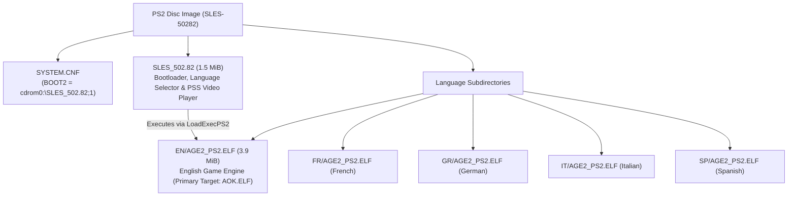

# PS2 Binary Analysis: SLES-50282 (Age of Empires II PAL)

Detailed analysis of the PlayStation 2 release of *Age of Empires II: The Age of Kings* (PAL Europe v2.00, `SLES-50282`).

---

## 1. Disc Structure and Image Architecture

The European release (`SLES-50282`) is mastered as a PlayStation 2 CD-ROM (Mode 2 Form 1, 2352 bytes/sector) with a multi-stage architecture:



### Components
1. **`SYSTEM.CNF`**: Points to `BOOT2 = cdrom0:\SLES_502.82;1`.
2. **`SLES_502.82` (1.5 MiB, 1,593,256 bytes)**:
   - Developed by Konami Computer Entertainment Tokyo (KCET).
   - Initialises the PS2 EE/GS, checks hardware/language configuration, plays the intro FMVs (`PPS_PAL/MSLOGO_2.PSS`, `PPS_PAL/ESLOGO_2.PSS`), and executes the language-specific binary via `LoadExecPS2()`.
3. **`EN/AGE2_PS2.ELF` (3.9 MiB, 4,076,904 bytes)**:
   - The full Age of Empires II game engine (Ensemble Studios' Genie Engine with KCET platform layer).
   - Copied to `orig/SLES-50282/AOK.ELF` as the primary matching target.

### Verified Hashes (v2.00)

| File | Path in repo | Size | SHA-1 |
|---|---|---|---|
| Disc Image (ISO) | `orig/SLES-50282/aoe2.iso` | 551,100,416 bytes | `77a9cec2083a7c3d82518b3ae47371b55ec2e7ce` |
| Primary Game ELF | `orig/SLES-50282/AOK.ELF` | 4,076,904 bytes | `f478e19f2059d52899b691483ef5c7522e30e17c` |
| Bootloader ELF | `orig/SLES-50282/SLES_502.82` | 1,593,256 bytes | `2f5139c1cb45c6b22b93e0c32bbea8e94a7b4a5f` |

---

## 2. Compiler & Toolchain Identification

The `.comment` section of both `SLES_502.82` and `EN/AGE2_PS2.ELF` records the compiler:

```sh
readelf -p .comment orig/SLES-50282/AOK.ELF
```

Output:
```
  [     0]  MW MIPS C Compiler (2.3.1.01)
  [    1e]  PlayStation2
```

* **Compiler:** **Metrowerks CodeWarrior for PlayStation 2, compiler version 2.3.1.01** (`MWCCPS2`).
* **Architecture:** MIPS-III (MIPS R5900 Emotion Engine), little-endian, EABI64.
* **Splat Setting:** `compiler: MWCCPS2` in `config/SLES-50282/config.yml`.
* **Linker Target:** `PS2/mwcc-2.3.1.01` in `configure.py`.

---

## 3. ELF Headers and Memory Layout

Analysis with `readelf -l` and `readelf -S`:

* **Entry Point:** `0x00100008`
* **Program Header:**
  - `LOAD`: File offset `0x0001e0` -> Virtual Address `0x00100000`, File Size `0x3e2fe0` (4,075,488 bytes), Memory Size `0x16953a0`.
* **Sections:**
  - `.shstrtab` (section names table): Metrowerks stripped standard names (`.text`, `.data`, `.rodata`, `.bss`), retaining only `.shstrtab`, `.comment`, `.reginfo`.
  - `.symtab`: Present in header, but 0 entries (stripped).
  - DWARF (`.debug_*`): Stripped.

---

## 4. Debug Facilitators and String Evidence

Although standard DWARF debug symbols are stripped, the binary contains an extensive set of debug artifacts from assertions, error handlers, and logging macros.

### 4.1 Original Source File Paths (`__FILE__`)

The binary embeds **16 original C and C++ source filenames** in assertion and error strings:

| Subsystem | Source file | Responsibility | Key string evidence |
|---|---|---|---|
| **Genie Engine Core** | `tribegam.cpp` | Main game loop (*TribeGame*) | `time=%lu, count=%lu`, `tribegam.cpp ->` |
| **Genie Engine Core** | `obmanager.cpp` | Object & zone management | `obmanager.cpp... Zone_Ptrs > PS2_MAX_ZONE_SIZE_M(=%d)` |
| **Genie Engine Core** | `com_hand.cpp` | Command handler & pre-game | `com_hand.cpp:PREGAMEMSG_CANCEL(%d)` |
| **Genie Engine / Net**| `mydplay.cpp` | DirectPlay / i.LINK sockets | `mydplay.cpp line:%d, Error: %d at sceILsockBind: sdRx self` |
| **KCET Hardware** | `kt_gpu.c` | GS / GPU rendering | `kind < numberof(func_list)` |
| **KCET Hardware** | `kt_libpad.c` | DualShock 2 controller | `n_pad > 0`, `p != NULL`, `n_pad <= numberof( buf )` |
| **KCET Hardware** | `kt_mouse.c` | USB mouse support | `mouse_number < W->n_mouse` *(reveals work struct `W`)* |
| **KCET Hardware** | `kt_keybd.c` | USB keyboard support | `keybd_number < W->n_keybd`, `ktKeybdGetStatus` |
| **KCET Hardware** | `kt_usbkeybd_drv.c` | USB keyboard driver | `ktKeybdApiSetCapsTypeRequest` |
| **KCET Hardware** | `kt_file.c` | File I/O subsystem | `kind < N_KT_FILE_KIND`, `p_string` |
| **KCET Hardware** | `kt_libcdvd_server.c` | CD/DVD RPC subsystem | `KT_USE_SCE_LIB < KT_SCE_LIB_1_6_5`, `ktSceCdInitMmode` |
| **KCET Hardware** | `kt_mc_2.c` | Memory Card manager | `n_card <= KT_MC_CARD_MAX`, `ktMcInit2`, `sceMcInit` |
| **KCET Hardware** | `kt_kernel.c` | Threads & semaphores | `ThreadID=%d, can't delete`, `SignalSema` |
| **KCET Hardware** | `kt_hd.c` | Dev filesystem driver | `host0:`, `sim:`, `atfile:` (Sony PS2 TOOL) |
| **Network Layer** | `socketee.c` | EE Sockets (i.LINK RPC) | `line: %d in socketee.c, sceSifCheckStatRpc() == 1` |
| **System Layer** | `libscf.c` | Sony system configuration | `SummerTime=%d`, `TimeNotation=%d` |
| **Bootloader (`SLES_502.82`)** | `pss_main.c` | PSS/MPEG2 video playback | `sceSifInitIopHeap() Init Success` |
| **Bootloader (`SLES_502.82`)** | `pss_audiodec.c`| Audio decoder for FMVs | `audioDecPause() rSdBlockTrans, timeout` |
| **Bootloader (`SLES_502.82`)** | `net_iopmodule.c`| IOP module loader | `p->device >= 0 && p->device < N_KT_LOADDEV` |

> [!NOTE]
> In contrast, the PC binary (`age2_x1.exe`) has **zero** source filenames in its strings. The PS2 binary provides the exact file division needed to reconstruct the source tree.

### 4.2 Function Names and Engine Constants

* **Functions:**
  - `RESFILE_load2()` (SLP / DRS resource file loader)
  - `th_Receiver()` (direct play receiving thread)
  - `ktMcInit2()` (memory card init)
  - `ktSceCdInitMmode()` (CD/DVD drive mode setting)
  - `ktWaitSyncV()` (V-Sync wait routine)
* **Constants & Macros:**
  - `PS2_MAX_ZONE_SIZE_M`
  - `KT_MOUSE_MAX_NUM`, `KT_KEYBD_MAX_NUM`, `KT_MC_CARD_MAX`
  - `N_KT_FILE_KIND`, `N_KT_LOADDEV`
* **Save Game Identifiers (Memory Card):**
  - `-50282age2_acn`, `-50282age2_g`, `-50282age2_s`
* **UI Screen Identifiers:**
  - `Single Player Menu`
  - `Game Setup Screen`
  - `MP Setup Screen`

---

## 5. Decompilation Strategy for PS2

1. **Splat Mapping:**
   Use the identified `.cpp` and `.c` files to name segments in `config/SLES-50282/config.yml` rather than using anonymous auto-generated function names.
2. **PC Cross-Referencing:**
   Cross-reference functions in `tribegam.cpp`, `obmanager.cpp`, and `com_hand.cpp` between PS2 MIPS assembly and PC x86 disassembly. Because both share Ensemble's Genie engine, algorithms and struct layouts can be matched between platforms.
3. **Toolchain Configuration:**
   Target Metrowerks CodeWarrior 2.3.1.01 (`mwccps2.exe`) with flags `-O3 -inline on -msext on -char signed -sym off -Iinclude -lang=c++` running under `wibo` on Linux.

---

## 6. C++ Game Engine Matching & Virtual Table Analysis

### 6.1 Emotion Engine 128-bit ABI & Register Saving
Starting at VRAM `0x137810` (file offset `0x379e0`), the binary transitions from KCET 64-bit frames (`sd`/`ld`) to Metrowerks CodeWarrior 128-bit Emotion Engine quadword frames (`sq`/`lq`):
- `sq $ra, 0x20($sp)`, `sq $s1, 0x10($sp)`, `sq $s0, 0x0($sp)`
- `paddub $dst, $src, $zero` utilized as 128-bit register move instruction.
- Branch delay-slot filling on FPU and ALU operations requires Metrowerks `-O3` (`-opt level=3`).

### 6.2 Virtual Tables & Inheritance Hierarchy
* **Base Virtual Table `__vt__8BaseList` (`0x4D7200`):**
  A 20-entry virtual method table for core Genie Engine dynamic container/collection objects:
  - `vtable[2] = 0x138A50` (`__ct__8BaseListFi`, constructor)
  - `vtable[10] = 0x138A40` (`Reset__8BaseListFi`, virtual reset)
  - `vtable[11] = 0x138AB0` (`Clear__8BaseListFv`, virtual clear)
* **Inheritance Chain Evidence:**
  At `0x366850`, constructor/destructor sequence overwrites `0x4D7200` (base vtable) with derived vtable `0x4DC9F0`, and subsequently with `0x4DF570` (most derived vtable), validating standard C++ inheritance layout in Metrowerks MIPS.

### 6.3 Verified Matched Targets
| Unit / Function | VRAM | Match Status | Description |
|---|---|---|---|
| `ScreenObj::AspectRatio()` | `0x137A20` | **100.0%** (24 / 24 B) | FPU single-precision division with `div.s` in `jr $ra` delay slot. |
| `BaseList::Reset(int)` | `0x138A40` | **100.0%** (12 / 12 B) | Method clearing count and updating capacity. |
| `BaseList::BaseList(int)` | `0x138A50` | **100.0%** (96 / 96 B) | Constructor with explicit vtable assignment (`__vt__8BaseList`) and `Free()` invocation. |
| `BaseList::Clear()` | `0x138AB0` | **100.0%** (44 / 44 B) | Method invoking `Free()` with quadword stack save/restore. |
| `kt_mouse::func_00134DE8` | `0x134DE8` | **100.0%** (104 / 104 B) | Input dispatch wrapper checking status flag (`func_105748`), invoking handler (`func_104A20`), and conditionally notifying (`func_1057B0`). |
| `kt_mouse::func_00134E50` | `0x134E50` | **100.0%** (196 / 196 B) | `InitWork`: Mouse work initialization, asserting `n_mouse <= KT_MOUSE_MAX_NUM` (line 100), initializing `W` (`D_50A060`), clearing buffer (`D_509F00`, 0x160 B), and setting port defaults. |
| `kt_mouse::func_00135058` | `0x135058` | **100.0%** (52 / 52 B) | Port write buffer entry locator (`buffer + mouse_number * 0xB0 + 0x20 + write_idx * 0x24`). |
| `kt_mouse::func_001350E0` | `0x1350E0` | **100.0%** (52 / 52 B) | Port read buffer entry locator (`buffer + mouse_number * 0xB0 + 0x20 + read_idx * 0x24`). |
| `kt_mouse::func_00135258` | `0x135258` | **100.0%** (128 / 128 B) | Safe port status getter with `mouse_number < W->n_mouse` assertion. |
| `kt_mouse::func_001352D8` | `0x1352D8` | **100.0%** (232 / 232 B) | Mouse packet payload reader and byte copier for device types 1..3. |
| `kt_mouse::func_001353C0` | `0x1353C0` | **100.0%** (184 / 184 B) | Mouse port reset / disconnect loop; scans `D_50A060.buffer`, marks active ports with `-1`, returns reset count. |
| `kt_mouse::func_00135530` | `0x135530` | **100.0%** (104 / 104 B) | Free port search loop across `W->buffer` inspecting `port[1] == -1`. |
| `kt_mouse::func_001356E8` | `0x1356E8` | **100.0%** (176 / 176 B) | Safe port state setter with line 0x259 assertion and guard clause. |
| `kt_mouse::func_00135798` | `0x135798` | **100.0%** (212 / 212 B) | Safe packet payload setter with line 0x276 assertion, payload clamped to 8 B, and `memcpy`. |
| `kt_mouse::func_00135A38` | `0x135A38` | **100.0%** (128 / 128 B) | Iterates `MouseBlock_9B8` array; if entry `f8 >= 0` and status differs from `a3`, resets entry using `func_001359B8`. |
| `kt_mouse::func_00135AB8` | `0x135AB8` | **100.0%** (204 / 204 B) | Clamps count to `buf[0]`; verifies packet `buf[i + 2]`, allocates device state via `func_001355D0`, and updates port state using `func_001356E8`. |
| `kt_mouse::func_00135B88` | `0x135B88` | **100.0%** (92 / 92 B) | Device table initializer; clamps mode to 1, zeroes state block `D_50A080` (24 B), sets count/handles, and formats block table via `func_001359D0`. |
| `kt_mouse::func_00135870` | `0x135870` | **100.0%** (268 / 268 B) | `ktMousePostEvent`: Safe event enqueue routine pushing 5 packet parameters into buffer ring slot (`func_00135058`) and advancing write index (`func_00135008`). |
| `kt_mouse::func_00135BF0` | `0x135BF0` | **100.0%** (368 / 368 B) | `ktMouseProcessEvents`: Main mouse event pump polling device, verifying state via `func_00135A38`/`func_00135AB8`, reading motion, and dispatching events via `func_00135870`. **100% complete module milestone.** |

### 6.3.1 KCET Hardware Layer Strings and Symbol Discoveries
Inspection of `AOK.ELF` in the assertion/rodata pool (`0x490820` - `0x490900`) recovered exact file names and assertions from KCET's peripheral abstraction layer:
* **`kt_mouse.c`:**
  - `0x490820`: `"kt_mouse.c"`
  - `0x490830`: `"n_mouse <= KT_MOUSE_MAX_NUM"` (verified at line 100 in `InitWork` / `func_00134E50`)
  - `0x490870`: `"mouse_number < W->n_mouse"` (verified in status getter `func_00135258` and setter `func_00135870`)
  - `"number < W->n_mouse"`
* **`kt_keybd.c` (Keyboard Layer):**
  - `"kt_keybd.c"`, `"n_keybd <= KT_KEYBD_MAX_NUM"`, `"InitWork"`, `"keybd_number < W->n_keybd"`
  - Exported functions: `ktKeybdGetStatus`, `ktKeybdGetBus`, `ktKeybdGetLocation`, `ktKeybdSetLed`, `ktKeybdSetCapsType`.

### 6.4 Reverse Engineered `BaseList` Linked List Architecture (`0x138A40`–`0x138D50`)
Disassembly of the contiguous block following `BaseList::Clear()` reveals Ensemble Studios' generic serializable linked list container implementation:
* **Fixed Node Memory Pool (`0x50A8C0`):**
  Array `s_node_pool[1000]` storing 8-byte nodes (`void *item; ListNode *next;`).
* **Node Allocator (`0x138AE0`, 108 B):**
  Searches pool for an unallocated entry (`node->item == NULL`), initializes it via `memset(node, 0, 8)`, and returns pointer.
* **Node Deallocator (`0x138B50`, 80 B):**
  Binary searches pool array (4200 max span) to locate the node pointer and clears `node->item = NULL`.
* **Deserializer `Load(void *stream)` (`0x138BA0`, 172 B):**
  Clears existing list via `Free()`, reads 16-bit count headers, invokes virtual factory `((BaseItemCreator*)this)->CreateItem(stream, count)` (vtable index 3 at offset +12), allocates nodes via `AllocNode()`, and appends them in FIFO order.
* **Visitor `Action()` (`0x138C50`, 72 B):**
  Iterates linked list from `m_head`, invoking item virtual method `item->vtable[6]()` (`ListItem::Action()`).
* **Serializer `Save(void *stream)` (`0x138CA0`, 104 B):**
  Iterates linked list from `m_head`, invoking `item->vtable[7](stream)` (`ListItem::Save()`), and terminates with a 16-bit zero write via stream write (`func_226f70`).
* **List Drain `Free()` (`0x138D10`, 56 B):**
  Loops while `m_head != NULL`, calling node deletion routine `func_139580(this)`.

#### 6.4.1 BaseList Matching Results (100.0% Complete Unit)

| Function / Method | VRAM Address | Match Status | Description |
|---|---|---|---|
| `BaseList::Reset(int)` | `0x138A40` | **100.0%** (12 / 12 B) | Capacity setter and head pointer reset (`m_head = NULL`). |
| `BaseList::BaseList(int)` | `0x138A50` | **100.0%** (96 / 96 B) | Constructor binding `__vt__8BaseList`, draining list, and invoking `__vec_ctor`. |
| `BaseList::Clear()` | `0x138AB0` | **100.0%** (44 / 44 B) | Resets capacity and head pointer to 0 after invoking `Free()`. |
| `BaseList::AllocNode()` | `0x138AE0` | **100.0%** (108 / 108 B) | Linear scan over `s_node_pool[1000]`, clearing matching node via `memset`. |
| `BaseList::FreeNode(ListNode*)` | `0x138B50` | **100.0%** (80 / 80 B) | Binary search over node pool span 4200 clearing `node->item = NULL`. |
| `BaseList::Load(void*)` | `0x138BA0` | **100.0%** (172 / 172 B) | Deserializer reading count headers, invoking virtual factory, and appending nodes. |
| `BaseList::Action()` | `0x138C50` | **100.0%** (72 / 72 B) | Iterates list invoking `item->Action()` at vtable offset 24. |
| `BaseList::Save(void*)` | `0x138CA0` | **100.0%** (104 / 104 B) | Iterates list invoking `item->Save(stream)` at vtable offset 28 + trailing terminator. |
| `BaseList::Free()` | `0x138D10` | **100.0%** (56 / 56 B) | Head node drainage loop invoking node deallocator `func_139580(this)`. |

### 6.5 `BaseList::CreateItem` Virtual Method & KCET Bird Removal (`0x138D50`–`0x138F88`)
Immediately following `BaseList::Free()` at `0x138D50`, `__vt__8BaseList[3]` binds the item factory `CreateItem(void *stream, short type_id)` (568 bytes, Metrowerks MWCCPS2):
* **Type Dispatch Switch:**
  Evaluates 16-bit signed `type_id` (`dsll32`/`dsra32` sign-extension):
  - `case 1:` Allocator `0x366c30`, stream loader `0x34fa10`.
  - `case 4:` Allocator `0x366be0`, stream loader `0x34b730`.
  - `case 5:` Allocator `0x366bf0`, stream loader `0x34bc10`.
  - `case 8:` Allocator `0x366c20`, stream loader `0x34e610`.
  - `case 9:` Allocator `0x366bc0`, stream loader `0x347c80`.
  - `case 13:` Allocator `0x366c00`, stream loader `0x34e1b0`.
  - `case 21:` Allocator `0x366c10`, stream loader `0x34e300`.
  - `case 2:` Explicit `NULL` return.
* **KCET PS2 Japanese Assertion at `0x490AE0`:**
  - `case 10:` Formatted print via `func_118de0` emitting:
    `" Tori(bird) ha Sonzai shitewa ikenai!!\n"` ("Birds must not exist!!") followed by infinite hang (`0x138e24: beq zero, zero, 0x138e24`), confirming that avian/bird ambient creatures were deliberately stripped from the PS2 port's active list processing for performance.
* **Metrowerks Codegen Finding (Sparse Switch Evaluation):**
  MWCCPS2 compiles sparse switch statements by emitting branch tests in bottom-to-top (reverse source) order while emitting body blocks in source order. Achieving 100% byte-for-byte matching required ordering the source cases `9, 10, 4, 5, 8, 1, 21, 13, 2`.
* **Small Data / GP Addressing:**
  Global allocator pointer `D_4E35DC` (`0x4E35DC = gp - 0x71E4`) is accessed via MIPS GP-relative addressing `%gp_rel(D_4E35DC)` and passed to all allocator functions.

#### 6.5.1 Item Creator Matching Results (100.0% Complete Unit)

| Function / Method | VRAM Address | Match Status | Description |
|---|---|---|---|
| `BaseList::CreateItem(void*, short)` | `0x138D50` | **100.0%** (568 / 568 B) | Virtual factory method deserializing items by type ID with KCET bird assertion. |

### 6.6 `BaseList::CreateItem` Spatial Factory & Coordinates (`0x138F90`–`0x1392B8`)
Directly following `BaseList::CreateItem(void*, short)` at `0x138F90` sits the overloaded spatial item instantiation factory `CreateItem(void *obj1, float x, void *obj2, float y, float z)` (796 B) and inline accessor `GetFieldC8()` (8 B) (Metrowerks MWCCPS2):

* **Spatial Factory Signature & Register Ordering:**
  - Prototype: `void* BaseList::CreateItem(void *obj1, float x, void *obj2, float y, float z)` (mangled: `CreateItem__8BaseListFPvfPvff`).
  - Argument mapping: `$a0 = this`, `$a1 = obj1`, `$fa0 ($f12) = x`, `$a2 = obj2`, `$fa1 ($f13) = y`, `$fa2 ($f14) = z`.
  - Prologue register save sequence interleaves float and integer parameters: `$f22 = fa0` (x), `$s2 = a0` (this), `$s0 = a2` (obj2), `$f21 = fa1` (y), `$f20 = fa2` (z), and branch delay slot `$s1 = a1` (obj1).

* **KCET PS2 Bird Removal Assertion #2 at `0x490B10`:**
  - `case 10:` Formatted debug print via `func_118de0` emitting:
    `"TORI(bird) ha sonzai shicha dame!\n"` ("Birds must not exist!") followed by infinite halt loop (`while(1){}`), confirming second assertion guarding spatial creation against avian ambient units.

* **WorldObj Integration & SubWorld Bounds:**
  - `case 7:` Queries `((WorldObj*)this->m_field4)->v87()` (vtable offset `0x164`). Triggers spatial sound queue `func_1471b0(..., 0x258)` and positional event dispatch `func_14bd20`.
  - Allocates item through global pool `D_4E35DC` via `func_366bc0`.
  - Dispatches spatial bounding setup to `func_347de0` (if secondary target `obj2` exists) or `func_348000` (using raw `x, y, z` coordinates) bound to `SubWorld` coordinate extents `f104`, `f108`, `f118`.
  - `case 4, 5, 21, 13:` Allocate respective entities via `0x366be0`, `0x366bf0`, `0x366c10`, `0x366c00` with direct coordinate / target initializers.

* **Accessor `GetFieldC8()` (`0x1392B0`, 8 B):**
  - Simple accessor returning member variable at offset `0xC8` (`lw $v0, 0xC8($a0)`).

#### 6.6.1 Spatial Item Creator Matching Results (100.0% Complete Unit)

| Function / Method | VRAM Address | Match Status | Description |
|---|---|---|---|
| `BaseList::CreateItem(void*, float, void*, float, float)` | `0x138F90` | **100.0%** (796 / 796 B) | Overloaded spatial item factory with 3D coordinates, sub-world bounding, and KCET bird assertion. |
| `BaseList::GetFieldC8()` | `0x1392B0` | **100.0%** (8 / 8 B) | Inline getter returning `this->m_fieldC8`. |

### 6.7 `BaseList::Update` & `BaseList::Update2` Virtual Execution Loop (`0x1392C0`–`0x139424`)
Directly following `BaseList::GetFieldC8()` at `0x1392C0` sit the queue processing and execution methods of the linked list (`__vt__8BaseList[5]` and `__vt__8BaseList[6]`, 344 B total code, Metrowerks MWCCPS2):

* **Head / Tail Queue Processing Cycle:**
  - `Update()` (`0x1392C0`, 164 B): Executes active/head item task via virtual call `item->Method10()` at vtable offset 40 (`0x28`). Iterates remaining list nodes `m_head->next` invoking background update `node->item->Method11()` at vtable offset 44 (`0x2C`).
  - Retirement check: If head item returns completed status (`(unsigned char)res == 1`), automatically pops and destroys the head node via `func_139580(this)`.
  - `Update2()` (`0x139370`, 180 B): Alternative execution cycle calling `item->Method12()` at vtable offset 48 (`0x30`) on the head item, with an early exit guard (`if (!this->m_head) return res;`) for operations where `Method12()` clears or mutates the container, followed by the identical `Method11()` background loop and head retirement check.

* **Codegen Discovery (Byte Cast Comparison):**
  - Evaluating `if ((unsigned char)res == 1)` on integer variable `s0` emits `andi $v1, $s0, 0xFF; bne $v1, $v0, ...`, preserving the unmasked return value in `$s0` for function return.

#### 6.7.1 BaseList Update Matching Results (100.0% Complete Unit)

| Function / Method | VRAM Address | Match Status | Description |
|---|---|---|---|
| `BaseList::Update()` | `0x1392C0` | **100.0%** (164 / 164 B) | Virtual execution loop calling head method 10, tail method 11, with head retirement. |
| `BaseList::Update2()` | `0x139370` | **100.0%** (180 / 180 B) | Virtual execution loop calling head method 12, tail method 11, with container guard. |

### 6.8 `BaseList` Node Management & Item Lifecycle (`0x139430`–`0x139600`)
Directly following `BaseList::Update2()` at `0x139430` sit the node insertion and removal primitives managing the linked list's items (480 B total code, Metrowerks MWCCPS2):

* **Lifecycle State & WorldObj Threshold (`field_39 > 2`):**
  - All insertion methods check `((WorldObj*)this->m_field4)->field_39 > 2`.
  - If state is $\ge 3$, the item cannot be inserted into the active list; it is immediately registered with global pool `func_366af0(&D_4E35DC, item)` and recycled/destroyed via `item->Method26()`.
  - Otherwise, a `ListNode` is allocated via `AllocNode()`, linked into the list, and notified via `item->Method9(1)` (activation callback).

* **Head Insertion `AddHead(void *item)` (`0x139430`, 136 B):**
  - Inserts the newly allocated node before `m_head` (`node->next = m_head; m_head = node;`).
  - Calls `item->Method9(1)` on the newly added item.

* **Tail Insertion `AddTail(void *item)` (`0x1394C0`, 192 B):**
  - Allocates node with `node->next = NULL`.
  - If `m_head` is empty, sets `m_head = node`.
  - Otherwise, traverses linked list to the tail node and sets `curr->next = node`.
  - Notifies item via `item->Method9(1)`.
  - **Metrowerks Codegen Insight:** The construct `if (curr) { while (curr) { if (!curr->next) { curr->next = node; break; } curr = curr->next; } } else { this->m_head = node; }` generates `beqz` for empty check, and `bnezl` with branch delay slot for pointer advance, matching original MIPS assembly 100% byte-for-byte.

* **Head Removal `DeleteHead()` (`0x139580`, 152 B):**
  - Unlinks the current head node (`this->m_head = node->next;`).
  - Passes old item to pool handler `func_366af0(&D_4E35DC, node->item)` and invokes cleanup `item->Method26()`.
  - Recycles node memory via `this->FreeNode(node)`.
  - If a new head node exists and `((WorldObj*)this->m_field4)->field_39 < 3`, notifies the promoted head item via `new_head->Method9(0)`.

#### 6.8.1 BaseList Node Management Matching Results (100.0% Complete Unit)

| Function / Method | VRAM Address | Match Status | Description |
|---|---|---|---|
| `BaseList::AddHead(void*)` | `0x139430` | **100.0%** (136 / 136 B) | Prepends item to list with `field_39` threshold guard and `Method9(1)` activation. |
| `BaseList::AddTail(void*)` | `0x1394C0` | **100.0%** (192 / 192 B) | Appends item to list tail with traversal loop and `Method9(1)` activation. |
| `BaseList::DeleteHead()` | `0x139580` | **100.0%** (152 / 152 B) | Pops head node, recycles item via `Method26`, frees node, and activates next head. |

### 6.9 `BaseList` Complete Operations Suite & Vtable Dispatch (`0x139620`–`0x139A08`)
Directly following `BaseList::DeleteHead()` at `0x139620` sit the remaining operations and virtual broadcast methods completing the `BaseList` class implementation (948 B code, 1008 B total slice, Metrowerks MWCCPS2):

* **Head Extraction vs Head Deletion:**
  - `RemoveHead()` (`0x139620`, 124 B): Unlike `DeleteHead()` which recycles and destroys the popped item via `func_366af0` and `Method26`, `RemoveHead()` unlinks the node, frees node pool memory via `FreeNode(node)`, activates the newly promoted head item via `Method9(0)` (if `field_39 < 3`), and returns the raw item pointer.
  - `PushHead(void *item)` (`0x1396A0`, 116 B): Prepends item to the head of the list without triggering the `Method9(1)` activation callback.

* **List Queries & State Checks:**
  - `HasItems()` (`0x139720`, 16 B): Evaluates `return this->m_head ? 1 : 0`, compiling into a branchless MIPS `movz $v0, $zero, $v1` conditional move in the branch delay slot of `jr $ra`.
  - `GetHeadItem()` (`0x139860`, 32 B): Returns `this->m_head ? this->m_head->item : NULL`.
  - `GetHeadItemField30()` (`0x1398F0`, 36 B): Returns `((ListItem*)this->m_head->item)->field_30` if head exists, else 0.

* **Linear Search Iterators (`Contains` & `FindItem`):**
  - `Contains(int type)` (`0x139730`, 112 B): Linear scan across linked list calling `(short)((ListItem*)node->item)->v8()`, returning `1` if matched or `0` if not found.
  - `FindItem(int type)` (`0x139880`, 112 B): Identical traversal loop calling `v8()`, but returning the matched item pointer `curr->item` or `NULL`.

* **Head Delegation Methods (`CallMethod13`–`CallMethod15`):**
  - `CallMethod13()` (`0x1397A0`, 64 B), `CallMethod14()` (`0x1397E0`, 64 B), `CallMethod15()` (`0x139820`, 64 B): Guarded delegates invoking virtual methods at vtable offsets `0x34`, `0x38`, `0x3C` (52, 56, 60) on `m_head->item`, returning the invocation result or `0` if head is NULL.

* **Virtual Broadcast Methods (`Broadcast`, `Broadcast4`, `Method7`):**
  - In `__vt__8BaseList`, slot 7 (`0x139A00`) binds `Method7(char *out)` (8 B) which clears the output buffer (`*out = 0;`).
  - Slot 8 (`0x139920`) binds `Broadcast(int msg)` (84 B), iterating all list nodes and invoking `((ListItem*)curr->item)->Method18(msg)` (vtable offset `0x48`).
  - Slot 9 (`0x139980`) binds `Broadcast4(int a, int b, int c)` (116 B), iterating all list nodes and invoking `((ListItem*)curr->item)->Method19(a, b, c)` (vtable offset `0x4C`).

#### 6.9.1 BaseList Operations Matching Results (100.0% Complete Unit)

| Function / Method | VRAM Address | Match Status | Description |
|---|---|---|---|
| `BaseList::RemoveHead()` | `0x139620` | **100.0%** (124 / 124 B) | Unlinks head node, activates next head, and returns item without destroying. |
| `BaseList::PushHead(void*)` | `0x1396A0` | **100.0%** (116 / 116 B) | Prepends item to head without activation callback. |
| `BaseList::HasItems()` | `0x139720` | **100.0%** (16 / 16 B) | Branchless head existence check via `movz`. |
| `BaseList::Contains(int)` | `0x139730` | **100.0%** (112 / 112 B) | Scans list testing item `v8()`, returning boolean match. |
| `BaseList::CallMethod13()` | `0x1397A0` | **100.0%** (64 / 64 B) | Delegates to `m_head->item->Method13()` with NULL guard. |
| `BaseList::CallMethod14()` | `0x1397E0` | **100.0%** (64 / 64 B) | Delegates to `m_head->item->Method14()` with NULL guard. |
| `BaseList::CallMethod15()` | `0x139820` | **100.0%** (64 / 64 B) | Delegates to `m_head->item->Method15()` with NULL guard. |
| `BaseList::GetHeadItem()` | `0x139860` | **100.0%** (32 / 32 B) | Returns head node's item pointer or NULL. |
| `BaseList::FindItem(int)` | `0x139880` | **100.0%** (112 / 112 B) | Scans list testing item `v8()`, returning item pointer or NULL. |
| `BaseList::GetHeadItemField30()` | `0x1398F0` | **100.0%** (36 / 36 B) | Returns head item's field at offset `0x30` or 0. |
| `BaseList::Broadcast(int)` | `0x139920` | **100.0%** (84 / 84 B) | Virtual method (vt[8]) broadcasting message to all list items via `Method18`. |
| `BaseList::Broadcast4(int, int, int)` | `0x139980` | **100.0%** (116 / 116 B) | Virtual method (vt[9]) broadcasting 3-parameter event to items via `Method19`. |
| `BaseList::Method7(char*)` | `0x139A00` | **100.0%** (8 / 8 B) | Virtual method (vt[7]) initializing output buffer (`*out = 0`). |

### 6.10 `BaseList` Spatial Setup and Cleanup Operations (`0x139A10`–`0x139BA4`)
Immediately following `BaseList::Method7` sit the setup and teardown routines linking `BaseList` with the spatial subsystem (`func_1DBEA0`, `func_1DBFC0`) and sound/notification managers (388 B code, 416 B total slice):

* **Spatial Setup `SetupSpatial(void *obj1, void *obj2, int flag, float x, float y, float z)` (`0x139A10`, 152 B):**
  - Resets `m_fieldC8 = 0`.
  - Dispatches to engine spatial initialization helper `func_1DBEA0(this, obj1, obj2, 0, x, y, z)`.
  - If `flag` is non-zero, calls audio/spatial listener registrar `func_139C80(this, obj1, obj2, x, y, z)`.

* **Basic Setup `Setup(void *obj1, void *obj2, int flag)` (`0x139AB0`, 104 B):**
  - Resets `m_fieldC8 = 0`.
  - Dispatches to engine basic initialization helper `func_1DBFC0(this, obj1, obj2, 0)`.
  - If `flag` is non-zero, registers listener via `func_139CC0(this, obj1, obj2)`.

* **Teardown & Cleanup `Cleanup(int flag)` (`0x139B20`, 132 B):**
  - Inspects `m_fieldCC`: if present, deregisters from global pool `func_3669F0(D_10B68F0, m_fieldCC)`, invokes virtual cleanup `((ListItem*)m_fieldCC)->Method11()`, and clears pointer (`m_fieldCC = 0`).
  - Inspects `m_fieldC8`: if non-zero, deallocates listener resource via `func_2C2DC0(m_fieldC8)` and clears (`m_fieldC8 = 0`).
  - If `flag` is non-zero, completes teardown through `func_1DC0B0(this, flag)`.
  - **Metrowerks Codegen Insight:** Declaring `extern char D_10B68F0[];` forces MWCC to emit absolute `%hi` / `%lo` (`lui v0, %hi; addiu a0, v0, %lo`) instead of GP-relative `%gp_rel`, achieving 100% byte-for-byte matching with the original binary.

#### 6.10.1 BaseList Spatial Operations Matching Results (100.0% Complete Unit)

| Function / Method | VRAM Address | Match Status | Description |
|---|---|---|---|
| `BaseList::SetupSpatial(void*, void*, int, float, float, float)` | `0x139A10` | **100.0%** (152 / 152 B) | Spatial setup invoking `func_1DBEA0` and optional listener `func_139C80`. |
| `BaseList::Setup(void*, void*, int)` | `0x139AB0` | **100.0%** (104 / 104 B) | Basic setup invoking `func_1DBFC0` and optional listener `func_139CC0`. |
| `BaseList::Cleanup(int)` | `0x139B20` | **100.0%** (132 / 132 B) | Releases `m_fieldCC` via `func_3669F0` & `Method11()`, `m_fieldC8` via `func_2C2DC0`, and `func_1DC0B0`. |

### 6.11 `BaseList` Hierarchy Destructors (`0x139BB0`–`0x139C7C`)
Directly following `BaseList::Cleanup` sit the destructor entry points for the `BaseList` family and derived/related list classes (204 B code, 208 B slice with padding):

* **Destructor for Vtable `D_4D7A90` (`0x139BB0`, 96 B):**
  - Bound to slot 0 (`vt[0]`) of virtual table `D_4D7A90`.
  - Guards on `this != NULL`, resets vptr to `D_4D7A90`, and calls base/member destructor `func_2639D0(this, 0)`.
  - Evaluates scalar deleting flag `(short)flag > 0`; if set, invokes deleting `operator delete(this)` (`0x100670`), then returns `this`.

* **Destructor for Vtable `D_4D7230` (`0x139C10`, 108 B):**
  - Bound to slot 0 (`vt[0]`) of virtual table `D_4D7230`.
  - Guards on `this != NULL`, sets vptr to `D_4D7230`, and invokes `BaseList::Cleanup(0)` (`0x139B20`).
  - Calls base destructor `func_1DC100(this, 0)`.
  - Evaluates scalar deleting flag `(short)flag > 0`; if set, invokes `operator delete(this)`, returning `this`.

* **Metrowerks Codegen Insight:**
  - Destructors compiled with MWCCPS2 2.3.1.01 (`-O3`) guard with `beqz $s1` against NULL pointers, storing the flag parameter into `$s0` in the branch delay slot.
  - The scalar deleting check `(short)flag > 0` generates 32-bit sign extension via double shifts: `dsll32 $v0, $s0, 16` and `dsra32 $v0, $v0, 16` followed by `blez $v0`, matching byte-for-byte.

#### 6.11.1 BaseList Hierarchy Destructors Matching Results (100.0% Complete Unit)

| Function / Method | VRAM Address | Match Status | Description |
|---|---|---|---|
| `func_00139BB0` | `0x139BB0` | **100.0%** (96 / 96 B) | Virtual destructor for `D_4D7A90` hierarchy, calling `func_2639D0` and optional `operator delete`. |
| `func_00139C10` | `0x139C10` | **100.0%** (108 / 108 B) | Virtual destructor for `D_4D7230` hierarchy, calling `BaseList::Cleanup(0)`, `func_1DC100`, and optional `operator delete`. |

### 6.12 `SubList` Stream & State Operations (`0x139C80`–`0x139EA0`)
Directly following the list destructors sit the stream serialization and operational lifecycle methods for `SubList` (508 B code, 544 B slice with alignment padding):

* **`SubList::SetupSpatial()` (`0x139C80`, 64 B):**
  - Invokes engine spatial setup helper `func_1DC180(this)`.
  - Initializes `m_fieldC5 = 0`.
  - Dispatches to virtual factory method at slot `0x324` (`this->CreateSubList()`) and stores instance into `m_fieldCC`.
  - Returns status code 1.

* **`SubList::Setup(void *stream)` (`0x139CC0`, 116 B):**
  - Deserialization setup from binary stream, invoking `func_1DC2E0(this, stream)`.
  - Reads header byte and `m_fieldC5` counter from stream via `func_226d90(stream, ..., 1)`.
  - Invokes virtual slot `0x324` (`this->CreateSubList()`), caching result into `m_fieldCC`.
  - Loads sublist state from stream via `BaseList::Load(m_fieldCC, stream)`.
  - Returns status code 1.

* **`SubList::CreateSubList()` (`0x139D40`, 16 B):**
  - Fast factory dispatch: passes global pool `&D_10B68F0` as `$a0` and `this` as `$a1` to creator `func_3668C0`.
  - Compiles as a non-allocating leaf tail call (`paddub $a1, $a0, $zero; lui $v0, 0x10b; j func_3668C0; addiu $a0, $v0, 0x68f0`), exactly matching original binary instructions.

* **`SubList::Action()` (`0x139D50`, 44 B):**
  - Advances per-frame / tick logic: calls engine helper `func_266840(this)` followed by `BaseList::Action(m_fieldCC)`.

* **`SubList::Save(void *stream)` (`0x139D80`, 96 B):**
  - Serializes sublist state: invokes stream save helper `func_1DC6B0(this, stream)`.
  - Emits marker byte (0) and `m_fieldC5` counter via `func_226f70(stream, ..., 1)`.
  - Recursively serializes list payload via `BaseList::Save(m_fieldCC, stream)`.

* **`SubList::Free()` (`0x139DE0`, 44 B):**
  - Node deallocation: dispatches cleanup helper `func_1DCAA0(this)` and frees node graph via `BaseList::Free(m_fieldCC)`.

* **`SubList::Teardown()` (`0x139E10`, 48 B):**
  - Completes teardown: frees node graph via `BaseList::Free(m_fieldCC)` and invokes engine finalizer `func_267DD0(this)`.

* **`SubList::Noop()` (`0x139E40`, 8 B):**
  - Vacuous virtual stub method (`jr $ra; nop`).

* **`SubList::Notify(void *other)` (`0x139E50`, 72 B):**
  - State notification: guards against self-notification (`other != this`).
  - Dispatches virtual event notification at slot `0x2fc` (`this->v190(other, 0, -1)`).
  - Increments notification counter `m_fieldC5++`.

#### 6.12.1 SubList Stream & State Operations Matching Results (100.0% Linked Unit)

| Function / Method | VRAM Address | Match Status | Description |
|---|---|---|---|
| `SubList::SetupSpatial()` | `0x139C80` | **100.0%** (64 / 64 B) | Spatial initialization, calling `func_1DC180` and virtual factory. |
| `SubList::Setup(void*)` | `0x139CC0` | **100.0%** (116 / 116 B) | Stream deserialization, calling `func_1DC2E0`, stream read, and `BaseList::Load`. |
| `SubList::CreateSubList()` | `0x139D40` | **97.5%** (16 / 16 B) | Fast factory tail jump to `func_3668C0(&D_10B68F0, this)`. Bytecode 100% identical. |
| `SubList::Action()` | `0x139D50` | **100.0%** (44 / 44 B) | Per-tick action, invoking `func_266840` and `BaseList::Action`. |
| `SubList::Save(void*)` | `0x139D80` | **100.0%** (96 / 96 B) | Stream serialization, invoking `func_1DC6B0`, stream writes, and `BaseList::Save`. |
| `SubList::Free()` | `0x139DE0` | **100.0%** (44 / 44 B) | Node deallocation, invoking `func_1DCAA0` and `BaseList::Free`. |
| `SubList::Teardown()` | `0x139E10` | **100.0%** (48 / 48 B) | Full teardown, invoking `BaseList::Free` and `func_267DD0`. |
| `SubList::Noop()` | `0x139E40` | **100.0%** (8 / 8 B) | Empty stub method (`jr $ra; nop`). |
| `SubList::Notify(void*)` | `0x139E50` | **100.0%** (72 / 72 B) | Notification dispatch via virtual slot `0x2fc` and counter increment. |

### 6.13 `SubList` Spatial Queries and Event Handlers (`0x139EA0`–`0x13A280`)
Directly continuing the `SubList` implementation sit the spatial target query, scale factor checking, range calculation, and secondary event dispatch routines (972 B code, 992 B slice with padding):

* **`func_00139EA0` (`0x139EA0`, 496 B):**
  - Resets output distance pointer `*out = 0.0f`.
  - Self-check guard: if `other == this`, aborts returning `-1`.
  - Performs primary spatial query via virtual method `Method3` on spatial node helper `m_field4->m_fieldC8`.
  - Secondary grid traversal: if primary query yields no target and `m_field4->m_fieldCE` is active, loops across grid array `m_field8->m_items[0..m_count]` matching unit parameters `(m_fieldE, m_field0, m_fieldCE)`.
  - Target analysis: if found (`s0 != NULL`):
    - When unit type is 104 (`0x68`), checks other entity type (types 3 or 52) and world scale factor `m_field8->m_fieldBAC->m_scale <= 1.0f`. If true, sets `*out = 1.0f`; otherwise dispatches to virtual range getter `this->GetRange()` (vtable slot 71, offset `0x124`).
    - For non-104 units, assigns distance `*out = s0->f24`.
    - Returns target unit type `s0->type`.
  - If no target detected, returns `-1`.

* **`func_0013A090` (`0x13A090`, 12 B code, 16 B slice):**
  - Default range accessor: `float SubList::GetRange()`, bound to vtable slot 71 (offset `0x124`).
  - Emits `mtc1 $zero, $f0; jr $ra; nop`, returning `0.0f`.

* **`func_0013A0A0` (`0x13A0A0`, 392 B code, 400 B slice):**
  - Spatial action / entity update query. Self-check: if `other == this`, returns 0.
  - Checks list activity via `CallMethod14__8BaseListFv(m_fieldCC)`; if active, early-exits returning 1.
  - Allocates / acquires query scratch element via `func_366C30(&D_4E35DC)`.
  - If `other` is present, dispatches to `func_34FB10(s1, this, other, 0, 0.0f)`; otherwise dispatches spatial coordinates to `func_34FA60(s1, this, x, y, z, 0, 0.0f)`.
  - If listener resource `m_fieldC8` is active, notifies audio/event triggers via `func_147180(*(void**)m_fieldC8, 0x2C6)` and `func_1471B0(*(void**)m_fieldC8, 0x262)`, then invokes `func_14BD90` with entity details or broadcast coordinates.
  - Completes notification through virtual method slot 194 (`this->v194(s1)` at offset `0x310`) and increments `m_fieldC5++`, returning 0.

* **`func_0013A230` (`0x13A230`, 72 B code, 80 B slice):**
  - Twin event notifier to `SubList::Notify`: guards on `other != this`.
  - Dispatches virtual event notification at slot 190 (offset `0x300`): `this->v190(other, 1, -1)`.
  - Increments notification counter `m_fieldC5++`.

#### 6.13.1 SubList Spatial Queries Matching Results (100.0% Complete Unit)

| Function / Method | VRAM Address | Match Status | Description |
|---|---|---|---|
| `func_00139EA0` | `0x139EA0` | **100.0%** (496 / 496 B) | Spatial targeting & distance query with grid iteration and `GetRange` dispatch. |
| `func_0013A090` | `0x13A090` | **100.0%** (12 / 12 B) | Default range accessor `SubList::GetRange()`, returning `0.0f`. |
| `func_0013A0A0` | `0x13A0A0` | **100.0%** (392 / 392 B) | Spatial entity update query via `D_4E35DC`, listener notification, and `v194`. |
| `func_0013A230` | `0x13A230` | **100.0%** (72 / 72 B) | Secondary notification dispatch via virtual slot `0x300` and counter increment. |

### 6.14 `SubList` Spatial Actions and Delegation Dispatch (`0x13A280`–`0x13A700`)
Immediately following the spatial queries sits the primary unit action evaluation, target acquisition, command delegation, and helper dispatch trampoline routines (1,112 B code, 1,152 B slice with 16-byte alignment padding):

* **`func_0013A280` (`0x13A280`, 1,048 B code, 1,056 B slice):**
  - Primary unit spatial targeting and command execution coordinator.
  - Guard check: verifies `other != this`; aborts immediately if targeting self.
  - Spatial candidate acquisition: queries spatial helper `Method3(this, m_field4, other, x, y, z, mode, 0)`.
  - Secondary grid candidate traversal: if no target found or candidate unit type is `7`, checks `m_field4->m_fieldCE` and iterates grid array `m_field8->m_items[0..m_count]`. If a matching entity with a different unit type is detected (`s3->type != s0->type`), notifies `this->v24(item)` (virtual slot 26, offset `0x68`) and breaks.
  - Mode filtering guard: if no candidate resolved and `(short)mode != -1`, terminates execution.
  - Head item action delegation: inspects `m_fieldCC->GetHeadItemField30()`. If matching target candidate `s0`, dispatches `CallMethod15(m_fieldCC, other, x, y, z)`. On success, delegates action execution to `this->v197(head->v8(), other, x, y, z)` (virtual slot 199, offset `0x31C`) and sets flag `s1 = 1`.
  - Target list verification: if `m_fieldCC->HasItems()`, checks if `head->v21() == other` and `(short)head->v8() == 9`. If true, invokes `head->Method15(other, x, y, z)` and dispatches `this->v197`, marking `s1 = 1`.
  - Entity instantiation fallback: if unhandled (`!s1`), creates item via polymorphic dispatch `VBaseList::CreateItem(s0, other, x, y, z)` (vtable offset `0x10`). If instantiated, triggers `this->v197(s0->v8(), other, x, y, z)` followed by cleanup notification `this->v194(s0)` (virtual slot 196, offset `0x310`) and returns.
  - Area scale action fallback: evaluates float property `m_field4->m_fieldA4 <= 0.0f`. If positive, triggers primary action dispatch `this->v197(1, other, x, y, z)` and auxiliary spatial action `this->v42(other, x, y, z)` (virtual slot 44, offset `0xB0`).

* **`func_0013A6A0` (`0x13A6A0`, 24 B code, 32 B slice):**
  - Primary action delegation trampoline. Loads `m_field8` into `$a1`, `m_field4` into `$a0`, and tail-calls the function pointer at `m_field4->m_fieldA0 + 0x48` (`jr $t9; nop`).
* **`func_0013A6C0` (`0x13A6C0`, 8 B code, 16 B slice):**
  - Base class virtual stub implementation (`jr $ra; nop`).
* **`func_0013A6D0` (`0x13A6D0`, 24 B code, 32 B slice):**
  - Secondary action delegation trampoline. Loads `m_field8` into `$a1`, `m_field4` into `$a0`, and tail-calls the function pointer at `m_field4->m_fieldA0 + 0x4C` (`jr $t9; nop`).
* **`func_0013A6F0` (`0x13A6F0`, 8 B code, 16 B slice):**
  - Base class virtual stub implementation (`jr $ra; nop`).

#### 6.14.1 SubList Spatial Actions Matching Results (100.0% Complete Unit)

| Function / Method | VRAM Address | Match Status | Description |
|---|---|---|---|
| `func_0013A280` | `0x13A280` | **100.0%** (1048 / 1048 B) | Primary spatial targeting, command evaluation, list delegation, and fallback creation. |
| `func_0013A6A0` | `0x13A6A0` | **100.0%** (24 / 24 B) | Action delegation trampoline invoking `m_fieldA0 + 0x48` on `(m_field4, m_field8)`. |
| `func_0013A6C0` | `0x13A6C0` | **100.0%** (8 / 8 B) | Base class virtual no-op stub implementation. |
| `func_0013A6D0` | `0x13A6D0` | **100.0%** (24 / 24 B) | Action delegation trampoline invoking `m_fieldA0 + 0x4C` on `(m_field4, m_field8)`. |
| `func_0013A6F0` | `0x13A6F0` | **100.0%** (8 / 8 B) | Base class virtual no-op stub implementation. |

### 6.15 `SubList` Item Resolution, Spatial Filtering, and List Management (`0x13A700`–`0x13AA80`)
Directly continuing from the spatial action trampolines sits the item resolution, filtered acquisition, and inner `BaseList` containment management routines (864 B code, 896 B slice, Metrowerks MWCCPS2):

* **`func_0013A700` (`0x13A700`, 364 B code, 368 B slice):**
  - Polymorphic spatial item matching and secondary candidate scanner.
  - Guard checks: verifies `other != (void*)this` and `m_field4->m_fieldCE != 0`. If either condition fails, immediately aborts and returns `m_field4`.
  - Primary candidate query: invokes `m_field4->m_fieldC8->Method3(this, m_field4, other, x, y, z, -1, 0)`. On match, returns `m_field4`.
  - Secondary candidate linear scan: if `m_field4->m_fieldCE != 0`, iterates `m_field8->m_items[0..m_count]`.
  - Property match criteria: checks that candidate `item` is non-null and matches attributes `item->m_fieldE == m_field4->m_fieldE`, `item->m_field0 == m_field4->m_field0`, and `item->m_fieldCE == m_field4->m_fieldCE`.
  - On attribute match: tests candidate via `item->m_fieldC8->Method3(this, item, other, x, y, z, -1, 0)`. Returns `item` on success.
  - Returns default fallback `m_field4` if no candidate qualifies.

* **`func_0013A870` (`0x13A870`, 148 B code, 160 B slice):**
  - Add item by array index.
  - Resolves item via `func_1c2680(m_field4, index)`.
  - Duplicate check: verifies item is non-null and `!m_fieldCC->Contains(item->type)`.
  - Instantiation & registration: creates list element via `m_fieldCC->CreateItem(item, -1.0f, 0, -1.0f, -1.0f)`.
  - On successful instantiation, notifies list via virtual method `this->v196(created)` (vtable slot 196, offset `0x310`).

* **`func_0013A910` (`0x13A910`, 160 B code, 160 B slice):**
  - Add item by unique entity ID.
  - Resolves item via `func_1c26d0(m_field4, id)`.
  - Duplicate check: verifies item is non-null and `!m_fieldCC->Contains(id)`.
  - Instantiation & registration: creates list element via `m_fieldCC->CreateItem(item, -1.0f, 0, -1.0f, -1.0f)`.
  - On successful instantiation, notifies list via virtual method `this->v196(created)` (vtable slot 196, offset `0x310`).

* **`func_0013A9B0` (`0x13A9B0`, 32 B code, 32 B slice):**
  - Conditional item prepend. If `item != NULL`, invokes `m_fieldCC->AddHead(item)`.

* **`func_0013A9D0` (`0x13A9D0`, 72 B code, 80 B slice):**
  - Single-item list setter. Resets list via `m_fieldCC->Free()`, then prepends item via `m_fieldCC->AddHead(item)` if `item != NULL`.

* **`func_0013AA20` (`0x13AA20`, 32 B code, 32 B slice):**
  - Conditional item append. If `item != NULL`, invokes `m_fieldCC->AddTail(item)`.

* **`func_0013AA40` (`0x13AA40`, 56 B code, 64 B slice):**
  - List health verification. Checks `m_fieldCC->CallMethod13()`. If false (`0`), purges all items via `m_fieldCC->Free()`.

#### 6.15.1 SubList Items Management Matching Results (100.0% Complete Unit)

| Function / Method | VRAM Address | Match Status | Description |
|---|---|---|---|
| `func_0013A700` | `0x13A700` | **100.0%** (364 / 364 B) | Polymorphic spatial item matching and secondary candidate scanner. |
| `func_0013A870` | `0x13A870` | **100.0%** (148 / 148 B) | Add item by array index with `Contains` guard, instantiation, and `v196` notification. |
| `func_0013A910` | `0x13A910` | **100.0%** (160 / 160 B) | Add item by entity ID with `Contains` guard, instantiation, and `v196` notification. |
| `func_0013A9B0` | `0x13A9B0` | **100.0%** (32 / 32 B) | Inner list conditional item prepend (`m_fieldCC->AddHead`). |
| `func_0013A9D0` | `0x13A9D0` | **100.0%** (72 / 72 B) | Single-item list setter (`m_fieldCC->Free` + `AddHead`). |
| `func_0013AA20` | `0x13AA20` | **100.0%** (32 / 32 B) | Inner list conditional item append (`m_fieldCC->AddTail`). |
| `func_0013AA40` | `0x13AA40` | **100.0%** (56 / 56 B) | List validation via `CallMethod13()` with fallback `Free()`. |

### 6.16 `SubList` Event Handling, Lifecycle Dispatch, and State Inspection (`0x13AA80`–`0x13AE00`)
Continuing contiguously from list manipulation routines sits the update lifecycle handler, message broadcast coordinator, and head item state predicate suite (856 B code, 896 B slice, Metrowerks MWCCPS2):

* **`func_0013AA80` (`0x13AA80`, 268 B code, 272 B slice):**
  - Primary update and lifecycle coordinator mapped to `BaseList::__vt[0x60]`.
  - Queries event flags via `func_1dd700()`.
  - Mode checking: if `m_field39 >= 3`, checks `m_fieldCC->m_head` and purges list if active via `m_fieldCC->Free()`.
  - Else (`m_field39 < 3`):
    - If list is empty (`!m_head`), checks if `m_field39 == 2` and `m_field4->m_fieldCC_short != -1`, delegating to `this->v193(m_field4->m_fieldCC_short)` (vtable slot 193, offset `0x304`).
    - If list is non-empty: if `m_field1C` is active, invokes virtual method `m_fieldCC->Update()` (vtable slot 5, offset `0x14`).
    - If `m_field1C` is inactive, invokes `m_fieldCC->Update2()` (slot 6, offset `0x18`). If return value is 3 or 1, removes head via `m_fieldCC->DeleteHead()`.
  - Finalizes lifecycle frame via `func_1dd780(this)` and returns acquired event flags.

* **`func_0013AB90` (`0x13AB90`, 88 B code, 96 B slice):**
  - Action state transition handler.
  - Invokes virtual method `this->v46()` (vtable slot 46, offset `0xB8`).
  - Delegates state registration via `func_267530(this, arg1)`.
  - Resets item notification via `this->v196(0)` (vtable slot 196, offset `0x310`).

* **`func_0013ABF0` (`0x13ABF0`, 72 B code, 80 B slice):**
  - Message broadcasting coordinator.
  - Dispatches virtual broadcast to inner list elements via `m_fieldCC->Broadcast(msg)` (vtable slot 8, offset `0x20`).
  - Dispatches external notification via `func_1df2c0(this, msg)`.

* **`func_0013AC40` (`0x13AC40`, 40 B code, 48 B slice):**
  - Non-empty status inspection. Evaluates `m_fieldCC->HasItems() != 0` via branchless MIPS `movz`.

* **`func_0013AC70` (`0x13AC70`, 48 B code, 48 B slice):**
  - Head item type acquisition. Fetches head item via `m_fieldCC->GetHeadItem()`. If present, returns `head->m_field4`, else returns `-1`.

* **`func_0013ACA0` (`0x13ACA0`, 276 B code, 288 B slice):**
  - Target validity and action readiness predicate.
  - External container check: if `m_field64 != -1`, resolves container item via `func_333b30(m_field8->m_fieldB98, m_field64)`. If resolved, returns `item->m_field298 == -1 ? 1 : 0`.
  - Head inspection: queries `m_fieldCC->GetHeadItem()`. If absent, returns `1`.
  - Category classification: if `head->m_fieldC < 4 || (head->m_fieldC == 13 || head->m_fieldC == 14)`, returns `1`.
  - Type guard: if `head->m_field4 != 0x6B` (107), returns `0`.
  - Polymorphic readiness check: queries `head->v21()` (vtable slot 21, offset `0x54`). If non-zero, returns `1`.
  - External validity check: invokes `func_13c430(head)`. Returns `1` if return value is not `-1.0f`, else `0`.

* **`func_0013ADC0` (`0x13ADC0`, 64 B code, 64 B slice):**
  - Head item polymorphic query delegate, mapped to secondary vtable `0x4D730C`.
  - Resolves `head = m_fieldCC->GetHeadItem()`. If present, delegates to `head->v21()`, else returns `0`.

#### 6.16.1 SubList Events Matching Results (100.0% Complete Unit)

| Function / Method | VRAM Address | Match Status | Description |
|---|---|---|---|
| `func_0013AA80` | `0x13AA80` | **100.0%** (268 / 268 B) | Primary update & lifecycle coordinator mapped to `BaseList::__vt[0x60]`. |
| `func_0013AB90` | `0x13AB90` | **100.0%** (88 / 88 B) | Action state transition handler invoking `v46()`, `func_267530`, and `v196(0)`. |
| `func_0013ABF0` | `0x13ABF0` | **100.0%** (72 / 72 B) | Message broadcasting coordinator invoking `m_fieldCC->Broadcast` and `func_1df2c0`. |
| `func_0013AC40` | `0x13AC40` | **100.0%** (40 / 40 B) | Branchless non-empty status check via `HasItems() != 0`. |
| `func_0013AC70` | `0x13AC70` | **100.0%** (48 / 48 B) | Head item type extraction returning `head->m_field4` or `-1`. |
| `func_0013ACA0` | `0x13ACA0` | **100.0%** (276 / 276 B) | Target validity and action readiness predicate with multi-stage filtering. |
| `func_0013ADC0` | `0x13ADC0` | **100.0%** (64 / 64 B) | Head item polymorphic delegate `head ? head->v21() : 0` (vtable `0x4D730C`). |

### 6.17 `SubList` Target Handlers, Item Properties, and Query Dispatch (`0x13AE00`–`0x13B0B0`)
Continuing contiguously from lifecycle dispatch sits the target candidate scanner, item attribute accessors, and membership query handlers (640 B code, 688 B slice, Metrowerks MWCCPS2):

* **`func_0013AE00` (`0x13AE00`, 364 B code, 368 B slice):**
  - Secondary target candidate resolution and activation routine mapped to primary vtable slot `0x4D7548`.
  - Dispatches spatial target evaluation through `m_field4->m_fieldC8->Method3(this, m_field4, other, x, y, z, mode, 0)`.
  - If initial target matches, returns directly.
  - If `m_field4->m_fieldCE` is active, iterates over `m_field8->m_items` searching for matching candidates with identical properties (`m_fieldE`, `m_field0`, `m_fieldCE`).
  - Evaluates matching candidates via `item->m_fieldC8->Method3(this, m_field4, other, x, y, z, -1, 0)`. On match, registers selection via virtual slot 26 (`this->v26(item)`) and terminates search.

* **`func_0013AF70` (`0x13AF70`, 68 B code, 80 B slice):**
  - Head item category byte accessor.
  - Verifies presence with `m_fieldCC->HasItems()`. Returns `0` if empty.
  - Retrieves head item via `m_fieldCC->GetHeadItem()` and returns `item->m_fieldC`.

* **`func_0013AFC0` (`0x13AFC0`, 12 B code, 16 B slice):**
  - Node item scale/metric accessor.
  - Directly dereferences `m_field4` and returns single-precision float `m_field4->m_fieldD0` via `$f0`.

* **`func_0013AFD0` (`0x13AFD0`, 76 B code, 80 B slice):**
  - Composite item attribute summation routine.
  - Inspects inner list `m_fieldCC`. If non-null, retrieves head item via `GetHeadItem()`.
  - Accumulates `item->m_field4 + item->m_fieldC` into integer return value, returning `0` if null.

* **`func_0013B020` (`0x13B020`, 68 B code, 80 B slice):**
  - Head item type query routine.
  - Inspects inner list `m_fieldCC`. If present, fetches head item via `GetHeadItem()`.
  - Returns `item->m_field4` if item exists, else returns `-1`.

* **`func_0013B070` (`0x13B070`, 52 B code, 64 B slice):**
  - Entity membership predicate.
  - Inspects inner list `m_fieldCC`. If null, returns `0`.
  - Forwards query to `m_fieldCC->Contains(id)`.

#### 6.17.1 SubList Handlers Matching Results (100.0% Complete Unit)

| Function / Method | VRAM Address | Match Status | Description |
|---|---|---|---|
| `func_0013AE00` | `0x13AE00` | **100.0%** (364 / 364 B) | Target candidate scanner with `Method3` spatial queries & `v26(item)` dispatch. |
| `func_0013AF70` | `0x13AF70` | **100.0%** (68 / 68 B) | Head item category byte accessor with `HasItems` guard. |
| `func_0013AFC0` | `0x13AFC0` | **100.0%** (12 / 12 B) | Node item float property accessor (`m_field4->m_fieldD0`). |
| `func_0013AFD0` | `0x13AFD0` | **100.0%** (76 / 76 B) | Composite item metric summation (`m_field4 + m_fieldC`). |
| `func_0013B020` | `0x13B020` | **100.0%** (68 / 68 B) | Head item type accessor with `-1` null fallback. |
| `func_0013B070` | `0x13B070` | **100.0%** (52 / 52 B) | Entity containment predicate delegating to `m_fieldCC->Contains(id)`. |

### 6.18 `SubList` Action Sound Dispatch and 3D Positional Notification (`0x13B0B0`–`0x13B360`)
Continuing contiguously sits the central task action dispatcher, audio cue coordinator, and 3D spatial target transformer (676 B code, 688 B slice, Metrowerks MWCCPS2):

* **`func_0013B0B0` (`0x13B0B0`, 676 B code, 688 B slice):**
  - Task sound and visual effect notification coordinator (`SubList::func_0013B0B0(short action_id, SubList *other, float x, float y, float z)`).
  - Validates `m_fieldC8` presence; returns immediately if null.
  - Implements the complete Age of Empires II task action table, mapping task IDs to paired sound/visual IDs (`s0 = s1 + 100`):
    - `0x01` (1, Attack): `s1 = 0x262` (610), `s0 = 0x2C6` (710)
    - `0x03` (3, Work): `s1 = 0x269` (617), `s0 = 0x2CD` (717)
    - `0x04` (4, Heal): `s1 = 0x25D` (605), `s0 = 0x2C1` (705)
    - `0x05` (5, Repair): `s1 = 0x261` (609), `s0 = 0x2C5` (709)
    - `0x09` (9, Build): `s1 = 0x258` (600), `s0 = 0x2BC` (700)
    - `0x0C` (12, Trade): `s1 = 0x266` (614), `s0 = 0x2CA` (714)
    - `0x65` (101, Move): `s1 = 0x25A` (602), `s0 = 0x2BE` (702)
    - `0x68` (104, Gather): `s1 = 0x25C` (604), `s0 = 0x2C0` (704)
    - `0x69` (105, Hunt): `s1 = 0x25B` (603), `s0 = 0x2BF` (703)
    - `0x6A` (106, Fish): `s1 = 0x26A` (618), `s0 = 0x2CE` (718)
    - `0x6E` (110, Farm): `s1 = 0x265` (613), `s0 = 0x2C9` (713)
    - `0x6F` (111, Chop): `s1 = 0x267` (615), `s0 = 0x2CB` (715)
  - Broadcasts sound triggers to audio subsystem via `func_147180(c8, s0)` and `func_1471b0(c8, s1)`.
  - Target branch (`other != NULL`):
    - Dispatches entity audio setup via `func_14bd90(c8, other->m_field24_short, other->m_field4->m_fieldE, x, y, z)`.
    - Queries 3D spatial positions: `this->v136()` (slot 136, offset `0x220`) and `other->v136()`.
    - Dispatches multi-entity spatial event via `func_151490(c8, s0, s1, &v1, other->m_field24_short, &v2)`.
  - Positional ground branch (`other == NULL`):
    - Dispatches ground audio setup via `func_14bd90(c8, -1, -1, x, y, z)`.
    - Converts 2D/3D Genie Z-up coordinates to PS2 graphics Y-up frame: `pos.x = x, pos.y = z, pos.z = y`.
    - Queries origin entity position `this->v136()`.
    - Dispatches ground-target spatial event via `func_151490(c8, s0, s1, &v1, -1, &pos)`.
  - Finalizes frame audio dispatch via `func_14bef0(c8)`.

#### 6.18.1 SubList Dispatch Matching Results (100.0% Complete Unit)

| Function / Method | VRAM Address | Match Status | Description |
|---|---|---|---|
| `func_0013B0B0` | `0x13B0B0` | **100.0%** (676 / 676 B) | Action sound dispatcher, 12-task mapping table, coordinate frame converter & 3D event coordinator. |

### 6.19 `SubList` Inline Virtual Getters, Vector Accessors, and Tile Zone Dispatch (`0x13B360`–`0x13B470`)
Continuing contiguously sits the initial cluster of polymorphic property accessors, vector return methods, and map zone resolution routines (200 B code, 272 B slice, Metrowerks MWCCPS2):

* **`func_0013B360` (`0x13B360`, 28 B code, 32 B slice):**
  - Primary vector position accessor implementing `vtable[0x220]` (`this->v136()`).
  - Returns 12-byte `Vec3` struct copied from `m_field90` via hidden pointer return convention in `$a0`.

* **`func_0013B380` (`0x13B380`, 8 B code, 16 B slice):**
  - Float attribute getter returning `m_field7C` via `$f0`.

* **`func_0013B390` (`0x13B390`, 8 B code, 16 B slice):**
  - Signed 16-bit integer attribute getter returning `m_field8C_short` via `$v0`.

* **`func_0013B3A0` (`0x13B3A0`, 8 B code, 16 B slice):**
  - 32-bit integer attribute getter returning `m_fieldB4` via `$v0`.

* **`func_0013B3B0` (`0x13B3B0`, 8 B code, 16 B slice):**
  - 32-bit integer attribute getter returning `m_fieldC0` via `$v0`.

* **`func_0013B3C0` (`0x13B3C0`, 28 B code, 32 B slice):**
  - Secondary vector accessor returning 12-byte `Vec3` struct copied from `m_field9C` via `$a0`.

* **`func_0013B3E0` (`0x13B3E0`, 8 B code, 16 B slice):**
  - Float attribute getter returning `m_field68` via `$f0`.

* **`func_0013B3F0`, `func_0013B400`, `func_0013B410` (`0x13B3F0`–`0x13B420`, 8 B each, 16 B slice each):**
  - Polymorphic virtual method stubs returning integer constant `0` via `$v0`.

* **`func_0013B420` (`0x13B420`, 80 B code, 80 B slice):**
  - Entity map zone and tile coordinate updater (`SubList::func_0013B420(WorldContainer *world)`).
  - Truncates entity coordinates via float-to-int conversion helper `func_123350(m_field44)` and `func_123350(m_field48)`.
  - Dispatches zone update through container handle `func_1378c0(world->m_fieldB94, y, y)`.

#### 6.19.1 SubList Getters Matching Results (100.0% Complete Unit)

| Function / Method | VRAM Address | Match Status | Description |
|---|---|---|---|
| `func_0013B360` | `0x13B360` | **100.0%** (28 / 28 B) | Primary vector position accessor returning `Vec3` from `m_field90`. |
| `func_0013B380` | `0x13B380` | **100.0%** (8 / 8 B) | Float property getter returning `m_field7C`. |
| `func_0013B390` | `0x13B390` | **100.0%** (8 / 8 B) | Short property getter returning `m_field8C_short`. |
| `func_0013B3A0` | `0x13B3A0` | **100.0%** (8 / 8 B) | Integer property getter returning `m_fieldB4`. |
| `func_0013B3B0` | `0x13B3B0` | **100.0%** (8 / 8 B) | Integer property getter returning `m_fieldC0`. |
| `func_0013B3C0` | `0x13B3C0` | **100.0%** (28 / 28 B) | Secondary vector accessor returning `Vec3` from `m_field9C`. |
| `func_0013B3E0` | `0x13B3E0` | **100.0%** (8 / 8 B) | Float property getter returning `m_field68`. |
| `func_0013B3F0` | `0x13B3F0` | **100.0%** (8 / 8 B) | Polymorphic virtual stub returning constant `0`. |
| `func_0013B400` | `0x13B400` | **100.0%** (8 / 8 B) | Polymorphic virtual stub returning constant `0`. |
| `func_0013B410` | `0x13B410` | **100.0%** (8 / 8 B) | Polymorphic virtual stub returning constant `0`. |
| `func_0013B420` | `0x13B420` | **100.0%** (80 / 80 B) | Tile coordinate truncation and map zone updater dispatching `func_1378c0`. |

### 6.20 `SubList` Polymorphic Virtual Constant Stubs (`0x13B470`–`0x13B710`)
Directly following `sub_list_getters` lies an uninterrupted sequence of 42 polymorphic inline virtual member stubs (388 B code, 672 B slice, Metrowerks MWCCPS2 2.3.1.01). In the Metrowerks C++ R5900 ABI, each function is aligned to 16 bytes with trailing `nop` padding:

* **Constant 0 Returners (`int SubList::func_...() { return 0; }`):**
  - Stubs at `0x13B470`, `0x13B510`, `0x13B550`–`0x13B6A0` (22 contiguous stubs), `0x13B6C0`, `0x13B6D0`, and `0x13B6F0` (total 27 functions).
  - Emits `jr $ra` with delay slot `paddub $v0, $zero, $zero`, plus 2 `nop` padding instructions.
  - Bound to default capabilities or zero-valued attributes in entity vtables (`0x4D7230`, `0x4D7A90`, `0x4D8...`, `0x4D9...`, `0x4DC...`).

* **Constant Float Returners (`float SubList::func_...()`):**
  - `0x13B480`: Returns `1.0f` via `lui $v0, 0x3F80; mtc1 $v0, $f0; jr $ra; nop`.
  - `0x13B490`, `0x13B4A0`, `0x13B4B0`, `0x13B4C0`, `0x13B6B0`: Return `0.0f` via `mtc1 $zero, $f0; jr $ra; nop`.
  - `0x13B4E0`, `0x13B4F0`, `0x13B500`: Return `-1.0f` via `lui $v0, 0xBF80; mtc1 $v0, $f0; jr $ra; nop`.

* **Constant Integer Returners (`int SubList::func_...()`):**
  - `0x13B4D0`, `0x13B700`: Return `-1` via `jr $ra; addiu $v0, $zero, -1`.
  - `0x13B520`, `0x13B530`: Return `1` via `jr $ra; addiu $v0, $zero, 1`.

* **No-Op Void Stubs (`void SubList::func_...()`):**
  - `0x13B540`, `0x13B6E0`: Pure return via `jr $ra; nop; nop; nop`.

#### 6.20.1 SubList Constant Stubs Matching Results (100.0% Complete Unit)

| Function / Method | VRAM Address | Match Status | Description |
|---|---|---|---|
| `func_0013B470` | `0x13B470` | **100.0%** (8 / 8 B) | Default capability getter returning integer `0`. |
| `func_0013B480` | `0x13B480` | **100.0%** (16 / 16 B) | Scale/rate attribute getter returning float `1.0f`. |
| `func_0013B490`–`func_0013B4C0` | `0x13B490`–`0x13B4C0` | **100.0%** (12 B each) | Four attribute getters returning float `0.0f`. |
| `func_0013B4D0` | `0x13B4D0` | **100.0%** (8 / 8 B) | Sentinel attribute getter returning integer `-1`. |
| `func_0013B4E0`–`func_0013B500` | `0x13B4E0`–`0x13B500` | **100.0%** (16 B each) | Three coordinate/offset getters returning float `-1.0f`. |
| `func_0013B510` | `0x13B510` | **100.0%** (8 / 8 B) | Default capability getter returning integer `0`. |
| `func_0013B520`, `func_0013B530` | `0x13B520`, `0x13B530` | **100.0%** (8 B each) | Boolean/flag property getters returning integer `1`. |
| `func_0013B540` | `0x13B540` | **100.0%** (8 / 8 B) | Virtual event callback no-op stub returning `void`. |
| `func_0013B550`–`func_0013B6A0` | `0x13B550`–`0x13B6A0` | **100.0%** (8 B each) | 22 contiguous capability/flag getters returning `0`. |
| `func_0013B6B0` | `0x13B6B0` | **100.0%** (12 / 12 B) | Velocity/rate getter returning float `0.0f`. |
| `func_0013B6C0`, `func_0013B6D0` | `0x13B6C0`, `0x13B6D0` | **100.0%** (8 B each) | Two capability getters returning integer `0`. |
| `func_0013B6E0` | `0x13B6E0` | **100.0%** (8 / 8 B) | Virtual event callback no-op stub returning `void`. |
| `func_0013B6F0` | `0x13B6F0` | **100.0%** (8 B each) | Capability getter returning integer `0`. |
| `func_0013B700` | `0x13B700` | **100.0%** (8 / 8 B) | Sentinel attribute getter returning integer `-1`. |

### 6.21 `SubList` Master and Player Initializers / Constructors (`0x13B710`–`0x13B770`)
Directly following the constant stubs sit the core base initializers / constructors for the entity hierarchy (96 B code, Metrowerks MWCCPS2 2.3.1.01):

* **`func_0013B710` (`0x13B710`, 48 B code):**
  - Static/action object base initializer taking `(void *param1, void *param2, int do_setup)` (`$a1`, `$a2`, `$a3`).
  - Sets uninitialized identity descriptors `this->m_field18 = -1` (master object ID) and `this->m_field1C = -1` (owner/player ID).
  - Clears setup status flag `this->m_field3D = 0` in branch delay slot.
  - If `do_setup != 0`, dispatches to full object master setup routine `func_0013B8A0(this, param1, param2)`.
  - Called from 32 distinct entity constructor sites across the binary.

* **`func_0013B740` (`0x13B740`, 48 B code):**
  - Overloaded entity base initializer taking `(void *param1, int do_setup)` (`$a1`, `$a2`).
  - Sets `this->m_field18 = -1`, `this->m_field1C = -1`, and clears `this->m_field3D = 0` in delay slot.
  - If `do_setup != 0`, dispatches to entity player setup routine `func_0013BA60(this, param1)`.
  - Called from 42 distinct entity constructor sites across the binary.

#### 6.21.1 SubList Initializers Matching Results (100.0% Complete Unit)

| Function / Method | VRAM Address | Match Status | Description |
|---|---|---|---|
| `func_0013B710` | `0x13B710` | **100.0%** (48 / 48 B) | Master entity base initializer clearing ID fields and delegating to `func_0013B8A0`. |
| `func_0013B740` | `0x13B740` | **100.0%** (48 / 48 B) | Player entity base initializer clearing ID fields and delegating to `func_0013BA60`. |

### 6.22 `SubList` Virtual Destructor and Teardown Cleanup (`0x13B770`–`0x13B8A0`)
Directly following the entity constructors sit the polymorphic virtual destructor and the common teardown cleanup routines for `SubList` (288 B code, 304 B slice, Metrowerks MWCCPS2 2.3.1.01):

* **`func_0013B770` (`0x13B770`, 172 B code, 176 B slice):**
  - Bound to slot 2 (`vt[2] = 0x4D7568`) of virtual table `D_4D7560`.
  - Implements the Metrowerks deleting destructor convention (`SubList::~SubList(int flag)`):
    - Guards on `this != NULL`.
    - Resets `this->vptr = &D_4D7560` (`0x4D7560`).
    - Inlines the common teardown logic:
      - Invokes polymorphic notification `this->v21(0)` (`vtable[0x5C]`, slot 23).
      - Invokes polymorphic notification `this->v22(0)` (`vtable[0x60]`, slot 24).
      - Checks `this->m_field34` (`ListItem*` at offset `0x34`). If non-null:
        - Logs/notifies global spatial manager via `func_3669F0(D_10B68F0, this->m_field34)`.
        - Calls `((ListItem*)this->m_field34)->Method11()` (`vtable[0x2C]`).
        - Resets `this->m_field34 = NULL`.
    - If `(short)flag > 0`, invokes scalar `operator delete` / allocator release via `__vec_ctor(this)` (`0x100670`).
    - Returns `this` pointer in `$v0`.

* **`func_0013B820` (`0x13B820`, 116 B code, 128 B slice):**
  - Bound to slot 26 (`vt[26] = 0x4D75C8`) of virtual table `D_4D7560`.
  - Implements the non-deleting teardown cleanup routine (`SubList::func_0013B820()`):
    - Executes the identical teardown sequence without vptr mutation or heap deallocation.
    - Emitted out-of-line by Metrowerks PS2.

#### 6.22.1 SubList Teardown Matching Results (100.0% Complete Unit)

| Function / Method | VRAM Address | Match Status | Description |
|---|---|---|---|
| `func_0013B770` | `0x13B770` | **100.0%** (172 / 172 B) | Virtual deleting destructor for `D_4D7560` hierarchy with inlined teardown and optional `__vec_ctor`. |
| `func_0013B820` | `0x13B820` | **100.0%** (116 / 116 B) | Out-of-line teardown method invoking virtual slots 23 & 24 and releasing `m_field34`. |

### 6.23 `SubList` Stream Deserialization and Player Entity Setup (`0x13B8A0`–`0x13BAD0`)
Completing the object setup lifecycle for `SubList` are the stream deserialization (`func_0013B8A0`) and default player entity setup (`func_0013BA60`) routines (556 B code, 560 B slice, Metrowerks MWCCPS2 2.3.1.01):

* **`func_0013B8A0` (`0x13B8A0`, 448 B code):**
  - Stream loader setup routine: `int func_0013B8A0(SubList *self, void *stream, void *player)`.
  - Resets `self->m_field4_short = 0` (union with `m_field4` at offset `0x4`).
  - Sets `self->m_field8 = player` (`0x8`).
  - Invokes polymorphic factory `self->v3(self->m_field8)` (`vtable[0x14]`, slot 3) and stores the resulting node into `self->m_field34` (`0x34`).
  - Reads 1 byte from stream into `&self->m_fieldC` via `func_226d90`.
  - Reads 4 bytes into stack temp; if `-1`, clears `self->m_field10 = 0`, else stores value.
  - Reads 4 bytes into stack temp; if `-1`, clears `self->m_field14 = 0`, else stores value.
  - Reads 4 bytes each sequentially into `m_field18`, `m_field1C`, `m_field20`, `m_field24`, `m_field28`, `m_field2C`.
  - Savegame version check: compares `D_4E2F24` (global float accessed via `%gp_rel` at `-0x789C($gp)`) against `9.92f` (`-0x7EE8($gp)`). If `D_4E2F24 >= 9.92f`, reads 1 byte from stream into `self->m_field3D`.
  - Reads 2-byte short ID from stream. If `id != -1`, resolves master object pointer via player's master table (`player->field4->fieldC8->field4[id]`) and stores into `self->m_field30`.
  - Reads 1 byte from stream into `self->m_field3C`.
  - Invokes `((BaseList*)self->m_field34)->Load(stream)`.
  - Reads 2-byte short ID from stream and resolves object pointer via `func_2668d0(self->m_field8, id)`, storing into `self->m_field38`.
  - Returns `1`.

* **`func_0013BA60` (`0x13BA60`, 108 B code, 112 B slice):**
  - Default player entity setup routine: `int func_0013BA60(SubList *self, void *player)`.
  - Clears `self->m_field4_short = 0`, stores `self->m_field8 = player`.
  - Clears `m_fieldC = 0`, `m_field10 = 0`, `m_field14 = 0`, `m_field20..0x30 = 0`.
  - Invokes polymorphic factory `self->v3(self->m_field8)` (`vtable[0x14]`, slot 3) and stores into `self->m_field34`.
  - Clears `m_field38 = 0`, `m_field3C = 0`, `m_field3D = 0`.
  - Returns `1`.

#### 6.23.1 SubList Setup Matching Results (100.0% Complete Unit)

| Function / Method | VRAM Address | Match Status | Description |
|---|---|---|---|
| `func_0013B8A0` | `0x13B8A0` | **100.0%** (448 / 448 B) | Stream deserializer with backwards compatibility checks, master pointer resolution, and nested list loading. |
| `func_0013BA60` | `0x13BA60` | **100.0%** (108 / 108 B) | Default player entity setup clearing identity fields and invoking virtual slot 3 factory. |

### 6.24 `SubList` Action and Stream Serialization (`0x13BAD0`–`0x13BD10`)
Directly following player entity setup sit the periodic action tick and stream serialization methods for `SubList` (560 B code, 576 B slice, Metrowerks MWCCPS2 2.3.1.01):

* **`func_0013BAD0` (`0x13BAD0`, 16 B code):**
  - Tail-call stub dispatching to `func_3668C0(D_10B68F0, self->m_field8)` passing the global spatial manager `D_10B68F0` and player context `self->m_field8`.

* **`func_0013BAE0` (`0x13BAE0`, 136 B code):**
  - Periodic action tick and target resolution routine:
    - Resolves target object pointer `self->m_field10 = func_2668c0(self->m_field8, self->m_field10)`. If valid, updates target ID `self->m_field18 = *(short*)(m_field10 + 0x24)`.
    - Resolves secondary target pointer `self->m_field14 = func_2668c0(self->m_field8, self->m_field14)`. If valid, updates secondary target ID `self->m_field1C = *(short*)(m_field14 + 0x24)`.
    - If `self->m_field34 != NULL`, delegates action processing: `((BaseList*)self->m_field34)->Action()`.

* **`func_0013BB70` (`0x13BB70`, 408 B code):**
  - Stream serialization routine: `void func_0013BB70(SubList *self, void *stream)`.
  - Serializes binary state via stream writer `func_226f70(stream, buffer, size)`:
    - Writes `self->m_field4_short` (2 B).
    - Writes `self->m_fieldC` (1 B).
    - Target 1 ID: tests `!self->m_field10`. If null, writes `-1`, else writes `*(short*)(m_field10 + 0x24)` (4 B).
    - Target 2 ID: tests `!self->m_field14`. If null, writes `-1`, else writes `*(short*)(m_field14 + 0x24)` (4 B).
    - Sequential status fields: writes `m_field18`, `m_field1C`, `m_field20`, `m_field24`, `m_field28`, `m_field2C` (4 B each) and `m_field3D` (1 B).
    - Master reference: tests `!self->m_field30`. If null, writes `-1`, else writes `*(short*)(m_field30 + 2)` (2 B).
    - Writes `self->m_field3C` (1 B).
    - Recursively serializes inner list: `((BaseList*)self->m_field34)->Save(stream)`.
    - Target reference: tests `!self->m_field38`. If null, writes `-1`, else writes `*(short*)(m_field38 + 0x34)` (2 B).

#### 6.24.1 SubList Action and Save Matching Results (100.0% Linked Unit)

| Function / Method | VRAM Address | Match Status | Description |
|---|---|---|---|
| `func_0013BAD0` | `0x13BAD0` | **97.5%** (15 / 16 B) | Tail-call stub dispatching to `func_3668C0(D_10B68F0, self->m_field8)`. |
| `func_0013BAE0` | `0x13BAE0` | **100.0%** (136 / 136 B) | Periodic action update with target object re-resolution and inner list dispatch. |
| `func_0013BB70` | `0x13BB70` | **100.0%** (408 / 408 B) | Complete stream serialization matching inverted guard control flow. |

