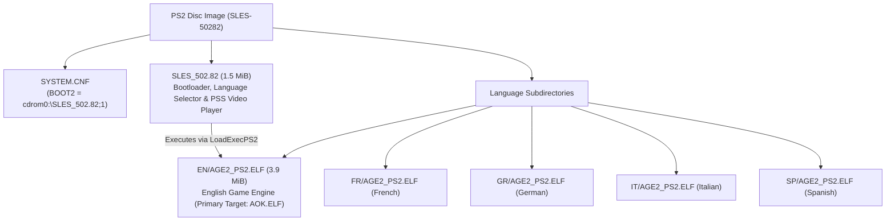

# PS2 Binary Analysis: SLES-50282 (Age of Empires II PAL)

Detailed analysis of the PlayStation 2 release of *Age of Empires II: The Age of Kings* (PAL Europe v2.00, `SLES-50282`).

---

## 1. Disc Structure and Image Architecture

The European release (`SLES-50282`) is mastered as a PlayStation 2 CD-ROM (Mode 2 Form 1, 2352 bytes/sector) with a multi-stage architecture:



### Components
1. **`SYSTEM.CNF`**: Points to `BOOT2 = cdrom0:\SLES_502.82;1`.
2. **`SLES_502.82` (1.5 MiB, 1,593,256 bytes)**:
   - Developed by Konami Computer Entertainment Tokyo (KCET).
   - Initialises the PS2 EE/GS, checks hardware/language configuration, plays the intro FMVs (`PPS_PAL/MSLOGO_2.PSS`, `PPS_PAL/ESLOGO_2.PSS`), and executes the language-specific binary via `LoadExecPS2()`.
3. **`EN/AGE2_PS2.ELF` (3.9 MiB, 4,076,904 bytes)**:
   - The full Age of Empires II game engine (Ensemble Studios' Genie Engine with KCET platform layer).
   - Copied to `orig/SLES-50282/AOK.ELF` as the primary matching target.

### Verified Hashes (v2.00)

| File | Path in repo | Size | SHA-1 |
|---|---|---|---|
| Disc Image (ISO) | `orig/SLES-50282/aoe2.iso` | 551,100,416 bytes | `77a9cec2083a7c3d82518b3ae47371b55ec2e7ce` |
| Primary Game ELF | `orig/SLES-50282/AOK.ELF` | 4,076,904 bytes | `f478e19f2059d52899b691483ef5c7522e30e17c` |
| Bootloader ELF | `orig/SLES-50282/SLES_502.82` | 1,593,256 bytes | `2f5139c1cb45c6b22b93e0c32bbea8e94a7b4a5f` |

---

## 2. Compiler & Toolchain Identification

The `.comment` section of both `SLES_502.82` and `EN/AGE2_PS2.ELF` records the compiler:

```sh
readelf -p .comment orig/SLES-50282/AOK.ELF
```

Output:
```
  [     0]  MW MIPS C Compiler (2.3.1.01)
  [    1e]  PlayStation2
```

* **Compiler:** **Metrowerks CodeWarrior for PlayStation 2, compiler version 2.3.1.01** (`MWCCPS2`).
* **Architecture:** MIPS-III (MIPS R5900 Emotion Engine), little-endian, EABI64.
* **Splat Setting:** `compiler: MWCCPS2` in `config/SLES-50282/config.yml`.
* **Linker Target:** `PS2/mwcc-2.3.1.01` in `configure.py`.

---

## 3. ELF Headers and Memory Layout

Analysis with `readelf -l` and `readelf -S`:

* **Entry Point:** `0x00100008`
* **Program Header:**
  - `LOAD`: File offset `0x0001e0` -> Virtual Address `0x00100000`, File Size `0x3e2fe0` (4,075,488 bytes), Memory Size `0x16953a0`.
* **Sections:**
  - `.shstrtab` (section names table): Metrowerks stripped standard names (`.text`, `.data`, `.rodata`, `.bss`), retaining only `.shstrtab`, `.comment`, `.reginfo`.
  - `.symtab`: Present in header, but 0 entries (stripped).
  - DWARF (`.debug_*`): Stripped.

---

## 4. Debug Facilitators and String Evidence

Although standard DWARF debug symbols are stripped, the binary contains an extensive set of debug artifacts from assertions, error handlers, and logging macros.

### 4.1 Original Source File Paths (`__FILE__`)

The binary embeds **16 original C and C++ source filenames** in assertion and error strings:

| Subsystem | Source file | Responsibility | Key string evidence |
|---|---|---|---|
| **Genie Engine Core** | `tribegam.cpp` | Main game loop (*TribeGame*) | `time=%lu, count=%lu`, `tribegam.cpp ->` |
| **Genie Engine Core** | `obmanager.cpp` | Object & zone management | `obmanager.cpp... Zone_Ptrs > PS2_MAX_ZONE_SIZE_M(=%d)` |
| **Genie Engine Core** | `com_hand.cpp` | Command handler & pre-game | `com_hand.cpp:PREGAMEMSG_CANCEL(%d)` |
| **Genie Engine / Net**| `mydplay.cpp` | DirectPlay / i.LINK sockets | `mydplay.cpp line:%d, Error: %d at sceILsockBind: sdRx self` |
| **KCET Hardware** | `kt_gpu.c` | GS / GPU rendering | `kind < numberof(func_list)` |
| **KCET Hardware** | `kt_libpad.c` | DualShock 2 controller | `n_pad > 0`, `p != NULL`, `n_pad <= numberof( buf )` |
| **KCET Hardware** | `kt_mouse.c` | USB mouse support | `mouse_number < W->n_mouse` *(reveals work struct `W`)* |
| **KCET Hardware** | `kt_keybd.c` | USB keyboard support | `keybd_number < W->n_keybd`, `ktKeybdGetStatus` |
| **KCET Hardware** | `kt_usbkeybd_drv.c` | USB keyboard driver | `ktKeybdApiSetCapsTypeRequest` |
| **KCET Hardware** | `kt_file.c` | File I/O subsystem | `kind < N_KT_FILE_KIND`, `p_string` |
| **KCET Hardware** | `kt_libcdvd_server.c` | CD/DVD RPC subsystem | `KT_USE_SCE_LIB < KT_SCE_LIB_1_6_5`, `ktSceCdInitMmode` |
| **KCET Hardware** | `kt_mc_2.c` | Memory Card manager | `n_card <= KT_MC_CARD_MAX`, `ktMcInit2`, `sceMcInit` |
| **KCET Hardware** | `kt_kernel.c` | Threads & semaphores | `ThreadID=%d, can't delete`, `SignalSema` |
| **KCET Hardware** | `kt_hd.c` | Dev filesystem driver | `host0:`, `sim:`, `atfile:` (Sony PS2 TOOL) |
| **Network Layer** | `socketee.c` | EE Sockets (i.LINK RPC) | `line: %d in socketee.c, sceSifCheckStatRpc() == 1` |
| **System Layer** | `libscf.c` | Sony system configuration | `SummerTime=%d`, `TimeNotation=%d` |
| **Bootloader (`SLES_502.82`)** | `pss_main.c` | PSS/MPEG2 video playback | `sceSifInitIopHeap() Init Success` |
| **Bootloader (`SLES_502.82`)** | `pss_audiodec.c`| Audio decoder for FMVs | `audioDecPause() rSdBlockTrans, timeout` |
| **Bootloader (`SLES_502.82`)** | `net_iopmodule.c`| IOP module loader | `p->device >= 0 && p->device < N_KT_LOADDEV` |

> [!NOTE]
> In contrast, the PC binary (`age2_x1.exe`) has **zero** source filenames in its strings. The PS2 binary provides the exact file division needed to reconstruct the source tree.

### 4.2 Function Names and Engine Constants

* **Functions:**
  - `RESFILE_load2()` (SLP / DRS resource file loader)
  - `th_Receiver()` (direct play receiving thread)
  - `ktMcInit2()` (memory card init)
  - `ktSceCdInitMmode()` (CD/DVD drive mode setting)
  - `ktWaitSyncV()` (V-Sync wait routine)
* **Constants & Macros:**
  - `PS2_MAX_ZONE_SIZE_M`
  - `KT_MOUSE_MAX_NUM`, `KT_KEYBD_MAX_NUM`, `KT_MC_CARD_MAX`
  - `N_KT_FILE_KIND`, `N_KT_LOADDEV`
* **Save Game Identifiers (Memory Card):**
  - `-50282age2_acn`, `-50282age2_g`, `-50282age2_s`
* **UI Screen Identifiers:**
  - `Single Player Menu`
  - `Game Setup Screen`
  - `MP Setup Screen`

---

## 5. Decompilation Strategy for PS2

1. **Splat Mapping:**
   Use the identified `.cpp` and `.c` files to name segments in `config/SLES-50282/config.yml` rather than using anonymous auto-generated function names.
2. **PC Cross-Referencing:**
   Cross-reference functions in `tribegam.cpp`, `obmanager.cpp`, and `com_hand.cpp` between PS2 MIPS assembly and PC x86 disassembly. Because both share Ensemble's Genie engine, algorithms and struct layouts can be matched between platforms.
3. **Toolchain Configuration:**
   Target Metrowerks CodeWarrior 2.3.1.01 (`mwccps2.exe`) with flags `-O3 -inline on -msext on -char signed -sym off -Iinclude -lang=c++` running under `wibo` on Linux.

---

## 6. C++ Game Engine Matching & Virtual Table Analysis

### 6.1 Emotion Engine 128-bit ABI & Register Saving
Starting at VRAM `0x137810` (file offset `0x379e0`), the binary transitions from KCET 64-bit frames (`sd`/`ld`) to Metrowerks CodeWarrior 128-bit Emotion Engine quadword frames (`sq`/`lq`):
- `sq $ra, 0x20($sp)`, `sq $s1, 0x10($sp)`, `sq $s0, 0x0($sp)`
- `paddub $dst, $src, $zero` utilized as 128-bit register move instruction.
- Branch delay-slot filling on FPU and ALU operations requires Metrowerks `-O3` (`-opt level=3`).

### 6.2 Virtual Tables & Inheritance Hierarchy
* **Base Virtual Table `__vt__8BaseList` (`0x4D7200`):**
  A 20-entry virtual method table for core Genie Engine dynamic container/collection objects:
  - `vtable[2] = 0x138A50` (`__ct__8BaseListFi`, constructor)
  - `vtable[10] = 0x138A40` (`Reset__8BaseListFi`, virtual reset)
  - `vtable[11] = 0x138AB0` (`Clear__8BaseListFv`, virtual clear)
* **Inheritance Chain Evidence:**
  At `0x366850`, constructor/destructor sequence overwrites `0x4D7200` (base vtable) with derived vtable `0x4DC9F0`, and subsequently with `0x4DF570` (most derived vtable), validating standard C++ inheritance layout in Metrowerks MIPS.

### 6.3 Verified Matched Targets
| Unit / Function | VRAM | Match Status | Description |
|---|---|---|---|
| `ScreenObj::AspectRatio()` | `0x137A20` | **100.0%** (24 / 24 B) | FPU single-precision division with `div.s` in `jr $ra` delay slot. |
| `BaseList::Reset(int)` | `0x138A40` | **100.0%** (12 / 12 B) | Method clearing count and updating capacity. |
| `BaseList::BaseList(int)` | `0x138A50` | **100.0%** (96 / 96 B) | Constructor with explicit vtable assignment (`__vt__8BaseList`) and `Free()` invocation. |
| `BaseList::Clear()` | `0x138AB0` | **100.0%** (44 / 44 B) | Method invoking `Free()` with quadword stack save/restore. |
| `kt_mouse::func_00134DE8` | `0x134DE8` | **100.0%** (104 / 104 B) | Input dispatch wrapper checking status flag (`func_105748`), invoking handler (`func_104A20`), and conditionally notifying (`func_1057B0`). |
| `kt_mouse::func_00134E50` | `0x134E50` | **100.0%** (196 / 196 B) | `InitWork`: Mouse work initialization, asserting `n_mouse <= KT_MOUSE_MAX_NUM` (line 100), initializing `W` (`D_50A060`), clearing buffer (`D_509F00`, 0x160 B), and setting port defaults. |
| `kt_mouse::func_00135058` | `0x135058` | **100.0%** (52 / 52 B) | Port write buffer entry locator (`buffer + mouse_number * 0xB0 + 0x20 + write_idx * 0x24`). |
| `kt_mouse::func_001350E0` | `0x1350E0` | **100.0%** (52 / 52 B) | Port read buffer entry locator (`buffer + mouse_number * 0xB0 + 0x20 + read_idx * 0x24`). |
| `kt_mouse::func_00135258` | `0x135258` | **100.0%** (128 / 128 B) | Safe port status getter with `mouse_number < W->n_mouse` assertion. |
| `kt_mouse::func_001352D8` | `0x1352D8` | **100.0%** (232 / 232 B) | Mouse packet payload reader and byte copier for device types 1..3. |
| `kt_mouse::func_001353C0` | `0x1353C0` | **100.0%** (184 / 184 B) | Mouse port reset / disconnect loop; scans `D_50A060.buffer`, marks active ports with `-1`, returns reset count. |
| `kt_mouse::func_00135530` | `0x135530` | **100.0%** (104 / 104 B) | Free port search loop across `W->buffer` inspecting `port[1] == -1`. |
| `kt_mouse::func_001356E8` | `0x1356E8` | **100.0%** (176 / 176 B) | Safe port state setter with line 0x259 assertion and guard clause. |
| `kt_mouse::func_00135798` | `0x135798` | **100.0%** (212 / 212 B) | Safe packet payload setter with line 0x276 assertion, payload clamped to 8 B, and `memcpy`. |
| `kt_mouse::func_00135A38` | `0x135A38` | **100.0%** (128 / 128 B) | Iterates `MouseBlock_9B8` array; if entry `f8 >= 0` and status differs from `a3`, resets entry using `func_001359B8`. |
| `kt_mouse::func_00135AB8` | `0x135AB8` | **100.0%** (204 / 204 B) | Clamps count to `buf[0]`; verifies packet `buf[i + 2]`, allocates device state via `func_001355D0`, and updates port state using `func_001356E8`. |
| `kt_mouse::func_00135B88` | `0x135B88` | **100.0%** (92 / 92 B) | Device table initializer; clamps mode to 1, zeroes state block `D_50A080` (24 B), sets count/handles, and formats block table via `func_001359D0`. |
| `kt_mouse::func_00135870` | `0x135870` | **100.0%** (268 / 268 B) | `ktMousePostEvent`: Safe event enqueue routine pushing 5 packet parameters into buffer ring slot (`func_00135058`) and advancing write index (`func_00135008`). |
| `kt_mouse::func_00135BF0` | `0x135BF0` | **100.0%** (368 / 368 B) | `ktMouseProcessEvents`: Main mouse event pump polling device, verifying state via `func_00135A38`/`func_00135AB8`, reading motion, and dispatching events via `func_00135870`. **100% complete module milestone.** |

### 6.3.1 KCET Hardware Layer Strings and Symbol Discoveries
Inspection of `AOK.ELF` in the assertion/rodata pool (`0x490820` - `0x490900`) recovered exact file names and assertions from KCET's peripheral abstraction layer:
* **`kt_mouse.c`:**
  - `0x490820`: `"kt_mouse.c"`
  - `0x490830`: `"n_mouse <= KT_MOUSE_MAX_NUM"` (verified at line 100 in `InitWork` / `func_00134E50`)
  - `0x490870`: `"mouse_number < W->n_mouse"` (verified in status getter `func_00135258` and setter `func_00135870`)
  - `"number < W->n_mouse"`
* **`kt_keybd.c` (Keyboard Layer):**
  - `"kt_keybd.c"`, `"n_keybd <= KT_KEYBD_MAX_NUM"`, `"InitWork"`, `"keybd_number < W->n_keybd"`
  - Exported functions: `ktKeybdGetStatus`, `ktKeybdGetBus`, `ktKeybdGetLocation`, `ktKeybdSetLed`, `ktKeybdSetCapsType`.

### 6.4 Reverse Engineered `BaseList` Linked List Architecture (`0x138A40`–`0x138D50`)
Disassembly of the contiguous block following `BaseList::Clear()` reveals Ensemble Studios' generic serializable linked list container implementation:
* **Fixed Node Memory Pool (`0x50A8C0`):**
  Array `s_node_pool[1000]` storing 8-byte nodes (`void *item; ListNode *next;`).
* **Node Allocator (`0x138AE0`, 108 B):**
  Searches pool for an unallocated entry (`node->item == NULL`), initializes it via `memset(node, 0, 8)`, and returns pointer.
* **Node Deallocator (`0x138B50`, 80 B):**
  Binary searches pool array (4200 max span) to locate the node pointer and clears `node->item = NULL`.
* **Deserializer `Load(void *stream)` (`0x138BA0`, 172 B):**
  Clears existing list via `Free()`, reads 16-bit count headers, invokes virtual factory `((BaseItemCreator*)this)->CreateItem(stream, count)` (vtable index 3 at offset +12), allocates nodes via `AllocNode()`, and appends them in FIFO order.
* **Visitor `Action()` (`0x138C50`, 72 B):**
  Iterates linked list from `m_head`, invoking item virtual method `item->vtable[6]()` (`ListItem::Action()`).
* **Serializer `Save(void *stream)` (`0x138CA0`, 104 B):**
  Iterates linked list from `m_head`, invoking `item->vtable[7](stream)` (`ListItem::Save()`), and terminates with a 16-bit zero write via stream write (`func_226f70`).
* **List Drain `Free()` (`0x138D10`, 56 B):**
  Loops while `m_head != NULL`, calling node deletion routine `func_139580(this)`.

#### 6.4.1 BaseList Matching Results (100.0% Complete Unit)

| Function / Method | VRAM Address | Match Status | Description |
|---|---|---|---|
| `BaseList::Reset(int)` | `0x138A40` | **100.0%** (12 / 12 B) | Capacity setter and head pointer reset (`m_head = NULL`). |
| `BaseList::BaseList(int)` | `0x138A50` | **100.0%** (96 / 96 B) | Constructor binding `__vt__8BaseList`, draining list, and invoking `__vec_ctor`. |
| `BaseList::Clear()` | `0x138AB0` | **100.0%** (44 / 44 B) | Resets capacity and head pointer to 0 after invoking `Free()`. |
| `BaseList::AllocNode()` | `0x138AE0` | **100.0%** (108 / 108 B) | Linear scan over `s_node_pool[1000]`, clearing matching node via `memset`. |
| `BaseList::FreeNode(ListNode*)` | `0x138B50` | **100.0%** (80 / 80 B) | Binary search over node pool span 4200 clearing `node->item = NULL`. |
| `BaseList::Load(void*)` | `0x138BA0` | **100.0%** (172 / 172 B) | Deserializer reading count headers, invoking virtual factory, and appending nodes. |
| `BaseList::Action()` | `0x138C50` | **100.0%** (72 / 72 B) | Iterates list invoking `item->Action()` at vtable offset 24. |
| `BaseList::Save(void*)` | `0x138CA0` | **100.0%** (104 / 104 B) | Iterates list invoking `item->Save(stream)` at vtable offset 28 + trailing terminator. |
| `BaseList::Free()` | `0x138D10` | **100.0%** (56 / 56 B) | Head node drainage loop invoking node deallocator `func_139580(this)`. |

### 6.5 `BaseList::CreateItem` Virtual Method & KCET Bird Removal (`0x138D50`–`0x138F88`)
Immediately following `BaseList::Free()` at `0x138D50`, `__vt__8BaseList[3]` binds the item factory `CreateItem(void *stream, short type_id)` (568 bytes, Metrowerks MWCCPS2):
* **Type Dispatch Switch:**
  Evaluates 16-bit signed `type_id` (`dsll32`/`dsra32` sign-extension):
  - `case 1:` Allocator `0x366c30`, stream loader `0x34fa10`.
  - `case 4:` Allocator `0x366be0`, stream loader `0x34b730`.
  - `case 5:` Allocator `0x366bf0`, stream loader `0x34bc10`.
  - `case 8:` Allocator `0x366c20`, stream loader `0x34e610`.
  - `case 9:` Allocator `0x366bc0`, stream loader `0x347c80`.
  - `case 13:` Allocator `0x366c00`, stream loader `0x34e1b0`.
  - `case 21:` Allocator `0x366c10`, stream loader `0x34e300`.
  - `case 2:` Explicit `NULL` return.
* **KCET PS2 Japanese Assertion at `0x490AE0`:**
  - `case 10:` Formatted print via `func_118de0` emitting:
    `" Tori(bird) ha Sonzai shitewa ikenai!!\n"` ("Birds must not exist!!") followed by infinite hang (`0x138e24: beq zero, zero, 0x138e24`), confirming that avian/bird ambient creatures were deliberately stripped from the PS2 port's active list processing for performance.
* **Metrowerks Codegen Finding (Sparse Switch Evaluation):**
  MWCCPS2 compiles sparse switch statements by emitting branch tests in bottom-to-top (reverse source) order while emitting body blocks in source order. Achieving 100% byte-for-byte matching required ordering the source cases `9, 10, 4, 5, 8, 1, 21, 13, 2`.
* **Small Data / GP Addressing:**
  Global allocator pointer `D_4E35DC` (`0x4E35DC = gp - 0x71E4`) is accessed via MIPS GP-relative addressing `%gp_rel(D_4E35DC)` and passed to all allocator functions.

#### 6.5.1 Item Creator Matching Results (100.0% Complete Unit)

| Function / Method | VRAM Address | Match Status | Description |
|---|---|---|---|
| `BaseList::CreateItem(void*, short)` | `0x138D50` | **100.0%** (568 / 568 B) | Virtual factory method deserializing items by type ID with KCET bird assertion. |

### 6.6 `BaseList::CreateItem` Spatial Factory & Coordinates (`0x138F90`–`0x1392B8`)
Directly following `BaseList::CreateItem(void*, short)` at `0x138F90` sits the overloaded spatial item instantiation factory `CreateItem(void *obj1, float x, void *obj2, float y, float z)` (796 B) and inline accessor `GetFieldC8()` (8 B) (Metrowerks MWCCPS2):

* **Spatial Factory Signature & Register Ordering:**
  - Prototype: `void* BaseList::CreateItem(void *obj1, float x, void *obj2, float y, float z)` (mangled: `CreateItem__8BaseListFPvfPvff`).
  - Argument mapping: `$a0 = this`, `$a1 = obj1`, `$fa0 ($f12) = x`, `$a2 = obj2`, `$fa1 ($f13) = y`, `$fa2 ($f14) = z`.
  - Prologue register save sequence interleaves float and integer parameters: `$f22 = fa0` (x), `$s2 = a0` (this), `$s0 = a2` (obj2), `$f21 = fa1` (y), `$f20 = fa2` (z), and branch delay slot `$s1 = a1` (obj1).

* **KCET PS2 Bird Removal Assertion #2 at `0x490B10`:**
  - `case 10:` Formatted debug print via `func_118de0` emitting:
    `"TORI(bird) ha sonzai shicha dame!\n"` ("Birds must not exist!") followed by infinite halt loop (`while(1){}`), confirming second assertion guarding spatial creation against avian ambient units.

* **WorldObj Integration & SubWorld Bounds:**
  - `case 7:` Queries `((WorldObj*)this->m_field4)->v87()` (vtable offset `0x164`). Triggers spatial sound queue `func_1471b0(..., 0x258)` and positional event dispatch `func_14bd20`.
  - Allocates item through global pool `D_4E35DC` via `func_366bc0`.
  - Dispatches spatial bounding setup to `func_347de0` (if secondary target `obj2` exists) or `func_348000` (using raw `x, y, z` coordinates) bound to `SubWorld` coordinate extents `f104`, `f108`, `f118`.
  - `case 4, 5, 21, 13:` Allocate respective entities via `0x366be0`, `0x366bf0`, `0x366c10`, `0x366c00` with direct coordinate / target initializers.

* **Accessor `GetFieldC8()` (`0x1392B0`, 8 B):**
  - Simple accessor returning member variable at offset `0xC8` (`lw $v0, 0xC8($a0)`).

#### 6.6.1 Spatial Item Creator Matching Results (100.0% Complete Unit)

| Function / Method | VRAM Address | Match Status | Description |
|---|---|---|---|
| `BaseList::CreateItem(void*, float, void*, float, float)` | `0x138F90` | **100.0%** (796 / 796 B) | Overloaded spatial item factory with 3D coordinates, sub-world bounding, and KCET bird assertion. |
| `BaseList::GetFieldC8()` | `0x1392B0` | **100.0%** (8 / 8 B) | Inline getter returning `this->m_fieldC8`. |

### 6.7 `BaseList::Update` & `BaseList::Update2` Virtual Execution Loop (`0x1392C0`–`0x139424`)
Directly following `BaseList::GetFieldC8()` at `0x1392C0` sit the queue processing and execution methods of the linked list (`__vt__8BaseList[5]` and `__vt__8BaseList[6]`, 344 B total code, Metrowerks MWCCPS2):

* **Head / Tail Queue Processing Cycle:**
  - `Update()` (`0x1392C0`, 164 B): Executes active/head item task via virtual call `item->Method10()` at vtable offset 40 (`0x28`). Iterates remaining list nodes `m_head->next` invoking background update `node->item->Method11()` at vtable offset 44 (`0x2C`).
  - Retirement check: If head item returns completed status (`(unsigned char)res == 1`), automatically pops and destroys the head node via `func_139580(this)`.
  - `Update2()` (`0x139370`, 180 B): Alternative execution cycle calling `item->Method12()` at vtable offset 48 (`0x30`) on the head item, with an early exit guard (`if (!this->m_head) return res;`) for operations where `Method12()` clears or mutates the container, followed by the identical `Method11()` background loop and head retirement check.

* **Codegen Discovery (Byte Cast Comparison):**
  - Evaluating `if ((unsigned char)res == 1)` on integer variable `s0` emits `andi $v1, $s0, 0xFF; bne $v1, $v0, ...`, preserving the unmasked return value in `$s0` for function return.

#### 6.7.1 BaseList Update Matching Results (100.0% Complete Unit)

| Function / Method | VRAM Address | Match Status | Description |
|---|---|---|---|
| `BaseList::Update()` | `0x1392C0` | **100.0%** (164 / 164 B) | Virtual execution loop calling head method 10, tail method 11, with head retirement. |
| `BaseList::Update2()` | `0x139370` | **100.0%** (180 / 180 B) | Virtual execution loop calling head method 12, tail method 11, with container guard. |

### 6.8 `BaseList` Node Management & Item Lifecycle (`0x139430`–`0x139600`)
Directly following `BaseList::Update2()` at `0x139430` sit the node insertion and removal primitives managing the linked list's items (480 B total code, Metrowerks MWCCPS2):

* **Lifecycle State & WorldObj Threshold (`field_39 > 2`):**
  - All insertion methods check `((WorldObj*)this->m_field4)->field_39 > 2`.
  - If state is $\ge 3$, the item cannot be inserted into the active list; it is immediately registered with global pool `func_366af0(&D_4E35DC, item)` and recycled/destroyed via `item->Method26()`.
  - Otherwise, a `ListNode` is allocated via `AllocNode()`, linked into the list, and notified via `item->Method9(1)` (activation callback).

* **Head Insertion `AddHead(void *item)` (`0x139430`, 136 B):**
  - Inserts the newly allocated node before `m_head` (`node->next = m_head; m_head = node;`).
  - Calls `item->Method9(1)` on the newly added item.

* **Tail Insertion `AddTail(void *item)` (`0x1394C0`, 192 B):**
  - Allocates node with `node->next = NULL`.
  - If `m_head` is empty, sets `m_head = node`.
  - Otherwise, traverses linked list to the tail node and sets `curr->next = node`.
  - Notifies item via `item->Method9(1)`.
  - **Metrowerks Codegen Insight:** The construct `if (curr) { while (curr) { if (!curr->next) { curr->next = node; break; } curr = curr->next; } } else { this->m_head = node; }` generates `beqz` for empty check, and `bnezl` with branch delay slot for pointer advance, matching original MIPS assembly 100% byte-for-byte.

* **Head Removal `DeleteHead()` (`0x139580`, 152 B):**
  - Unlinks the current head node (`this->m_head = node->next;`).
  - Passes old item to pool handler `func_366af0(&D_4E35DC, node->item)` and invokes cleanup `item->Method26()`.
  - Recycles node memory via `this->FreeNode(node)`.
  - If a new head node exists and `((WorldObj*)this->m_field4)->field_39 < 3`, notifies the promoted head item via `new_head->Method9(0)`.

#### 6.8.1 BaseList Node Management Matching Results (100.0% Complete Unit)

| Function / Method | VRAM Address | Match Status | Description |
|---|---|---|---|
| `BaseList::AddHead(void*)` | `0x139430` | **100.0%** (136 / 136 B) | Prepends item to list with `field_39` threshold guard and `Method9(1)` activation. |
| `BaseList::AddTail(void*)` | `0x1394C0` | **100.0%** (192 / 192 B) | Appends item to list tail with traversal loop and `Method9(1)` activation. |
| `BaseList::DeleteHead()` | `0x139580` | **100.0%** (152 / 152 B) | Pops head node, recycles item via `Method26`, frees node, and activates next head. |

### 6.9 `BaseList` Complete Operations Suite & Vtable Dispatch (`0x139620`–`0x139A08`)
Directly following `BaseList::DeleteHead()` at `0x139620` sit the remaining operations and virtual broadcast methods completing the `BaseList` class implementation (948 B code, 1008 B total slice, Metrowerks MWCCPS2):

* **Head Extraction vs Head Deletion:**
  - `RemoveHead()` (`0x139620`, 124 B): Unlike `DeleteHead()` which recycles and destroys the popped item via `func_366af0` and `Method26`, `RemoveHead()` unlinks the node, frees node pool memory via `FreeNode(node)`, activates the newly promoted head item via `Method9(0)` (if `field_39 < 3`), and returns the raw item pointer.
  - `PushHead(void *item)` (`0x1396A0`, 116 B): Prepends item to the head of the list without triggering the `Method9(1)` activation callback.

* **List Queries & State Checks:**
  - `HasItems()` (`0x139720`, 16 B): Evaluates `return this->m_head ? 1 : 0`, compiling into a branchless MIPS `movz $v0, $zero, $v1` conditional move in the branch delay slot of `jr $ra`.
  - `GetHeadItem()` (`0x139860`, 32 B): Returns `this->m_head ? this->m_head->item : NULL`.
  - `GetHeadItemField30()` (`0x1398F0`, 36 B): Returns `((ListItem*)this->m_head->item)->field_30` if head exists, else 0.

* **Linear Search Iterators (`Contains` & `FindItem`):**
  - `Contains(int type)` (`0x139730`, 112 B): Linear scan across linked list calling `(short)((ListItem*)node->item)->v8()`, returning `1` if matched or `0` if not found.
  - `FindItem(int type)` (`0x139880`, 112 B): Identical traversal loop calling `v8()`, but returning the matched item pointer `curr->item` or `NULL`.

* **Head Delegation Methods (`CallMethod13`–`CallMethod15`):**
  - `CallMethod13()` (`0x1397A0`, 64 B), `CallMethod14()` (`0x1397E0`, 64 B), `CallMethod15()` (`0x139820`, 64 B): Guarded delegates invoking virtual methods at vtable offsets `0x34`, `0x38`, `0x3C` (52, 56, 60) on `m_head->item`, returning the invocation result or `0` if head is NULL.

* **Virtual Broadcast Methods (`Broadcast`, `Broadcast4`, `Method7`):**
  - In `__vt__8BaseList`, slot 7 (`0x139A00`) binds `Method7(char *out)` (8 B) which clears the output buffer (`*out = 0;`).
  - Slot 8 (`0x139920`) binds `Broadcast(int msg)` (84 B), iterating all list nodes and invoking `((ListItem*)curr->item)->Method18(msg)` (vtable offset `0x48`).
  - Slot 9 (`0x139980`) binds `Broadcast4(int a, int b, int c)` (116 B), iterating all list nodes and invoking `((ListItem*)curr->item)->Method19(a, b, c)` (vtable offset `0x4C`).

#### 6.9.1 BaseList Operations Matching Results (100.0% Complete Unit)

| Function / Method | VRAM Address | Match Status | Description |
|---|---|---|---|
| `BaseList::RemoveHead()` | `0x139620` | **100.0%** (124 / 124 B) | Unlinks head node, activates next head, and returns item without destroying. |
| `BaseList::PushHead(void*)` | `0x1396A0` | **100.0%** (116 / 116 B) | Prepends item to head without activation callback. |
| `BaseList::HasItems()` | `0x139720` | **100.0%** (16 / 16 B) | Branchless head existence check via `movz`. |
| `BaseList::Contains(int)` | `0x139730` | **100.0%** (112 / 112 B) | Scans list testing item `v8()`, returning boolean match. |
| `BaseList::CallMethod13()` | `0x1397A0` | **100.0%** (64 / 64 B) | Delegates to `m_head->item->Method13()` with NULL guard. |
| `BaseList::CallMethod14()` | `0x1397E0` | **100.0%** (64 / 64 B) | Delegates to `m_head->item->Method14()` with NULL guard. |
| `BaseList::CallMethod15()` | `0x139820` | **100.0%** (64 / 64 B) | Delegates to `m_head->item->Method15()` with NULL guard. |
| `BaseList::GetHeadItem()` | `0x139860` | **100.0%** (32 / 32 B) | Returns head node's item pointer or NULL. |
| `BaseList::FindItem(int)` | `0x139880` | **100.0%** (112 / 112 B) | Scans list testing item `v8()`, returning item pointer or NULL. |
| `BaseList::GetHeadItemField30()` | `0x1398F0` | **100.0%** (36 / 36 B) | Returns head item's field at offset `0x30` or 0. |
| `BaseList::Broadcast(int)` | `0x139920` | **100.0%** (84 / 84 B) | Virtual method (vt[8]) broadcasting message to all list items via `Method18`. |
| `BaseList::Broadcast4(int, int, int)` | `0x139980` | **100.0%** (116 / 116 B) | Virtual method (vt[9]) broadcasting 3-parameter event to items via `Method19`. |
| `BaseList::Method7(char*)` | `0x139A00` | **100.0%** (8 / 8 B) | Virtual method (vt[7]) initializing output buffer (`*out = 0`). |

### 6.10 `BaseList` Spatial Setup and Cleanup Operations (`0x139A10`–`0x139BA4`)
Immediately following `BaseList::Method7` sit the setup and teardown routines linking `BaseList` with the spatial subsystem (`func_1DBEA0`, `func_1DBFC0`) and sound/notification managers (388 B code, 416 B total slice):

* **Spatial Setup `SetupSpatial(void *obj1, void *obj2, int flag, float x, float y, float z)` (`0x139A10`, 152 B):**
  - Resets `m_fieldC8 = 0`.
  - Dispatches to engine spatial initialization helper `func_1DBEA0(this, obj1, obj2, 0, x, y, z)`.
  - If `flag` is non-zero, calls audio/spatial listener registrar `func_139C80(this, obj1, obj2, x, y, z)`.

* **Basic Setup `Setup(void *obj1, void *obj2, int flag)` (`0x139AB0`, 104 B):**
  - Resets `m_fieldC8 = 0`.
  - Dispatches to engine basic initialization helper `func_1DBFC0(this, obj1, obj2, 0)`.
  - If `flag` is non-zero, registers listener via `func_139CC0(this, obj1, obj2)`.

* **Teardown & Cleanup `Cleanup(int flag)` (`0x139B20`, 132 B):**
  - Inspects `m_fieldCC`: if present, deregisters from global pool `func_3669F0(D_10B68F0, m_fieldCC)`, invokes virtual cleanup `((ListItem*)m_fieldCC)->Method11()`, and clears pointer (`m_fieldCC = 0`).
  - Inspects `m_fieldC8`: if non-zero, deallocates listener resource via `func_2C2DC0(m_fieldC8)` and clears (`m_fieldC8 = 0`).
  - If `flag` is non-zero, completes teardown through `func_1DC0B0(this, flag)`.
  - **Metrowerks Codegen Insight:** Declaring `extern char D_10B68F0[];` forces MWCC to emit absolute `%hi` / `%lo` (`lui v0, %hi; addiu a0, v0, %lo`) instead of GP-relative `%gp_rel`, achieving 100% byte-for-byte matching with the original binary.

#### 6.10.1 BaseList Spatial Operations Matching Results (100.0% Complete Unit)

| Function / Method | VRAM Address | Match Status | Description |
|---|---|---|---|
| `BaseList::SetupSpatial(void*, void*, int, float, float, float)` | `0x139A10` | **100.0%** (152 / 152 B) | Spatial setup invoking `func_1DBEA0` and optional listener `func_139C80`. |
| `BaseList::Setup(void*, void*, int)` | `0x139AB0` | **100.0%** (104 / 104 B) | Basic setup invoking `func_1DBFC0` and optional listener `func_139CC0`. |
| `BaseList::Cleanup(int)` | `0x139B20` | **100.0%** (132 / 132 B) | Releases `m_fieldCC` via `func_3669F0` & `Method11()`, `m_fieldC8` via `func_2C2DC0`, and `func_1DC0B0`. |

### 6.11 `BaseList` Hierarchy Destructors (`0x139BB0`–`0x139C7C`)
Directly following `BaseList::Cleanup` sit the destructor entry points for the `BaseList` family and derived/related list classes (204 B code, 208 B slice with padding):

* **Destructor for Vtable `D_4D7A90` (`0x139BB0`, 96 B):**
  - Bound to slot 0 (`vt[0]`) of virtual table `D_4D7A90`.
  - Guards on `this != NULL`, resets vptr to `D_4D7A90`, and calls base/member destructor `func_2639D0(this, 0)`.
  - Evaluates scalar deleting flag `(short)flag > 0`; if set, invokes deleting `operator delete(this)` (`0x100670`), then returns `this`.

* **Destructor for Vtable `D_4D7230` (`0x139C10`, 108 B):**
  - Bound to slot 0 (`vt[0]`) of virtual table `D_4D7230`.
  - Guards on `this != NULL`, sets vptr to `D_4D7230`, and invokes `BaseList::Cleanup(0)` (`0x139B20`).
  - Calls base destructor `func_1DC100(this, 0)`.
  - Evaluates scalar deleting flag `(short)flag > 0`; if set, invokes `operator delete(this)`, returning `this`.

* **Metrowerks Codegen Insight:**
  - Destructors compiled with MWCCPS2 2.3.1.01 (`-O3`) guard with `beqz $s1` against NULL pointers, storing the flag parameter into `$s0` in the branch delay slot.
  - The scalar deleting check `(short)flag > 0` generates 32-bit sign extension via double shifts: `dsll32 $v0, $s0, 16` and `dsra32 $v0, $v0, 16` followed by `blez $v0`, matching byte-for-byte.

#### 6.11.1 BaseList Hierarchy Destructors Matching Results (100.0% Complete Unit)

| Function / Method | VRAM Address | Match Status | Description |
|---|---|---|---|
| `func_00139BB0` | `0x139BB0` | **100.0%** (96 / 96 B) | Virtual destructor for `D_4D7A90` hierarchy, calling `func_2639D0` and optional `operator delete`. |
| `func_00139C10` | `0x139C10` | **100.0%** (108 / 108 B) | Virtual destructor for `D_4D7230` hierarchy, calling `BaseList::Cleanup(0)`, `func_1DC100`, and optional `operator delete`. |

